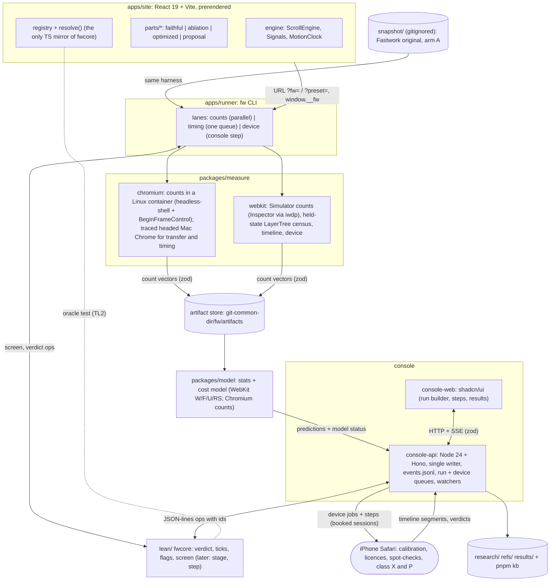

# v2 plan: a measurable, provable loop for the fastwork.com scroll experiment

This is the design for you to review. It merges the eight kickoff notes (cited as `[01]` to `[08]`, with section
numbers; `[08]` is the forensics of v1's raw chat history, §2.3) and the feasibility review (`[FR]` = `research/notes/2026/10-17-v2-plan-feasibility-review.md`). Where the
notes disagree, Appendix A says which way this plan goes and why. Appendix D logs every critique item and what
changed. **You only need to answer four questions before Monday (§12.1).** Nothing is built yet, and nothing is
committed.

**Status words.** CONFIRMED = a note cites a source, doc or v1 record for it, or it was checked on this Mac today.
INFERRED = a design choice or expectation that a spike or measurement must still check. Targets and thresholds are
proposals until you accept them.

## Glossary of labels (each prefix is used for one thing only)

| Label | Means | Where |
|---|---|---|
| **Q1 … Q20** | questions / decisions for you | §12 |
| **Day 1 … Day 45** | working days from Monday 2026-10-19 (Day 1-10 in detail) | §10.1, §10.2 |
| **M0 … M6** | milestones | §10.1 |
| **G1 … G4** | outcome goals | §1.1 |
| **V-a … V-p** | method (validation) criteria | §1.2 |
| **TL0 … TL5** | test layers | §5.4 |
| **PL0 … PL6** | parity levels (rewrite vs original) | §6.6 |
| **class W / SM / X / P** | landing classes: less **W**ork, **SM**oothness or mixed, device-only (**X**), **P**roposal | §9.2 |
| **SPK-a … SPK-p** | spikes (short experiments that answer one question) | Appendix B |
| **tier T0 … T3** | v1's pixel-difference tiers | §6.6 |
| **K1 … K9** | WebKit calibration fixture pages [04 §9] | §4.4 |
| **R1 … R20** | risks | §11 |
| stages | question → build → screen → review → (device) → land, always written as words | §9 |

## 0. The plan in one page

**v1's result, and why v2 is different.** v1 reached its goal: slow frames in your swipe fell from 20.1 % to 1.7 %,
and the end-of-page longest frame fell from 584 ms to 42 ms. It cost 10 days, 442 started agents (848 transcripts)
and about $11.4k at list price, recomputed per request (v1's own readout scaled to about $13.5k) [01 §0, 08 §3]. 231
of its 276 incidents were filed against its own tools, 45 of them feature requests rather than failures [01 §1,
08 §4]. Your three pain points all show in v1's data. v2 answers each one structurally:

| Pain point | v1 evidence | v2 answer |
|---|---|---|
| 1. The phone was needed for every measurement | ~111 of 276 incidents involve the iPhone or Simulator driver; phone blocks took 12-35 min plus cooling [01 §B.1] | **Two-speed loop.** The inner loop is deterministic engine **work counts** (Chromium headless-shell in a Linux container, and WebKit on the iOS Simulator) feeding a **cost model** that is calibrated on the phone. The phone becomes a scheduled outer loop (§4) |
| 2. Patching the minified Svelte build was slow | Retrospective cause C6; ~349 commits on the end-of-page line [01 §B.1] | **React rewrite as pluggable parts.** Each part has a `faithful` variant that copies the original's look and, for the parts we experiment on, its per-frame engine work, plus ablation, optimized and proposal variants picked by flags (§6) |
| 3. A coupled, bug-prone loop; every tool change re-ran everything | Full suite 250-280 s on every tooling commit; `lock.mjs` grew to 1,685 lines [01 §B.1, 06 §1] | **A small pure core with a thin IO shell.** The few decisions that matter (verdict, flags, screening, frame ticks) live in one Lean 4 project (`fwcore`) with theorems. Tools are plugins. Results are content-addressed, so changing a tool re-runs only that tool's tests and artifacts. An explicit MVP tier keeps the tooling small (§3, §5) |

**What the chat history adds** (§2.3, [08]): v1's agents did their work well; the loop around them did not. One
overloaded lead was woken mostly by recurring check prompts, long-lived contexts idled and woke up cold, home-made
coordination tools broke more often than agents did, and you acted as device technician and status bus. v2 fixes
that with scripts, events and hooks, not with more agents or more rules (§8.5).

**What to expect, plainly** (so you can judge pain points 1 and 2 with the right expectations):
- **The phone does not go away.** Before the model may stand in for the phone for one kind of change, it needs a
  calibration session and 5 of 5 blind swipe verdicts that agree with it. Expect **about 5-10 phone sessions before
  the first kind of change is licensed** (INFERRED [FR §1.8]). Changes that only the phone can see (backdrop/filter,
  toolbar, first-touch layer builds: class X) and look changes (class P) always need the phone. After that, phone use
  drops to calibration every 14 days or on a version change, plus one blind spot-check per 5 landings. That is far
  below v1, but it is not zero.
- **"React + MUI" will mostly be "readable React parts + flags".** Everything that animates on scroll is plain React
  with CSS Modules, because MUI's runtime styling and its layout-animating widgets would distort the measurements
  (CONFIRMED [02 §5]). In the recommended option, MUI is used for about 3 of ~32 parts (the signup dialog, the
  drawer and the language menu) and as a measured `impl: mui` variant (Q4). The gain for pain point 2 comes from
  readable source plus flags, not from MUI itself.
- **Chromium is a development aid; the iPhone is the target.** The Chromium counts lane is fast and deterministic,
  but Chromium cannot predict iPhone Safari, so the cost model is calibrated for WebKit first (§4.4, Q8).

**Headline goal.** Rebuild the page, reproduce v1's outcome on the phone as a set of flag arms, and do it with a
fraction of v1's device time, tool bugs and tokens. Every speed-up the model claims must hold up against your finger
(§1).

**Order of work.** M0 bootstrap as a thin vertical slice (Day 1-5: one counts script on the original, one Lean
verdict round trip, one WebKit Simulator spike) → M1 measure the **original** snapshot in both engines, before any
rewrite → M2 pilot three parts → M3 calibrate the WebKit model → M4 port the parts we will experiment on → M5
experiments → M6 write-up (§10).

## 1. Goals and success criteria

Each criterion has a measurement and an owner. "Proposal" thresholds become binding once you accept them (Q9).

### 1.1 Outcome goals

| # | Goal | Metric | Target | Checked by |
|---|---|---|---|---|
| G1 | v2 reproduces v1's effect | On the iPhone in your swipe, the `original` preset is within v1's A/A band of the original site, and the `v2-best` preset is at or below v1's g0.0m | slow frames (> 34 ms) ≤ 1.7 %; end-of-page longest frame ≤ 42 ms; frames > 50 ms per 100 moving frames in the finger's zone no worse than g0.0m | phone block + blind A/B (§4.6) |
| G2 | Fewer device blocks, less device chore work for you | phone sessions, device incidents, chore steps per session | ≤ 10 phone sessions up to the first licensed class (INFERRED estimate 5-10); afterwards ≤ 1 block per landed class SM change and calibration ≤ 1 session per 14 days; device-driver incidents ≤ 10 % of incidents (v1: ~40 %); **≤ 1 get-ready step and 0 reactive chore steps per phone session** (v1: 82-105 of 166 steps were chores [08]) | console step log, bug ledger |
| G3 | Lower cost | list-price dollars, total and per milestone; Opus share; lead $/day | **whole project ≤ $6.0k (≈ 53 % of v1's $11.4k)**; each milestone within its cap in §8.4 (+15 % triggers a review); Opus ≤ 85 % of dollars (v1 ~97 %); lead ≤ $50 per working day on average | `pnpm fw usage` [07 §8] |
| G4 | Write-up material | every landed experiment card has a plain one-paragraph summary and a reproducible clip or chart reference; cleanup never deletes listed evidence | all landed cards (v1: 74 of your messages were about evidence and the article [08]) | `kb lint`; M6 review |

The lead's *share* is no longer a target: once the other roles are cheap, a lean lead is still a large share. The
lead's dollars per day are capped instead (§8.4).

### 1.2 Method goals

| # | Goal | Metric | Target (proposal) | Source |
|---|---|---|---|---|
| V-a | **Count transfer: Chromium** | container (Linux headless-shell) counts vs counts from a traced, non-timed headed Mac Chrome run, per count family | equal per family, or the family is marked "container-only" and never feeds a fitted coefficient | [FR §1.6] |
| V-b | **Count transfer: WebKit** | Simulator count equals phone count at the same held state | ≥ 95 % of states, per count type; failing types are marked "not transferable" | [04 §9] |
| V-c | **Ranking** | Spearman ρ, predicted vs measured cost per variant (holdout) | ρ ≥ 0.8 on the iPhone. Chromium: only if an Android phone is added (Q1, Q8), then also stage MAPE ≤ 20 % at p50 | [03 §9.3, 04 §9] |
| V-d | **Decision agreement** | sign of predicted Δ vs measured Δ, where the prediction exceeds the noise band | ≥ 90 %, and 0 sign errors among "large" predictions | [03 §9.3, 04 §9] |
| V-e | **Magnitude** | median abs(log(pred/meas)) | ≤ 0.3. If missed, the model is "ranks only" and may not size a change | [04 §9] |
| V-f | **Feel agreement** | blind verdicts with predictions frozen first | 5 of 5, no sign disagreement, before the model can stand in for the device for a change class | v1 `stats-vs-finger.md` via [03 §9.3] |
| V-g | **Visual parity** of each `faithful` part | v1 tiers against a same-run original-vs-original (A/A) baseline | tier **T1** at PL0-PL3 (all parts) and PL4 (experiment parts) in Chromium and Playwright WebKit on the core viewport matrix; element boxes ≤ 0.5 CSS px; one Simulator check at 430×775 DPR 3 | [02 §4] |
| V-h | **Work parity** of each experiment part | PL5 bands per count family (§6.6) | within the band for every family; layers ±0; same compositor/main-thread split | [02 §4.6, FR §2] |
| V-i | **Determinism, per count type** | two identical counts-lane runs | each count type classified *deterministic* (byte-identical), *stable* (within a stated tolerance) or *quarantined* (never used). Chromium: all used types deterministic. WebKit: the deterministic set covers what the K1-K9 fixtures need | [03 §7.1, 04 §8.5] |
| V-j | **Time to adopt a tool** | new measurement plugin → first cached artifact | ≤ 1 agent-day; tests run = that plugin + `contracts` only; 0 other artifacts invalidated (shown by `fw run --dry`) | [06 §3] |
| V-k | **Test speed** | pre-commit gate; TL1 whole repo | pre-commit ≤ 30 s (affected packages); TL1 < 20 s cold | [06 §3.4] |
| V-l | **Bug ledger** (replaces "share of logic proved") | every entry has `kind: request \| incident`; every incident tagged *proof would have caught it* / *property test caught it* / *adapter (IO, device, container)* | complete ledger; at M4 it decides whether Lean pays (Q12), counting incidents only (v1 filed 45 requests as incidents [08]) | [FR §3.1] |
| V-m | **Bugs in proved areas** | incidents in verdict / flag resolution / screening / frame ticks | 0 logic incidents (adapter bugs are counted separately) | bug ledger |
| V-n | **Harness neutrality** | on fixtures, frame-stepped counts vs free-running counts, per family | equal per family; a family that fails is not used for screening in that engine | [FR §1.2] |
| V-o | **Timing parity** (PL6) | Mac Chrome per-stage time, rewrite vs original | rewrite within the original's A/A band (ABBA, n ≥ 4) per stage; plus one Simulator and one phone whole-page check at M4 | [FR §2] |
| V-p | **Transfer to the original** | the same change as an overlay on the original, in the counts lane | same sign of Δ per stage as on the rewrite, for every landing whose change can be overlaid | [FR §2] |

## 2. What we keep and what we drop from v1

### 2.1 Keep (each with its v2 form)

| Keep | Why (v1 evidence) | v2 form |
|---|---|---|
| Frozen, hash-pinned baseline | The pin changed only twice, both on purpose [01 §B.2] | `snapshot.lock.json` pins the original; each rewrite build is pinned by commit + flag vector + `servedHash` |
| One change per arm | Overlays gave clean A/B arms | Overlays become **flag arms**; never bundle fixes in one arm (bundled builds hid causes) |
| A/A noise floor; "better" only with disjoint ranges; ±4 ms twins | g0.0l vs g0.0m was correctly called level [01 §B.2] | The landing verdict is **4 vs 4** runs with disjoint ranges (or v1's sequential ABBA rule). Its false-win rate under the null is proved to be exactly 1/70, and comparisons are counted per experiment (§5.1) |
| Prediction cards before data | 17 or more flagged prediction misses in 153 rows | The question card carries a pre-registered predicted Δ per stage and zone (§9) |
| Claim status words, engine-build applicability, "read source first" | Claim C1 (`layerPainted`) reached you as fact on two probes [01 §B.2] | Rule cards in `refs/rules/` with file:line@commit, status (incl. WEAKENED), builds [04 §11] |
| Pixel tiers T0-T3, screencast capture, frozen frames | False 0 % passes after a scroll (P14) | Parity levels PL0-PL6 (§6.6) |
| Element ablation with a fairness check | Showed end-of-page backgrounds cost a median 16 → 3 slow frames [02 §2.6] | Generated ablation variants per part (§6.2) |
| The validated feel metric: frames > 50 ms per 100 moving frames in the finger's zone | The only metric that agreed with you 7 of 7 [01 §A.4] | Primary device metric (§4.6) |
| Less-work landing rule | Gates sized to risk | Landing class W, now per-frame and over a declared-complete vector (§9.2) |
| Proposals with Try-it pages; blind swipe A/B; comment on anything | Look changes are your call; your thumb caught what Chrome missed. 41 proposals, median 10 min to your decision; 94 of 198 of your threads came from comment buttons [08] | The console Proposals view (shadcn); Try-it, comment-on-any-row and a preset gallery on Wi-Fi are M1 features; a second iPhone for free play (Q1) |
| Your coaching, as rules with enforcers | You re-taught the same management behaviour on 11 days; the lead said its role file never told it [08] | Day 1, in the lead file and `CLAUDE.md`: the issue loop (cause from data, workaround, long-term fix with an owner), proactive by default, trace before asking, the answer format; each names its enforcer and is re-injected after compaction (§8.5) |
| Named spawns `<role>-<topic>`; one worktree per editor; one lander; ff-only | 0 merge commits in 2,483 [01 §B.2] | Same, enforced by git config, deny rules and a land-time gate [06 §6] |
| Quiet-host gate and contamination flag for timing runs | One overloaded evening voided all 9 A/Bs | Kept, for the **timing lane only**; the counts lane needs no lock |

### 2.2 Drop (each with what replaces it)

| Drop | Evidence | Replacement |
|---|---|---|
| A device run for every measurement | ~111 device incidents; 19 end-of-page phone blocks for 5 passes [01 §B.1] | Counts lane + WebKit cost model + validity table (§4) |
| Patching a minified bundle | Cause C6; a replace-all broke six SVG circles unseen [01 §B.1] | React parts with flags (§6) |
| The 6x CPU throttle as the model | One scalar, super-linear (6x costs 7.8x), GPU untouched, fitted on the unfixed page [03 §11] | Per-stage, per-count coefficients per device, with a page factor `ρ_page` [03 §9, FR §1.7] |
| A full test suite on every tooling commit | 250-280 s; ~22 h of serial suite time [01 §B.1] | `vitest --changed` per affected package; TL0-TL5 layers [06 §3.4] |
| Real time and the real host in tests | 75 of 143 s were sleeps [06 §1]; 44 flaky-test incidents and 14 port, process and temp-dir collisions on the shared host [08] | Clock port; a lint bans timers in the pure zone and real load, fixed ports, process-name matching and shared temp folders in tests; engine e2e tests run outside pre-commit; scratch paths per agent |
| Side effects at import; 8-24 copies of one parser; two different medians | [01 §B.1, 06 §1] | Pure zone enforced by a lint; one `model` package for stats |
| Many writers to many JSON stores; agents writing board state | 575 board writes a day; 8 stale-board incidents [01 §B.3] | One writer (console-api), one append-only event log, status as a projection |
| A 9.7k-word rulebook loaded by every agent | ~8 % of all cache reads [01 §B.3] | Root `CLAUDE.md` under 300 words at Day 1, never above 1,500; each rule names its enforcer |
| Opus everywhere; the lead as router; 160 agents in 29 h; recurring check prompts | Opus ~97 %; 3,761 cron fires were 42 % of the lead's turns and 35 % of its dollars; the lead was first responder on 773 of 985 of your console messages [01 §C, 08] | Small roster, model ladder, a capped lead, no LLM polling, scripts for checks and gates (§8.5) |
| Routing agents (mgmt-ops ×10, desks, clerk, devices, ops-readers) | 47 agents, $847; 47 % of their messages to the lead were land requests; 22 % of workers' consecutive instructions switched between two bosses [08] | `pnpm fw` scripts over `events.jsonl`: queue order, land queue, device dispatch, digests, card pre-data reads (§8.5) |
| Agents holding device leases; hand-moved queues | 40 scheduler incidents (median fix 2.2 h); ≈ 230 lead hand moves; 264 order-request messages [08] | A device job queue in console-api; priority is a tested function of your list (§3.3, §4.1) |
| Shared ledger files that many agents edit | `ops-handover.md` 569 commits, `PREDICTIONS.md` 378; 94 `rebase --continue` [08] | Predictions in each `card.md`, handovers in per-agent notes, the board as a projection (§7.1) |
| Multi-step inline shell in worktree agents | 3,046 isolation refusals, 57 % of all v1 errors [08] | Committed `pnpm fw` verbs; one plain command per Bash call (§8.2) |
| Hand-built lock code (1,685 lines) | ~39-89 lock incidents depending on the count [01 §B.5, 05 §3] | No lock in the counts lane; one in-process queue in console-api for the timing lane. Many lock incidents were cross-process races that a single writer removes (INFERRED [FR §3.1]) |
| An 842-line git-guard hook | The guard drew its own incidents | git config + deny rules + a land-time path check in `fw gate`; one small spawn-guard hook (§8.3) |

**Rule for every new tool, hook or package:** it must name the v1 incident class it prevents (or the failure it
fixed in v2). If it cannot, it waits until something fails without it. An **enforcer** (alarm, lint, router, status
board) also reads only events, never agent self-reports; ships with false-positive and false-negative golden tests;
and reaches ≥ 90 % precision on an event-log replay before any alarm reaches you (v1: 46 enforcement incidents, 61 of
80 lead-made threads were alarms [08]). A new *agent* rule must cite an incident caused by an agent mistake;
otherwise fix the tool (v1: 4 agent-mistake incidents against 139 tooling ones, hand labels [08]).

### 2.3 What the chat history showed

[08] ([`research/kickoff/08-chat-forensics/README.md`](../../research/kickoff/08-chat-forensics/README.md)) read v1's raw transcripts (848, 135k model requests), the console
and the incident store. Its numbers are reproducible from the commands it lists; readings are marked INFERRED there.
- **A star, not a team.** 64 % of the main session's 12,582 messages started or ended at the lead; only 16 % went
  worker to worker. The lead talked to about 310 agents, up to 38 in one hour, and compacted 125 times.
- **The lead was woken by polls, not decisions.** 42 % of its 8,948 turns started from 3,761 cron fires: 2,897 from
  your `/loop` prompts (1,889 "check iphone connection"), 864 from crons the lead created itself. They cost 35 % of
  the lead's dollars. It also landed, signed, spawned, scheduled the phone queue (≈ 230 hand moves) and answered
  78 % of your console messages first.
- **Idle contexts cost the most.** 2,924 cold cache rewrites after 5-60 min idle cost $2,763, 24 % of the $11.4k;
  19 agents alive over 24 h cost 36 %. A 1h cache for waiting subagents would have cost about 15 % less (INFERRED replay).
- **Home-made coordination broke more than the agents did.** Coupled tooling and enforcers made 139 of 276
  incidents; agent mistakes 4 (hand labels). 57 % of all 5,393 errors were worktree-isolation refusals of inline
  shell.
- **You were the device technician and the status bus.** 82-105 of 166 console steps were device chores; one re-plug
  waited 11 h 41 min and stalled a landing. 132 of your messages match a catch-up regex, and you asked the lead to
  delegate or called it the bottleneck on 11 days.
- **What worked:** the console's steps, Try-it proposals and comment buttons; fast replies (median 40 s); message
  delivery (0.35 % failed); short, fresh agents (645 agents under an hour cost 11 %); one lander, ff-only.

The resulting changes are in §8.5 (coordination rules) and in the sections each one names; Appendix D lists them.

## 3. Architecture

### 3.1 Overview



### 3.2 Modules and their narrow contracts

Rule: a module talks to another only through the contract in this table. Each contract is a zod schema in
`packages/contracts`, exported to JSON Schema and, where Lean reasons about it, mirrored in Lean with golden
fixtures [06 §2.5, 05 §6].

| From → to | Contract | Notes |
|---|---|---|
| runner → site | URL `?fw=part:variant,…`, `?preset=<id>`, `seed`, `t0`, `rm`; page exposes `window.__fw = {config, configHash, scroll, clock, markMeasureStart}` and `<meta name="fw-config">` | The same harness drives arm A (original) by injecting an equivalent `__fw.scroll` [02 §3.5] |
| site build → runner | Vite `manifest.json` → `servedHash` per route | Edits to part X change the keys only of routes that serve X [06 §3.1] |
| runner → plugin | `MeasurePlugin {id, semantics, lane, input, output, run, reduce}` | `reduce()` is pure and golden-tested; an output that fails its schema is an incident, never a result [06 §2.4] |
| plugin → artifact store | key = `sha256(canonical JSON of {subject, tool{plugin,semantics}, engine{build,flags}, profile, protocol})` (sorted keys; full JCS later if needed) | Counts artifacts are reused; timing artifacts append samples [06 §3.1] |
| artifact store → model | count vector per (frame, part, zone) + coefficient set `(device, engine build, thermal class, ρ_page)` → `{stage p50/p90, missed vsyncs, status: uncalibrated | ranks-only | sizes}` | Pure; applied at report time, so a refit re-runs no measurement [06 §3.3] |
| TS → fwcore | one JSON-lines request per decision, MVP ops: `verdict`, `ticks`, `twins`, `flags.resolve`, `screen`, `samples` (later: `stage.step`, `step.step`) | Long-lived child process; ~140 µs per round trip (MEASURED [05 §1]). **Hardening below** |
| console-web → console-api | typed HTTP + SSE; zod schemas shared from `contracts` | The UI never decides. **Previews always call console-api (and so `fwcore`)**, so the site resolver stays the only mirror |
| agent → device lane | job card `{kind, card, priority class}`; agents never hold the phone; long runs live in console-api, never in an agent's shell | v1: 40 scheduler incidents; runners died with their agent (I-221, I-240, I-256) [08] |
| console-api → status and steps | each status row: stage, owner, next step, ETA, age of its last event, and `needs-you: yes/no + the exact action` (set only by an open step or proposal event); a step is shown only after a script checks it is ready, and has a retry | v1: 25 "what does this mean" asks, rows saying "waiting on you" with nothing to do [08] |
| any client → console-api | every request carries `contractsVersion`; a mismatch is refused with "rebase" | v1: worktrees on old tool code misread shared state (I-010, I-011, I-041, I-102) |
| everything → knowledge store | one frontmatter schema; `pnpm kb index | find | lint` | §7.2 |

**Hardening the TS ↔ `fwcore` glue** (each item is CONFIRMED as a real failure path in [FR §3.2]):
1. **Request ids.** Every request carries `id`; `fwcore` echoes it; the client rejects a reply whose id does not
   match the oldest outstanding request, kills the child and fails the call. `fwcore` replies to **every** line,
   including a blank one (with an error), so replies can never shift onto the wrong request (today's sketch skips
   blank lines without a reply: `05-lean-sketch/Main.lean` l.7-10).
2. **Timeout and restart.** A per-call timeout (default 2 s); on timeout or exit the client restarts `fwcore` and
   fails the outstanding calls. It never retries silently.
3. **Panics abort.** `fwcore` is always spawned with `LEAN_ABORT_ON_PANIC=1`, because a Lean panic otherwise prints
   and returns a default value (lean4 v4.35.0 `src/runtime/object.cpp` l.76-82, l.198-202). Any stderr output is
   logged as an incident.
4. **No partial operations in the glue.** A grep gate fails the build on `!`-suffixed partial ops (`get!`, `head!`,
   `[i]!`, `panic!`) in `Fw/Wire.lean` and `Main.lean`.
5. **Numbers.** Counts cross as `Nat`; times as integer **ns**; fitted coefficients as `Rat` with an explicit wire
   form `{"num":"<int>","den":"<positive int>"}` (decimal strings, reduced), with golden round-trip tests. Never
   `Float`. (The sketch's `UnitCost` in `Nat` µs would truncate a sub-µs per-element cost to 0: `Cost.lean` l.21-25.)

### 3.3 Where each decision runs (one place only)

- **Default: in `fwcore`.** The Node side sends inputs and gets the decision back. TS never re-implements it [05 §0].
- **Exception: code that must run in the browser.** Today that is only the site's flag resolver. It is a TS mirror,
  and a TL2 oracle test (fast-check, 2,000 cases) must agree with `fwcore flags.resolve` on every change [05 §5.3].
- **Plain bookkeeping stays in TS** with unit tests, for example "which artifact keys are missing" (a set
  difference). Lean is kept for decisions whose wrong answer would mislead an experiment.
- **Priority is data you own.** One ordered list (`presets/priority.json`, or a list you drag in the console). The
  experiment queue and the device queue read it through one pure, table-tested TS function of the list and the job
  class (user step > calibration > class X/P > spot-check). Agents never set priority; a manual move is an event with
  a reason (v1: 39 priority overrides by you, ≈ 230 hand moves [08]).
- **Numbers that are fitted, not decided** (coefficients, regressions) live in TS (`packages/model`). Lean proves the
  **screening rule** for the model that is actually deployed (§4.3, §5).

### 3.4 MVP tier and later tier

| | MVP (built in M0-M2) | Later (only when a named failure needs it) |
|---|---|---|
| apps | `site`, `runner` (`fw`), `console-web`, `console-api` | — |
| packages | `contracts`, `measure` (chromium + webkit), `model` (stats + cost model), `kb`, `fwcore-client` | split `measure-sdk`; separate `artifact-store`, `usage` packages; `core` |
| console storage | `events.jsonl` + in-memory projection; one in-process run queue and one device job queue; three watchers (device, stall, notice coalescer, §8.5) | SQLite read model (if queries get slow); a proved lease (only if a second timing host appears) |
| Lean | `Frames`, `Verdict`, `Flags` (+ generated registry), `Cost`/`screen` | `Stage`, `Step` (lifecycle). `Thread`, `Log`, `Lease` only after an incident class appears. No engine-rule data in Lean |
| hooks | `SessionStart` brief (also after compaction), `SubagentStop` usage, one `PreToolUse(Agent)` spawn-guard | `SubagentStart` role brief, `TeammateIdle` (only if the stall watcher is not enough), `TaskCompleted` |
| repo tooling | pnpm workspaces, Biome, lefthook (one pre-commit), Vitest | Turborepo, knip, dependency-cruiser, ast-grep rule sets, REUSE.toml, JCS keys |
| knowledge store | 4 kinds (`note`, `decision`, `ref`, `rule`), 5 claim statuses | more kinds if the index needs them |

## 4. Measurement methodology

### 4.1 Three lanes

| Lane | Runs | Determinism | Gives | Never gives |
|---|---|---|---|---|
| **counts** | parallel, no lock. **Chromium:** Playwright's linux-arm64 `chromium-headless-shell` inside a Linux container (Docker Desktop is installed on this Mac, CONFIRMED locally), with BeginFrameControl. **WebKit:** Simulator Mobile Safari through `ios_webkit_debug_proxy` | per count type (V-i): deterministic, stable or quarantined | work per virtual frame, per 100 px, per part and per scroll zone | milliseconds |
| **timing** | one at a time from the console-api queue: headed Mac Chrome with `PipelineReporter` tracing; Simulator Timeline with `Page.enable` first | statistical (ABBA, n ≥ 4) | per-stage ms on this host, for timing parity (PL6) and A/A bands | iPhone ms |
| **device** | iPhone Safari blocks as **jobs in a console-api queue**, run only inside a session window you book. Each session starts with `fw device check` (v1's named trap codes: link, unlock and UI Automation, tabs, proxy), which repairs what it can and then posts **one** get-ready step (usual USB port, unlocked, Auto-Lock Never, UI Automation on, same Wi-Fi, Do Not Disturb, one thermal profile); then the queued blocks run back to back | statistical | the truth for feel; iPhone coefficients; render-server time (Instruments) | anything at scale |

**Why a container.** Chromium refuses BeginFrameControl on macOS: `chromium@317846d579b2`
`headless/lib/browser/protocol/target_handler.cc` l.62-65 returns "BeginFrameControl is not supported on MacOS
yet", and the protocol doc for `Target.createTarget.enableBeginFrameControl` says the same (CONFIRMED [FR §1.1]).
The container must serve **every font from `snapshot/`** with no system fallback fonts, because Linux text shaping
and fallback fonts change line breaks and so change layout and paint counts (INFERRED). SPK-i checks this on Day 1.
If SPK-i fails, the Chromium counts lane loses compositor stepping, and V-i is re-scoped to the count types that stay
deterministic without it.

Heavy trace categories (invalidation tracking, layers) are used in the counts lane only and never feed timing data;
v1 saw −17 fps from one such probe (CONFIRMED [03 §12]).

### 4.2 Step 1: deterministic work counts

**The harness must not change the mechanism it measures.** The first draft advanced a Playwright fake clock and
seeked every animation each frame. Both perturb the engine (CONFIRMED [FR §1.2]):
- Playwright's `page.clock` fakes `requestAnimationFrame` (https://playwright.dev/docs/clock). The app's rAF then
  runs as a timer task outside the rendering steps, scroll-linked writes lag one frame, and the rAF count is lost.
- In Chromium, seeking (`setCurrentTime`) marks the animation compositor-pending; `PreCommit` cancels a non-playing
  animation on the compositor and restarts a playing one (`animation.cc` l.576-618, l.741-800 @317846d5). Seeking
  would charge main-thread work to animations that really run on the compositor.
- In WebKit, `setCurrentTime` ends in `invalidateEffect()`, a style invalidation per animation per step
  (`WebAnimation.cpp` l.587-620, l.1057-1063 @fba976461fc0).

**One virtual frame in Chromium** (both arms):
1. **Driver:** `puppeteer-core` (or raw CDP) creates the page target with
   `Target.createTarget({enableBeginFrameControl: true})` in headless-shell started with
   `--enable-begin-frame-control --deterministic-mode --run-all-compositor-stages-before-draw`. Playwright's own page
   creation does not set that flag (INFERRED from [03 §7.1]), so it is not the driver. This is the first check on
   Day 1.
2. **Clock shim** injected before any page script: fakes `Date`, timers and `performance.now` from the virtual time,
   with the date pinned to `2026-10-01T00:00:00+07:00` (before the countdown target `2026-11-02T12:00+07:00`, which
   passes during this experiment). It **keeps native `requestAnimationFrame`**.
3. Apply the scroll step from a committed profile (the v1 scripted swipe, a fling, slow drags, or v1 finger replays).
4. `HeadlessExperimental.beginFrame({frameTimeTicks})`. The document timeline advances by `frameTimeTicks`, so CSS
   and Web Animations advance **without seeking**, and rAF callbacks fire inside the rendering steps as in real life.
5. Read the counter deltas.

**One held state in WebKit.** The Simulator has no BeginFrameControl, so WebKit stepping needs seeking plus "two
rAFs" (with the native rAF kept). WebKit counts are therefore classified per count type (V-i):
- **Seek overhead is measured, not assumed.** A fixture with N accelerated animations is run seeked and
  free-running; the extra style counts per seeked animation are recorded, and the affected counts are tagged
  `harness-induced` and subtracted or excluded.
- **Compositor status is read only from free-running runs:** a held-state `LayerTree` census (layer reasons) while
  the page plays normally, never from a stepped run.
- **Time box and fallback.** WebKit stepped counts get two days (Day 7-8). If the deterministic set is still too
  small, the fallback is held-state `LayerTree` censuses plus timeline record counts from a real gesture run, with a
  stated tolerance (count types become *stable*, not *deterministic*).

`Math.random` is seeded (mulberry32); `t0` and the seed are part of the artifact key.

**What gets counted** (full catalogues in [03 §7.2] and [04 §4.1]):

| Family | Chromium (Blink/cc) | WebKit (Simulator, Inspector protocol) |
|---|---|---|
| Script | rAF callbacks (`FireAnimationFrame`); script ms measured, not modelled | rAF count; script ms through page-side wrappers |
| Style | `UpdateLayoutTree` passes, `elementCount` | `RecalculateStyles` records (**no element count without WKTR**, see below) |
| Layout | passes, forced layouts (with JS stack), `dirtyObjects` | `Layout` records with root (Safari 27 adds the root node) |
| Paint and raster | `Paint` count (**not** area: the clip is the cull rect), raster-invalidation rects × dpr², tiles, paint ops | `Paint` clip area, ΔpaintCount per layer |
| Image decode | `decodedPx` per frame (new component) | `decodedPx` per frame (new component) |
| Layers | layer count, reasons, `drawsContent` | `LayerTree` count, `memory` (backing bytes), 29 reason flags |
| Compositor | `Animation` trace `compositeFailed` bitmask per animation (free-running only) | active accelerated animations × requested rate (80-120 Hz each, [04 §2.3]) as a component; layer reason `animation` from the free-running census |
| Frame outcome | `PipelineReporter` states (timing lane only) | `RenderingFrame` segments (timing lane only) |

Tile and raster counts in the container use software raster; headed Mac Chrome uses GPU raster with different tile
geometry (INFERRED [FR §1.6]). V-a compares them per family before any of them is used.

**WebKit element counts (decided now, Q10).** WebKit's largest model term is the restyled-element count, and Phase A
does not have it; v1's WebKit costs were dominated by restyle (custom-property restyle 2.2×, presence-flip layouts;
v1 `research/cpu-throttle-calibration/README.md` l.39). So, from M1:
- until a WKTR count exists, the WebKit model is at most `ranks-only` for style-affecting changes, and **class W is
  barred for any diff that touches selectors, classes or custom properties**;
- the 1-day WKTR spike runs on a rented cloud Mac at the start of M3 (this Mac has 16 GB RAM and 69 GB free,
  CONFIRMED [04 §5] and locally), unless you object. v1's cleanest less-work landings were CSS-only diffs [08], so if
  M1 ends early the spike moves into M1.

### 4.3 Step 2: the cost models

Both models are **monotone in counts with non-negative coefficients**, so removing work can never raise a
prediction. Lean proves that for the model as deployed (§5).

- **WebKit (the target)** [04 §7]: `W = J + Σ c·counts` (WebContent main thread);
  `F = max(s²·Ap/R_cg, Bn/R_alloc)` (GPU-process raster wait; the draft's `− overlap` term broke monotonicity and is
  replaced by `max`, [FR §1.4]); `U = c_ui·Nc` (UI-process apply); `dt ≈ max(T_req, W + F + U + δ)` with
  `T_req` = 16.67 ms (60 Hz page rendering, CONFIRMED in source); a separate render-server term `RS`, priced only by
  Instruments on the phone, with "active accelerated animations × requested rate" as its count. Seeds from v1, such
  as about 0.14 ms per repainted layer, are priors only.
- **Chromium (development aid)** [03 §9]: `T_s(f) = κ_s + Σ_j c_{s,j} · x_{s,j}(f)` per stage, checked against the
  scheduler's budget inequalities B1-B4, `k = max(1, ⌈T/I⌉)` vsyncs per frame. Used for mechanism and screening.
  Coefficients are fitted only if an Android phone is added (Q8). Near the B1 boundary the scheduler can switch mode,
  so a screen result there is reported as "mixed" (INFERRED [FR §1.3]).
- **Page factor.** Per-unit cost depends on the page: v1 measured custom-property restyle at 2.2× the blank-page cost
  on fastwork (CONFIRMED, v1 `research/cpu-throttle-calibration/README.md` l.39), and stylesheet size, selector
  shape, DOM depth and layout-object types all matter (INFERRED). The fit is `T = θ_run · ρ_page · (κ + c·x)`, with
  `ρ_page` estimated on arm A (the original) in M3. Predictions from fixtures alone are labelled `uncalibrated` until
  `ρ_page` exists.
- **Fits are constrained to `c ≥ 0`**, including the τ = 0.9 quantile fit (unconstrained quantile regression would
  void the monotonicity theorem).
- **Model status per output:** `uncalibrated` → `ranks-only` (passes V-c and V-d) → `sizes` (also passes V-e).
  Stored per (engine, device, browser build, output).

**Screening without coefficients (class W).** If a variant's count vector is ≤ the baseline's **in every component
and in every frame**, and strictly lower somewhere, then the predicted cost of every frame is no higher under **any**
non-negative coefficients. This is a theorem, restated for the deployed model (with `κ`, indicator terms, `⌈T/I⌉`,
`max` and the p90 predictor), so a "dominates" result needs no calibration. Three conditions make it meaningful:
1. **Per frame, not per zone.** Batching can lower a zone's total while raising one frame's peak.
2. **Frames aligned by content anchor** (crossing coordinates), not by scroll y, so a variant that changes layout
   height compares the same content.
3. **The vector is declared complete for the mechanism class**, and a lint confirms the diff touches no family the
   vector does not count: images and assets, `filter`/`backdrop-filter`, new WAAPI or CSS animations, fonts. A diff
   that fails the lint is class SM.

**Golden fixtures from v1.** `fwcore screen` is tested on two v1 rulings the lead made by hand: case A (layout passes
per frame dominate → class W) and case B (paint moved 1-3 frames earlier, total equal, more memory → not W) [08].

**Canonical rate.** Steps run at 60 Hz (the iPhone's page-rendering rate). Chromium budgets are also reported at
120 Hz (Q11).

### 4.4 Step 3: calibration

| | iPhone Safari (the target, first) | Mac Chrome (development aid) |
|---|---|---|
| Fixtures | the 9-page suite K1 restyle … K9 presence flip [04 §9]; style and layout fixtures take the original's rule count and custom-property count as **parameters** (restated numbers, never copied CSS) | ~8 synthetic micro-pages, each sweeping one count [03 §9.2] |
| Page term | `ρ_page` fitted on arm A in M3 | not fitted |
| Timing truth | Timeline segments joined by `performance.mark`; Instruments for K7 (backdrop) and K8 (CA animations) | `PipelineReporter` + BlinkBreakdown per frame, used for timing parity (PL6) |
| Fit | NNLS on segments; thermal class recorded per run; a block whose thermal class changes mid-block is refused; ABBA order | none, unless an Android phone is added (then NNLS + constrained τ = 0.9 on the Android phone) |
| Re-calibrate when | the Safari/iOS version changes, 14 days pass, or 2 spot-checks fall outside the band | — |
| Device time | ~10 min of fixtures per session, plus holdout scenarios | none |

All fixtures are our own pages in `fixtures/calibration/`. No Fastwork code goes in them.

### 4.5 Step 4: validation and the validity table

- **Pre-registration.** Every candidate carries its predicted Δ by stage and zone before any device data.
- **Holdout scenarios** (3-5 real page scenarios with flags) produce V-c to V-e.
- **Feel check.** v1's blind pairs are rebuilt as flag configurations, and you swipe blind. We need 5 of 5 with no
  sign disagreement (V-f) before the model may stand in for the device for that change class.
- **Validity table** (`results/validity/*.jsonl`). One row per (model output, mechanism class, engine build):
  predictions, device verdicts, transfer check, status. An output that disagrees with the device twice is retired,
  as v1 did in `stats-vs-finger.md` [01 §A.4].
- **Spot-check.** One blind device A/B per 5 landings. Any sign disagreement demotes the output.

### 4.6 What only the phone can tell us (honest limits)

| Limit | Why | Handling |
|---|---|---|
| **Work is not feel** | v1's cost card was right about the work and wrong about what you felt (CONFIRMED [03 §0]) | Decision agreement + blind feel (V-d, V-f); landing classes (§9.2) |
| **Render server / GPU** (backdrop-filter, filter passes, CA animation rate) | Off the rAF path; visible only to Instruments on the device (CONFIRMED [04 §2.2, §4.6]) | Class X: always on the device; `RS` is calibration-only |
| **Finger-only effects** | iOS toolbar resizes (775↔815), velocity-based tile coverage (`scrollTo` sets no velocity [04 §8.3]), 80 Hz runs, layout only while the scroll view is dragging | Replay toolbar steps in the counts lane; a Simulator WDA finger-drag counts profile (count types *stable*, with a stated tolerance) for drag-state mechanisms, as v1's case A used [08]; feel and timing on the device |
| **First-interaction layer builds, hydration** | Count-based predictions missed in the same direction five times in v1 [01 §A.4]; Svelte 5 and React 19 hydrate differently [02 §7] | Class X; the M4 whole-page PL6 check includes rest 6 s + first scroll |
| **Emergent dynamics** | Back-pressure, catch-up frames, coalesced layouts: a stepped harness removes them [04 §12] | The device outer loop must still see them |
| **Heat and Low Power Mode** | Coefficients drift; LPM halves rAF to 30 Hz (CONFIRMED [04 §2.3]) | Thermal class per run; θ factor; LPM recorded and refused for calibration |
| **Blink cannot see WebKit-only costs** | presence-flip layouts, `steps()`/`linear()` off the CA path, store discard on resize [01 §A.3] | A separate WebKit count vector and coefficients; never predict iPhone feel from Blink counts |
| **Version skew** | Simulator iOS 26.5 (installed, CONFIRMED locally), phone 26.6.x or 27, host Safari 27.0.1 [04 §12] | Every count and coefficient stored with (engine, family, platform); matching Simulator runtime (Q1) |
| **Experimental interfaces** | `HeadlessExperimental`, BeginFrameControl (Linux only), the Playwright webview backend [03 §12, 04 §4.3] | Pin versions and the container image digest; keep a thin raw Inspector client |

**Primary device metric:** frames > 50 ms per 100 moving frames in the finger's zone, from the swiped run (7 of 7 in
v1). Also reported: slow-frame % (> 34 ms) and the longest frame per zone, binned by **vsync ticks** (proved tick
math) and placed by **crossing coordinates** (the nearest code threshold, not raw y).

## 5. Lean strategy

### 5.1 What is proved

`lean/README.md` lists the inventory. **P** = already proved in the kickoff sketch (`research/kickoff/05-lean-sketch/`,
630 lines, no `sorry`, standard axioms only, MEASURED [05 §0]).

| Tier | Module | Theorems (examples) | v1 bug class it removes |
|---|---|---|---|
| MVP | `Fw/Spec/Frames` | `tick_ge5_iff`, `tick_ge7_iff`, `tick_mono`, `countAbove_antitone`, `tick5_eq_countAbove` (P); near bands disjoint; twin rule | 60 vs 120 Hz tick confusion; the 50.0 ms coin toss |
| MVP | `Fw/Spec/Verdict` | `better_sound`, `better_needs_runs`, duality (P); **`land_null_prob`: under the null (8 exchangeable runs, no ties) the 4v4 rule says "better" with probability exactly 1/70** (enumerate the C(8,4) orderings in `Rat`); the sequential ABBA decision implies the non-overlap verdict | an untested n ≥ 3 branch; two medians; a 1-in-20 false-win rule |
| MVP | `Fw/Spec/Flags` + `Fw/Gen/Registry` | `resolve_sound`, `override_diff` (A/B arms differ in exactly one part) (P); `registry_ok := by decide` on the generated registry | arms that changed more than the named thing |
| MVP | `Fw/Spec/Cost` (`screen`) | `screen_sound` for the deployed model: per-frame componentwise dominance on aligned steps ⇒ every frame's predicted cost (with `κ`, indicators, `⌈T/I⌉`, `max`, p90) is no higher for all coefficients `c ≥ 0` in `Rat` | over-trusting proxies (it formalizes when no calibration is needed) |
| later | `Fw/Spec/Stage`, `Fw/Spec/Step` | `land_requires` (land ⇒ screen passed ∧ reviewer signed ∧ (device verdict ∨ valid licence for the class)); one stage per step; a step is answered at most once | landing without the required evidence; double-answered steps |
| only on an incident | `Thread`, `Log`, `Lease` | ownership, replay invariants, bounded wait | — (the single-writer design removes most of v1's lock and board incidents first) |

**Dropped:** the former "wave 3" (engine decision rules as Lean data, metric reducers, part geometry claims) and the
"≥ 90 % proved" target. A proof about our transcription of an engine rule cannot catch a transcription error. Engine
rule data is checked instead by **table tests** against `compositeFailed` (Chromium) or WKTR (WebKit). At M4 the bug
ledger (V-l) decides whether Lean pays for itself, the way Cedar counted bugs found by proof vs by testing [05 §2]
(Q12).

**Not proved:** engine behaviour, coefficients, pixels, IO adapters, performance numbers. These are measured and
calibrated [05 §4.5].

**Multiplicity.** Each experiment records how many comparisons it made (k). A landing needs `k · p_null ≤ 0.05`:
4v4 (1/70) allows k ≤ 3; above that use 5v5 (1/252, also proved by enumeration) or v1's sequential rule.

### 5.2 How TypeScript and Lean connect

- **Lean decides, TypeScript does** (architecture (i) of [05 §5]). `lean/` is one Mathlib-free Lake project that
  builds the native executable `fwcore` (JSON-lines over stdin/stdout, hardened as in §3.2).
- Types: zod is the source of truth (`packages/contracts`). Lean types derive `ToJson`/`FromJson`. `fwcore samples`
  emits golden JSON that zod must parse byte-for-byte, so the Lean JSON shape cannot drift [05 §2, 06 §2.5].
- Mirrors: only the site's resolver (browser). It is oracle-tested against `fwcore` in TL2 on every change.

### 5.3 A worked example: how to read, prove and test one decision

**How to read a theorem:** the statement (the line after `theorem … :`) **is the spec**. You and the reviewer check
that the statement says what we mean; Lean checks that the proof is right. `#guard` lines are examples that run at
build time.

```lean
-- lean/Fw/Spec/Verdict.lean (MVP)
/-- Landing verdict: 4 control and 4 variant runs; lower is better. -/
def land (ctl var : List Int) : Verdict := verdictN 4 .lower ctl var

/-- Spec 1: "better" means every variant run beat every control run. -/
theorem land_sound (h : land ctl var = .better) : ∀ y ∈ var, ∀ x ∈ ctl, y < x := …

/-- Spec 2: with no real difference, a false "better" happens with probability exactly 1/70. -/
theorem land_null_prob : falseBetterProb 4 4 = (1 : Rat) / 70 := by decide   -- 70 orderings enumerated

-- Examples run at build time (illustrative numbers; real rows are taken from v1's results index):
#guard land [21, 19, 23, 20] [4, 3, 5, 2] = .better
#guard land [21, 19, 23, 20] [4, 3, 5, 22] = .noise
```

The JSON-lines op it backs (one line each way, the id echoed):
`{"id":"r-17","op":"verdict","n":4,"dir":"lower","ctl":[21,19,23,20],"var":[4,3,5,2]}` →
`{"id":"r-17","verdict":"better","pNull":{"num":"1","den":"70"}}`

The oracle test that keeps the browser's TS resolver equal to Lean's (TL2, `@fast-check/vitest`):

```ts
test.prop([arbFlagRequest(registry)], { numRuns: 2000 })('site resolver = fwcore flags.resolve', async (req) => {
  const ts = resolve(registry, req);                              // apps/site/src/registry/resolve.ts
  const lean = await fwcore.call({ op: 'flags.resolve', req });   // id-checked, times out, aborts on panic
  expect(ts).toEqual(lean);
});
```

### 5.4 Test strategy per layer

| Layer | What | Tool | Runs when | Budget |
|---|---|---|---|---|
| TL0 | proofs, `#guard` examples, axiom/`sorry` gate, partial-op grep on `Wire`/`Main` | `lake build`, `lake test`, `scripts/Axioms.lean`, grep for `sorry`, `native_decide`, `implemented_by`, `unsafe`, `!`-ops | `lean/` affected | 0.5 s per changed module (MEASURED) |
| TL1 | pure unit + property tests; no real time, host load, ports, process lists or shared temp folders (lint; 2 s per-test cap); engine rule table tests | Vitest + fast-check | pre-commit, affected packages | < 20 s whole repo |
| TL2 | contracts: zod ⇄ JSON Schema ⇄ Lean golden round trips (incl. the `Rat` wire form); the resolver oracle test | Vitest + `fwcore` | pre-commit, affected | < 30 s |
| TL3 | visual parity per part (PL0-PL4) | Playwright (Chromium + WebKit) | pre-land, affected parts | < 10 s per part per config |
| TL4 | measurement plugins on real engines, incl. harness-neutrality fixtures (V-n) | `fw run` (cached by artifact key) | on demand; pre-land for touched parts | 0 on a cache hit |
| TL5 | device + your finger | console steps | milestone gates and scheduled blocks | scheduled |

**"Gate" means the local gate in M0-M1:** lefthook pre-commit + `pnpm fw gate` (which also re-runs the checks at
land, so a commit made with hooks skipped still cannot land). GitHub Actions is optional, after Q3.

## 6. Pluggable parts and flags

### 6.1 Parts

The parts follow the page anatomy in [02 §2]: `nav`, `nav.hitTest`, `nav.langMenu`; `hero.{orbit, deck, exit,
accent, countdown, cue}`; `people.{card, o, deck, carousel}`; `pain`, `pain.notes`; `commission`,
`commission.typing`; `platform.{sweep, glint, entries, stageBg, marquee}`; `morph.{mount, tween, panel, countdown,
columns}`; `overlays.{signup, drawer}`; and the cross-cutting parts `engine.scroll`, `engine.scene` and `images`
(about 32 in all).

**Experiment parts** (the M5 backlog): `morph.*`, `people.*` (reveal and deck), avatars, `engine.scroll` and
`nav.hitTest` (scroll-engine reads), `hero.countdown`. Only these need full work parity (PL5-PL6). All other parts
need look parity only (PL0-PL3).

Dead CSS (about half of the Platform section's animation CSS never runs [02 §2.6]) is not ported as live rules. The
`faithful` preset can add it back as an **inert stylesheet** with the same rule count (restated, never copied), so
per-element style cost matches the original (INFERRED; decided after the M2 pilot measures the difference).

### 6.2 Registry and variants

Each part has a static `part.json`, which is the single source of truth. TS imports it, and codegen turns it into
`lean/Fw/Gen/Registry.lean`:

```jsonc
{ "id": "hero.countdown", "slot": "hero", "anchors": ["hero-countdown"], "experiment": true,
  "variants": {
    "faithful": { "kind": "faithful",  "tier": "T1", "layerBudget": 80 },
    "strip":    { "kind": "optimized", "tier": "T0", "provenance": {"v1Fix": "cd-strip"}, "layerBudget": 16 },
    "frozen":   { "kind": "ablation" }, "static": { "kind": "ablation" },
    "nopaint":  { "kind": "ablation" }, "box": { "kind": "ablation" } },
  "requires":  { "morph.countdown:strip": ["hero.countdown:strip"] },
  "conflicts": [] }
```

| Kind | Meaning | Gate |
|---|---|---|
| `faithful` | same DOM shape, the original's CSS values restated; for experiment parts, also the **same per-frame reads and writes**, including the bad ones (rect reads in rAF, a var written on a subtree, 10 layered faces per digit, the `elementFromPoint` hit test, the scroll-jack) | look parity PL0-PL3 (all); PL4-PL6 for experiment parts. **Time box:** 1 agent-day per part, 2 for `engine.*` and `morph.*`. After the time box the part may be promoted as **`faithful-with-delta`**, with the measured difference recorded in the validity table. Exempt from the compositor gate |
| `ablation` | generated per part: `frozen`, `static`, `nopaint`, `box`; `off` only when the preset says `"layoutChanging": true` | v1 fairness check: boxes equal, script and layout counts equal, only paint/raster lower |
| `optimized` | v1 fixes re-implemented from their READMEs (never copied from patches), and new ideas | declared tier verified; **compositor gate** (free-running): `compositeFailed = 0`, layer count = `layerBudget`, no pixel-moving filter animation, no scroll-linked JS style writes, unless the part declares a waiver (Q11) |
| `proposal` | look changes, such as finger-following end or instant People card | your decision via Try-it + blind A/B |

**Presets** (`presets/*.json`, with `extends`): `original` (all `faithful`; the parity reference), `v1-best` (g0.0m
rebuilt as flags, including its two proposals), `ablation-<part>`, `v2-best`.

### 6.3 Resolution

- **Order:** URL `?fw=` → `?preset=` → registry default `faithful`. Unknown ids and violated `requires`/`conflicts`
  are an error page, never a fallback.
- The resolved config is sorted and hashed. The hash goes into `window.__fw.configHash`, every artifact key and every
  capture. **A build ID is the commit + the flag vector** (+ `servedHash` per route).
- **Flags resolve at load, never per frame.** Flipping a flag in a running page re-creates v1's lesson 10 (subtree
  invalidation, `will-change` flips). If ever needed, that is a separate, named experiment.

### 6.4 Choosing what a run measures (the workflow)

From the command line (the same options exist in the console):

```sh
# One part swapped to its optimized variant, both engines, the v1 scripted swipe:
pnpm fw run --preset original --fw hero.countdown:strip --engines chromium,webkit --profile swipe-v1

# Ablate every People part, one arm per part (variant `static` vs faithful), WebKit only:
pnpm fw run --preset original --ablate 'people.*' --engines webkit --profile swipe-v1

# Timing lane, ABBA n=4, for timing parity or an A/B:
pnpm fw run --preset original --fw nav.hitTest:hit-skip --lane timing --abba 4

# Dry run: show the resolved config, its hash, and which artifacts are cache hits, then exit:
pnpm fw run --preset original --fw hero.countdown:strip --engines chromium --dry
```

Output: raw artifacts go to the local store `<git-common-dir>/fw/artifacts/<key>/`; the run summary goes to
`results/runs/<date>-<configHash7>.json` (committed) with a line in `results/index/runs.jsonl`. `fw report <run>`
prints per-zone counts, the screen result (dominates / mixed / worse) and the model prediction with its status.

**Console "Run builder" view** (console-web): tick parts → pick a variant per part from the registry → pick engines,
profile and lane → see the resolved config, its hash and the cache hits (from `fw run --dry` through console-api) →
queue the run. The queue lives in console-api; results appear in the Results view.

### 6.5 Runtime rules inside parts

1. **No per-frame value goes through React state, context, MUI `sx` or Emotion.** Drivers write refs, inline styles
   or CSS variables on the consuming element, or use WAAPI or scroll timelines.
2. All JS motion goes through the injectable `MotionClock` and the scroll source. Components have no free-running
   `requestAnimationFrame` or `setInterval`.
3. `engine/Signals` gives each scroll threshold **one owner**. The faithful engine reproduces the triple flip at hero
   progress 0.72 in one frame; an optimized engine may split it.
4. The faithful `engine.scroll` is literal: one passive listener, one rAF, callbacks in the original's order, with
   the original's forced-layout order.
5. The site is prerendered (the original's first paint is server-rendered). Only production builds are measured.
6. **Styling (Q4):** plain React + CSS Modules for every animated or parity-critical part. In the recommended option,
   Material UI is used for `overlays.signup` (Dialog), `overlays.drawer` (Drawer) and `nav.langMenu` (Menu): closed
   or idle during scroll scenarios, with their transitions replaced by the original's restated keyframes (INFERRED;
   checked at PL4 in their own interaction scenario). MUI runs behind `enableCssLayer` with Emotion extracted at
   prerender. A `STYLE-INJECTION` guard fails a run if any style rule is inserted after `markMeasureStart()`. An
   `impl: plain | mui` variant pair on one or two simple parts measures MUI's cost. Base UI is not used. Reason: MUI
   9.5.0 still needs Emotion at runtime, Pigment CSS is on hold, and MUI's Tabs animate `left`/`width` after a rect
   read (CONFIRMED [02 §5]).

### 6.6 Parity gate (rewrite vs original)

Arms: **A** = the snapshot served from `snapshot/`; **A2** = A loaded again (A/A, captured in every run); **R** = the
rewrite at preset `original`. Both arms load the same image and font bytes from the same paths.

| Level | Check | Gate | Applies to |
|---|---|---|---|
| PL0 | structure: the anchor set exists and counts match (`parity.json` maps `data-fw` ids to original selectors) | exact | all parts |
| PL1 | element boxes at each stop | ≤ 0.5 CSS px | all parts |
| PL2 | computed styles (a property list per anchor) | exact after normalisation; numeric ≤ 1e-3 | all parts |
| PL2b | accessibility tree and tab order at each stop | equal to the original's, also when a part hides content by opacity (v1's g0.0m needed a third revision for this [08]) | all parts |
| PL3 | still pixels at fixed stops, animations frozen | v1 tiers against A/A | all parts |
| PL4 | frame-by-frame pixels at 16.667 ms steps, plus motion paths | per frame as PL3; paths within 1 device px | experiment parts |
| PL5 | work counts per scenario (rest 6 s, scripted scroll, the part's trigger), per family | rAF callbacks and forced layouts **exact**; style and layout passes and elements `|R−A| ≤ max(2, 5 %)`; paint/raster `|R−A| ≤ max(2, 10 %)`; layers ±0; compositor/main split exact. Bands are proposals, re-set once from the M2 pilot and then frozen (INFERRED) | experiment parts |
| PL6 | timing parity: Mac Chrome timing lane, per stage, R within A's A/A band (ABBA, n ≥ 4); at M4 one Simulator Timeline and one phone whole-page check, including rest 6 s + first scroll | within band | experiment parts; whole page at M4 |

**Transfer check (V-p), at every landing.** If the change can be expressed as a CSS or script overlay on the
original, the runner applies the same change to arm A in the counts lane and requires the **same sign of Δ per
stage** as on the rewrite. A change that cannot be overlaid is recorded as "transfer unchecked" and cannot land as
class W.

The core viewport matrix runs on every PR: 430×932 and 430×775/815 (toolbar) at DPR 3 with touch; 375×667 and
1440×900 at DPR 2; reduced motion at 430 and 1440. The full 14-config matrix runs before an experiment part is
promoted. The last step is one Simulator check, because Playwright WebKit is not iOS Safari: it has no toolbar and no
Conservative compositing policy [02 §7].

## 7. Repo layout and the knowledge store

### 7.1 Tree (MVP; "later" items are added only when needed, §3.4)

```
fastwork-com-web-optimize-lean/
├─ CLAUDE.md                  < 300 words at Day 1 (≤ 1,500 ever): rules with "Enforced by", trust boundary, lanes
├─ .claude/                   settings.json, agents/*.md, hooks/*.mjs (3 in MVP), skills/*/SKILL.md
├─ .mcp.json                  serena, lean-lsp (local tools only), chrome-devtools (exploration only)
├─ .serena/project.yml        language_servers: [typescript, lean4]  (lean4 checked by SPK-k)
├─ lefthook.yml  pnpm-workspace.yaml  package.json  biome.json
├─ snapshot.lock.json         id + content hash of the Fastwork snapshot (no content)
├─ apps/
│  ├─ site/                   React 19 + Vite, prerendered; /__harness/:part
│  │  └─ src/{engine/, registry/, parts/<id>/{part.json, parity.json, faithful/, variants/<v>/}}
│  ├─ console-web/            shadcn/ui + Tailwind 4: run builder, steps, results (later: validity, proposals, usage)
│  ├─ console-api/            Node 24 + Hono; single writer; events.jsonl; run queue; fwcore child
│  └─ runner/                 `fw`: run | gate | screen | report | usage | src:fetch | snapshot | sim
├─ packages/
│  ├─ contracts/              zod + generated JSON Schema + golden fixtures (leaf)
│  ├─ measure/                chromium/ (container driver, counts), webkit/ (iwdp, census, timeline), fixtures
│  ├─ model/                  stats + cost model (PURE: no fs, clock, random, browser)
│  ├─ fwcore-client/          id-checked JSON-lines client + oracle tests
│  └─ kb/                     frontmatter schema, index, find, lint
├─ docker/counts-chromium/    Dockerfile pinned by digest; fonts mounted from snapshot/ at run time (no font in git)
├─ lean/                      Lake project fwcore (seeded from research/kickoff/05-lean-sketch)
├─ fixtures/calibration/      our own micro-pages (WebKit K1-K9 first, Chromium set)
├─ presets/  profiles/        flag presets, priority.json (yours); scroll scripts, viewport and toolbar replays
├─ research/
│  ├─ kickoff/                the 7 kickoff notes, unchanged
│  ├─ notes/YYYY/MM-DD-<slug>.md          (also per-agent handoff notes; no shared ledger files)
│  ├─ decisions/YYYY-MM-DD-<slug>.md   (ADR: context, options, decision, enforcer)
│  └─ INDEX.md                GENERATED
├─ refs/
│  ├─ external/<slug>.md      papers, docs, articles: link + notes
│  ├─ upstream/               sources.lock.yaml, PINS.md (engine ↔ browser version map),
│  │                          excerpts/<repo>/<path>@<sha7>#L<a>-L<b>.md (≤ 40 lines), protocol/<engine>/*.json
│  ├─ rules/<engine>/<family>/*.yaml   engine decision rules (with table tests)
│  └─ v1/<slug>.md            pointers into v1 (path + commit + summary), never copies
├─ results/
│  ├─ experiments/<date>-<slug>/{card.md, result.json}   (predictions live only in card.md)
│  ├─ runs/  index/*.jsonl  validity/*.jsonl  calibration/<device>/<date>.json  bugs/ledger.jsonl
├─ docs/plan/PLAN.md          this file
├─ snapshot/                  GITIGNORED: the Fastwork original, local only, files read-only
└─ .cache/                    GITIGNORED: sparse upstream clones, raw traces, kb.json
```

### 7.2 Frontmatter (one zod schema in `packages/kb`, checked by `pnpm kb lint`)

```yaml
id: 2026-10-17-webkit-presence-flip       # date-slug: no collisions across worktrees
kind: note | decision | ref | rule
title: "..."
status: draft | review | accepted | superseded
created: 2026-10-17
updated: 2026-10-17
authors: [agent:<role>-<topic>, user]
topics: [measurement, webkit]
engines: [webkit]                          # optional
builds: ["webkit:7624/ios", "chromium:155.0.8059.80"]   # where the claims apply
parts: [people.carousel]                   # must exist in the registry
links: { refs: [], sources: [], experiments: [], v1: [] }
claims: [{ text: "...", status: CONFIRMED | OBSERVED | INFERRED | WEAKENED | REFUTED, cite: "<id|url>" }]
```

A **rule card** (`kind: rule`) adds `statement` (a predicate over a style diff, count or setting), `source {repo,
commit, path, lines}`, `counts` (which count-vector entries it predicts), and `test` (the table test that checks it
against `compositeFailed` or WKTR), and `mechanism: <engine>/<family>/<id>`: `kb lint` fails when two live cards
share a mechanism with opposite statuses (v1's cross-agent contradictions surfaced only through managers [08]).
`fw refs:drift` re-reads each card's cited lines at a new engine tag and flags
changed hunks; that is how the 7624 → 7625 drift would have been caught [04 §11].

### 7.3 What never enters git

- No Fastwork HTML/JS/CSS, images or fonts. Assets are served from `snapshot/`, pinned by hash, and the server
  refuses to start on a mismatch. `fw snapshot` makes the snapshot files read-only.
- No screenshots, diff images or raw traces. They stay in the local artifact store; git gets index lines and
  summaries only (Q15). Simulator frames may be captured; phone-screen frames only for named recording sets made with
  Do Not Disturb on (Q19; v1 changed this rule three times mid-investigation [08]).
- No personal data: no emails, LAN IPs or device ids.

The ported copy and design values in `apps/site/src/parts/**` count as Fastwork-derived. Whether the repo may be
public is Q3. Enforced by `.gitignore`, a lefthook pre-commit path and scrub check, deny rules on `git add -f`, Serena
`ignored_paths` and a `kb lint` rule.

## 8. Agent teams

### 8.1 Verified mechanics this design relies on

Checked against Claude Code 2.1.301 docs on 2026-10-17 [07 §2, FR §5]; the settings keys were also found in the
installed binary. Re-verify on upgrade.

- **In-process teammates honour the definition's `model`, `effort`, `tools`, `disallowedTools` and
  `autoCompactWindow`** (CONFIRMED). Split-pane teammates do not. In-process is the documented default, so committing
  `teammateMode: "in-process"` only makes it explicit.
- A teammate brought back re-applies its `.claude/agents/` definition **only if that folder is trusted**
  (CONFIRMED); `session-brief` checks this.
- One team per session; no nested teams; teammates start with the lead's permission mode; `/resume` does not restore
  in-process teammates.
- Teammates never call `EnterWorktree` (v1 I-272). Code-editing roles run as **named worktree subagents**: `name`
  plus `isolation: "worktree"` **on the call** keeps a named spawn a subagent (CONFIRMED by docs, "Subagent names").
  A named spawn **without** `isolation` on the call becomes a teammate in the main checkout, even if the role file
  sets isolation (CONFIRMED); the spawn-guard hook denies that.
- `CLAUDE_CODE_MAX_CONCURRENT_SUBAGENTS` does not count teammates (CONFIRMED), so the teammate cap is enforced by the
  spawn-guard hook, which has unit tests.
- Task tools are off by default on the 5.5 models (`CLAUDE_CODE_ENABLE_TODO_TOOLS=1`). Settings-file `env` values are
  reapplied to running sessions and this variable is not startup-only (CONFIRMED by docs; SPK-a is a confirmation run).
- Agent permission rules match literal call parameters only (CONFIRMED): a role file with `model: claude-fable-5-1`
  is not caught by an `Agent(model:…)` rule. So Fable is controlled by an `Agent(model:*fable*)` ask rule **and** a
  lint that forbids `fable` in `.claude/agents/*.md`.
- **Observed in v1, re-checked on the v2 version by SPK-p** (INFERRED until then) [08]: a finished background task did
  not wake an idle teammate (I-274; 214 signature matches); a long foreground command left an agent deaf to messages;
  the lead's SendMessage address was `main`, and 20 sends failed on guessed names (19 `lead`, 1 `team-lead`); after a
  compaction the naming rule was lost and 9 unnamed spawns followed. `session-brief` prints the verified address; the
  stall watcher (§8.5) covers the wake gap.

**Bootstrap order.** Day 1-3 run in a **plain session**: the lead works alone or with generic subagents, and no role
file is used before it exists. On Day 3, after elan is confirmed and `settings.json` plus the first agent files are
committed, the session is restarted so `CLAUDE_CODE_EXPERIMENTAL_AGENT_TEAMS` takes effect from the committed env,
and the team starts. Writing `.claude/**` prompts you (an `ask` rule); the lead batches those writes into one
sitting on Day 1 and one on Day 3. No second Claude Code session for side tasks: approvals stay in this one (v1's side
session was nothing but approvals [08]).

### 8.2 Roster

Models are pinned to full IDs: `opus` = `claude-opus-5-5`, `sonnet` = `claude-sonnet-5-5`,
`haiku` = `claude-haiku-5-5`, `fable` = `claude-fable-5-1`. `cW` is the context cap (`autoCompactWindow`). The table
is checked against `.claude/agents/*.md` by `pnpm fw roster:check`, so the files are the truth.

| Role | Runs as | Model / effort | cW | Cache TTL | Spawned when | Writes |
|---|---|---|---|---|---|---|
| lead (main session) | session | opus / medium; `high` only on planning days | **200k** | 1h (v1's lead ran on 1h and lost $3 to idle rewrites) | always; ≤ 600 requests/day; no `CronCreate`; delegates all multi-file reading | lands to `main`; `research/decisions/` |
| engine-researcher (`eng-chromium`, `eng-webkit`) | teammate | opus / high | **200k**, with a written handoff note in `research/notes/` before compaction | 1h | M0-M3 research questions; parked between | `research/notes/`, `refs/**`, fixtures |
| source-locator | subagent (from eng-*) | sonnet / low | 150k | 5m | "where is X computed, file:line@sha" | nothing |
| ref-librarian (`lib-<topic>`) | subagent | haiku / low | 100k, low `maxTurns` (Haiku's price step is at 100k) | 5m | pin sources, write ref and rule cards, `kb lint` | `refs/**` |
| Explore (override) | subagent | haiku / low | 100k | 5m | any search | nothing |
| part-builder (`part-<slug>`) | named worktree subagent | sonnet / medium; per call opus/high for `engine.*`, hero exit, morph | 200k | 1h | one part or variant each; time box 1 agent-day (2 for engine/morph) | `apps/site/src/parts/<slug>/**` |
| console-builder (`console-<feature>`) | named worktree subagent | sonnet / medium | 200k | 1h | M0+ console features (the step queue first, §10.2) | `apps/console-*/**` |
| measure-engineer (`meas-<plugin>`) | named worktree subagent | **sonnet / high**; per call opus/high for the cost-model fit and harness neutrality | 200k | 1h | one plugin or fit each | `packages/measure`, `packages/model` |
| lean-prover (`lean-<module>`) | named worktree subagent (from Day 3) | opus / high; fable per call (ask) for a stuck theorem | 200k | 1h | one Lean module each | `lean/**`, golden fixtures |
| experiment-owner (`exp-<hypothesis>`) | teammate | **sonnet / medium** | 200k | 1h | M5: ≤ 3 alive; 1 agent-day or 3 build iterations per question, then the card and a review | `results/experiments/**`, presets |
| reviewer (`review-<topic>`) | subagent, fresh context, read-only | **opus / medium**; `xhigh` per call only for theorem statements | 200k | 5m | the review stage of every change; every new theorem statement | nothing (its verdict is its reply) |
| *(no agent)* | scripts + hooks | — | — | — | gates (tests, parity, `lake build`, `kb lint`), usage meter, device runs and preflight, watchers, queue order, land queue, status digests (§8.5) | `results/index`, console log |

Caps: at most **3 teammates** (spawn-guard) and **4 worktree subagents** alive at once;
`CLAUDE_CODE_MAX_CONCURRENT_SUBAGENTS=6` as a backstop for subagents; at most 6 spawns per 10 minutes per spawner,
and depth-2 spawns are read-only helpers (v1: one agent made 133 spawns in an hour [08]). **Cache TTL is chosen by
expected wait:** 1h for roles that wait under an hour on gates, builds or peers; 5m for fresh, short roles; a wait of
an hour or more, or of unknown length (a device session, you), ends the agent with a handoff note (§8.5). Every role
file has `maxTurns`, and each spawn prompt names whom the agent **reports to** (its spawner). "Teams" are lanes inside the one session team
(research, build, measure, proof, experiment, review). Escalate per call (`model`/`effort` parameters), never with a
second role file.

**One committed agent file, in full** (`.claude/agents/part-builder.md`):

```markdown
---
name: part-builder
description: Ports or varies ONE site part behind its flag (apps/site/src/parts/<slug>). Use for part work only.
model: claude-sonnet-5-5
effort: medium
tools: Read, Grep, Glob, Edit, Write, Bash
disallowedTools: WebFetch, WebSearch, Agent
autoCompactWindow: 200000
maxTurns: 150
experimental: { cacheTtl: 1h }
---
You own exactly one part: apps/site/src/parts/<slug>/. Never edit outside it.
Contract: part.json is the truth; restate the original's CSS values, never copy code or assets; no per-frame value
through React state, sx or Emotion; motion only through MotionClock. Time box: 1 agent-day (2 for engine/morph);
if parity is not met by then, stop and report the measured delta (faithful-with-delta).
Done = `pnpm fw gate --part <slug>` green. Commit with `git add -- <paths>` and `git commit -m`.
Bash: one plain command per call; multi-step work is a `pnpm fw` verb. Never `node -e`, `sed` on variables,
`python -c`, `cd` or `git -C`. Send your result to the agent you report to; the lead gets at most 300 characters plus a
file path, and `waiting-for: lead|device|user`. To wait an hour or more, write a handoff note and stop.
```

The engine-researcher file differs in `model: claude-opus-5-5` and `effort: high`. `experimental: {cacheTtl: 1h}` is
the per-agent TTL field (CONFIRMED in the sub-agents doc from v2.1.248); the Day 6 meter checks it against the measured
gap distribution per role (§8.4).

### 8.3 `.claude/settings.json` (committed; sketch, strip comments)

```jsonc
{
  "env": {
    "CLAUDE_CODE_EXPERIMENTAL_AGENT_TEAMS": "1",
    "CLAUDE_CODE_SUBAGENT_MODEL": "claude-sonnet-5-5",     // default for spawns without a role file
    "CLAUDE_CODE_MAX_SUBAGENT_SPAWN_DEPTH": "2",
    "CLAUDE_CODE_MAX_CONCURRENT_SUBAGENTS": "6",           // subagents only; teammates are capped by spawn-guard
    "CLAUDE_CODE_ENABLE_TODO_TOOLS": "1"
    // never set CLAUDE_CODE_EFFORT_LEVEL (it overrides every role's effort)
  },
  "teammateMode": "in-process",                            // the documented default, made explicit
  "autoCompactWindow": 200000,                             // the lead
  // no global subagentPromptCacheTtl: TTL is set per role by expected wait (§8.2, §8.4 lever 1)
  "worktree": { "baseRef": "head", "symlinkDirectories": [".cache"] },
  "permissions": {
    "allow": [
      "Edit(/apps/**)", "Write(/apps/**)", "Edit(/packages/**)", "Write(/packages/**)", "Edit(/lean/**)",
      "Write(/lean/**)", "Edit(/research/**)", "Write(/research/**)", "Edit(/refs/**)", "Write(/refs/**)",
      "Edit(/results/**)", "Write(/results/**)", "Edit(/presets/**)", "Edit(/profiles/**)", "Edit(/fixtures/**)",
      "Write(/fixtures/**)", "Edit(/docs/**)",
      "Bash(pnpm fw *)", "Bash(pnpm kb *)", "Bash(pnpm install)", "Bash(pnpm exec *)", "Bash(pnpm test*)",
      "Bash(lake build*)", "Bash(lake test*)", "Bash(lake exe *)",
      "Bash(git status*)", "Bash(git diff*)", "Bash(git log*)", "Bash(git add -- *)", "Bash(git commit -m *)",
      "Bash(git checkout -b *)", "Bash(git worktree add .claude/worktrees/*)", "Bash(git rebase main)",
      "Bash(git merge --ff-only *)", "Bash(gh search code *)", "Bash(xcrun simctl list*)",
      "mcp__lean-lsp__lean_goal", "mcp__lean-lsp__lean_term_goal", "mcp__lean-lsp__lean_diagnostic_messages",
      "mcp__lean-lsp__lean_hover_info", "mcp__lean-lsp__lean_completions",          // local tools only (SPK-l)
      "mcp__serena__find_symbol", "mcp__serena__find_referencing_symbols", "mcp__serena__get_symbols_overview",
      "mcp__serena__find_declaration", "mcp__serena__get_diagnostics_for_file"],
    "ask":   ["Agent(model:*fable*)", "CronCreate", "Edit(/.claude/**)", "Write(/.claude/**)", "Edit(/CLAUDE.md)",
              "Write(/CLAUDE.md)", "mcp__serena__rename_symbol"],
    "deny":  ["Bash(gh api*)",                       // upstream reads go through `pnpm fw src:fetch` (GET only)
              "Bash(git push*)", "Bash(git -C * push*)", "Bash(git commit*--no-verify*)",
              "Bash(git commit -n*)", "Bash(git commit * -n *)", "Bash(git add -f *)", "Bash(git add --force*)",
              "Bash(gh pr *)", "Bash(gh repo create *)",
              "Edit(/snapshot/**)", "Write(/snapshot/**)", "Bash(rm *snapshot/*)", "Bash(mv *snapshot/*)",
              "Bash(cp * snapshot/*)", "Edit(/.cache/upstream/**)",
              "mcp__chrome-devtools__performance_start_trace",
              "mcp__serena__replace_symbol_body", "mcp__serena__insert_after_symbol",
              "mcp__serena__insert_before_symbol", "mcp__serena__replace_content", "mcp__serena__replace_in_files",
              "mcp__serena__safe_delete_symbol", "mcp__serena__write_memory"]
  },
  "hooks": {
    "SessionStart": [/* session-brief.mjs, also on source "compact": roster with live agents' idle minutes and context
                        size, the verified lead address, the naming rule, spend by role today, open steps, device
                        state, disk, agents-folder trust (≤ 15 lines) */],
    "SubagentStop": [/* usage-record.mjs (async): tokens and list-price $ per agent; dedupes by message.id keeping the
                        final stream record; splits 5m from 1h cache writes (two-record unit test: 8, then 210) */],
    "PreToolUse":   [/* spawn-guard.mjs, matcher "Agent": deny an unnamed call, a name that resolves to a live or
                        resumable agent, name + editing subagent_type without isolation, a 4th teammate, > 6 spawns
                        per 10 min per spawner, and model fable without the ask path */]
  }
}
```

Notes:
- Bash patterns are a convenience, not the guard: the real guards are the snapshot hash refusal at serve time,
  read-only snapshot files, `fw gate` re-running checks at land (so a commit made with `-n` cannot land), and the
  land-time path check (a pure, unit-tested function: the diff's paths ⊆ the role's write globs). That path check
  replaces v1's per-role write hook.
- `lean-lsp-mcp` tool names and the flag that disables its remote search tools are checked at install (SPK-l). The
  remote tools are also switched off in `.mcp.json` launch args, if the server supports it.
- After Day 1, the lead runs one dry run, counts permission prompts per hour, and uses the `fewer-permission-prompts`
  skill to add any read-only command that still prompts.
- The allow list holds verb patterns, because worktree agents run one plain command per call (v1: 3,046 isolation
  refusals, 57 % of all errors [08]). SPK-o checks that a named worktree subagent can gate and commit with zero
  refusals.
- The uncommitted `settings.local.json` gives read-only access to the v1 repo, plus deny rules on writing there.

### 8.4 Token budget

- **v1's bill was context and idling, not thinking** (MEASURED [08 §3], list price, $11.4k). By dollars: cache reads
  44 % (96 % of tokens), cache writes 41 %, output 14 %. 2,924 cold rewrites after 5-60 min idle cost 24 % of all
  spend; 19 agents alive over 24 h cost 36 %. Fix owners 33 %, the lead 16 %, reviewers 2.2 % (fresh and short).
- **The levers, in order of measured effect on v1** (INFERRED counterfactuals [08 §3]):
  1. **Do not idle** (−15 to −24 %): 1h TTL for waits under an hour, handoff and exit for longer ones (§8.2, §8.5).
     A 1h write costs 2× base input instead of 1.25×, but in v1 59 % of write dollars were rewrites after a 5-60 min
     idle, which 1h turns into reads. The Day 6 meter confirms it per role (cacheCreation vs cacheRead, gap histogram).
  2. **Sonnet for building and measuring**, Opus per call for engine, hero exit and morph (≈ −15 %).
  3. **Scripts, not agents, for polling, routing and the device** (≈ −13 %): no `CronCreate`, no routing agents (§8.5).
  4. **Cap context per role** at 200k, with handoff notes (≈ −8 %; compactions get more frequent, budgeted below).
  5. **A message budget**: one-line FYIs to the lead, results to their consumer (§8.5).
  6. **Search on Haiku**; **effort** is minor (a 25 % output cut saves ≈ 3.6 %), so do not tune it first.
- **Activity assumption** (stated, because the budget depends on it). $127 a day is about a quarter of v1's daily
  activity: v1 ran about $1,000 a day, and v2's roster on v1's workload would cost about $520-600 a day (INFERRED
  [08 §3]). The budget assumes the lead stays under 600 requests a day at a ~110k average prompt (≈ $42 a day), about
  two builders active on average, and part jobs near v1's fix-owner median (≈ 350 requests, ≈ $19 on Sonnet). If v2
  runs hotter, the stop rule fires; that is intended.
- **Bottom-up budget per milestone** (list-price USD, INFERRED; the meter replaces it). "Opus esc." is part-builder
  per-call Opus work; "reserve" covers compactions and cold wakes (v1: ≈ 4 % and 24 %):

  | Milestone (working days) | lead | eng-* | builders | Opus esc. | measure | lean | exp | reviewer | haiku | reserve | **total cap** |
  |---|---|---|---|---|---|---|---|---|---|---|---|
  | M0 bootstrap slice (5) | 210 | 50 | 0 | 0 | 70 | 0 | 0 | 20 | 5 | 15 | **370** |
  | M1 measure the original (8) | 340 | 350 | 80 | 0 | 170 | 120 | 0 | 60 | 10 | 35 | **1,165** |
  | M2 pilot parts (5) | 210 | 100 | 220 | 80 | 90 | 0 | 0 | 50 | 5 | 20 | **775** |
  | M3 calibrate (5) | 210 | 200 | 0 | 0 | 180 | 120 | 0 | 50 | 5 | 20 | **785** |
  | M4 experiment-part port (10) | 420 | 100 | 520 | 170 | 70 | 40 | 0 | 80 | 10 | 40 | **1,450** |
  | M5 experiments (10) | 420 | 100 | 80 | 50 | 70 | 0 | 200 | 100 | 10 | 40 | **1,070** |
  | M6 write-up (2) | 90 | 0 | 0 | 0 | 0 | 0 | 0 | 20 | 0 | 5 | **115** |
  | **total** (45 days) | 1,900 | 900 | 900 | 300 | 650 | 280 | 200 | 380 | 45 | 175 | **≈ 5,730** |

  Opus share ≈ 66 % (lead, eng-*, lean, reviewer, escalations). Lead ≈ $42/day. If a milestone passes its cap by
  15 %, the lead stops and writes a decision record (change model, effort, window or scope) before continuing.
- **Reporting.** Every experiment card and daily summary carries, from `pnpm fw usage` (a port of v1's transcript
  meter, with the dedupe fix in §8.3): `tokens_by_role`, the cache-read share, the cold-wake share, compactions,
  list-price dollars, isolation refusals per 100 turns per role, resumes per role, and the lead's distinct
  counterparts and inbound messages per hour (alarms at 10 and 60; v1's p90 was 13 and 80). The console header shows
  usage, and an alert fires at 80 % of the weekly usage limit (v1's limit stopped the lead plus up to 5 agents at once,
  three times [08]).

### 8.5 Coordination rules (from the v1 chat history)

Each rule cites the v1 evidence in [08] and is enforced by a script, hook or lint, not by a memory note.

| Area | Rule | Enforced by | v1 evidence [08] |
|---|---|---|---|
| **Topology** | The lead decides and lands; it does not route. A worker sends its result to its consumer (reviewer, exp-* owner) and gives the lead ≤ 300 characters plus a file path. Reports live in notes and cards, never in messages. Each worker has one manager (its spawner); others send FYIs | role files; spawn prompts name "reports to"; the meter's span alarms | 64 % of messages touched the lead, 16 % went peer to peer; hand-backs ≈ 4k characters; 22 % two-boss switches |
| **No routing agents** | Queue order, land queue, device dispatch, check-in digests, card pre-data reads and console first response to status questions are `pnpm fw` scripts over `events.jsonl`. Only judgement questions wake the lead | §2.2 Drop; console-api | 10 mgmt-ops hub instances; the lead first on 78 % of your console messages |
| **Owner state from events** | `fw` stage commands emit events; the lead reads the projection instead of asking. A hand-back carries `waiting-for: lead\|device\|user`; the lead sends one message per hand-back | console-api; `session-brief` | 39 "crossed" messages, 55 status nags, 1,334 back-to-back lead sends |
| **No LLM polling** | No recurring prompt checks the device, agent liveness or queues. `CronCreate` is `ask`, and `CLAUDE.md` forbids `/loop` status checks. console-api runs three watchers: device (usbmux, WDA, proxy, lock state, Wi-Fi; one status and at most one open re-plug step), stall (a finished background task plus a silent agent gets one wake message), and a coalescer for repeated "finished" and Monitor notices. `pnpm fw status --watch` posts deltas only | §8.3 `ask`; console-api | 3,761 cron fires (42 % of lead turns, 35 % of its $), 864 of them lead-created; 214 wake-gap matches; one "finished" notice repeated 83 times |
| **Waiting** | Wait under an hour: stay alive on the 1h cache, waiting in the foreground with a bounded timeout, never a silent background wait. An hour or more, or unknown: write a handoff note to `research/notes/` and exit; the script that ends the wait (gate, device job, build) spawns a fresh agent with the note | role files; `session-brief` lists live agents with idle minutes and context size | $2,763 of cold rewrites; a device owner idled 11 h 26 min, then rebuilt its cache |
| **Lifetime and compaction** | `maxTurns` on every role; time boxes as request counts the meter checks; no agent lives across two milestone days without a handoff note; after every compaction `session-brief` re-injects the roster, the lead address and the naming rule (≤ 15 lines) | role files; `SessionStart` on `compact` | 19 agents over 24 h = 36 % of $; the naming rule lost at a compaction, 9 unnamed spawns |
| **Names and addresses** | Spawn-guard denies unnamed spawns and names in use; restarts are `<role>-<topic>-<n>`; peer directories are generated from the live roster; one verified lead address | spawn-guard (unit tests); SPK-p | 45 failed sends (20 to guessed lead addresses); 6 same-name reuses |
| **Your attention** | The console is your channel from the first phone or Simulator step (§10.2). Every status row shows "needs you" plus the exact action and the age of its last event (§3.2). One digest per experiment-card stage change, on the card page, not in a thread. Alarms go to an ops log; you see one counter. One question per thread, auto-closed; long topics become pages. Priority is your list (§3.3). Device chores are batched into sessions you book (§4.1) | console-api; console-web | 132 catch-up regex matches; 61 of 80 lead-made threads were alarms; 82-105 of 166 steps were chores; a 500-message thread |
| **Coaching** | Your rules go into role files and `CLAUDE.md` on Day 1 with their enforcers (§2.1), not into memory notes | `kb lint` on role files | the same asks on 11 days; 4 rules broken after they were written |

## 9. Loop protocol v2

### 9.1 Tracks

| Track | Purpose | Stages |
|---|---|---|
| **fidelity** | make a part `faithful` | port → PL0-PL3 (all) → PL4-PL6 (experiment parts) → Simulator check → promoted, or `faithful-with-delta` after the time box |
| **calibration** | keep the model honest | fixtures on device → fit (with `ρ_page`) → holdout → validity table update |
| **experiment** | change a part and land it | **question → build → screen → review → (device) → land**, below |

Time boxes are request counts the meter checks. The part time box (1-2 agent-days) also applies to a **page region**
as a whole (all parts of the end-of-page morph together); going past it needs a decision record (v1: the end-of-page
line took 37 agents and 10.8 % of all cache reads in 78 h [08]).

### 9.2 Experiment stages, gates and signatures

| Stage | What happens | Artifact | Gate | Signed by |
|---|---|---|---|---|
| **question** | hypothesis, part, variants, mechanism (rule cards cited), **pre-registered predicted Δ** per stage and zone, landing class, number of planned comparisons k; order from your priority list (§3.3); for a part whose behaviour is contested, first a class P decision on the behaviour | `results/experiments/<date>-<slug>/card.md` | card schema valid; prediction present before any data | experiment-owner writes, **lead** approves |
| **build** | the variant behind its flag | commit on `<role>/<topic>`; config hash; parity report | `fw gate --part`: typecheck, TL1/TL2, declared parity level, compositor gate (optimized, free-running), style-injection guard, path check | script |
| **screen** | counts lane, both engines, original preset vs variant; ablations where needed for attribution; transfer overlay on arm A | artifact keys + `screen.json` (dominates / mixed / worse, per frame on aligned steps; model prediction + status; transfer sign) | determinism per count type; uncounted-family lint; `fwcore screen` | script |
| **review** | fresh-context check: does the result match the card; attribution (positive and negative ablation); no cherry-picking; the `kb lint` mechanism check | `review.md` | reviewer verdict `accept` | **reviewer** |
| **device** (only when the class requires it) | a job card queued for the next session you book; preflight first; phone block C V V C, warm-up, sentinel; blind A/B for feel; the owner hands off and exits while it waits | device record + `fwcore verdict` (4v4, k recorded) | verdict `better` or `level` as declared; validity row written | **you** (the swipe) + script |
| **land** | preset updated; validity table updated with prediction vs outcome | `result.json`; `results/index` line | `land_requires` holds (checked in TS in MVP, by `fwcore stage.step` later) | **lead** (ff-only) |

**Landing classes** decide whether the device stage is needed:

| Class | When | Device needed? |
|---|---|---|
| **W** less work | per-frame componentwise dominance on anchor-aligned steps in both engines, over a vector declared complete for the mechanism class; the uncounted-family lint passes; the diff touches no selector, class or custom property (until WKTR, §4.2); the transfer check has the same sign; parity level met; layers within budget | No. Lands on counts; part of the 1-in-5 spot-check sample |
| **SM** smoothness claim or mixed counts | trades one cost for another, claims a feel improvement, or fails any W condition | No, if the model output for this mechanism class has status `sizes` and a valid licence (V-f passed); otherwise yes |
| **X** device-only mechanism | the lint finds `filter`, `backdrop-filter`, `mix-blend-mode` or group opacity changes; toolbar or first-interaction effects; heat | Always |
| **P** proposal | changes the look | Your decision on a Try-it page + blind A/B |

Rules carried over from v1: one change per arm; stalls belong in the slow landing of an eased motion, not the fast
start; a single probe never becomes a rule (claims need the status vocabulary). Every stage change is an event, so the
console shows each card's stage, owner, next step and ETA without anyone asking (§8.5).

## 10. Roadmap

### 10.1 Milestones

| Milestone | Content | Exit criteria |
|---|---|---|
| **M0 Bootstrap as a vertical slice** (Day 1-5) | your four answers (§12.1); minimal settings + CLAUDE.md; the Chromium counts script in a container on the **original**; `fwcore verdict` round trip; WebKit Simulator spike; spikes SPK-a…e, i, j, k, l, o, p; the console step queue | two byte-identical Chromium count vectors for the original (or SPK-i failure recorded and V-i re-scoped); `lake build` + axiom gate green; spike answers recorded as decision records |
| **M1 Measure the original** (Day 6-13) | artifact store; per-zone Chromium counts and V-a transfer check; WebKit counts per type (time-boxed Day 7-8, then fallback); harness neutrality fixtures (V-n); `fwcore` MVP modules; console skeleton (run builder, results, Try-it, comment on any row, a preset gallery on Wi-Fi) | Chromium: all used count types deterministic; WebKit: the deterministic + stable set covers what K1-K9 need; baseline count vectors per zone for the original; one plugin refactor shows 0 re-runs (V-j) |
| **M2 Pilot parts** (Day 14-18) | `engine.scroll` faithful, `hero.countdown`, `nav.hitTest`, `hero.exit`; registry + resolver + oracle test; harness route; PL0-PL6; `impl: plain | mui` pair on one simple part | 3 parts `faithful` (V-g, V-h, V-o); PL5 bands re-set from pilot data and frozen; MUI cost measured; inert-dead-CSS decision made |
| **M3 Calibrate** (Day 19-23) | WKTR spike on a cloud Mac (Q10); SPK-n link soak; iPhone K1-K9 session in a booked window; `ρ_page` on arm A; holdout; validity table v0 | V-b and V-c on the phone; model status per output recorded; first V-f attempt scheduled |
| **M4 Port the experiment parts** (Day 24-33) | remaining experiment parts at PL0-PL6; all other parts at PL0-PL3; whole-page PL6 check (Mac Chrome, one Simulator, one phone); console: validity, proposals, usage; **Lean go/no-go from the bug ledger** | every part promoted (`faithful` or `faithful-with-delta`); Simulator check passed |
| **M5 Experiments** (Day 34-43) | first, the end-of-page behaviour decision (class P, Try-it: the `faithful` tween vs the finger-following `proposal`, both against `original`; only the chosen variant is optimized; reversing it later is a preset change); then the 22-row backlog from [01 §A.1] as flag arms, by v1's measured impact: end-of-page morph, People reveal, deck sizing under the toolbar, avatar presence flips, scroll-engine reads, countdown layers, idle loops. Each known v1 outcome is also a **postdiction test** of the model | G1 reached; V-d/V-e/V-f measured on ≥ 10 changes; G2/G3 reported |
| **M6 Distill** (Day 44-45) | write-up from the G4 material; transfer results; cost report | G4 met; report published (your call) |

### 10.2 The first two weeks, day by day

This starts Monday 2026-10-19, after your review. The countdown target date (2026-11-02) falls right after week 2,
so date pinning is in from Day 1. Already on this Mac (CONFIRMED locally): Xcode with the iOS 26.5 Simulator runtime,
`ios_webkit_debug_proxy`, Docker Desktop, and 69 GB free disk.

| Day | Deliverable | Who |
|---|---|---|
| Day 1 | Your answers to Q1-Q4 recorded. Minimal `.claude/settings.json` (env, permissions, no hooks yet) and `CLAUDE.md` under 300 words. **SPK-i:** one standalone script `packages/measure/chromium/counts.mjs` that starts headless-shell (linux-arm64) in a container with BeginFrameControl via `puppeteer-core` + `Target.createTarget({enableBeginFrameControl:true})`, serves the snapshot with its own fonts only, steps the scripted swipe, and writes one count-vector JSON. SPK-k: Serena `find_symbol` on a Lean file. Your coaching rules (§2.1) in `CLAUDE.md` | lead (plain session, generic subagents) |
| Day 2 | Run it twice: byte-identical? **SPK-j** (Chromium side): the clock shim with native rAF vs a free-running run on a small fixture (V-n). Per-zone counts for the original at 430×775 saved. First V-a comparison against one traced headed Mac Chrome run | lead + generic subagent |
| Day 3 | elan installed (Q2); `lean/` seeded from the sketch with request ids, `LEAN_ABORT_ON_PANIC=1`, the partial-op grep and the blank-line reply; `fwcore verdict` round trip from a 30-line TS client. Commit `settings.json` + the first agent files (lead, eng-*, measure-engineer, lean-prover, reviewer, part-builder, console-builder) + the 3 hooks; restart the session; the team starts; SPK-o and SPK-p | lead; lean-prover from the afternoon |
| Day 4-5 | **Console step queue first** (post, Start, answer, Done, on the §3.2 contract), before any Simulator or phone step asks you anything. **WebKit Simulator spike:** Simulator + iwdp; `Page.enable` before `Timeline.start`; `LayerTree` census at held states while free-running; two-rAF stepping trial with native rAF; seek-overhead fixture (N accelerated animations, seeked vs free-running); first per-count-type determinism table | console-builder, measure-engineer, eng-webkit |
| Day 6 | `contracts` (count-vector schema), the simple artifact store, `fw run` with `--fw`, `--preset`, `--engines`, `--dry`; meter check: idle-gap histogram and cacheCreation vs cacheRead per role (confirms the TTL by expected wait) | measure-engineer, lead |
| Day 7-8 | WebKit stepped counts on the original (**time box**; fallback at the end of Day 8 is held-state censuses + gesture-run timeline counts with tolerance). Simulator runtime matched to the phone (Q1) | measure-engineer, eng-webkit |
| Day 9 | `fwcore` MVP: frames, verdict (4v4 + `land_null_prob`), flags, cost/`screen`; console skeleton: run builder and results from the event log (steps exist since Day 4) | lean-prover, console-builder |
| Day 10 | M1 review: baseline count report for the original (both engines, per zone, with determinism class per count type); the M2 part plan; first `pnpm fw usage` cost report against the §8.4 caps | lead, reviewer |

Added only when their absence causes a failure (week 2 or later): Turborepo, knip, dependency-cruiser, ast-grep rule
sets, REUSE.toml, JCS artifact keys, `kb lint` beyond the frontmatter schema, and the three later hooks. Parallel
during week 2: eng-chromium and eng-webkit turn the rule cards into `refs/rules/**` (seeded with v1's 16 WebKit rules
and the Chromium `compositeFailed` reasons) with table tests, and draft the K1-K9 fixtures.

## 11. Risks and mitigations

| # | Risk | Likelihood / impact | Mitigation |
|---|---|---|---|
| R1 | The React port looks right but does different engine work (reconciliation, effect order, DOM depth, hydration), so findings do not transfer | medium / high | PL5 bands + PL6 timing parity for experiment parts; the transfer check on arm A at every landing; prerender; DOM shape kept close |
| R2 | The model looks precise and steers wrong (v1: right about work, wrong about feel; one 4-5x over-prediction) | medium / high | Decision and feel agreement before any stand-in; "ranks-only" status; class X always on device; spot-checks; retire outputs after 2 misses |
| R3 | WebKit-only and render-server costs are invisible off the device | certain / high | Separate WebKit counts; CA-rate component; `RS` priced by Instruments; class X |
| R4 | Experimental interfaces break (`HeadlessExperimental`, Playwright webview backend, agent-team fields) | medium / medium | Pin versions and the container digest; re-verify fields on each Claude Code upgrade |
| R5 | Coefficients are unidentifiable (collinear flag designs) or drift (heat, LPM, versions) | medium / medium | Micro-fixtures; fractional factorial designs; θ per run; `ρ_page`; re-calibration triggers |
| R6 | Wrong spec, correct proof | medium / high | Reviewer reads statements against the protocol; `#guard` examples from v1 data; no proofs about transcribed engine rules |
| R7 | Over-engineering before the first measurement (v1 day 1 was 38 % process) | high / medium | Week 1 is a vertical slice; MVP tier (§3.4); every new tool names the incident class it prevents; a new agent rule must cite an agent-mistake incident, otherwise fix the tool |
| R8 | Port size: ~11.8k lines of CSS, half dead; Platform visual mapping only inferred | high / medium | Full work parity only for experiment parts; time box per part; `faithful-with-delta` |
| R9 | MUI pollutes measurements (Emotion runtime insertion, layout-animating widgets) | high if unconstrained | Q4 scope; `STYLE-INJECTION` guard; measured `impl` pair |
| R10 | Legal scope of a public port of copy and design values | unknown / high | Keep the repo private (Q3); assets never in git |
| R11 | Toolchain churn (Lean monthly, TS 7 native port vs tools) | medium / low | Pin `lean-toolchain` and `typescript@6.0.3`; bump in one deliberate PR |
| R12 | `servedHash` under-invalidates (runtime-fetched assets) | low / medium | Assets only through Vite imports; the runner refuses a result whose requests leave the manifest closure |
| R13 | Shared caches in the git common dir fill the disk (v1 I-095); `.lake` is ~214 MB per worktree | medium / medium | `fw cache prune` + size caps; disk in `session-brief` |
| R14 | Token overrun from long-lived and idle contexts | medium / medium | 200k caps, TTL by expected wait, handoff-and-exit for long waits, `maxTurns`, lean lead, per-milestone caps with a stop rule (§8.4) |
| R15 | The harness changes the mechanism it measures | CONFIRMED / high | No seeking in Chromium; native rAF; seek overhead measured in WebKit; V-n per family |
| R16 | Container counts differ from Mac Chrome (fonts, software raster) | medium / medium | Fonts from `snapshot/` only; V-a per family; Chromium as a development aid |
| R17 | Device link instability: v1 had 36 USB, WDA and Wi-Fi incidents, never root-caused, and a toolchain update broke its compiled link shim [08] | high / high | Device watcher logs every attach and detach from Day 1; preflight before each session; SPK-n link soak with a cable and port swap; no compiled native shims, or a pinned toolchain |
| R18 | Agents stall or go deaf: a background notice does not wake an idle teammate; long foreground commands block messages [08] | medium / medium | Stall watcher in console-api; bounded foreground waits; re-checked by SPK-p on each Claude Code upgrade |
| R19 | The lead becomes the hub again (polls, relays, first responder) [08] | medium / high | §8.5: no LLM polling, no routing agents, results peer-first, span alarms at 10 counterparts and 60 messages an hour |
| R20 | You become the device technician and status bus again [08] | medium / high | G2 chore target; booked sessions with one get-ready step; "needs you" set only by events; status questions answered by script |

## 12. Decisions you need to make

### 12.1 Answer before Monday (4 questions)

**Q1. Devices.**
- What iOS/Safari version is on the iPhone 15 Pro Max? (We download the matching Simulator runtime, several GB; iOS
  26.5 is already installed.)
- May we use Developer Mode + Instruments on the phone during calibration blocks?
- Do you have an Android phone with Chrome? Android is about 74 % of mobile OS share in Thailand in September 2026
  (CONFIRMED, StatCounter, country-wide; fastwork.com's own split is unknown). With one, the Chromium model could be
  calibrated and validated on a real target; without one, Chromium stays a development aid (Q8).

- **New (from [08]):** phone work will run only in **session windows you book** in the console, each starting with one
  get-ready step. Which times of day suit you, and how long can a session be?
- May the second iPhone stay a free-play device for Try-it and best builds, kept out of measurement?

**Recommend:** yes to Developer Mode + Instruments; add Android only if you already have a device (it adds calibration
sessions); a few fixed windows a week; yes to the free-play phone.

**Q2. Install the Lean toolchain** (elan in `~/.elan`, about 2.8 GB per toolchain; 69 GB free). **Recommend yes.**
Without it, the Lean part of the plan stops and the decisions move to TS with property tests.

**Q3. Keep this repo private** until you confirm with Fastwork that the 12 Oct 2026 permission covers a public React
port that restates the page's copy and design values. Alternative: later publish only the engine, harness, Lean and
research, with `apps/site/src/parts/**` excluded. **Recommend private.**

**Q4. MUI scope** (this changes your original idea, so it is your call). In short: **about 3 of ~32 parts use MUI;
the rest are plain React with CSS Modules.**
- (a) **MUI for the parts that do not animate on scroll: `overlays.signup` (Dialog), `overlays.drawer` (Drawer),
  `nav.langMenu` (Menu), with their transitions replaced by the original's; plus a measured `impl: plain | mui` pair
  on one or two simple parts.** No Base UI.
- (b) Build every part with MUI components and treat Emotion as a measured variable everywhere. Every MUI default
  must be overridden to match the original anyway, and MUI's Tabs animate layout.
- (c) No MUI in the site at all; MUI exists only as the `impl: mui` measured variant.

**Recommend (a).** It keeps the measurements clean and still uses MUI where it fits. The console uses shadcn/ui in
every option.

### 12.2 Defaults we will use unless you object (one line each)

- **Q5 Fidelity:** look + work parity (PL0-PL6) for experiment parts; look parity (PL0-PL3) for the rest; time box per part, then `faithful-with-delta`.
- **Q6 Parity reference:** the snapshot `b1789284481295-a455e793`; the faithful morph is the original 680 ms scroll-jacked tween; g0.0m is the preset `v1-best`, and its look changes are proposals.
- **Q7 Device budget:** iPhone 15 Pro Max Safari is the target; expect 5-10 phone sessions before the first licensed class; classes X and P always use the phone; calibration every Safari/iOS change, every 14 days, or after 2 out-of-band spot-checks.
- **Q8 Chromium's role:** a development aid (counts, mechanism, screening, timing parity), with no fitted coefficients, unless Q1 adds an Android phone.
- **Q9 Acceptance bands:** V-a to V-p as in §1.2; a licence is per change class, never for all changes at once.
- **Q10 WebKit element counts:** from now, no class W for style-affecting diffs and ranks-only for style changes; a 1-day WKTR spike on a rented cloud Mac at the start of M3 (one day's rental; cloud Macs often have a 24-hour minimum, INFERRED).
- **Q11 Optimized variants:** compositor gate (free-running), layer budget, no pixel-moving filter animation, no scroll-linked JS style writes unless waived; 60 Hz canonical, 120 Hz also reported for Chromium.
- **Q12 Lean scope:** MVP modules only (Frames, Verdict, Flags, Cost/screen), Stage/Step later, no engine rules in Lean; the bug ledger decides at M4 whether Lean continues.
- **Q13 Landing verdict:** 4 vs 4 runs with a proved 1/70 null rate; comparisons counted per experiment; 5v5 or sequential when k > 3.
- **Q14 Loop protocol:** question → build → screen → review → (device) → land, with classes W/SM/X/P (§9).
- **Q15 Raw traces:** local artifact store only; git gets index lines and summaries.
- **Q16 Budget:** ≤ $6.0k list price for the whole project, with the per-milestone caps, the stated activity assumption (about a quarter of v1's daily activity) and the stop rule in §8.4; lead ≤ $50/day.
- **Q17 Agent-team operation and helper tools:** the lead writes one decision record after the M0 spikes, starting from the draft in Appendix C.
- **Q18 Waiting:** 1h cache for roles that wait under an hour (the lead included); for longer waits the agent writes a handoff note and exits (§8.5).
- **Q19 Screen capture:** Simulator frames allowed; phone-screen frames only for named recording sets made with Do Not Disturb on, kept in the local artifact store.
- **Q20 Supervision:** no recurring LLM check prompts; `CronCreate` asks you first; console-api watchers wake agents only on a change (§8.5).

## Appendix A. Conflicts between the kickoff notes, and how this plan resolves them

| # | Conflict | Resolution | Why |
|---|---|---|---|
| A1 | **Where decisions run.** [05]: Lean decides at runtime via `fwcore`. [06]: TS `core` with differential tests | [05]'s rule for decisions that matter; a TS mirror + oracle test only in the browser (the flag resolver); plain bookkeeping in TS (§3.3) | One implementation; no Lean round trip for a set difference |
| A2 | **Console storage.** [05]: `events.jsonl` + snapshots. [06]: Hono + SQLite | The event log is the truth; SQLite only later, as a disposable read model | MVP tier |
| A3 | **MUI.** [06] and [07] write "React + MUI" for parts; [02] limits MUI after reading its source | [02]'s scope, narrowed further (no Base UI), pending Q4 | MUI's runtime styling and layout-animating widgets are measurement confounds (CONFIRMED [02 §5]) |
| A4 | **Copying the original.** [07]'s part-builder says never copy class names or CSS. [02] maps anchors to original selectors and restates CSS values | Parts use their own class names; `parity.json` may name original selectors as locators; design values are restated; code and assets are never copied | Parity needs locators and values; the legal line is code and assets |
| A5 | **Serena `rename_symbol`.** [06] enables it; [07]'s draft denies it | `ask` until the Q17 decision record | Your call |
| A6 | **Teammate effort.** [01] (v1, 2.1.286): teammates ignore `effort`. [07] (2.1.301 docs): in-process teammates honour it | [07]; CONFIRMED again by [FR §5] | Newer docs |
| A7 | **Acceptance thresholds.** [03] and [04] propose different sets | Merged into V-a to V-p (§1.2), with the Chromium fit made optional | They measure different things |
| A8 | **The compositor gate vs faithful variants.** | The gate applies to `optimized` variants only | Faithful variants exist to reproduce costs |
| A9 | **Lifecycle.** [05]'s sketch proves v1's R→I→D→F→V→L | v2's question → … → land (§9); proved later (Stage/Step), checked in TS in MVP | Engine-stat measurement changes the gates, as [05 §7 Q4] anticipated |
| A10 | **Reference store paths.** [01] `references/`; [04] `refs/webkit/…`; [06] `refs/upstream/…` | `refs/upstream/` for pins, excerpts and protocol; `refs/rules/<engine>/<family>/` for rule cards | One store for both engines |
| A11 | **Spec-reviewer model.** [05]: mid-tier is enough. [07]: Opus high/xhigh | Opus medium; `xhigh` only for theorem statements | Wrong spec is the main Lean risk (R6); cost (§8.4) |
| A12 | **An `ask` rule on every measurement-code edit** ([07] draft) | Dropped; the golden-semantics gate and the review stage guard it | It would interrupt you without adding a check |
| A13 | **Snapshot location.** [02]: `FW_SNAPSHOT_DIR`. [06]: gitignored `snapshot/` | `snapshot/` (gitignored, read-only), filled by `fw snapshot` from `FW_SNAPSHOT_DIR` and verified against `snapshot.lock.json` | One path for tools, one variable for the machine |
| A14 | **Where the cost model lives.** [05]: `Cost.lean`. [06]/[03]: TS `cost-model` | Fitting and evaluation in TS (`packages/model`); the screening theorem in Lean (`fwcore screen`) | Fitting is numeric; the landing decision is not |
| A15 | **Bootstrap order.** [06]: site skeleton first. [03], [04]: counts first | Counts on the **original snapshot** first, as a Day 1 vertical slice | Baseline first; de-risks the method (R7) |
| A16 | **Cache TTL.** [08]'s lenses: "1h for waiting roles" vs "keep 5m for device-blocked owners" | By expected wait: 1h under an hour; handoff and exit for longer | A 1h cache cannot span an overnight device wait, and an agent should not be alive during one |

## Appendix B. Spikes (each answer becomes a decision record)

| Spike | Question | Status before running |
|---|---|---|
| SPK-a | Does `CLAUDE_CODE_ENABLE_TODO_TOOLS` take effect from the project `env`? | CONFIRMED by docs; one confirmation run |
| SPK-b | Does `name` + `isolation: "worktree"` on one Agent call give a named, messageable worktree subagent? | CONFIRMED by docs; one confirmation run |
| SPK-c | Do hooks inside in-process teammates carry `agent_type`, or only `agent_id`? | open |
| SPK-d | Does `Agent(model:*fable*)` match (wildcards in parameter values)? | open (INFERRED yes) |
| SPK-e | Where do teammate transcripts live, for the usage meter? | open |
| SPK-f | Do per-package `CLAUDE.md` files load when an agent works in that package? (Turborepo `cacheDir` moves to the later tier) | open |
| SPK-g | Can `xctrace` System Trace attached to macOS Safari decode WebKit kdebug trace points by name [04 §4.6]? | open |
| SPK-h | Do the Chromium trace argument paths (`elementCount`) and the invalidation-rect categories hold on the pinned build [03 §7.4]? | open |
| SPK-i | Does linux-arm64 headless-shell in a container accept BeginFrameControl with the three flags, with fonts only from `snapshot/`, and give byte-identical count vectors? | open; Day 1 |
| SPK-j | Harness neutrality: clock shim with native rAF vs free-running (Chromium); seek overhead per accelerated animation (WebKit) | open; Day 2 and Day 4-5 |
| SPK-k | Does Serena's `lean4` language server answer `find_symbol` on a Lean file? (`lean4` is in Serena's language list, CONFIRMED in `.serena/project.yml`.) If not: Serena for TypeScript only, lean-lsp-mcp for Lean | open; Day 1 |
| SPK-l | lean-lsp-mcp: exact local tool names, and a launch flag that disables its remote search tools | open; Day 3 |
| SPK-m | WebKit determinism per count type (stepped vs held-state) | open; Day 4-5, 7-8 |
| SPK-n | Device link soak: one hour idle with an attach/detach logger, then a cable and port swap; do WDA, the proxy and UI Automation survive a re-plug? | open; first booked phone session (M3 at the latest) |
| SPK-o | Can a named `isolation: "worktree"` subagent run `pnpm fw gate --part x`, `git add -- p` and `git commit -m` with zero isolation refusals? | open; Day 3 |
| SPK-p | On the v2 Claude Code version: the lead's SendMessage address; does a finished background task wake an idle teammate; does `SessionStart` fire with source `compact` so `session-brief` can re-inject the roster? | open; Day 3 |

## Appendix C. Draft for the Q17 decision record (agent-team operation and helper tools)

The lead finalises these after the spikes; they are listed here so nothing is hidden.

- Permission mode: `default` with the lane-scoped allow-list (§8.3), not `acceptEdits` or `auto` (v1's auto mode
  refused 211 calls when its classifier was unavailable [08]); prompts per hour counted on the Day 1 dry run.
- `.claude/**` and guard changes batched into planned sittings; no side Claude Code sessions; `CronCreate` behind `ask`.
- Lead: Opus `medium`, `high` on planning days only; context cap 200k (not 400k or 1M).
- In-process teammates (tmux panes lose per-role effort).
- Fable: per call only, behind `ask`, with a budget you set (or not at all).
- Task tools on.
- Telemetry: the local transcript meter only (no OpenTelemetry at first).
- `includeGitInstructions: false` for agents, after the `land` skill exists.
- pnpm workspaces (Turborepo later); bun only as an optional local runner; pin `typescript@6.0.3`.
- Serena with `typescript` (+ `lean4` if SPK-k passes): navigation, plus `rename_symbol` behind `ask`; other edit tools denied.
- lean-lsp-mcp with its remote search tools off (queries leave the machine and help little without Mathlib).
- chrome-devtools-mcp for exploration only, with `--isolated --no-usage-statistics`.

## Appendix D. Review log

### Revision 3 (chat forensics)

Source: [08] `research/kickoff/08-chat-forensics/README.md`, Section 5 (18 ranked improvements, merged from 63 in the
five lens notes). Its numbers were corrected before this revision (wrong counts, unreproducible figures and causal
claims marked INFERRED; privacy fixes). Every item was applied:

| [08] rank | Change | Where |
|---|---|---|
| 1 | Wait policy: 1h TTL by expected wait (lead too); handoff and exit for waits ≥ 1 h; idle minutes in `session-brief` | §8.2 (TTL column, caps text, part-builder file), §8.4 lever 1, §8.5, §9.2 device stage, Q18 |
| 2 | No LLM polling: `CronCreate` behind `ask`; device, stall and coalescer watchers in console-api; wake-gap limit recorded | §8.1, §8.3, §8.5, §3.1, §3.4, §11 R18, Q20, SPK-p |
| 3 | Device lane is a console-api job queue; booked sessions; preflight and one get-ready step; link risk and soak | §4.1, §3.2, §1.1 G2, §9.2, §10.1 M3, §11 R17, §12.1 Q1, SPK-n |
| 4 | Lifetime and iteration bounds: `maxTurns`, request-count time boxes, exp-* 1 agent-day or 3 iterations, region time box, no agent across two milestone days | §8.2, §8.5, §9.1 |
| 5 | No routing agents; owner state from events; one manager per worker | §2.2, §8.2 (no-agent row), §8.5 |
| 6 | `pnpm fw` verbs; one plain command per Bash call; isolation-refusal meter | §2.2, §8.2 part-builder file, §8.3 Notes, §8.4 Reporting, SPK-o |
| 7 | Console as your channel from the first step (Day 4-5); needs-you and age per row; digests; alarms off your inbox; usage badge | §3.2, §8.5, §10.1 M0, §10.2 Day 4-5 and Day 9, §8.4 Reporting |
| 8 | Priority is your list, read by a tested function | §3.3, §9.2 question stage |
| 9 | Your coaching rules on Day 1, re-injected after compaction | §2.1, §8.3 `session-brief`, §8.5, §10.2 Day 1 |
| 10 | Spawn and address hygiene: unnamed spawns, names in use, spawn rate, verified lead address (not guessed) | §8.1, §8.2 caps, §8.3 spawn-guard, SPK-p |
| 11 | Message budget: results peer-first, ≤ 300-character FYI to the lead; span and resume meters | §8.2 part-builder file, §8.4 lever 5 and Reporting, §8.5 |
| 12 | Budget re-derived: corrected v1 figures, levers re-ranked, activity assumption, ≈ $1,000 moved from the lead to builders, Opus escalations and measuring, a compaction and cold-wake reserve; meter dedupe fix; 80 % weekly-usage alert | §0, §1.1 G3, §8.3 `usage-record`, §8.4, Q16 |
| 13 | Decoupled tooling: tests never read the host; `contractsVersion`; no shared ledgers | §2.2, §3.2, §5.4, §7.1 |
| 14 | Enforcer discipline; `kind: request \| incident` in the ledger; §0 incident figure corrected | §0, §1.2 V-l, §2.2 tool rule |
| 15 | Decide the end-of-page behaviour first; accessibility and focus parity | §10.1 M5, §9.2, §6.6 PL2b |
| 16 | Simulator finger-drag counts; v1 gate rulings as `screen` golden tests; WKTR possibly in M1 | §4.2, §4.3, §4.6 |
| 17 | Harness: permission `default`, prompts per hour, batched `.claude/**` changes, no side sessions, capture policy | §8.1, §8.3, Appendix C, §7.3, Q19 |
| 18 | Keep what worked (Try-it, comments, preset gallery, free-play phone); G4 write-up material; `mechanism` key on rule cards | §2.1, §1.1 G4, §7.2, §10.1 M1/M6, §12.1 Q1 |

New decisions for you: two additions to Q1 (booked session windows; a free-play second phone) and three defaults
(Q18-Q20); Q16 now states the activity assumption and a $50/day lead cap.

### Revision 2

Every critique item was applied. Where the fix was adapted rather than taken word for word, the reason is given.

| # | Item (severity) | Outcome |
|---|---|---|
| 1 | BeginFrameControl refused on macOS (blocker) | Fixed: counts lane in a Linux container with pinned fonts; SPK-i on Day 1; fallback re-scopes V-i (§4.1, Appendix B) |
| 2 | Harness changes the mechanism (blocker) | Fixed: no seeking in Chromium, `frameTimeTicks` drives the timeline, clock shim keeps native rAF; WebKit seek overhead measured and tagged; compositor status from free-running censuses only; new V-n (§4.2) |
| 3 | G3 contradicts the token numbers (blocker) | Fixed together with #18: G3 re-baselined to ≤ $6.0k (≈ 45 % of v1), Opus ≤ 85 %, lead ≤ $80/day; bottom-up table per milestone and role; the lead-share target dropped because a lean lead is still a large share once other roles are cheap (§1.1, §8.4) |
| 4 | PL5 means exact equality; count parity ≠ cost parity; no transfer check (major) | Fixed: per-family bands re-set from the M2 pilot; PL6 timing parity; per-landing transfer check on arm A; optional inert dead-CSS stylesheet (§6.6, §6.1) |
| 5 | Class W on an incomplete vector (major) | Fixed: per-frame dominance on anchor-aligned steps, declared-complete vector, uncounted-family lint, `decodedPx` and CA-rate components, `max` instead of `− overlap`, theorem restated for the deployed model, `c ≥ 0` in the quantile fit (§4.2, §4.3, §9.2) |
| 6 | WebKit restyled-element count missing (major) | Fixed: decided now (Q10): no class W for style-affecting diffs, ranks-only for style changes, WKTR spike at the start of M3 |
| 7 | Chromium count transfer; validation on the wrong device (major) | Fixed: V-a transfer gate; Chromium is a development aid without fitted coefficients unless an Android phone is added; Thailand mobile OS share checked (Android ≈ 74 %, StatCounter Sep 2026) and put in Q1 |
| 8 | Coefficients depend on the page (major) | Fixed: `ρ_page` fitted on arm A in M3; fixture-only predictions `uncalibrated`; fixtures parameterised by the original's rule and custom-property counts (§4.3, §4.4) |
| 9 | Verdict false-positive rate 1/20 (major) | Fixed: 4v4 landing verdict, `land_null_prob = 1/70` proved by enumeration, comparisons counted with a Bonferroni rule (§5.1, Q13) |
| 10 | Silent wrong answers in the TS ↔ Lean glue (major) | Fixed: request ids, reply to every line, timeout + restart, `LEAN_ABORT_ON_PANIC=1`, stderr = incident, partial-op grep, ns / `Rat` with an explicit wire form (§3.2) |
| 11 | Lean's value overstated (major) | Fixed: wave 3 and the ≥ 90 % target dropped; bug ledger V-l; table tests for engine rules; Lean go/no-go at M4 (§5.1, Q12). Adapted with #21: of wave 2, only Stage/Step stay, as "later" |
| 12 | `gh api` allow rule permits writes (major) | Fixed: `gh api` denied entirely; reads go through `pnpm fw src:fetch` (§8.3) |
| 13 | Global 1h cache TTL (major) | Fixed: removed; per-agent `experimental.cacheTtl: 1h` for idle teammates only, decided from the Day 6 meter (§8.2, §8.4) |
| 14 | Every edit prompts in default mode (minor) | Fixed: lane-scoped Edit/Write allows, `git add -- *`, `git commit -m *`. Adapted with #21: the per-role write fence is a land-time path check in `fw gate` (a pure, tested function), not a `guard.mjs` hook |
| 15 | Spawning guards (minor) | Fixed: spawn-guard hook (matcher `Agent`) denies a named editing spawn without isolation and a 4th teammate, with unit tests; `Agent(model:*fable*)` + a lint on role files (§8.1, §8.3) |
| 16 | User expectations in §0 (minor) | Fixed: "What to expect, plainly" in §0; repeated in Q4 and Q7 |
| 17 | Spikes partly answered by docs (minor) | Fixed: SPK-a and SPK-b marked CONFIRMED by docs; `teammateMode` noted as the default; agents-folder trust check in `session-brief` (Appendix B, §8.1) |
| 18 | G3 vs roster (major, duplicate of #3) | Fixed: roster changed as suggested (eng-* 200k with handoffs; measure-engineer sonnet/high; experiment-owner sonnet/medium; reviewer opus/medium; lead 200k at ≈ $65/day) and the milestone table added. The suggested "M0-M1 ≤ $800" was not adopted: the bottom-up estimate gives ≈ $1.65k, and a cap the plan cannot meet would repeat the original problem |
| 19 | Week 1 is all infrastructure (major) | Fixed: Day 1-5 vertical slice; tooling moved to "when it fails" (§10.2). Adapted: the Day 1 counts script runs in a container because of #1 |
| 20 | V-i byte-identical everywhere is impossible on WebKit (major) | Fixed: determinism per count type; new M1 exit; WebKit time box Day 7-8 with a named fallback (§1.2, §4.2, §10.1) |
| 21 | Overall scope too large (major) | Fixed: MVP / later tier table (§3.4); lease optional; `fw plan` moved to TS; Thread/Log only on an incident; 3 hooks; 4 frontmatter kinds; "name the incident class" rule (§2.2). Adapted: MVP has 5 packages (the suggested 4 plus `fwcore-client`), because both the runner and console-api need the hardened client and `contracts` must stay a pure leaf |
| 22 | Too many decisions (major) | Fixed: 4 questions before Monday, 13 one-line defaults, the former D14/D15 sub-items moved to Appendix C (§12) |
| 23 | MUI barely used and never named (major) | Fixed: Q4 names the 3 MUI parts, says "about 3 of ~32 parts", adds option (c), drops Base UI |
| 24 | Label collisions (major) | Fixed: Q, Day, V-, TL, PL, SPK-, class W/SM/X/P, stages as words, tracks as words; glossary after the front matter |
| 25 | Circular bootstrap (major) | Fixed: Day 1-3 in a plain session; team starts on Day 3 after the committed settings; tooling by the lead, not console-builder; lean-prover only after elan (§8.1, §10.2) |
| 26 | No workflow for choosing parts per run (major) | Fixed: `fw run` examples with output paths and the console Run builder view (§6.4) |
| 27 | Permission gaps (minor) | Fixed: `gh api` denied; `git commit -n` patterns; Bash `rm`/`mv`/`cp` on `snapshot/`; needed allows added; `fewer-permission-prompts` after a Day 1 dry run. Adapted: `git commit*-n*` was not used because it also matches `--no-edit` and any message containing "-n"; narrower patterns plus the land-time gate re-run cover it |
| 28 | lean-lsp-mcp blanket allow (minor) | Fixed: only named local tools allowed; remote tools off in launch args; exact names checked in SPK-l |
| 29 | Chromium driver not named (minor) | Fixed: `puppeteer-core`/raw CDP with `Target.createTarget({enableBeginFrameControl:true})`, Day 1 first check (§4.2) |
| 30 | No worked Lean example (minor) | Fixed: §5.3 (theorem, `#guard`, JSON op, oracle test, how to read a theorem). The `#guard` numbers are marked illustrative; real rows come from v1's results index |
| 31 | No committed agent file shown (minor) | Fixed: full `part-builder.md` and `roster:check` (§8.2) |
| 32 | Serena Lean support unchecked (minor) | Fixed: SPK-k on Day 1, with a TS-only fallback |
| 33 | "CI" undefined (minor) | Fixed: local gate in M0-M1; GitHub Actions optional after Q3 (§5.4) |
| 34 | Second mirror implied (minor) | Fixed: console previews always call console-api (§3.2) |
