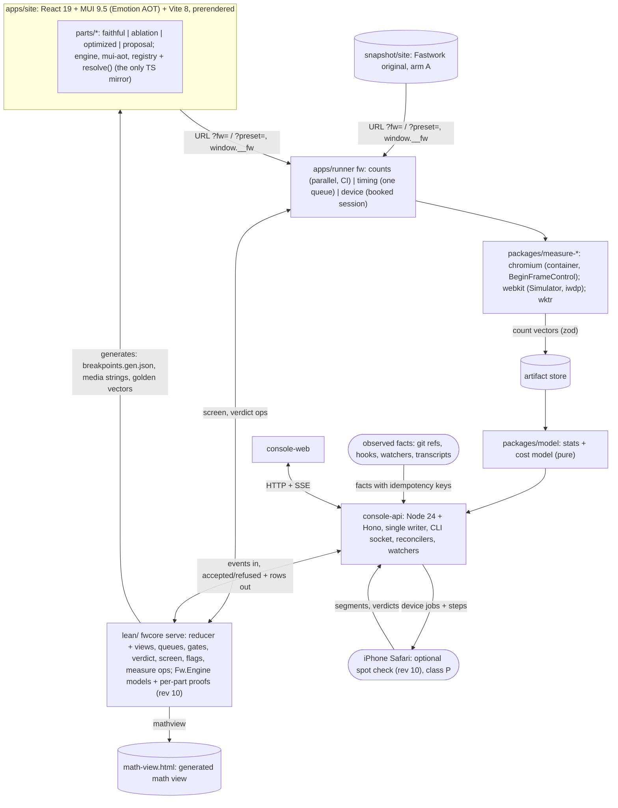

# v2 plan: a measurable, provable loop for the fastwork.com scroll experiment

This is the design for you to review. It merges the kickoff notes, cited as `[01]` to `[11]` with section numbers
(`[08]` the v1 chat forensics, `[09]` the MUI zero-runtime study with sub-notes `[09.01]`-`[09.04]`, `[10]` automation
and proof with `[10.01]`-`[10.04]`, `[11]` the breakpoint inventory), the feasibility review `[FR]`, the device note
`[ENV]`, the catch-up log `[CU]` (`docs/team/improvements/2026-10-17.md`) and the evidence note `[EV]`
(`research/notes/2026/10-17-plan-evidence.md`, cited by section), which holds the findings, history and worked
examples that left the plan in revision 8. Appendix A says which way the plan goes where the notes disagree;
Appendix D logs every change.

**Revisions in one line each.** **Rev 9** (your decision of 2026-10-17 23:13 +0700, ad5eeea): the experiment
takes at most 3 days from the first commit (931aa35, 13:15), so the report is due **2026-10-20 13:15 +0700** (§10).
**Rev 9.1**: your answers Q34-Q36 and the C1 WebKit GO. **Rev 10** (2026-10-18): your principle that every part's
animation is math, so the evidence for an optimization is a **Lean proof** (same picture, less engine work, in
Chromium and WebKit, at every width; §4.7, §5.1), CI counts check the engine models and the phone is an optional spot
check. **Rev 11** (2026-10-19 01:00): **Lego parts**: unit savings add up and pass savings do not (§4.8), a part
contract decides which parts are coupled (§6.8), and two integration waves with one whole-page gate each reach C3
(§10.7). Work runs as a dependency graph; the checkpoints are the only dates.

**Status words.** CONFIRMED = a note cites a source, doc or v1 record for it, or it was checked on this Mac today.
INFERRED = a design choice or expectation that a spike or measurement must still check. MEASURED = a number from a
run in this repo, with its commit. Targets and thresholds are proposals until you accept them.

## Glossary of labels (each prefix is used for one thing only)

| Label | Means | Where |
|---|---|---|
| **Q1 … Q37** | questions and defaults for you (answered ones in §12.0); Q34-Q35 added in rev 7, Q36-Q37 in rev 9; Q37 resolved in rev 10 | §12 |
| **D1 … D2** | your rev 10 decisions, answered 2026-10-18 (phone session 2 stays an optional spot check; three look-changing proposals get Try-it pages) | §12.1 |
| **M0 … M6** | milestone gates (exit states); M4 is out of scope for v2 since rev 9; M3 = optional phone spot checks and M5 = proofs + decision since rev 10 | §10.2 |
| **MX** | the work-graph milestone that holds the tasks cut in revisions 9 and 10; nothing in it is started | §10.4 |
| **(vis) / (work)** | the theorem pair proved per part × optimization: same visible scene for all t and all widths; per-frame work ≤ componentwise, < somewhere | §4.7, §5.1 |
| **class E / E-s / Q / L** | how "same visual" is proved: exact; exact at every sample; within the gate's PL1/PL2 tolerances; a look change (not proved, goes to `proposal`) | §4.7, §6.2 |
| **H1 … H3** | path premises of the visual theorems (text antialiasing, raster scale, sample phase), carried as hypotheses; the design note calls them C1-C3, renamed here because C1-C4 are checkpoints | §4.7 |
| **F0 … F6** | falsification checks: predictions the engine models make about CI counts; a mismatch is a model bug; F6 (rev 11) checks that part deltas add up in a combined run | §4.7, §4.8, §6.6 |
| **RG1 … RG11** | research gaps in the engine models (`engine-gaps`); the design note calls them R1-R11, renamed here because R1-R35 are risks | §10.6 |
| **`v2-proved`** | the flag arm made of every optimization with a proved pair and no falsified prediction | §6.2, §10.1 |
| **T+Nh** | hours after the 3-day decision (T0 = 2026-10-17 23:15 +0700); the report is due at T+62h | §10 |
| **G1 … G4** | outcome goals | §1.1 |
| **CG1 … CG5**, solo | coupled groups of the part contract: parts that read each other's output and must be built and measured together (Lean `Group.g1…g5`; the Lego note calls them G1-G5, renamed here because G1-G4 are goals); solo = coupled to nothing | §6.8 |
| **I1 … I5** | independence premises between two parts (I1-I4 decided in Lean, I5 layerization a recorded premise) | §6.8 |
| **wave 1 / wave 2** | the two integration rounds to C3, each ending in one whole-page gate | §10.7 |
| **V-a … V-t** | method (validation) criteria | §1.2 |
| **TL0 … TL5** | test layers | §5.4 |
| **PL0 … PL6** | parity levels (rewrite vs original) | §6.6 |
| **N0 … N5** | styling-neutrality checks | §6.7 |
| **S1 … S13** | styling rules inside parts | §6.5 |
| **class W / SM / X / P** | landing classes: less **W**ork, **SM**oothness or mixed, device-only (**X**), **P**roposal | §9.2 |
| **SPK-a … SPK-u** | spikes (short experiments that answer one question) | Appendix B |
| **L1 / L1-cond / L2 / L3** | proof levels: proved in Lean; proved but with a named unprovable premise; Lean spec with Lean-generated code or golden vectors for TS; not provable | §5.1 |
| **tier T0 … T3** | v1's pixel-difference tiers | §6.6 |
| **K1 … K10** | calibration fixture pages: K1-K9 WebKit [04 §9]; K10 sheet mutation, both engines [09.03 §5.2] | §4.3 |
| **R1 … R40** | risks | §11 |
| swap check | the check a section port passes to replace its shell: PL1 boxes + look tier at every breakpoint, one part, Chromium on CI; cheaper than the full gate | §10.5 |
| task ids (`class-freeze`, `port-morph` …) | tasks in `docs/team/work-graph.json`; a task id is also the agent name and the console card id | §10.4 |
| stages | question → build → screen → review → (device) → land, always written as words; derived from evidence events, never set by hand (§9.2) | §9 |

## 0. The plan in one page

**v1's result, and why v2 is different.** v1 reached its goal: slow frames in your swipe fell from 20.1 % to 1.7 %,
and the end-of-page longest frame fell from 584 ms to 42 ms. It cost 10 days, 442 started agents (848 transcripts)
and about $11.4k at list price, recomputed per request (v1's own readout scaled to about $13.5k) [01 §0, 08 §3]. 231
of its 276 incidents were filed against its own tools, 45 of them feature requests rather than failures [01 §1,
08 §4]. Your three pain points all show in v1's data. v2 answers each one structurally:

| Pain point | v1 evidence | v2 answer |
|---|---|---|
| 1. The phone was needed for every measurement | ~111 of 276 incidents involve the iPhone or Simulator driver; phone blocks took 12-35 min plus cooling [01 §B.1] | **Proofs, then counts.** Each optimization is proved (same picture, less engine work) under cited engine models of Chromium and WebKit (rev 10, §4.7); deterministic **work counts** on CI (Chromium headless-shell in a Linux container; WebKit Simulator when green) check the models. The phone is an optional spot check (§4, §10.3) |
| 2. Patching the minified Svelte build was slow | Retrospective cause C6; ~349 commits on the end-of-page line [01 §B.1] | **React rewrite as pluggable parts.** Each part has a `faithful` variant that copies the original's look and, for the parts we experiment on, its per-frame engine work, plus ablation, optimized and proposal variants picked by flags (§6) |
| 3. A coupled, bug-prone loop; every tool change re-ran everything | Full suite 250-280 s on every tooling commit; `lock.mjs` grew to 1,685 lines [01 §B.1, 06 §1] | **A proved core with a thin IO shell.** Every provable decision, queue and status view runs in one long-lived Lean 4 process, `fwcore` (§5.1); TypeScript moves data. Results are content-addressed, so a tool change re-runs only that tool's tests (§3) |

**What the chat history adds** (§2.3, [08]): v1's agents did their work well; the loop around them did not. v2 fixes
that with scripts, events and hooks, not with more agents or rules (§8.5). **Nobody writes status** (rev 5): every
console view is a formula over one event log that only console-api writes. **Lean first, and you read math, not
Lean** (rev 5): everything reproducible is proved before it is coded (§3.3), and every theorem carries its math on a
generated page (§5.3).

**What to expect, plainly:**
- **The evidence is a proof, not a phone run (rev 10).** For every part × optimization Lean proves (vis) the same
  picture for every t and width and (work) no more engine work per frame, less somewhere, under models of Chromium
  and WebKit (§4.7). CI counts check the models (F0-F6); the phone is an optional spot check; no cost model (Q37).
- **Parts as Lego (rev 11).** Unit savings of independent parts add up on the page; pass savings are part-local
  unless §4.8's condition holds. The contract (§6.8) says which parts are independent; one combined run per profile
  replaces one run per units-type flag (INFERRED under the open bridge, §4.8 limit 3), and the gate stays whole-page
  because the original is one page.
- **MUI everywhere, styles compiled ahead of time** (2026-10-17): Emotion styles rendered at build time into one
  static CSS file (§6.5); a neutrality gate (§6.7) checks MUI adds no sheet mutations, DOM writes or commits.
- **Chromium counts validate the Chromium model; WebKit is validated on the Simulator lane where it ran, else
  model-only.** Chromium counts never predict iPhone Safari by themselves; there is no Android phone.

**State at 16207afb (2026-10-19 00:50, T+25.5h; MEASURED from commit trailers and run ids unless marked).**
- **Proofs:** the engine models (`engine-core-lean`, Chromium and WebKit models) and all 10 proof tasks landed; the
  `v2-proved` arm holds 8 optimizations (9156d536, §10.6). Math view after `math-final`: 5,109 agree, 0 disagree,
  517 stale, 1,373 pending. `model-checks` (268d8124) found 4 refuted predictions, each a model or harness finding
  (§4.7); the touch lane does not finish its swipe (`run.mjs:276`).
- **Site:** every section ported; `integrate-ports-4` (c4b57a22) passed the gate in Chromium (run 39142015714: 0 bad,
  57 commission-resize readings excused); `page-root-clip` landed (3600b283); the WebKit Simulator rewrite lane landed
  (c2410d2d).
- **Composition and contract (rev 11):** `Fw.Engine.Compose` (a8678ca0) proves units compose and passes do not
  (§4.8); `Fw.Parts.Contract` (cf3eebf3) holds 34 part rows and their coupled groups (§6.8).
- **Running (wave 1, §10.7):** `site-assets`, `content-hero`, `content-people-pain-commission`,
  `morph-group-integrate`, `faithful-checks-rerun`. Report draft 2 is in (eebcc491). Nothing is waiting on you.

**The 3-day frame (§10).** The experiment is the set of optimizations with a proved pair, shipped as the
`v2-proved` arm beside `faithful` and `v1-best`, on a fully ported page (every section passed the gate in
`integrate-ports-4`). Chromium counts on CI falsify the engine models; WebKit is the cited model, checked on the
Simulator lane where it ran. Checkpoints: C1 WebKit go/no-go (GO), C2 engine models and region (met except the
faithful check), **C3 decision 2026-10-19 23:15** after two Lego waves, C4 report 2026-10-20 13:15.

**Headline goal, as v2 answers it.** Rebuild the end-of-page region and reproduce v1's outcome there as flag arms whose
"same look, less work" is **proved** for both engines at every width, with a fraction of v1's device time, tool bugs
and elapsed time; cost reported, not capped (§1).

## 1. Goals and success criteria

Each criterion has a measurement and an owner. "Proposal" thresholds become binding once you accept them (Q9).

### 1.1 Outcome goals

| # | Goal | Metric | Target | Checked by |
|---|---|---|---|---|
| G1 | v2 reproduces v1's effect, proved (rev 10) | Every flag in `v2-proved` has its theorem pair (§4.7) in both engines at every width band, and no F0-F5 prediction is falsified on CI; the `original` preset passes PL1-PL6 against the original site | 0 unproved flags in `v2-proved`; 0 open F-mismatches at C3 (each open one named as a model bug); optional: your swipe of `v2-proved` vs `original` reported as a spot check | `lake build` + `fw engine-check` (§4.7); phone optional (D1) |
| G2 | Fewer device blocks, less device chore work for you | phone sessions, device incidents, chore steps per session | in v2: 2 booked sessions (§10.3), no licence claimed; then ≤ 1 block per class SM landing; device incidents ≤ 10 % (v1 ~40 %); **≤ 1 get-ready step, 0 chore steps per session** (v1: 82-105 of 166 [08]) | console step log, bug ledger |
| G3 | Speed first, cost reported (decided 2026-10-17) | time to each gate (from git history); list-price dollars per milestone, role and day; Opus share; cold-wake share | **no hard caps or stop rules**; one date, the 3-day deadline 2026-10-20 13:15 +0700, with checkpoints (§10). Cost reported daily against the §8.4 forecast; soft alerts at 1.5× a milestone's forecast and at 60 % / 80 % of the weekly limit; total against v1's $11.4k at M6 | `pnpm fw usage` [07 §8] |
| G4 | Write-up material | every landed experiment card has a plain one-paragraph summary and a reproducible clip or chart reference; cleanup never deletes listed evidence | all landed cards (v1: 74 of your messages were about evidence and the article [08]) | `kb lint`; M6 review |

### 1.2 Method goals

| # | Goal | Metric | Target (proposal) | Source |
|---|---|---|---|---|
| V-a | **Count transfer: Chromium** | container counts vs a traced, non-timed headed Mac Chrome run, per family | equal per family, or the family is "container-only" and never feeds a coefficient | [FR §1.6] |
| V-b, V-c, V-e | **Count transfer (WebKit), ranking, magnitude** | Simulator vs phone counts; Spearman ρ; median abs(log(pred/meas)) | ≥ 95 % of states; ρ ≥ 0.8 on the iPhone; ≤ 0.3. **Not reached in v2:** no cost model (Q37) and no phone counts; the per-stage prediction is checked by V-h | [04 §9, 03 §9.3] |
| V-d | **Decision agreement** | sign of predicted Δ vs measured Δ above the noise band | ≥ 90 %, 0 sign errors among large predictions. In v2: reported for the one decision | [03 §9.3, 04 §9] |
| V-f | **Feel agreement** | blind verdicts with predictions frozen first | 5 of 5 before a stand-in licence; in v2 optional only (D1): a spot check of `v2-proved` vs `original`, reported, never a gate | v1 `stats-vs-finger.md` via [03 §9.3] |
| V-g | **Visual parity** of each `faithful` part | v1 tiers against a same-run A/A baseline | tier **T1** at PL0-PL3 and PL4 in Chromium and Playwright WebKit **at every breakpoint edge** (§6.6; shells excepted, Q36); boxes ≤ 0.5 CSS px | [02 §4]; your requirement |
| V-h | **Work parity** of each experiment part | PL5 bands per count family (§6.6) | within band for every family; layers ±0; same compositor/main split | [02 §4.6, FR §2] |
| V-i | **Determinism, per count type** | repeated CI runs classified by Lean `measure.classify` (`Fw/Measure/Classes`) | every type *deterministic*, *stable* or *quarantined*; screening uses only the first two (rules below) | `spk-i.md`, [03 §7.1, 04 §8.5] |
| V-j | **Time to adopt a tool** | new measurement plugin → first cached artifact | ≤ 1 agent-day; 0 other artifacts invalidated (`fw run --dry`). Reported, not gated, in v2 | [06 §3] |
| V-k | **Test speed** | pre-commit gate; TL1 whole repo | pre-commit ≤ 30 s; TL1 < 20 s cold | [06 §3.4] |
| V-l | **Bug ledger, per module** | every entry has `kind`, `module`, `level` and `caughtBy` | complete; drives the demotion rule (§5.1) | [10.03] |
| V-m | **Bugs in proved areas** | logic incidents in any L1 module | 0 escaped logic incidents | bug ledger |
| V-n | **Harness neutrality** | frame-stepped vs free-running counts, per family | equal per family, else not screened in that engine; compositor-only animations still cost 1 `UpdateLayoutTree` per frame in Chromium (MEASURED 70c3370) | [FR §1.2], [CU] |
| V-o | **Timing parity** (PL6) | Mac Chrome per-stage time, rewrite vs original | within the original's A/A band (ABBA, n ≥ 4) per stage | [FR §2] |
| V-p | **Transfer to the original** | the same change as an overlay on the original, counts lane | same sign of Δ per stage, for every landing that can be overlaid | [FR §2] |
| V-q | **Styling neutrality** of MUI | N0-N5 (§6.7) | sheet mutations 0 after hydration; DOM-write and commit census equal to `impl: plain`; style shape within ±10 % | [09] |
| V-r | **Mutant kill rate** | each L1 module ships v1 bugs put back on purpose (`FwTest/Mutants/<module>/*.patch`) | 100 % make `lake build` fail; a survivor blocks the module's next land | [10.03] |
| V-s | **Math sign-off** | docstring math whose deep statement hash equals the signed hash | 0 missing, 0 stale, 0 unsigned at land (`math-final` before the report) | [10.04 §2.3] |
| V-t | **No hand-written status** | console fields an agent can set directly; a replay of v1's status history through the v2 reducer | 0 directly settable fields; the replay share reported, not gated, in v2 | [10.02] |

**V-i rules** (SPK-i, decided 6b4237e; `research/notes/2026/10-17-spk-drafts/spk-i.md`). No byte identity: whole
count files never match (thread ids, GC, async work; MEASURED 70c3370), so classes are per count type. **Chromium
policy** p = (kMax 4 frames, tMax 24 units), 3 runs: *deterministic* = no frame differs; *stable(k, t)* = ≤ 4 frames
differ and totals differ by ≤ 24; else *quarantined* (CONFIRMED `Classes.lean`); pixel-area types use
max(tMax, ⌊min |total| / 1000⌋) (proved `classifyU_sound`, 5879861). **Use:** deterministic types frame by frame;
stable types only as totals with margin 2t (`margin_exact`); quarantined never (`quarantined_unsound`).
`trace.Paint` is quarantined in the frozen table, so Chromium paint is not screened. **Signed class** = the worst
over ≥ 3 CI runs with the image pinned (`measure.freeze`, bc2e28a); one run's classes are never signed. **WebKit:**
per-cell tolerances, 2 passes in each of 2 boots; per-step Layout/Paint quarantined, totals within 3-5 % (367fec2).

## 2. What we keep and what we drop from v1

### 2.1 Keep (each with its v2 form; the v1 evidence for each row is in [EV §2])

| Keep | v2 form |
|---|---|
| Frozen, hash-pinned baseline; one change per arm | `snapshot.lock.json` pins the original; each rewrite build is pinned by commit + flag vector + `servedHash`; overlays become **flag arms**, never bundled |
| A/A noise floor; "better" only with disjoint ranges | The landing verdict is **4 vs 4** runs with disjoint ranges; false-win rate under the null ≤ 1/70 (§5.1); comparisons counted per experiment |
| Prediction cards before data; claim status words; "read source first" | Pre-registered predicted Δ per stage and zone on the question card (§9); rule cards in `refs/rules/` with file:line@commit and status [04 §11] |
| Pixel tiers T0-T3; element ablation with a fairness check | Parity levels PL0-PL6 (§6.6); generated ablation variants per part (§6.2) |
| The validated feel metric: frames > 50 ms per 100 moving frames in the finger's zone; the less-work landing rule | Primary device metric (§4.6); landing class W, per frame over a declared-complete vector (§9.2) |
| Proposals with Try-it pages; blind swipe A/B; comment on anything | The console Proposals view; a second iPhone for free play (Q1) |
| Your coaching, as rules with enforcers; named spawns; one worktree per editor; one lander; ff-only | In the lead file and `CLAUDE.md` from the start, each rule naming its enforcer (§8.5); the one lander is the lead through `fw land` (§8.2) |
| Quiet-host gate and contamination flag for timing runs | Timing lane only; the counts lane needs no lock |

### 2.2 Drop (each with what replaces it; the v1 evidence is in [EV §2])

| Drop | Replacement |
|---|---|
| A device run for every measurement; the 6x CPU throttle as the model | Counts lane + a per-stage, per-count cost model with a page factor `ρ_page` + validity table (§4) |
| Patching a minified bundle | React parts with flags (§6) |
| A full test suite on every tooling commit; real time and the real host in tests | `vitest --changed` per affected package; TL0-TL5 layers; a clock port and a lint that bans timers, real load, fixed ports and shared temp folders in the pure zone (§5.4) |
| Side effects at import; 8-24 copies of one parser; two different medians | Pure zone enforced by a lint; one `model` package for stats |
| Many writers to many JSON stores; agents writing board state; shared ledger files | One writer (console-api), one append-only event log, status as a Lean projection; agents' only inputs are typed, refusable requests (§8.3, §8.5) |
| A 9.7k-word rulebook loaded by every agent | Root `CLAUDE.md` under 300 words at the start, never above 1,500; each rule names its enforcer |
| Opus everywhere; the lead as router; recurring check prompts; routing agents | A small roster, Opus where it speeds the work, a lead that decides and does not route, no LLM polling; `fwcore` decides queue order, land queue, device dispatch and digests (§8.5) |
| Agents holding device leases; hand-moved queues; hand-built lock code (1,685 lines); an 842-line git-guard hook | A device job queue in console-api with a proved priority function; no lock in the counts lane; git config + deny rules + a land-time path check; one small spawn-guard hook (§8.3) |
| Multi-step inline shell in worktree agents | Committed `pnpm fw` verbs; one plain command per Bash call (§8.2) |

**Rule for every new tool, hook or package:** it names the v1 incident class it prevents, or it waits until
something fails without it. An **enforcer** reads only events, never agent self-reports, ships with golden tests and
reaches ≥ 90 % precision on a log replay before any alarm reaches you. A new *agent* rule must cite an agent-mistake
incident; otherwise fix the tool (v1: 4 agent-mistake incidents against 139 tooling ones [08]).

### 2.3 What the chat history showed

[08] read v1's 848 raw transcripts: **a star, not a team** (64 % of 12,582 messages touched the lead); **woken by
polls** (42 % of the lead's turns were cron fires); **home-made coordination broke more than agents did** (139 tooling
incidents against 4 agent mistakes); **you were device technician and status bus** (82-105 of 166 steps were chores).
What worked: steps, Try-it proposals, comment buttons, fast replies, short fresh agents, one lander, ff-only.

## 3. Architecture

### 3.1 Overview



### 3.2 Modules and their narrow contracts

Rule: a module talks to another only through the contract in this table. Each contract is a zod schema in
`packages/contracts`, exported to JSON Schema and, where Lean reasons about it, mirrored in Lean with golden
fixtures [06 §2.5, 05 §6].

| From → to | Contract | Notes |
|---|---|---|
| runner → site | URL `?fw=part:variant,…`, `?impl=part:plain,…`, `?preset=<id>`, `seed`, `t0`, `rm`; the page exposes `window.__fw = {config, configHash, scroll, clock, hydrated, styleMisses, markMeasureStart}` | The same harness drives arm A by injecting an equivalent `__fw.scroll`; `markMeasureStart()` is refused before `hydrated` |
| site build → runner | Vite `manifest.json` → `servedHash` per route | Edits to part X change only the keys of routes that serve X |
| runner → plugin | `MeasurePlugin {id, semantics, lane, input, output, run, reduce}` | count reduction runs in `fwcore` (§3.3); an output that fails its schema is an incident, never a result |
| plugin → artifact store | key = `sha256(canonical JSON of {subject, tool, engine, profile, protocol})` | counts artifacts are reused; timing artifacts append samples |
| artifact store → screen and engine check | **count vector per (frame, zone)**: 12 scroll zones per run, no per-part attribution (A31) → `fwcore screen` (dominance) and `measure.engineCheck` (F0-F5 golden rows, rev 10); no coefficient set in v2 (Q37) | pure; applied at report time, so a model fix re-runs no measurement |
| TS → fwcore | `fwcore serve` is long-lived and **stateful**; ops below | `Fw/Serve` (14152f1): apply round trip p50 40 µs; a 100,008-event replay 0.4 s (MEASURED [CU]) |
| console-web, agents, any client → console-api | typed HTTP + SSE for the UI (it never decides); `pnpm fw <verb>` sends one typed request to `.fw-console/run/cli.sock` with a single-use capability from the hook `cap.mjs` (HMAC over agent type, id, tool-use id, command hash); every request carries `contractsVersion`, a mismatch is refused with "rebase" | the socket never trusts a self-declared role (R27); v1 worktrees on old tool code misread shared state |
| agent → device lane | job card `{kind, card, priority class}`; agents never hold the phone | v1: 40 scheduler incidents; runners died with their agent [08] |
| console-api → status and steps | each status row is **computed, never written**, with a "why" popover listing its events; a step shows only after a script checks it is ready | v1: rows said "waiting on you" with nothing to do |
| observers → console-api | facts with an idempotency key; hooks write a spool file (< 100 ms); git facts come only from the ref reconciler | a key is marked seen only when its event is accepted |
| everything → knowledge store | one frontmatter schema; `pnpm kb index | find | lint` | §7.2 |

**`fwcore` ops** (each a Lean function; TS only sends and prints): console `console.apply/replay/query/reset/
landReadiness/actor`; work graph `task.*`, `milestone.define`, `plan.trailers`; gates and decisions `gate.*`,
`verdict`, `ticks`, `twins`, `flags.resolve/enumerate`, `screen`, `samples`; measurement `measure.*` incl.
`.classify`, `.selfCheck`, `.snapshotCounts`, `.freeze`, **`.zoneBaseline`** (running), `store.ciRun` (running);
operations `ops.spawn/pathCheck/usage/meter/hook/obs/admit`, `metrics.*`, `obs.health`.

**Hardening the TS ↔ `fwcore` glue** (each a real failure path, CONFIRMED [FR §3.2]): request ids echoed, a
mismatch kills the child; 10 s per call, 120 s per replay chunk, restart on timeout with outstanding calls failed;
`LEAN_ABORT_ON_PANIC=1` (a Lean panic otherwise returns a default value, lean4 v4.35.0 `src/runtime/object.cpp`
l.76-82); a grep gate bans `get!`, `head!`, `[i]!`, `panic!` in the wire layer; counts cross as `Nat`, times as
integer ns, rationals as `{"num","den"}`, never `Float`.

### 3.3 Where each decision runs (one place only)

- **Lean first for everything reproducible (2026-10-17; `CLAUDE.md`).** Every pure piece of the console, the site,
  measurement and tooling is specified and proved in Lean **before** it is coded; then it runs in `fwcore`, Lean
  generates it (constants, media strings, `breakpoints.gen.json`, test matrices), or the TS/React code passes
  Lean-generated golden vectors. I/O, rendering and glue hold no decision. A TS stand-in is temporary and listed in the
  report; the open ones are in R32 (`store-cirun` landed, 73ae012).
- **Browser-side code** (L2): media strings, motion curves, part logic and the flag resolver are generated by Lean or
  checked against golden vectors; the resolver's TL2 test covers every single-part override of every preset
  (`fwcore flags.enumerate`, a finite domain) plus 2,000 fast-check multi-part cases [10.03 §2.10].
- **Bookkeeping too:** reducer and views, queues, `fw plan`, cache prune, the path check, spawn-guard and usage dedupe
  are L1 modules (§5.1); v1 failed exactly there (hand-kept board, scheduler) [10.03 §1].
- **Priority is data you own:** one ordered list (`presets/priority.json`); both queues read it through one proved
  Lean function of the list, the job class and the waiting time (aging, Q27), starting the most urgent job **that
  fits** the booked window. A manual move is an event with a reason.
- **Fitted numbers** (coefficients) live in TS (`packages/model`); Lean proves the screening rule (§4.3) and an L1
  checker accepts coefficients before use. In v2 none are fitted (Q37).

### 3.4 MVP tier and later tier

| | MVP (built in M0-M2) | Later (only when a named failure needs it) |
|---|---|---|
| apps | `site`, `runner` (`fw`), `console-web`, `console-api` | — |
| packages | `contracts`, `measure-chromium`, `measure-webkit`, `model` (stats + cost model), `kb`, `fwcore-client` | split `measure-sdk`; separate `artifact-store`, `usage` packages; `core` |
| console storage | `.fw-console/` in the main checkout (gitignored; console-api its only writer): `events.jsonl` (append + fsync, then apply), snapshots, spool, CLI socket, secrets; projection in `fwcore serve`; reconcilers and watchers (§8.5) | SQLite read model (if queries get slow) |
| Lean | Lean-first, by milestone (§5.1): site and parts from the start; M0 console core, queues, spawn-guard, gates, verdict, work graph; M1-M3 the rest of the L1 inventory | only what an incident or a new decision calls for; the optional Mathlib package `FwMath` (§5.2) |
| hooks | Built in `apps/runner/hooks/` (3e67d48, 6756bb9): observer `emit.mjs` (spool-only, ~47 ms median, MEASURED 3fe1876) on session, subagent, compaction and tool events; `cap.mjs` on `PreToolUse(Bash)`; spawn-guard on `PreToolUse(Agent)` in shadow mode, plus `SubagentStart` so workflow spawns are logged too (2a43e6e) | `TaskCreated`/`TaskCompleted` observers, `SubagentStart` role brief |
| repo tooling | pnpm workspaces, Biome, Vitest; one pre-commit hook via `core.hooksPath` running `scripts/scrub.mjs` (0.17 s, d2574b0; not lefthook) | Turborepo, knip, dependency-cruiser, ast-grep rule sets, REUSE.toml, JCS keys |
| knowledge store | 4 kinds (`note`, `decision`, `ref`, `rule`), 5 claim statuses | more kinds if the index needs them; `kb lint` beyond the schema |

## 4. Measurement methodology

### 4.1 Three lanes

| Lane | Runs | Determinism | Gives | Never gives |
|---|---|---|---|---|
| **counts** | parallel, no lock, **on GitHub Actions** (below). Chromium headless-shell in a Linux container with BeginFrameControl; WebKit Simulator Mobile Safari through `ios_webkit_debug_proxy`; WKTR (§4.2); optional Chrome on the Android emulator, counts only | per count type (V-i) | work per virtual frame and per scroll zone (12 zones per run; **not per part**, A31) | milliseconds |
| **timing** | one at a time from the console-api queue: headed Mac Chrome with `PipelineReporter` tracing; Simulator Timeline with `Page.enable` first | statistical (ABBA, n ≥ 4) | per-stage ms on this host, for timing parity (PL6) and A/A bands | iPhone ms |
| **device** | iPhone Safari blocks as **jobs in a console-api queue**, run only in a session you book. Each session starts with `fw device check` (repairs what it can, then posts **one** get-ready step); the queued blocks then run back to back | statistical | the truth for feel; iPhone coefficients; render-server time | anything at scale |

**Measure on CI, not on this Mac** (your direction, 417d90d; `CLAUDE.md`; §12.0). An agent pushes its `ci/<task>`
branch and reads the result with `gh run view` / `gh run download`. Chromium runs in the container on
`ubuntu-24.04-arm`; WebKit Simulator counts on the `xcode-27` image (iOS 27.0, 24A434; `webkit-sim.yml`; go/no-go at C1, §10.2); WKTR is
planned for `macos-26` (iOS 26.5). A local run is a debug run, never a result. Each workflow has a `paths:` filter
and cancels stale runs on `ci/**` only (21 of 28 runs touched no input; MEASURED, 6723de2); macOS jobs share one
pool of 5 (our tier INFERRED; MEASURED, 56fe6c9; budget in R33). Full figures: [EV §3.1].

**Why a container.** Chromium refuses BeginFrameControl on macOS (`headless/lib/browser/protocol/target_handler.cc`
l.62-65 @317846d579b2, CONFIRMED [FR §1.1]). The container serves **every font from `snapshot/`** with no system
fallback, because fallback fonts change line breaks and so layout and paint counts (INFERRED). SPK-i ran
(70c3370): BeginFrameControl works in the container, but whole count files were never byte-identical, so V-i uses
per-type classes (§1.2). Heavy trace categories are used in the counts lane only (v1 saw −17 fps, CONFIRMED [03 §12]).

### 4.2 Step 1: deterministic work counts

**The harness must not change the mechanism it measures** (CONFIRMED [FR §1.2]). Playwright's `page.clock` fakes
`requestAnimationFrame`, so the app's rAF runs outside the rendering steps; seeking an animation restarts compositor
animations in Chromium and invalidates style per animation per step in WebKit ([EV §3.2]), so Chromium never seeks.
- **One virtual frame in Chromium** (both arms): `puppeteer-core` with BeginFrameControl in headless-shell (flags in
  [EV §3.2]; 70c3370, 25bd9f4); a clock shim gives `Date`, timers and `performance.now` virtual time (pinned to
  `2026-10-01T00:00:00+07:00`) and **keeps native `requestAnimationFrame`**; each scroll step comes from a committed
  profile; `HeadlessExperimental.beginFrame` advances animations without seeking; then the counter deltas are read.
- **One held state in WebKit:** no BeginFrameControl, so seeking plus "two rAFs"; counts classed per type (V-i);
  seek overhead measured on an N-animation fixture and tagged `harness-induced`; compositor status only from
  free-running `LayerTree` censuses.
- `Math.random` is seeded (mulberry32); `t0` and the seed are part of the artifact key.

**What the runs showed** ([EV §3.3] holds every row and run id): the Chromium frozen table (worst class over 3 runs,
62 types, `trace.Paint` quarantined; MEASURED da287ff, rule proved in `Fw/Measure/Freeze.lean`); the touch race fixed
(c38088e); zone sums of the original stored (c719d73); WebKit per-step Layout and Paint quarantined, totals within
3-5 % (367fec2).

**What gets counted** (full catalogues in [03 §7.2] and [04 §4.1]):

| Family | Chromium (Blink/cc) | WebKit (Simulator, Inspector protocol) |
|---|---|---|
| **Sheet mutations** | page-side census N0 (CSSOM write wrappers + `MutationObserver` on `<style>`/`<link>`); engine side N1: `StyleEngine::updateActiveStyleSheets`, `scheduleInvalidationsForRuleSets`, font-update slices | census N0 (always); `CSS.styleSheet*` events (attribution runs only) |
| Script | rAF callbacks (`FireAnimationFrame`); script ms measured, not modelled | rAF count; script ms through page-side wrappers |
| Style | `UpdateLayoutTree` passes, `elementCount` | `RecalculateStyles` records (no element count without WKTR) |
| Layout | passes, forced layouts (with JS stack), `dirtyObjects` | `Layout` records with root |
| Paint and raster | `Paint` count (not area), raster-invalidation rects × dpr², tiles, paint ops | `Paint` clip area, ΔpaintCount per layer |
| Image decode, layers | `decodedPx` per frame; layer count, reasons, `drawsContent` | `decodedPx`; `LayerTree` count, `memory`, 29 reason flags |
| Compositor | `Animation` trace `compositeFailed` bitmask (free-running only) | accelerated animations × requested rate [04 §2.3]; layer reason `animation` |
| Frame outcome | `PipelineReporter` states (timing lane only) | `RenderingFrame` segments (timing lane only) |

Container tiles and raster use software raster; headed Mac Chrome uses GPU raster (INFERRED [FR §1.6]); V-a compares
per family. **Sheet mutations are a family of their own:** inserting 100 rules during a scroll left every planned
count unchanged and only style-recalc time moved (20-24 vs 8-10 ms, CONFIRMED [09.04], Chrome 155); one insertion
is a full-document style rebuild in WebKit (`StyleScope.cpp` l.585-619 @77db40e2fa70). The original reads 0 after
load (SPK-q); the family is in every declared-complete vector (§4.3).

**WebKit element counts (Q10).** The Inspector protocol gives no restyled-element count, and v1's WebKit costs were
dominated by restyle. **Rev 10:** the (work) theorem for WebKit is proved under `Fw.Engine.WebKit`, whose style rows
cite `Style::TreeResolver` at the pin, so a style-touching diff needs no WebKit count to be class W; F5 checks the
model where the Simulator serves the rewrite. WKTR (`wktr-ci-lane`) reports its two deterministic cadence counts and
is not modelled (trunk 324039, not shipped iOS 27; A26).

### 4.3 Steps 2-4: cost models, calibration and validation (kept for a later study)

**In v2 no coefficient is fitted and none is needed (Q37 resolved, rev 10).** The model shapes ([04 §7], [03 §9]),
the fixtures K1-K10 (our own pages in `fixtures/calibration/`) and the NNLS calibration ([04 §9, 09.03 §5.2]) stay
designed but unrun; holdouts (V-c to V-e) and the blind feel check (V-f) likewise.

**Screening without coefficients (class W).** If a variant's count vector is ≤ the baseline's **in every component
and in every frame**, and strictly lower somewhere, every frame costs no more under **any** non-negative unit costs
(`Fw/Spec/Screen`, `Cost.mainUs_mono`). It needs (1) **per frame, not per zone total** (batching can lower a total
while raising one frame's peak); (2) **frames aligned by content anchor**, not by scroll y; (3) **a vector declared
complete for the mechanism class**, with a lint that the diff touches no family it does not count (images,
`filter`/`backdrop-filter`, new animations, fonts, styling-engine configuration), else class SM (S11). `fwcore screen`
is tested on two v1 hand rulings (case A → W, case B → not W) [08]. The **validity table**
(`results/validity/*.jsonl`) records the engine models' predictions against CI counts (F0-F6, V-h) per proved flag.

### 4.6 What only the phone can tell us (honest limits)

| Limit | Why | Handling |
|---|---|---|
| **Work is not feel** | v1's cost card was right about the work and wrong about what you felt (CONFIRMED [03 §0]) | decision agreement + blind feel (V-d, V-f); landing classes (§9.2); in v2 the end-of-page decision goes to the phone (session 2) |
| **Render server / GPU** (backdrop-filter, filter passes, CA animation rate) | off the rAF path; visible only to Instruments on the device (CONFIRMED [04 §2.2, §4.6]) | class X: always on the device |
| **Finger-only effects** | toolbar resizes (775↔815), velocity-based tile coverage (`scrollTo` sets no velocity [04 §8.3]), 80 Hz runs, layout only while dragging | toolbar steps replayed in the counts lane; the swiped phone run is the primary metric |
| **First-interaction layer builds, hydration** | count predictions missed in the same direction five times in v1 [01 §A.4]; Emotion hashes styles at hydration (≈ +16 ms script, [09.04], directional) | class X; `markMeasureStart()` only after `__fw.hydrated`; N5 |
| **Emergent dynamics** | back-pressure, catch-up frames, coalesced layouts: a stepped harness removes them [04 §12] | the device outer loop must still see them |
| **Heat and Low Power Mode** | LPM halves rAF to 30 Hz (CONFIRMED [04 §2.3]) | thermal class per run; LPM recorded and the run refused |
| **Blink cannot see WebKit-only costs** | presence-flip layouts, `steps()`/`linear()` off the CA path, store discard on resize [01 §A.3] | a separate WebKit count vector; never predict iPhone feel from Blink counts |
| **Version skew** | phone iOS 27.0.1; CI Simulator iOS 27.0 (24A434, MEASURED [CU]); WKTR is WebKit trunk 324039@main (CONFIRMED [ENV]) | every count stored with its engine build; no cross-build comparison |

**Primary device metric (spot checks only since rev 10):** frames > 50 ms per 100 moving frames in the finger's
zone, from the swiped run (7 of 7 in v1); also slow-frame % (> 34 ms) and the longest frame per zone, binned by
**vsync ticks** (`Fw.Frames.tickAt hz dtNs`) and placed by **crossing coordinates**. A phone number is reported as a
spot check and is never the evidence for a landing (§4.7).

### 4.7 The evidence model (rev 10): proofs decide, counts check the model, the phone spot-checks

Your principle (2026-10-18): every part's animation is computed by math, so prove it, do not measure it by hand.
For each part $P$ with original $o$ and optimized $v$, the plan requires a **theorem pair**, both proved in Lean:

| Theorem | Statement (plain) | Over what |
|---|---|---|
| **(vis)** | the visible scene of $v$ equals that of $o$: $\forall\, \mathit{env},\ \forall t:\ \mathrm{visible}(\mathrm{scene}_o(\mathit{env},t)) \approx \mathrm{visible}(\mathrm{scene}_v(\mathit{env},t))$; $\approx$ is `=` (class E, E-s) or the gate's PL1/PL2 tolerances (class Q), never a new tolerance | every width **interval between breakpoints** (`Fw.Site.Breakpoints`, 30 media predicates, so the proof splits per band, not per sampled width), touch × hover, DPR; every t (ms since the push, or scroll offset); every push sequence |
| **(work)** | per frame $k$ the work vector of $v$ is at most that of $o$ in every component (script, style, layout, props, paint, raster, commit, compositor tick) and strictly less in one: $W_\epsilon(v,k) \preceq W_\epsilon(o,k)$, $\exists k, s:\ W_\epsilon(v,k)_s < W_\epsilon(o,k)_s$; resident layers $\le$ too, else the result is a **trade** | both engine models $\epsilon \in \{\text{Chromium}, \text{WebKit}\}$, every frame; `Screen.screen_sound` and `Cost.mainUs_mono` then give "no frame costs more under any non-negative unit costs", so no coefficients are needed |

The models are `Fw.Engine.Core` (stages, work vector, per-frame union of dirtied stages, thread split),
`Fw.Engine.Chromium` and `Fw.Engine.WebKit` (each engine's table from a property change and the target's layer state
to the stages it dirties; every row cites a CONFIRMED engine line at `chromium@f842f52` / `WebKit@862f17d`), and
`Fw.Engine.Visual` (the scene; pixels come from an arbitrary `R : Scene → Image`, so equal scenes give equal images for
every R). Full tables: `10-18-engine-proof-design.md` §1-§3.

**Three hypotheses, never axioms (H1-H3).** The visual theorems assume the engine rasterizes the same scene the same
way whichever path produced it: **H1** no LCD text in a layer that moves between main and compositor paths (likely
vacuous at DPR 3, RG9); **H2** no scale animation on the compositor; **H3** the compositor samples the same value
function at its own frame time. They are carried as a `PathPremises` hypothesis on every theorem and are named in the
report; the optional `pixel-spot` task checks them in Chromium only.

**Who checks what.** The chain original site → `faithful` TS → Lean `faithful` spec → Lean `optimized` spec →
`optimized` TS has four links. The **breakpoint gate** (§6.6) links code to spec at both ends (PL0-PL2 at every stop,
124 loads, golden vectors). The **proofs** link the two Lean specs for every t and every width. **CI counts** check the
engine models by falsification: Lean emits one prediction row per (scenario, variant, stage) in {=0, =o, <o, ≤o,
any}; deterministic count types must match exactly, stable ones within the frozen margin 2t (`margin_sound`),
quarantined ones are never used. **A mismatch is a model bug**, fixed from engine source, never by widening a
tolerance.

| Check | Prediction | Where | Status |
|---|---|---|---|
| F0 | the lane does not disable threaded animation (bit 0 of `compositeFailedBits` never set) | fixture-rest | INFERRED from `run.mjs:41`; checks the pipeline note's "always odd" claim |
| F1 | compositor transform/opacity animation: layout = paint = commit = 0, style = 1 per frame | fixture-rest | MEASURED (README:146-148); becomes a regression golden |
| F2 | main-thread width/background-color: layout > 0 and paint > 0 per frame | fixture-rest | MEASURED (README:148-149) |
| F3 | for each landed variant, every stage the model says is 0 reads 0 in its zone | swipe-v1, rewrite arm per flag | new |
| F4 | `=o` stages within 2t; `<o` stages strictly lower on deterministic types | same | new |
| F5 | the WebKit predictions P1-P5 of the WebKit pipeline note | `webkit-sim` on the rewrite | lane landed (`webkit-sim-rewrite`, c2410d2d); WebKit stays model-only for any row it has not run |
| F6 | a combined run's delta per (part, stage, zone) equals the sum of the part deltas within the class margin, on units only (§4.8) | combined counts per profile | new, `compose-check`, after C3 |

**F3/F4 so far (`model-checks`, 268d8124; MEASURED):** 4 predictions refuted, each a model or harness bug for
`model-bug-fixes`: morph.tween waapi FireAnimationFrame 1,748 = 1,748 (swipe-v1 never pushes the morph); scene
hidden-pause UpdateLayoutTree 1,851 > 1,850 (INFERRED: a model or harness bug for `model-bug-fixes`; not explained by
§4.8, since `passes_not_compositional` predicts equal passes, not an increase); morph.mount
LayoutCount one frame late; nav.hitTest FunctionCall frames differ (stale frozen class).

**What the phone is now.** An optional spot check of what neither proof nor CI covers: UIKit's `setContentOffset`
behaviour under `scrollTo`, H1-H3 on WebKit, and felt smoothness. It has no dependents in the
graph, it is never evidence, and it is never a gate (§10.3).

### 4.8 Composition (rev 11): units add up, passes do not

The Lego plan builds and proves each part alone, then needs the page. `Fw.Engine.Compose` (a8678ca0, task
`compose-lean`) says what carries over when two parts' frames are put side by side (`FrameIn.append`, `++`). Each row
restates the Lean hypotheses (If) and conclusion (Then); every theorem is proved (CONFIRMED, lines at a8678ca0). Using a
row for the site is CONFIRMED only when the plan discharges every hypothesis; the last column names what stays open.

| Result | If | Then | For the plan |
|---|---|---|---|
| `frameWork_append_units`, `_hits` (217, 227) | nothing (any two frames, any engine) | page units per stage and page hit tests are the sums of the parts' | unit savings add up |
| `frame_le_append_units` (234) | per-part ≼ (the full order, passes included) | page ≤ on every stage's units and on hits (not page ≼) | F6 checks units only |
| `someLt_append_units` (249) | part 1 strictly lower on some stage's units, part 2 no larger on units in every stage | page strictly lower on some stage's units | the second premise is part of the claim |
| `passes_not_compositional` (137, + `_chromium`, `_webkit`) | a change dirties stage $s$ | there are parts $f_1, g_1, f_2$: $g_1$ skips $s$, $f_1$ and $f_2$ touch $s$, $g_1 \prec f_1$ with fewer $s$ passes, and $g_1 \mathbin{+\!\!+} f_2$ runs exactly as many $s$ passes as $f_1 \mathbin{+\!\!+} f_2$ | a pass saving can vanish on the page (equal passes, CONFIRMED); that it never becomes an increase follows by arithmetic from `passes_append` (108) but is stated by no theorem (INFERRED); reported part-local |
| `frame_le_append_passes_fails` (194) | a change dirties style | there are parts with $v_1 \preceq o_1$, $v_2 \preceq o_2$ and $v_1 \mathbin{+\!\!+} v_2 \not\preceq o_1 \mathbin{+\!\!+} o_2$ | per-part ≼ does **not** give page ≼ |
| `unionLe_append`, `frame_le_append`, `frame_lt_append` (264, 283, 293) | per-part `unionLe` (stage-set union check, `Core.lean:425`) | page `unionLe` and page ≼; page ≺ if, in addition, part 1 is strictly lower on some stage's units or on hit tests | the page condition |
| `frame_le_append_cover` (326) | each part covered (a sub-multiset of its original's changes, no more callbacks, forced passes, hits or compositor animations) | page ≼ | the other page condition |
| `lego_swap_sound` (371) | every part's frame and arm satisfy `ReadsOnly Indep`, and part $p$ is `Indep` of every other part | swapping $p$'s variant leaves every other part's frame, frame work (any engine) and arm unchanged | INFERRED for the site: `Indep` is abstract (limit 3) |
| `lego_swap_units`, `_visible` (411, 449) | `_units`: frames `ReadsOnly Indep`, $p$ `Indep` of every other part, $p < n$; `_visible`: arms `ReadsOnly Indep`, the same `Indep`, $p$'s height exactly equal and its visible scene equal at every offset | page units move by exactly $p$'s change, per stage; the visible stacked page of parts $0..n-1$ is unchanged from every offset | same premise; stacked parts only |
| `visible_scene_append` (Visual.lean:866) | nothing | $\mathrm{visible}(S \mathbin{+\!\!+} U) = \mathrm{visible}\,S \mathbin{+\!\!+} \mathrm{visible}\,U$ | visibility splits over parts |
| `Q_append` (Visual.lean:873) | $Q(S_1,U_1)$ and $Q(S_2,U_2)$ | $Q(S_1 \mathbin{+\!\!+} S_2,\ U_1 \mathbin{+\!\!+} U_2)$ | the tolerance check composes |
| `visible_append_of_boxes_eq`, `_Q` (Visual.lean:888, 909) | same part count; part by part exactly equal heights and equal (resp. $Q$) visible scenes at every offset | equal (resp. $Q$) visible `stackScene` from every offset | PL1's ½ px box tolerance composes (`boxQ` uses `tolBox`, Visual.lean:232, CONFIRMED); a ½ px band-height difference is not covered (INFERRED); nav and overlays are outside `stackScene` |

**Which way the plan goes.** The Lego note's `frame_le_append` over ≼ alone is false (`frame_le_append_passes_fails`);
the plan uses the true forms: the combined-run condition is per-part **`unionLe` or cover**, not per-part ≼. A
passes-type win (hidden-pause, scene pausing, panel blur → none) is claimed for the page only when no other part
touches that stage in the same frame; otherwise it is reported as part-local. A combined run cannot attribute a pass
saving to one part, so a passes-type saving is **model-only (proof, no count check)** unless its own per-flag run
lands before C3 (§10.7).

**Limits, stated in the report.** (1) The visual premise is "every visible y equal"; the gate's finite probes do not
discharge a ∀y, only the per-part band theorems do. (2) Fixed and overlay parts (nav, drawer, signup) are outside the
vertical `stackScene` model; their visual composition is the gate's evidence, not a theorem. (3) `Indep` is abstract
until a bridge proof `Independent P Q → Indep` ties it to §6.8; the lead adds it as a work-graph task (owner
`lean-prover`, after `contract-rows-from-code`); until it lands every cut resting on `lego_swap_*` is dropped under
this premise, never CONFIRMED (§10.7). (4) Results are per frame; run-level (per-frame list) composition is not stated.

## 5. Lean strategy

### 5.1 What is proved

**Lean-first (your requirement of 2026-10-17).** [10.03] places 87 console and tooling decisions, state machines and
pure functions at a proof level (site and part items not counted, INFERRED). `lean/README.md` holds the inventory;
the math view (§5.3) shows each item's math.

| Level | Count | Meaning |
|---|---|---|
| **L1** | 54 | Implemented and proved in Lean, run through `fwcore`; inputs are the console's own events, ids and counts |
| **L1-cond** | 30 | Proved, but its real-world meaning needs a named L3 premise (the counts are right, every spawn passes the hook, declared dependencies are complete, the signer's identity) |
| **L2** | 3 in [10.03]; more to re-estimate | Lean spec; the shipped TS/React/CSS is generated by Lean or passes Lean golden vectors (§3.3): flag resolver, wire codecs, optimistic preview, media strings, motion curves, part logic |
| **L3** | 18 categories | Not provable; each names how it is checked and which L1 decision it feeds (below) |

Lean reaches the code in one of the three ways of §3.3: it runs in `fwcore`, it generates the artifact, or it emits
golden vectors. Site and measurement items are in scope: the breakpoint model `Fw/Site/Breakpoints` (conditions,
edges, overlaps, the fractional-gap facts; it generates `breakpoints.gen.json`, the media strings and the 124-load
gate matrix), motion curves, count reduction and verdicts.

**Modules by milestone** (rev 9 scope; P = proved in a kickoff sketch):

| Milestone | Lean modules | v1 bug classes they remove |
|---|---|---|
| M0 | `Fw/Console` (reducer, authority, steps, needs-you, landing rule); `Fw/Spec/DeviceQueue`; `Fw/Ops`; `Fw/Wire`; `Fw/Spec/{Frames, Verdict, Null}`; `Fw/Gate`; `Fw/Plan`; the math-view lint | hand-kept board, double-answered steps, scheduler, spawn storms |
| M1 | `Fw/Site`; `Fw/Spec/{ArtifactKey, Store}`; `Fw/Measure` (classes, tolerances, zones, the freeze rule, **`measure.zoneBaseline`**, `store.ciRun`); run queue, sessions, lease (Q26); stage lifecycle, land queue | stale reuse, cherry-picking, lease mid-step, a lost queue place |
| M2 | `Fw/Parts` (part specs and golden vectors for the 9 end-of-page parts); `Fw/Spec/Flags` + `Fw/Gen/Registry` (P), presets; parity bands; `Fw/Spec/Screen` (dominance, proved sound for class W), uncounted families, landing classifier, `land_requires` | arms that changed more than the named thing; over-trusting proxies |
| M3 (rev 10: optional spot checks) | block validity and the thermal-class refusal for phone blocks; **no model ladder, fit checker or licence** (Q37 resolved, §12.0) | a device block used beyond its validity |
| **M5 (rev 10: proofs)** | **`Fw/Engine/{Core, Visual, Chromium, WebKit}`** (stage model, scene, engine tables with cites, `frame_le_of_cover`, `frame_le_union`, `run_dominates` → `Screen.screen_sound`, `toCost` → `Cost.mainUs_mono`); **one `Fw/Parts/<Part>Opt` module per part × optimization** with the (vis) and (work) pair (§4.7, §10.6); `Fw/Measure/EngineCheck` (F0-F5 rows and the match rule); **rev 11:** `Fw/Engine/Compose` (§4.8) and `Fw/Parts/Contract` (§6.8) | a "same look" claim that was only eyeballed; a "less work" claim that rested on one device run; a model that drifts from engine source without anyone noticing |
| M6 | the per-module evidence table and the per-part theorem table for the report; `FwMath` only if a verdict needs it | — |

**Built by ad5eeea** ([EV §4]): 51 modules on the math view; M0 mutants (V-r): 625, 621 killed, 3 equivalent, 0
survived (MEASURED 8074907). **Demotion rule:** a module moves from L1 to L2 by a decision record when its proofs cost
more than 1 agent-day on two consecutive changes while its bug ledger (V-l) shows 0 bugs caught; the Lean spec stays
the oracle. **Engine rules are Lean data (rev 10, A32):** a proof about our transcription cannot catch a transcription
error, so every table row cites its engine line at the pin and F0-F6 (§4.7) test it against counts. Part geometry is
the `faithful` Lean specs, tied to the TS parts by golden vectors and to the original by the gate (§6.6).

**Not proved (L3), each with its check:** that the engine tables match the shipped engines (cited rows + F0-F5;
rev 10, was "table tests"); work counts (V-a, V-b, V-i, V-n); run independence (A/A, ABBA); sha256 collisions;
pixels (tiers vs A/A; `pixel-spot` for H1-H3); the React parts (PL0-PL6, golden vectors); IO (contract suites,
`fwcore replay`); YAML and CSS parsing (golden files); human and LLM judgement (blind protocol, typed commands); the
UI (Playwright); `fwcore` speed; the clock; completeness of observation (reconcilers), of declared dependencies
(SPK-u) and of the part contract rows (`contract-rows-from-code`, §6.8); actor identity (SPK-t); "answered / complete" (your click).

**Multiplicity.** A landing by verdict needs `k · p_null ≤ 0.05`; under the null Pr[better] ≤ 1/70 for 4v4
(`land_null_prob`, 9367dea; `falseBetterProb_eq_pNull` for any m, n, 74ffd03; k ≤ 3 by `multOk`). Rev 10: a proved
pair makes no statistical comparison, so k counts only proposals and the optional spot check.

### 5.2 How TypeScript and Lean connect

- **Lean decides and holds the console state; TypeScript moves data** ([10.03 §4] (B)). `fwcore serve` is one
  long-lived JSON-lines process (hardened as in §3.2); console-api stamps, fsyncs and forwards each event and publishes
  changed rows over SSE; a refused event is logged with its reason; nightly `fwcore replay` must reproduce the live
  state hash. One reducer, `Fw/Console` ([10.02] semantics, [10.03] data structures); 100k events < 1 s in `lake test`.
- **Mathlib-free core, optional `FwMath`** (2026-10-17): core Lean covered every kickoff sketch; a proof that needs
  Mathlib goes in `FwMath`, which `Fw` never imports, so Mathlib's cache stays optional [05 §0].
- **Types:** zod is the truth (`packages/contracts`); `fwcore samples` emits golden JSON that zod must parse
  byte-for-byte [05 §2, 06 §2.5]. TS copies: only L2 items (§3.3), generated by Lean or held to Lean golden vectors.

### 5.3 How you read a theorem, and a worked example

**You read math, not Lean (decided 2026-10-17).** Every theorem, and every definition you are expected to read (for
example `may`, `stage`, `ready`, `stale`, `eff`), carries its math in its docstring: one English sentence, then one
`$$…$$` LaTeX block, in one notation table ([10.04 §3]). Lean checks the proof; the **math-reviewer** checks that the
math says exactly what the Lean says; you check that it is what we mean. `#guard` lines are examples that run at
build time.

**The math view is generated, never hand-kept** ([10.04 §2]). `lake exe mathview` exports per declaration the
docstring's English and math, the signature, a machine-made LaTeX form (no LLM), axioms (`sorryAx` = not proved) and
a 64-bit deep statement hash; `build-math-view.mjs` renders it into `docs/plan/math-view.html`, a page of its own published next to loop-plan.html (KaTeX as MathML, the
Lean collapsed). Sign-off records are keyed by statement and math hash; the lint (TL0) fails on missing math, `sorry`
outside an allowlist, a hash changed since signing, a KaTeX error or a non-standard axiom. The math-reviewer writes its
own math from the signature and compares clause by clause (ℕ vs ℤ, ≤ vs <, truncated subtraction, ties, ⇔ vs ⇒);
disagreement goes to a second reviewer, then you (Q28); a toolchain bump re-signs only unchanged entries (R24).
**Status (MEASURED):** no review round found a wrong proof; every disagreement was a docstring fix. After
`math-final` (d159442a): 5,109 agree, 0 disagree, 517 stale, 1,373 pending; a theorem added later is unsigned in the
report and says so.

**Short example** (`lean/Fw/Spec/Verdict.lean`, 9367dea; proof elided; the full worked example in [EV §5.2]):

```lean
/-- Soundness for lower-is-better: "better" means every variant run was strictly lower than every control run.
$$\forall C, V \in \mathbb{Z}^{*}:\quad \operatorname{verdict}(\mathrm{lower}, C, V) = \mathrm{better} \;\Rightarrow\; \forall y \in V,\ \forall x \in C:\ y < x$$ -/
theorem better_sound {ctl var : List Int} (h : verdict .lower ctl var = .better) :
    ∀ y ∈ var, ∀ x ∈ ctl, y < x := …

#guard verdict .lower [5, 5, 5] [4, 4, 4] == .better
```

### 5.4 Test strategy per layer

| Layer | What | Tool | Runs when | Budget |
|---|---|---|---|---|
| TL0 | proofs, `#guard` examples, the math-view lint (missing / stale / unsigned math, sorry, axioms, KaTeX), mutant patches (each must break the build, V-r), the 100k-event speed budget, partial-op grep on `Wire`/`Main` | `lake build`, `lake test`, `lake exe` | pre-commit on `lean/**`; mutants on CI (`mutants-ci`) | < 3 min warm |
| TL1 | pure unit + property tests; no real time, host load, ports or shared temp folders (lint; 2 s per-test cap) | Vitest + fast-check | pre-commit, affected packages | < 20 s whole repo |
| TL2 | contracts: zod ⇄ JSON Schema ⇄ Lean golden round trips (every event `type@n` with upcasters); the flag resolver over its whole domain (+ 2,000 fast-check cases) | Vitest + `fwcore` | pre-commit | < 60 s |
| TL3 | visual parity per part (PL0-PL4) | Playwright (Chromium + WebKit) | pre-land, affected parts | < 10 s per part per config |
| TL4 | measurement plugins on real engines, incl. harness-neutrality fixtures (V-n); console fault injection (duplicates, drops, reorders, torn last line, skewed clocks must give the fault-free state) | `fw run` (cached by artifact key) | on demand; pre-land for touched parts | 0 on a cache hit |
| TL5 | device + your finger | console steps | optional spot checks only (rev 10, §10.3) | optional |

**The local gate:** a pre-commit hook (`scripts/scrub.mjs` through `core.hooksPath`; blocks emails, home paths, LAN
IPs, device ids and secrets in staged files, 0.17 s, d2574b0) + `pnpm fw gate` (re-runs the checks at land).

**CI** (d70619d, 6723de2): `lean`, `chromium-counts`, `breakpoint-gate` (8 shards, ~5 min), `webkit-sim` on `main`,
`wktr` on its branch; read-only contents, actions pinned by SHA. CI is where measurement runs (§4.1); CI never
replaces `fw land`. `webkit-sim` takes 10-38 min and fails under host load (R33); its go/no-go is C1 (§10.2).

## 6. Pluggable parts and flags

### 6.1 Parts

The parts follow the page anatomy in [02 §2]; **34 part ids** live under `apps/site/src/parts` and each has one
row in the part contract (§6.8): the sections `nav`, `hero`, `people`, `pain`, `commission`, `platform` and their
children, `morph.{mount, tween, panel, countdown, columns}`, `overlays.{signup, drawer}` and the cross-cutting
`engine.scroll` and `engine.scene`. Shared buttons and the root theme tokens (with the 320 px floor, [11]) are
styling, not parts.

**Every part with markup is built from Material UI components** (decided 2026-10-17: `Box`, `Stack`, `Typography`,
`Button`, `Link`, `AppBar`, `Card`, `Avatar`, `Dialog`, `Drawer`, `Menu`, `Tab` …). Looks come from CSS Modules that
restate the original's values; motion comes from our drivers (§6.5). MUI's wrapper elements (Paper, Backdrop, Portal
roots) are listed in each part's `parity.json` wrapper map, which PL0/PL1 and N3 use.

**Experiment parts** need full work parity (PL5-PL6): the 9 end-of-page parts (`engine.scroll`, `hero.countdown`,
`hero.exit`, `nav.hitTest`, `morph.*`); every other part is ported `faithful` with look parity, and the rest of the
v1 backlog (the `people.*` reveal, avatars) is out of scope for v2. Dead CSS (about half of the Platform section's
animation CSS never runs [02 §2.6]) is not ported, and no inert sheet is added (Q35 = a; N4's rule-count difference
stays a fixture parameter, `10-17-css-decisions.md`).

### 6.2 Registry and variants

Each part has a static `part.json`, the single source of truth; TS imports it and codegen turns it into
`lean/Fw/Gen/Registry.lean`:

```jsonc
{ "id": "hero.countdown", "slot": "hero", "anchors": ["hero-countdown"], "experiment": true,
  "impls": ["mui", "plain"],              // mui = default; plain = control twin (experiment parts only)
  "muiStates": ["countdown-running"],     // ownerState values the AOT census must render (S2)
  "variants": {
    "faithful": { "kind": "faithful",  "tier": "T1", "layerBudget": 80 },
    "strip":    { "kind": "optimized", "tier": "T0", "provenance": {"v1Fix": "cd-strip"}, "layerBudget": 16 },
    "frozen":   { "kind": "ablation" }, "static": { "kind": "ablation" } },
  "requires":  { "morph.countdown:strip": ["hero.countdown:strip"] }, "conflicts": [] }
```

| Kind | Meaning | Gate |
|---|---|---|
| `faithful` | same DOM shape, the original's CSS values restated; for experiment parts also the **same per-frame reads and writes**, bad ones included (rect reads in rAF, the hit test, the scroll-jack) | PL0-PL6 (§6.6); time box 3 h in v2, then `faithful-with-delta` with the delta named |
| `shell` (rev 9, Q36; none left) | a static section with the original's box height per breakpoint; no drivers | PL1 outer box only |
| `ablation` | generated per part: `frozen`, `static`, `nopaint`, `box` | v1 fairness check: boxes equal, script and layout counts equal, only paint/raster lower |
| `optimized` | v1 fixes re-implemented from their READMEs (never copied from patches), and new ideas | **rev 10: lands only with its Lean pair** (§4.7): (vis) of class E, E-s or Q with the gate's tolerances, (work) over `Fw.Engine` for both engines and all bands, TS checked against the Lean golden vectors; plus layers ≤ `layerBudget` and no falsified F3/F4 prediction. Compositor eligibility is read from the counts lane itself (`compositeFailedBits`), which is threaded (F0); no separate free-running census. A class L change cannot be `optimized` |
| `proposal` | look changes: CM / compositor-morph, constant glass, FLIP on `people.o`, carousel st6, typing chunks, PR-040/041, finger-following end, instant People card | your decision via Try-it + blind A/B (D2, §12.1: you chose constant glass, FLIP / st6 and typing chunks; the others stay unbuilt); the model may still state their *work*, labelled "look changed" |
| `impl: plain` (an axis) | the same variant with plain elements in place of MUI, sharing CSS Module and drivers; experiment parts only | a measurement control for N3 (§6.7), never shipped |

**Presets** (`presets/*.json`, with `extends`): `original` (all `faithful`; the parity reference), `v1-best` (g0.0m
rebuilt as flags; a look change), `ablation-<part>`, **`v2-proved`** (rev 10: every flag with a proved pair and no
falsified prediction; look-identical by theorem), `v2-best` (`v2-proved` plus any proposal you accept).

### 6.3 Resolution

Order: URL `?fw=` → `?preset=` → registry default `faithful`; unknown ids and violated `requires`/`conflicts` are an
error page, never a fallback. The resolved config is sorted and hashed into `window.__fw.configHash`, every artifact
key and every capture. **A build ID is the commit + the flag vector + the style-engine variant + the MUI/Emotion
versions** (+ `servedHash` per route). **Flags resolve at load, never per frame** (flipping a flag in a running page
re-creates v1's lesson 10).

### 6.4 Choosing what a run measures

```sh
pnpm fw run --preset original --fw hero.countdown:strip --engines chromium --profile swipe-touch-v1  # one part swapped
pnpm fw run --preset original --impl hero.countdown:plain --engines chromium        # N3: MUI vs plain twin
pnpm fw run --preset original --fw nav.hitTest:hit-skip --lane timing --abba 4      # timing lane, ABBA n=4
pnpm fw run --preset original --fw hero.countdown:strip --engines chromium --dry    # config, hash, cache hits
```

Raw artifacts go to the local store `<git-common-dir>/fw/artifacts/<key>/`; the run summary to
`results/runs/<date>-<configHash7>.json` with a line in `results/index/runs.jsonl`; `fw ci` pulls a CI run's
artifacts into the store under `fwcore` keys (`store.ciRun`). `fw report <run>` prints per-zone counts, the screen
result (dominates / mixed / worse) and the model status. The console's Run builder does the same with pickers.

### 6.5 Runtime rules inside parts

1. **No per-frame value goes through React state, context, MUI `sx` or Emotion.** Drivers write refs, inline styles
   or CSS variables on the consuming element, or use WAAPI or scroll timelines.
2. All JS motion goes through the injectable `MotionClock` and the scroll source; no free-running rAF or timers.
3. `engine/Signals` gives each scroll threshold **one owner** (the faithful engine keeps the triple flip at 0.72).
4. The faithful `engine.scroll` is literal: one passive listener, one rAF, the original's callback and layout order.
5. The site is prerendered, as the original is. Only production builds are measured.
6. **Styling: MUI everywhere, Emotion AOT** (decided 2026-10-17; [09] README §1 has every source line). MUI 9.5.0
   and Emotion 11.14.x, pinned exactly. A build-only **census route** renders every MUI component in every state the
   parts declare (`muiStates`); `extractCriticalToChunks` writes those styles to a static `mui.[hash].css` in
   `@layer mui` plus `emotion-ids.json`; the prerendered HTML has no `<style data-emotion>`. Before `hydrateRoot` the
   client marks every census id in `cache.inserted`, so Emotion inserts nothing (mechanism CONFIRMED in Emotion's
   source; MEASURED in Chromium by SPK-r); measurement builds wrap `cache.insert` and one miss fails the build. Cache
   wiring: no `StyledEngineProvider`; one `createCache({ key: 'mui' })` per side through `CacheProvider`. Portals:
   the census renders every overlay with `disablePortal`, closed and open. Build variants: `aot` (default) and
   `runtime` (the negative control N0/N5 must catch); `pigment` is out of scope for v2 (Q21). Fallback per part: Base
   UI 1.9.0 + CSS Modules (§6.7). Rules S1-S13 extend rules 1-5 (lint = an ESLint or ast-grep rule in `apps/site`):

   | # | Rule | Prevents | Enforced by |
   |---|---|---|---|
   | S1 | No `sx`, `styled()`, Emotion `css`/`keyframes` under `src/parts/**`; style MUI through `className` and `slotProps.*.className` from CSS Modules in `@layer parts` | runtime insertion; class churn | lint; N0 |
   | S2 | Theme `styleOverrides`/`variants` branch only on props listed in `part.json` `muiStates` | a census miss = an insertion mid-run | census test; N5 |
   | S3 | Per-frame values only through `MotionClock` writers (custom property on the consuming element, inline `transform`/`opacity`, WAAPI, scroll timelines) | React commits, churn | rules 1-2; N2 |
   | S4 | Discrete flips may re-render but must map to classes already in the static CSS | an insertion at a flip | N0 in W-trigger; N2 |
   | S5 | No MUI `Fade`/`Grow`/`Slide`/`Collapse`/`Zoom` on scroll-linked or always-mounted paths; overlays use class-toggled keyframes restated from the original | forced reflow, rect reads, inline writes | lint; PL4 |
   | S6 | Ripples off theme-wide; focus styles restated in CSS | a re-render, rect read and `@keyframes` insertion at first touch | theme unit test; N0 |
   | S7 | On scroll paths: no MUI `Tabs` (reads `getBoundingClientRect` on every render and resize), `Popper`, `Tooltip`, `Autocomplete`; `Avatar` gets its `` as a child, never `src` (two commits per mount) | rect reads; forced layouts; hidden commits | lint; PL5; N2 |
   | S8 | One theme at module scope, one colour scheme, nothing written on `<html>` at hydration; `cssVariables: false` (Q34 = c, decided 2026-10-18) | `<Global>` insertion, root invalidation, consumer re-renders | N0/N1 in W-load/W-rest; N4; N5 |
   | S9 | No Emotion `<Global>` at runtime (`CssBaseline`, `GlobalStyles`, `enableColorScheme`); the reset is static CSS in `@layer reset` | `<Global>` bypasses `cache.inserted` | lint; N0 |
   | S10 | No `useMediaQuery` or `useScrollTrigger` for looks; breakpoints live in CSS | commits on scroll and toolbar resizes (775↔815) | lint with an allow-list |
   | S11 | Emotion configuration fixed (production `speedy`, one cache `mui`, `@layer mui`, no `injectFirst`); config and MUI version in the build ID; every MUI bump re-runs N0-N5 | an unpriced styling-engine change | build-ID hash |
   | S12 | Overlays closed during scroll scenarios, mounted at load or `keepMounted`; `disableScrollLock` matches the original; MUI's default `@media` replaced by `breakpoints.gen.json` conditions | insertion and body writes at the trigger | N0 in W-trigger; census |
   | S13 | The theme uses the original's font families and metrics (no Roboto default) | layout and paint differences that look like styling cost | PL1/PL3; N4 |

   **Build gates** (MUI source details and census numbers in [EV §6]): the client marks every id the server inserted
   (marking only HTML ids left 8 inserts on first overlay open, MEASURED); every build runs the census test with 0
   misses; no `@media` in `mui.css` that is not in `breakpoints.gen.json`; no `<style data-emotion>` in prerendered
   HTML; no `null`, `undefined` or `NaN` in emitted CSS.

### 6.6 Parity gate (rewrite vs original)

Arms: **A** = the snapshot served from `snapshot/`; **A2** = A loaded again (A/A, captured in every run); **R** = the
rewrite at preset `original`. Both arms load the same image and font bytes from the same paths.

| Level | Check | Gate | Applies to |
|---|---|---|---|
| PL0 | structure: the anchor set exists and counts match (`parity.json` maps `data-fw` ids to original selectors and lists MUI wrapper elements) | exact, wrappers excluded | ported parts |
| PL1 | element boxes at each stop | ≤ 0.5 CSS px | ported parts |
| PL2 | computed styles (a property list per anchor); N4, the static style-shape census, once per build | exact after normalisation; numeric ≤ 1e-3; N4 as in §6.7 | ported parts |
| PL2b | accessibility tree and tab order at each stop | equal to the original's, also when content hides by opacity | ported parts |
| PL3 | still pixels at fixed stops, animations frozen | v1 tiers against A/A | ported parts |
| PL4 | frame-by-frame pixels at 16.667 ms steps, plus motion paths | per frame as PL3; paths within 1 device px | experiment parts |
| PL5 | work counts per scenario (rest 6 s, scripted scroll, the part's trigger), per family; N0/N1 sheet mutations, N2 DOM writes; N3 against the `impl: plain` twin | bands below | experiment parts (N0 on all) |
| PL6 | timing parity: Mac Chrome timing lane, per stage, R within A's A/A band (ABBA, n ≥ 4) | within band | experiment parts |

Every part is ported (`integrate-ports-4`); the 9 end-of-page parts are the experiment parts. Rev 8's whole-page
Simulator and phone check is replaced by the engine models plus F0-F6 (§4.7, §4.8).

**PL5 bands** (proposals; rev 10: computed and **reported** by `faithful-checks`, no separate freeze, `bands-freeze`
cut): rAF callbacks and forced layouts **exact**; style and layout passes and elements `|R−A| ≤ max(2, 5 %)`;
paint/raster `|R−A| ≤ max(2, 10 %)`; layers ±0; compositor/main split exact; sheet mutations 0; N2 equal to the plain
twin. Only deterministic and stable count types take part, stable ones as totals with margin 2t (V-i). **Counts are
per frame and per scroll zone, not per part** (A31), so the faithful check for the region compares zones y04000,
y04500 and tail of R against A; other zones are reported. **Predicted vs counted (rev 10, V-h):**
for every `optimized` flag the engine model's rows are checked by F3/F4 (§4.7): predicted-zero stages read 0
(deterministic) or stay within 2t (stable); `Paint` and `UpdateLayoutTree.elementCount` are quarantined, so paint
predictions use `raster.invalidationAreaPx` / `invalidationRects`. A mismatch is a model bug, never a tolerance change.

**Transfer check (V-p), at every landing.** If the change can be an overlay on the original, the runner applies it to
arm A in the counts lane and requires the **same sign of Δ per stage** as on the rewrite; otherwise it is "transfer
unchecked" and cannot land as class W.

**Every breakpoint, identically, for every part (2026-10-17).** The inventory [11] found 30 media conditions and
**18 edges** (CONFIRMED [11 §1]), including the touch arm `(hover: none) and (pointer: coarse) and (width <= 1200px)`
through C860, C1000 and C1030, and the pain-notes container width < 1100 (JS). `Fw/Site/Breakpoints` generates
`breakpoints.gen.json`, the media strings and the gate matrix; the build fails unless the snapshot extractor agrees.
Rules: pure 860 is not C860; overlaps keep the original's winner; fractional gaps (600.5, 640.5, 860.5, 1000.5) need
exactly restated bounds; JS gates run the identical query. The (vis) theorems quantify over the same width bands.

**Breakpoint lint and gate.** Per part and kind the normalised conditions must equal the inventory's set (an L1
decision). The gate, required before any ported part is promoted: PL0-PL3, original vs rewrite with a per-config A/A,
Chromium and Playwright WebKit, 124 loads per engine plus one width inside each band and live-resize sweeps; a part's
probe scope cuts this to 10.8 job-minutes (MEASURED). **Status:** `integrate-ports-4` passed in Chromium (run 39142015714: 0 bad, 57
commission-resize readings excused); the verdict runs in Lean (`verdict-to-lean`); PL2b, PL3 pixels and live flips are
reported, not gated, in v2. **Cells no engine can reach (Q33):** WebKit cannot produce the fractional gaps or the
hover × pointer cross; the gate marks them `unreachable` (3a8c263); the gaps lane reaches 8 of 8 Chromium cells, and
the phone probe in session 1 agreed 8 of 8 with Lean (0c901f2).

### 6.7 Styling-neutrality gate (N0-N5)

This gate shows that MUI adds no style-sheet mutations, DOM writes, React commits or engine work counts compared with
arm A and with the part's `impl: plain` twin; if it passes, PL5 compares mechanisms, not styling engines [09.03 §2].
It cannot see JS time or the per-element cost of a differently shaped sheet; N4 is the proxy, PL6 the timing check
(§12.2). Windows: **W-load** navigation → `__fw.hydrated`; **W-rest** → `markMeasureStart()`; **W-measure** the
scenario.

| Check | What and how | Gate |
|---|---|---|
| **N0** sheet mutations, page side (every counts run, both engines, both arms) | an init script before any page script (`Page.addScriptToEvaluateOnNewDocument` / `Page.setBootstrapScript`) wraps the CSSOM write APIs (`insertRule`, `deleteRule`, `replace*`, `selectorText`, `adoptedStyleSheets`, `disabled`, `MediaList`, rule-level `setProperty`/`cssText` with `parentRule != null`) and a `MutationObserver` watches `<style>`/`<link>`; a sheet hash at the end of each window | **0** mutations in W-measure; hash unchanged across W-rest and W-measure |
| **N1** sheet mutations, engine side | Chromium `blink_style` slices (`updateActiveStyleSheets`, `scheduleInvalidationsForRuleSets`); WebKit `CSS.styleSheet*` events | 0 in W-measure |
| **N2** DOM-write and commit census | per frame and per `data-fw` anchor: `class`/`style` changes, childList mutations, React commits per part (`<Profiler>`) | `impl: mui` = `impl: plain` per anchor |
| **N3** work counts, MUI vs plain | the PL5 families on the `impl` pair, same flags otherwise | passes, forced layouts, layers **exact**; `elementCount`/`dirtyObjects` within `max(2, w)`, w = MUI wrappers in the anchor |
| **N4** static style shape (once per build, A and R) | at the end of W-rest, walk `document.styleSheets`: rules, selectors by rightmost compound, custom properties, `@property`, `@layer`, `@keyframes` | reported, not gated; a large delta is named in the parity report |
| **N5** hydration | SSR `class`/`style` per anchor vs the DOM after `__fw.hydrated`; `cache.insert` misses | **0** attribute diffs, 0 misses, 0 style-tag moves |

A failed N0, N1 or N5 is an **incident against the part, never a result**: fixed inside the part's box or the part
moves to the Base UI fallback. A failed N2 or N3 makes the part `faithful-with-delta` with the delta in the validity
table. N0 runs in the counts lane; on the phone only the end-of-run hash runs. **In v2 N2-N4 run for the 9 ported
parts only; shells (Q36) have no twin.**

### 6.8 The part contract (rev 11): who reads whom

`Fw.Parts.Contract` (cf3eebf3, task `contract-lean`) holds one row per part id under `apps/site/src/parts`: 34 rows
(`parts_ids`), each with the signals it reads and writes (scroll y, viewport width and height, clock, pointer, morph
phase, CSS variables, class names, element boxes, scene pause), the elements it targets, the parts whose boxes its
frame writes move, and whether it reschedules the scroll list. All theorems are by `decide` (CONFIRMED, Lean file).

| Premise | Two parts P, Q are independent when … | Decided |
|---|---|---|
| I1 | neither writes an element the other owns or writes | Lean |
| I2 | neither part's frame writes move the other's box | Lean |
| I3 | no frame-time output of one **affects** an input of the other: the same signal, or a scroll-y write and any box read | Lean |
| I4 | no forced-update chain in the ordered scroll list and no shared schedule | Lean |
| I5 | compositing of overlapping layers does not couple them | recorded premise |

**Page-level parts** are derived, not declared: `pageLevel P := P.schedules || scrollY ∈ P.outputs`. Two parts are
page-level: `engine.scroll` (reschedules every scroll-list callback; `g4_iff`, `g4_couples`) and `morph.tween` (the
only frame-time scroll writer, `scroll_writers`; it couples to every part that reads a box, `scroll_writer_couples`).
Page-level parts read only the environment (`pagelevel_env_only`), so they are measured on whole-page runs only.
**`groups_partition`:** two parts that are not page-level and sit in different groups are independent.

| Group | Members (decided by the code rows) |
|---|---|
| CG1 | hero, hero.accent, hero.cue, hero.deck, hero.exit, hero.orbit, pain, pain.notes, people.card, people.o |
| CG2 | commission, commission.typing, engine.scene, morph.mount, morph.tween (page-level), nav, nav.hitTest, nav.langMenu, platform and its 5 children (entries, glint, marquee, stageBg, sweep) |
| CG4 | engine.scroll (page-level) |
| solo | hero.countdown, morph.columns, morph.countdown, morph.panel, overlays.drawer, overlays.signup, people, people.carousel, people.deck |

CG3 and CG5 are empty in the code rows; the ids are kept so `Group.g1…g5` and CG1-CG5 stay one to one.

**Which way the plan goes.** The Lego note grouped by feature (its five groups); the code rows moved 21 parts, so **the Lean
table wins** (A36). For example `people.o` reads the clock and `people.card`'s box and writes `data-o-stack`, which
`people.card` reads (`card.module.css:170`, width ≤ 860 px), so it is in CG1, not solo.

**The rows are declared by hand: premise `declared-rows-unverified`.** The golden
`packages/contracts/golden/parts/contracts.gen.json` carries it at top level, and every stage result and proved flag
that relies on the table (`part-stage`, `proved-flags-ts`) carries it too, until `contract-rows-from-code` lands: a
static extractor over each part's TS and CSS that emits a footprint JSON from which the Lean table is generated (the
hand rows become the diff baseline). Accepted limits (the `groups_partition` docstring): outputs list only signals
another part can read; I4 is pairwise with no clock-subscriber order; event-only writes are excluded; `moves` is
hand-listed; viewport width and height have no writer. Two selectors match no element under CSS-module renaming
(`pain.notes/index.tsx:40`, `nav.hitTest/logic.ts:19`; `build.mjs:41`): faithfulness findings for those two parts.
`scenariosFor` generates `packages/measure-chromium/scenarios.gen.json`; every scenario it names is one of the 5
profiles that exist (`scenarios_known`); there is no push profile yet.

## 7. Repo layout and the knowledge store

### 7.1 Layout (MVP; "later" items are added only when needed, §3.4)

| Path | Holds |
|---|---|
| `CLAUDE.md`, `LICENSE`, `NOTICE`, `README.md` | rules with "Enforced by" (< 300 words at the start, ≤ 1,500 ever); MIT for our code; the Fastwork approval and snapshot source |
| `.github/workflows/` | lean, chromium-counts, breakpoint-gate, webkit-sim; wktr on its branch (§4.1, §5.4) |
| `.claude/`, `.mcp.json`, `.serena/` | settings (hooks, permissions, env), 14 agent roles (§8.2), skills; serena, serena-lean, lean-lsp |
| `apps/site/` | React 19 + MUI 9.5 + Vite 8, prerendered; `/__harness/:part`, `/__census`; `src/parts/<id>/{part.json, parity.json, faithful/, variants/}` |
| `apps/console-web/`, `apps/console-api/`, `apps/runner/` | shadcn/ui + Tailwind 4; Node 24 + Hono single writer with `fwcore serve` (§7.3); the `fw` CLI and hooks |
| `packages/` | `contracts` (zod + schema + goldens), `measure-chromium`, `measure-webkit`, `measure-wktr`, `model` (pure stats), `fwcore-client`, `kb` |
| `docker/counts-chromium/` | Dockerfile pinned by digest; fonts only from `snapshot/site` |
| `lean/` | the Lake project `fwcore`; `math.lock.json` GENERATED |
| `breakpoints.json`, `fixtures/calibration/`, `presets/`, `profiles/` | GENERATED breakpoint inventory (§6.6); our own K1-K10 pages; flag presets; scroll scripts and replays |
| `research/`, `refs/`, `results/`, `docs/` | kickoff notes, dated notes, ADRs; upstream pins and rule cards; experiment cards, runs, validity, console exports; this plan, the explainer, team files |
| `snapshot/site/` | the Fastwork original, tracked unmodified (269 files, 30.1 MB; tree id = lock), read-only |
| `.fw-console/`, `.cache/`, `.local/`, `snapshot/site-pretty/` | GITIGNORED: live console state (console-api only), upstream clones and raw traces, v1 digests, pretty-printed snapshot |

### 7.2 Frontmatter

One zod schema in `packages/kb` (the truth; `pnpm kb lint` checks it): a date-slug `id`, `kind` (note, decision,
ref, rule), `status`, dates, authors, topics, engines, parts (must exist in the registry), builds, links, and
`claims` each with a status and a cite. A **rule card** adds `statement`, `source {repo, commit, path, lines}`,
`counts`, `test` and `mechanism`; `kb lint` fails when two live cards share a mechanism with opposite statuses [08],
and `fw refs:drift` flags changed cited lines at a new engine tag [04 §11].

### 7.3 Public repo: what enters git and what never does

- **No Fastwork code outside `snapshot/site/`.** The repo is public (your decision of 2026-10-17, MIT for our code);
  Fastwork approved publishing its compiled homepage, fonts included, so the snapshot is tracked unmodified with its
  source in `NOTICE` (9492807, 53ca23e), pinned by tree id (`snapshot.lock.json`); the server refuses to start on a
  mismatch. The ported parts in `apps/site/src/parts/**` restate CSS values, never copy them.
- **No screenshots, diff images or raw traces** in git: index lines and summaries only (Q15); phone-screen frames only
  for named recording sets with Do Not Disturb on (Q19).
- **No personal data:** no emails, names, LAN IPs, device ids or home paths; the pre-commit scrub (`scripts/scrub.mjs`
  through `core.hooksPath`, d2574b0) checks every commit, and the `git add -f` / `--no-verify` deny rules keep it on.
- **Console state** `.fw-console/` is gitignored and written only by console-api (Q23); git gets exports only.
- Only you push `main`, add remotes or create repos; agents may push `ci/*` branches only (§8.2).

## 8. Agent teams

### 8.1 Verified mechanics this design relies on

Checked against Claude Code 2.1.301 docs on 2026-10-17 [07 §2, FR §5]; re-verify on upgrade; evidence in [EV §8.1].
- In-process teammates honour the definition's `model`, `effort`, `tools` and `autoCompactWindow` (CONFIRMED); one
  team per session; `/resume` drops teammates.
- Code-editing roles run as **named worktree subagents** (`name` plus `isolation: "worktree"` on the call), or the
  spawn lands in the main checkout (CONFIRMED; spawn-guard flags it). Teammates do not count toward
  `CLAUDE_CODE_MAX_CONCURRENT_SUBAGENTS`, so spawn-guard caps them.
- Permission rules match literal call parameters only, so Fable sits behind an `Agent(model:*fable*)` ask rule and a
  lint on role files (CONFIRMED). Agents write only 5-minute cache (MEASURED [CU]; resume rule in §8.2).
- Forks carry no role (SPK-c, MEASURED 2e0d21b): lead iff the hook payload has no `agent_id` (`Fw/Ops/Identity`,
  proved); every spawn is logged through `SubagentStart` (618c1b6); `cap.mjs` fails closed.
- Code tools: Serena 2.0.0 for TypeScript and Lean (SPK-k); `lean-lsp-mcp` 0.31.0 (SPK-l); upstream source from
  pinned sparse clones in `.cache/upstream/`, never through WebFetch.

**Bootstrap.** Writing `.claude/**` prompts you (an `ask` rule), so the lead batches settings changes. No second
Claude Code session for side tasks (v1's was nothing but approvals [08]).

### 8.2 Roster

Models are pinned to full IDs: `opus` = `claude-opus-5-5`, `sonnet` = `claude-sonnet-5-5`, `haiku` = `claude-haiku-5-5`,
`fable` = `claude-fable-5-1`. The 14 files in `.claude/agents/` are the truth; this table restates them. Helper roles
and their rules come from the token policy (`docs/team/token-policy.md`, D1-D7, a0b9053).

| Role | Runs as | Model / effort | Spawned when | Writes |
|---|---|---|---|---|
| lead (main session) | session | opus / medium; `high` when it speeds a decision | always; no `CronCreate`; delegates multi-file reading | lands on `main` (ff-only) |
| part-builder (`part-<slug>`) | named worktree subagent | sonnet / medium; opus/high for `engine.*`, morph, the MUI theme and a part that failed its gate once | one part, variant or the shells; time box 3 h per part in v2 | `apps/site/src/parts/<slug>/**` |
| console-builder (`console-<feature>`) | named worktree subagent | sonnet / medium | console features, paired with the `lean-<module>` that owns the behaviour | `apps/console-*/**`, `apps/runner/**` |
| measure-engineer (`meas-<plugin>`) | named worktree subagent | sonnet / high; opus/high for harness neutrality and N0-N5 | one plugin or lane | `packages/measure-*`, `packages/model` |
| lean-prover (`lean-<module>`) | named worktree subagent | opus / high; fable per call (ask) for a stuck theorem | one Lean module; up to 3 alive, **6 during the rev 10 proof wave** (§10.5, R37) | `lean/**`, golden fixtures |
| reviewer, math-reviewer | subagent, fresh, read-only | opus / medium · opus / high | every review stage and new theorem statement · stale or unreviewed math entries; a second instance on a disagreement | nothing · a review record (§5.3) |
| researcher, plan-editor | teammate | opus / high | one question per task; plan changes (the only writer of this file) | `research/notes/**`; `docs/plan/PLAN.md` |
| env-ops, page-writer | teammate | sonnet / medium | installs (Homebrew first); explainer pages, never the generated math | toolchain notes; named page files |
| scout · runner · checker · patcher | helper subagents | haiku / low · haiku / low · sonnet / medium · sonnet / low | a search sweep whose answer fits in 1k tokens · build/test runs needing a diagnosis · checklist judgement over > 20 KB · a small named edit (lead-spawned only) | nothing (≤ 1k tokens back) · the named files |
| *(no agent)* | scripts + hooks | — | gates, usage meter, device runs, watchers, queue order, land queue, digests (§8.5) | `results/index`, console log |

**Helpers, concurrency and resumes** (D1-D7; `CLAUDE.md`). lean-prover, researcher, measure-engineer,
console-builder and plan-editor may spawn scout, runner and checker; only the lead spawns patcher; one helper per
parent at a time; spawn depth 2; session cap 10 subagents. Spawn-guard will cap teammates at 5 and 10 spawns per 10
minutes per spawner (shadow mode, §8.3; v1: 133 spawns in an hour [08]). The parallel study (5b8a2b1) measured a peak
of 12 busy agents and a speedup of 4.9; the real limit is this Mac, so `Fw/Sched` decides what starts. Only the lead
gets 1h cache (MEASURED, D6): an agent is resumed only while idle < 5 minutes or under 30k context, never over 250k
(124a614); otherwise the lead stops it and spawns a fresh agent of the same role from `docs/team/handoffs/<name>.md`.
From the Fable team review (`10-17-team-review-fable.md`): editing work goes to named worktree agents; a finished
agent is stopped at once; lean-prover runs a 6-item checker pass before math review; the lead owns team problems.

**Who commits.** Teammates never commit; the lead commits what they report. Named worktree subagents commit only on
their own branch (`git add -- <paths>`, `git commit -m`). Every change reaches `main` only through the lead's
`fw land` (ff-only, 840f7d6, §9.2); any other move of `main` is a violation. Only you push `main`, add remotes or
create repos; agents may push `ci/*` branches to trigger CI (never force, never delete). Rev 7.1 wording: [EV §8.2].

### 8.3 `.claude/settings.json` (committed; the file is the truth)

| Part | As built (3e67d48, 6756bb9, a0b9053) | Still planned |
|---|---|---|
| env | agent teams and task tools on; spawn depth 2; 10 concurrent subagents; Bash output ≤ 16,000 characters; Read ≤ 8,000 tokens | — |
| session | `teammateMode: in-process`; worktrees from `head` | — |
| allow | 47 verb patterns: `pnpm fw/kb/test/exec`, `lake build/test/exe`, read-only git, `git add -- *`, `git commit -m *`, `git push origin ci/*`, `gh run list/view/watch/download`, lean-lsp and Serena read tools | more read-only commands after a prompt count |
| ask | `git remote add`, `git config remote.*`, `Agent(model:*fable*)`, `Agent(general-purpose)`, `Agent(fork)`, `CronCreate`, edits to `.claude/**` and `CLAUDE.md` | — |
| deny | pushes to `main`, force, delete, mirror; `git add -f`; `--no-verify`; `gh api`, `gh pr`, `gh repo create`; the v1 repo; `.local/`; `pkill`, `killall` (b205acc) | edits to `snapshot/**`, `.fw-console/**`, `.cache/upstream/**`, generated files |
| hooks | `emit.mjs`, `cap.mjs`, `spawn-guard.mjs` in `apps/runner/hooks/` | `session-brief.mjs` on SessionStart and after compaction |
| sandbox | none yet | `denyWrite .fw-console`, the CLI socket as the only door (SPK-t; out of scope for v2 unless it blocks nothing) |

**Spawn rule.** Unnamed read-only subagents are allowed (`caps.unnamedReadOnly = true`, 30e3264,
`Fw/Ops/SpawnGuard`); a name is required for anything that edits, and a name in use, an editing role without
worktree isolation, a 6th teammate or a spawn burst is refused. Spawn-guard runs in **shadow mode** (logs, blocks
nothing; every spawn logged, 618c1b6). Q31's blocking is deferred past v2 with the A/B bench (§10.4).

Bash patterns are a convenience, not the guard; the real guards are the snapshot hash refusal at serve time, `fw land`
re-running the checks, and the land-time path check (`Fw/Ops/PathCheck`, proved: the diff's paths ⊆ the role's write
globs). No `Write(path)` rules (A22); the sandbox entries cover processes that open files themselves (Q23, SPK-t).
Never kill by name (R31).

### 8.4 Cost reporting (speed first, no hard caps)

**Decision of 2026-10-17: speed over token savings.** No caps or stop rules. Kept: reporting (`pnpm fw usage`,
transcript tailer deduped by `message.id`, L1: tokens and dollars per gate, role and day, cache and cold-wake shares),
the rev 3 forecast to report against (M0 370 · M1 1,165 · M2 775 · M3 785 · M5 1,070 · M6 115 USD, plus 20-40 %,
INFERRED [10.03 §7.1]), and soft alerts (a gate above 1.5× forecast; cold wakes above 10 %; the weekly limit at 60 %
and 80 %). What makes work faster: no idling past the 5-minute cache, no LLM polling, short agents, Haiku helpers,
output caps, measurement on CI. v1's bill was context and idling, not thinking ([08 §3]: cache reads 44 %, writes
41 %, output 14 %).

### 8.5 Coordination rules (from the v1 chat history)

Each rule is enforced by a script, hook or lint, not by a memory note; the v1 evidence is in [EV §8.3].

| Rule | Enforced by |
|---|---|
| **Topology.** The lead decides and lands; it does not route. A worker reports to its consumer and gives the lead ≤ 300 characters plus a file path | role files, "reports to" |
| **No routing agents.** Queue order, land queue, device dispatch and digests are `fwcore` decisions over `events.jsonl`; a status question gets a board-rendered reply with no LLM (Q29) | console-api |
| **Nobody writes status.** Every status field derives from evidence events; `fw land --task <id>` writes the `Task:` trailer that marks a work-graph task done (`plan.trailers`, af618a6) | deny rules, the reducer (proved: `unauthorized_rejected`, `only_user_answers`, `review_independent`, `land_requires`) |
| **No LLM polling.** `CronCreate` is `ask`; watchers are scripts: `fw watch` (`obs.health`: 5 agent states, 14 alert codes, 0877f7a) | settings, console-api |
| **Slow work.** Work that runs long against its estimate is named; a load spike moves a task to CI (§5.4); **in the 3-day frame a task past its checkpoint is cut, not extended (§10.2)** | lead, `obs.health` |
| **Waiting and lifetime.** Waits are foreground with a bounded timeout; every agent keeps `docs/team/handoffs/<name>.md` (≤ 30 lines); `maxTurns` on every role | role files, spawn-guard |
| **Names.** Spawn-guard refuses names in use and unnamed editing spawns (shadow mode in v2, Q31 deferred); restarts are `<role>-<topic>-<n>` | `Fw/Ops/SpawnGuard` |
| **Your attention.** The console is your channel: "needs you" plus the exact action; one question per thread; device chores, if any, batched into one optional session (§10.3) | console-web |

**Judgement commands** (typed events, refused when invalid): **you**: step answer / cancel, proposal decision,
priority list, session booking, decision answer, best-build pick, `math:sign`. **Lead:** card approve, `fw land
[--task <id>]`, card drop with a reason, rulings, queue moves. **Owner:** card open, `fw park | wait | ask-lead`,
hand-back `landed | no-gain | refuted | blocked`. **Reviewer:** `fw review --accept | --reject` (never on its own
card). **Any agent:** `fw screen | gate | run | device` job requests, kb and bug commands.

## 9. Loop protocol v2

### 9.1 Tracks

| Track | Purpose | Stages |
|---|---|---|
| **fidelity** | make a part `faithful` | port → PL0-PL3 → PL4-PL6 → promoted, or `faithful-with-delta` after the time box (3 h per part in v2; the end-of-page region as a whole has one 12 h box) |
| **experiment** | change a part and land it (calibration track: not run in v2, Q37) | **question → build → screen → review → (device) → land**, below |

### 9.2 Experiment stages, gates and signatures

| Stage | What happens | Gate | Signed by |
|---|---|---|---|
| **question** | hypothesis, part, variants, mechanism, **pre-registered predicted Δ** per stage and zone, landing class, planned comparisons k (`card.md`) | card schema valid; prediction before any data | owner |
| **build** | the variant behind its flag; commit on `<role>/<topic>`; config hash; parity report | `fw gate --part`: typecheck, TL1/TL2, lints S1-S13, breakpoint lint, build gates, parity level, compositor gate, N0 (+ N2/N3), path check | script |
| **screen** | counts lane on CI, original preset vs variant; ablations for attribution; transfer overlay on arm A | V-i rules; uncounted-family lint; `fwcore screen` (dominates / mixed / worse) | script |
| **review** | fresh-context check: does the result match the card; attribution; no cherry-picking; `kb lint` | reviewer verdict `accept` | **reviewer** (not the owner or a builder; enforced by the reducer) |
| **device** (when the class requires it) | a job card for the next booked session; preflight; phone block C V V C, warm-up, sentinel; blind A/B for feel | `fwcore verdict` `better` or `level` (4v4, k recorded) | script + your blind verdict |
| **land** | preset updated; validity table updated with prediction vs outcome | the reducer accepts the land request only when the card is ready (`landReq_ready`); `fw land` fast-forwards `main`; any other move of `main` is a landing **with a violation** | lead |

**Landing classes** decide whether the device stage is needed:

| Class | When | Device needed? |
|---|---|---|
| **W** less work | the W conditions below all hold; **rev 10: the (vis) and (work) pair is proved for both engines and all bands, and F3/F4 found no mismatch; rev 11: a page claim for a passes-type win also needs §4.8's `unionLe` or cover** | No. The phone is an optional spot check with no dependents (§4.7, §10.3) |
| **SM** smoothness claim or mixed counts | trades one cost for another, claims a feel improvement, or fails a W condition | yes in v2 (no licensed model exists) |
| **X** device-only mechanism | `filter`, `backdrop-filter`, `mix-blend-mode`, group opacity; toolbar or first-interaction effects; heat | always |
| **P** proposal | changes the look | your decision on a Try-it page + blind A/B |

**W conditions:** per-frame componentwise dominance on anchor-aligned steps in every measured engine, over a vector
declared complete for the mechanism class (sheet mutations included, and 0); the uncounted-family lint passes; no
touched selector, class or custom property without WebKit evidence (§4.2) and no styling-engine change (S11);
same-sign transfer check; parity level met; layers within budget.

**Land rule.** The git reconciler emits `landed`; a move of `main` that no accepted land request explains is a
landing with a violation (detected, not prevented). `land_requires` (landed ∧ no violation ⇒ all evidence at the
landed commit) holds over every log (proved, M0). Rules carried over from v1: one change per arm; a single probe
never becomes a rule. **Every stage is derived from evidence events keyed by the build commit:** a new build sends
the card back to screen and voids older evidence (`built_resets`); between device and land the state is `landReady`.

## 10. Roadmap: a dependency graph inside a 3-day frame

**One deadline, no calendar (your decisions of 2026-10-17).** Work still starts as soon as its inputs exist and runs
in parallel, one worktree per task; milestones are gates, and git history is the timeline (G3). Revision 9 adds the
one date you set: the whole experiment takes at most 3 days from the first commit, so **the report is due
2026-10-20 13:15 +0700**. Hours below count from T0 = 2026-10-17 23:15 +0700 (two minutes after your decision);
T+62h is the deadline. The live task state is the console Plan tab; the graph is `docs/team/work-graph.json`
(`Fw/Plan`, `fw plan sync`), which carries the same deadline in its `deadline` field.

### 10.1 The minimum experiment that still answers the question

The study asks whether a measurable, provable loop can reproduce v1's end-of-page outcome with a fraction of v1's
device time, tool bugs and elapsed time (§1). Rev 9 cut rev 8's design to the smallest honest version, and revs 10
and 11 changed what counts as evidence:

| Piece | v2 form | Why this is enough |
|---|---|---|
| Parts | every section ported `faithful` and gated (`integrate-ports-4`); the 9 end-of-page parts carry work parity too | v1's decision and measured effect sit in the end-of-page zones |
| Inner loop | Chromium counts on CI (A and R side by side); WebKit Simulator on the rewrite where it ran | Chromium is deterministic per type; paid runners are out |
| WebKit truth | the cited model `Fw.Engine.WebKit`, checked by F5 where the Simulator ran, else model-only; WKTR not modelled | what CI cannot check is named as a hypothesis |
| Cost model | none, and none needed (Q37): (work) is componentwise, so `Cost.mainUs_mono` covers any non-negative unit costs | class W needs no coefficients |
| Experiments | the **proof ledger**: `v2-proved` beside `faithful` and `v1-best`; one combined run per profile (§10.7); class L stays a proposal (D2) | a theorem per part replaces a pre-registered comparison; counts falsify the model |
| Report | written from T+48h, text frozen 2026-10-20 11:15; per part: theorem pair, premises, F0-F6 result, contract row | G4 needs every landed card summarised |

### 10.2 Checkpoints (each a gate with a "must be true" and a fallback)

| Checkpoint | Local time | Must be true | Fallback if not |
|---|---|---|---|
| **C1 WebKit go/no-go** | **T+12h = 2026-10-18 11:15** | **GO** only if two consecutive `webkit-sim` runs on `ci/webkit-green` completed with their determinism step in ≤ 45 min each (healthy job 33-43 min, CONFIRMED `handoffs/ci-webkit.md`). Also: the cross-run Chromium zone baseline exists (`measure.zoneBaseline` + `refreeze`); `shells` and the morph ports started; Q34-Q37 answered or their defaults applied. **Outcome: GO** (lead, 2026-10-18; `webkit-green` f03e94b: runs 39048376821 in 19 min and 39050061299 in 24 min, MEASURED); `webkit-quiet`, `step-align` and `zone-baselines-webkit` run as parallel lanes | **NO-GO** (not taken): `webkit-quiet`, `zone-baselines-webkit` and `step-align` move to MX; WebKit truth is the phone only; no further agent time on the Simulator lane |
| **C2 Region faithful + engine models** | **T+24h = 2026-10-18 23:15** | M1 closed; M2: shells landed (done) and the 9 parts `faithful` through the gate, `faithful-checks` green on zones y04000/y04500/tail in Chromium, PL5 bands reported; section ports running (§10.5). **Rev 10:** `engine-core-lean`, `engine-chromium-lean`, `engine-webkit-lean` landed, `engine-ci-check` green on F0-F2 (fixture-rest), `morph-tween-curve` landed; the proof wave started. **Outcome (MEASURED, trailers): met except the faithful check.** Engine models and all 10 proof tasks landed; `integrate-ports-4` passed the gate at 23:28 (Chromium 0 bad, 57 excused); `faithful-checks` found the rewrite had no page-root `overflow-x` clip, fixed by `page-root-clip` (3600b283) and re-run as `faithful-checks-rerun` in wave 1 | a part past its 3 h time box lands `faithful-with-delta` with the delta named; an engine table row without a cite stays INFERRED and is listed |
| **C3 Decision** | **T+48h = 2026-10-19 23:15** | M5: the **proof ledger closed** (every `proof-*` and `variant-*` task landed or cut, §10.6); **rev 11:** two whole-page gates passed, one per wave (§10.7); combined counts per profile on the wave-2 base with F3/F4 per part zone, 0 mismatches or each filed as a model bug; `v2-proved` named (extended by the six TS flags only if `proved-flags-ts` lands in wave 2); passes-type wins reported as part-local and model-only (proof, no count check) unless their per-flag run lands before C3; F6 reported as a pilot or as "statement landed, run after C3". Phone session 2 is optional | a proof task still open is cut and its optimization goes to the report as "modelled, not proved"; a falsified prediction that cannot be fixed by C3 drops that flag from `v2-proved` |
| **C4 Report** | **T+62h = 2026-10-20 13:15** | M6: report published; math view 0 disagree, 0 stale (`math-final` by T+52h); `fw usage` totals per milestone; per part the theorem pair, its premises H1-H3 and RG status, and the F0-F5 result | nothing: the deadline is yours; what is not in the text at T+60h is listed as "not done" |

**Gates, retargeted.** M0 closes with `mutant-ids-stable` (non-blocking after C1). **M1** = Chromium zone baselines
of the original across runs (plus WebKit only on GO). **M2** = the 9 end-of-page parts `faithful` (was: 3 of 4
pilots, then all parts at M4). **M3** = *optional phone spot checks* (rev 10; was device truth): session 1 held
(0c901f2), session 2 optional with no dependents. **M4** = **out of scope for v2**. **M5** = *proofs and the
decision* (rev 10): the engine models, one theorem pair per part × optimization, F0-F5, the proof ledger. **M6** =
report by the deadline. The `faithful` rule per part is unchanged (§6.6); shells need no gate (Q36).

**Critical path (rev 11; INFERRED from the work-graph edges at 16207afb).** `site-assets` → `content-hero` ‖
`content-people-pain-commission` → `integrate-wave-1` (refrozen base) → `model-bug-fixes` → `integrate-wave-2` → C3
→ `report-draft-3`. `morph-group-integrate` → `part-stage` → `counts-only` runs beside it and joins at wave 2; the
pilot stays on the C3 path only if `part-stage` lands by 18:00 (§10.7). The rev 10 path (engine models → proofs →
`experiments`) is done.

### 10.3 What you do, and when

**Done:** Q34-Q36 (2026-10-18 00:15); phone session 1 (0c901f2: gap probe 8 of 8 agree; swipes, 5ced4f6); D1 and D2
(about 01:50). **Optional:** session 2, 30 min, swipe `v2-proved` against `original`; nothing waits for it. The Lego
plan schedules no phone session before the report; D1 is your decision, so session 2 stays yours to call and is never
evidence. **At C4 (2026-10-20 13:15):** read the report; it is yours to publish or not (M6). `calibration` is cut
(Q37); keep the second iPhone for free play.

### 10.4 The work graph after revisions 9 to 11

**Cut (milestone MX, deps cleared, never started).** Rev 9: `port-parts`, `calibration` (Q37), `wktr-readme-fix`,
`vj-vt` (its Chromium half lives on as `vj-vt-chromium`), `ab-bench`, `spawn-enforce`. Rev 10: `bands-freeze` (the F4
margin is the frozen class margin 2t, `margin_sound`). Rev 11: `commission-resize` (57 readings stay excused),
`part-stage-webkit`, `part-io-lint` (superseded by `contract-rows-from-code`). A cut task is **not** done in `Fw/Plan`
(`tstate_cut_iff`), so a dependent stays blocked until its edge is removed. `swipe-baseline` and `gap-light` were done
in phone session 1 (5ced4f6) and are reported as spot checks, never as evidence. Lean-first holds for everything that
remains; a TS stand-in is listed in the task's report (R32).

### 10.5 Lanes before rev 11 (history)

Rev 9.1 ran the section ports in parallel behind static shells, each replacing its shell after a swap check (PL1
boxes at every breakpoint plus the look tier, Chromium on CI); rev 10 added the engine-model lane and a proof wave at
lean-prover concurrency 6. All of it landed by C2 (§0, §10.2); the lanes to C3 are §10.7.

### 10.6 The proof tasks (rev 10): what landed

Every proof task covers **both engines and every width band**; its theorem pair is the (vis) and (work) of §4.7.
**State at 16207afb (MEASURED, trailers):** all landed except `variant-morph-panel-rest` (parked)
and the optional `pixel-spot`; `experiments` and `write-up` close at C3 and C4.

| Task | Proves / builds | State |
|---|---|---|
| `engine-core-lean`, `engine-chromium-lean`, `engine-webkit-lean`, `engine-ci-check` | the models of §4.7 with cites; `fw engine-check` matches golden rows against CI runs (F0-F4) | landed |
| `engine-gaps`, `morph-tween-curve` | RG1-RG11 closed or left open at the pins; $1-(1-t)^3 =$ `cubic-bezier(1/3, 1, 2/3, 1)` | landed |
| `morph-tween-waapi` + variant | rAF tween = one WAAPI animation at every frame time and push (E-s); script strict | landed (`v2-proved`) |
| `proof-nav-hittest`, `proof-countdown-strip`, `proof-hidden-pause`, `proof-morph-mount` + variant | hit/elements skip; strip (layers 80 → 16); pause when not visible (E); mount shift | landed (`v2-proved`: elements-skip, strip, hidden-pause ×3, shift) |
| `proof-morph-panel`, `proof-hero-exit`, `proof-people-card`, `proof-pain-notes`, `proof-people-deck`, `proof-hero-accent` | panel rest; threaded exit; MQ-gated shrink; notes armed when visible; `cqi` deck; accent boil | landed; four of their flags (n11, n16, n21, n15) become TS in `proved-flags-ts` |
| `variant-hidden-pause` | TS variant against Lean golden vectors | landed (726cc17b) |
| `variant-morph-panel-rest`, `pixel-spot` | panel-rest TS variant (now in `proved-flags-ts` as n11); BeginFrame screenshots | parked; optional |
| `webkit-sim-rewrite`, `math-final`, `model-checks`, `preset-v2-proved` | Simulator on the rewrite; math view; F3/F4 per flag; the `v2-proved` preset | landed |

**Not proved (questions, not tasks):** carousel 0.999, platform sweep and glint, `engine.scroll` `observers`,
`hero.countdown` WAAPI roll; partly proved parts get no new variant before the report (hero.exit threaded,
people.deck `cqi`, accent wipe, typing container, sweep/glint). **Proposals, never proved equal (class L, D2):** CM,
constant glass, FLIP, st6, typing chunks, PR-040/041.

### 10.7 Lego lanes and the C3 slice (rev 11)

**The idea** (`10-19-lego-parts-plan.md`). A part cannot be measured alone against the original, because the
original is one page; the gate and the faithful check stay whole-page. Lean removes repetition only where §4.8's
hypotheses hold. One **combined** counts run per profile replaces one whole-page run per units-type flag (INFERRED
under the open bridge, §4.8 limit 3). If nothing, then page units per stage are the sum of the parts' frames in that
same run (`frameWork_append_units`, Compose.lean:217). Reading one part's own-flag saving out of the combined run also
needs its frame unchanged by the other flags: if `ReadsOnly Indep frame` and $p$ is `Indep` of every other part, then
swapping $p$'s variant moves page units by exactly $p$'s own frame delta (`lego_swap_units`, 411); `Indep` is abstract
(bridge open) and the rows carry `declared-rows-unverified`, so per-flag attribution is INFERRED until the bridge
lands. F3/F4 check the combined prediction per part zone; F6 checks additivity after C3. Passes do not add up, so a passes-type flag
(hidden-pause, scene pausing, panel blur) keeps a **model-only (proof, no count check)** pass saving; one per-flag
counts run each is scheduled before C3 (tonight, 23:15) if CI minutes allow, and a run that lands replaces that label.
Sibling gate re-runs and visual re-checks of untouched parts are **dropped under premise** (INFERRED): they rest on
`lego_swap_sound` and `lego_swap_visible` under the abstract `Indep` (bridge open, §4.8 limit 3), on rows carrying
`declared-rows-unverified`, and for the visual cut on exactly equal band heights of stacked parts only (box ½ px
composes under $Q$, `visible_append_of_boxes_Q`), never nav or overlays. `scope_sound` (`Scope.lean:710`) does not back them: it needs $u \in$ `pilotParts` (33 part
uses, lines 319-470) and says only that a scoped run keeps that part's own verdict, nothing about siblings. Until the
bridge lands, the two whole-page gates are the evidence for siblings and untouched parts. Content lanes change no
mechanism and need no theorem. Every part carries a contract row and a units-or-passes tag for its win.

| Wave | Lanes (one worktree each) | Ends with |
|---|---|---|
| 1 (lead integrates about 07:00-10:00) | `site-assets` (one manifest of every snapshot file the site serves; build copies byte for byte, fails on a missing one), `content-hero`, `content-people-pain-commission`, `faithful-checks-rerun` | one whole-page gate, both engines; base counts refreeze per profile (≤ 3 at once) |
| 2 (about 17:00-19:30) | `morph-group-integrate` (CG2: panel hosted in the nav, CTAs open the overlays), `proved-flags-ts` (n5, n8, n16, n21, n15, n11), `model-bug-fixes` (the 4 refuted rows, §4.7), `part-stage` (`?only=<id>&stage=…`, neighbour stubs), `counts-only`, `contract-rows-from-code` | one gate; combined counts per profile plus one CG2 run; `engine-check` per part zone; F6 pilot |
| after C3 | `compose-check` (F6 verdict per part, stage, zone), `speed-after-c3`, `svg-extract`, `snapshot-paths-cleanup` | report-only |

**Still measured to C3:** 2 whole-page gates; the faithful re-run (after `page-root-clip` and after wave-1 content,
which moves images); combined counts per profile plus a CG2 run plus page-level flags; the base refreeze after
content (PaintImage, DecodeImage); F3/F4 on every proved flag (proofs are about the model, and 4 refutations show the
model needs checking); per-flag runs for passes-type flags if CI minutes allow. **No longer measured:** per-flag
whole-page counts runs for units-type flags, phone sessions before the report. **Dropped under premise** (the two
whole-page gates are the evidence): sibling gate re-runs, visual re-checks of untouched parts.

**CI (`10-19-lego-ci-review.md`, with its adversarial check).** No workflow change for the whole-page lanes: every
wave-1 and wave-2 lane is a plain dispatch of a workflow that exists. **`counts-only` is rescoped** to one optional
`only`/`search` input on `chromium-counts.yml` (rewrite target only; the charset check at line 129 blocks `?only=`
today) plus one part-page run in `Fw.Engine.Keys.goldenRuns`. Dropped: `RunMeta.only` and a `runKey_inj` re-proof
(`runKey` appends any search, Keys.lean:37-38; `runKey_inj` needs only `NoPlus target`, 96-97) and the matrix cap 6
(the 39-50 min was queue time; an idle pool runs a counts dispatch in 7.5 min wall). **Premise:** a part page under a
whole-page profile borrows that profile's frozen classes (`engine-check.ts:87,110-112`); it is stated per result or
part-page classes are frozen. Land checks are already glob-based and Lean-decided (`land.ts:143-148`); a finer
`check.sh` read set waits until after C3.

**Budget (free runners only).** ≤ 3 counts dispatches at once, none overlapping a gate (a gate holds ~10 jobs). Idle
pool: counts 7.5 min wall, gate 16 min wall, `lean` lane 4.9 min median (p90 15.2). **Speed
(`10-19-speed-review.md`):** class A landed as `test-batch` (44d9ebaa: batched fwcore test calls, the 30 s `ask`
timeout); the per-job `mathview-differential` trigger moves to `speed-after-c3` (it saves time only when `lean` is the
slowest lane). Process rules from now: `mathview lint` before a ci push; narrowed gate runs to iterate, one whole-page
run per branch as the record; one land at a time while lanes build.

**Cuts and rules.** Anything that misses wave 2 by 17:00 keeps its wave-1 state and is listed; there is no third
gate. The part-page pilot (hero.countdown, nav.hitTest) stays on the C3 path only if `part-stage` lands by 18:00;
otherwise it is reported after C3. Cut before the report: `commission-resize`, the WebKit part lane, the Thai locale,
new variants for partly proved parts, class L proposals, `pixel-spot`, phone sessions.

**Where the sources disagree** (the Lego note against the repo and the CI review: 33 vs 34 parts, the
`webkit-sim-rewrite` cut, 528 vs 517 s against 10.8 vs 34.6 job-minutes, CI minutes), A37-A40 say which way the plan
goes and why.

## 11. Risks and mitigations

| # | Risk | Likelihood / impact | Mitigation |
|---|---|---|---|
| R1 | The React port looks right but does different engine work (reconciliation, effect order, DOM depth, hydration), so findings do not transfer | medium / high | PL5 bands + PL6 timing parity for experiment parts; the transfer check on arm A at every landing; prerender; DOM shape kept close |
| R3 | WebKit-only and render-server costs are invisible off the device | certain / high | Separate WebKit counts; CA-rate component; `RS` priced by Instruments; class X |
| R4 | Experimental interfaces break (`HeadlessExperimental`, Playwright webview backend, agent-team fields) | medium / medium | Pin versions and the container digest; re-verify fields on each Claude Code upgrade |
| R6 | Wrong spec, correct proof | medium / high | Math-reviewer back-translation without the docstring (§5.3); deep statement hashes; `#guard` examples from v1 data; mutants (V-r: 0 of 625 survived in M0); no proofs about transcribed engine rules. The kickoff check found 8 translation errors that compiled fine [10] |
| R7 | Over-engineering before the first measurement (v1 day 1 was 38 % process) | high / medium | M0 is a vertical slice; MVP tier (§3.4); every new tool names the incident class it prevents; a new agent rule must cite an agent-mistake incident, otherwise fix the tool |
| R8 | Port size: ~11.8k lines of CSS, half dead; Platform visual mapping only inferred; every breakpoint of every part must match (your requirement), which multiplies PL0-PL3 runs | high / medium | Full work parity only for experiment parts; time box per part; `faithful-with-delta` never for breakpoints; a generated breakpoint inventory and lint; the core matrix per PR, the full gate before promotion |
| R9 | MUI everywhere pollutes measurements: Emotion inserts or moves style sheets (a WebKit full style rebuild per frame; invisible to the planned counts, CONFIRMED [09.04]), class churn, theme re-renders | high if unconstrained | Emotion AOT (§6.5); rules S1-S13 with lint; N0-N5 (§6.7) with `impl: plain` twins; K10 prices one insertion; SPK-r first; `runtime` build as a negative control |
| R10 | Legal scope of a public port of copy and design values (public by your decision of 2026-10-17, 1594cd5; publish prep 454cbe0) | low / high | Fastwork's approval covers the compiled site, fonts included (README, NOTICE); the snapshot is tracked unmodified; our code restates CSS values and copies no Fastwork code (§7.3); the pre-publish personal-data grep was clean (454cbe0) |
| R11 | Toolchain churn (Lean monthly, TS 7 native port vs tools, MUI minors) | medium / low | Pin `lean-toolchain` to `leanprover/lean4:v4.35.0`, `typescript@6.0.3` and exact MUI/Emotion versions; bump in one deliberate PR; an MUI bump re-runs N0-N5 on all parts (S11) |
| R12 | `servedHash` under-invalidates (runtime-fetched assets) | low / medium | Assets only through Vite imports; the runner refuses a result whose requests leave the manifest closure |
| R13 | Shared caches fill the disk (v1 I-095); `.lake` is ~603 MB logical per worktree (APFS clone, MEASURED); 22 GB free at d41aef0 | medium / medium | `wt-prep` clones `main`'s `.lake` (7d22517); the Lake artifact cache (c0bf898); measurement on CI; WKTR needs ~3 GB, not a WebKit build; `fw cache prune` + size caps |
| R14 | Spend surprises or hitting the weekly usage limit (more likely now that caps are gone) | medium / medium | Daily cost reporting; soft alerts; 60 % / 80 % weekly-limit alerts; agents on 5-minute cache, stopped and respawned from handoff notes (§8.2); `maxTurns` (§8.4) |
| R15 | The harness changes the mechanism it measures | CONFIRMED / high | No seeking in Chromium; native rAF; seek overhead measured in WebKit; V-n per family |
| R16 | Container counts differ from Mac Chrome (fonts, software raster) | medium / medium | Fonts from `snapshot/` only; V-a per family; Chromium as a development aid |
| R18 | Agents stall or go deaf: a background notice does not wake an idle teammate; long foreground commands block messages [08] | medium / medium | Stall watcher in console-api; bounded foreground waits; re-checked by SPK-p on each Claude Code upgrade |
| R19 | The lead becomes the hub again (polls, relays, first responder) [08] | medium / high | §8.5: no LLM polling, no routing agents, results peer-first, span alarms at 10 counterparts and 60 messages an hour |
| R20 | You become the device technician and status bus again [08] | medium / high | G2 chore target; booked sessions with one get-ready step; "needs you" set only by events; status questions answered by script |
| R21 | Emotion AOT fails as a whole: server and client class hashes differ, states the census cannot reach, Popper styles, hydration mismatches that production React does not patch [09.02, 09.03] | medium / high | SPK-r before any part is built; a `cache.insert` miss fails the build; per-part Base UI fallback; whole-site Pigment fallback on MUI 9.0.1 (paused alpha, a build about 25× slower) |
| R22 | MUI behaviour, not styling, breaks parity: Tabs indicator layout animation, transitions with forced reflow, FocusTrap's 50 ms interval, Modal scroll lock, wrapper elements in PL0/PL1/PL5 [09.01 §6] | high / medium | S5-S7, S12; `parity.json` wrapper map; N3 wrapper allowance; per-part Base UI fallback; `faithful-with-delta` |
| R23 | The uniqueness trap: a stateful Lean loop that reads then writes the state copies the whole map per event (66× slower, MEASURED [10.03 §4.2]) | medium / medium | `modifyGet` in the ~30-line IO loop; `seen` as a `HashSet`; a 100k-event speed budget in `lake test` |
| R24 | A toolchain bump changes statement hashes and marks many math entries stale | high on a bump / low | `mathview accept --toolchain-bump` re-signs only entries whose signature text and machine-made LaTeX are unchanged; one reviewed PR per bump (R11) |
| R25 | The strict Bash sandbox (Q22; not applied yet, SPK-t unmet) breaks worktree builds, or its relative paths resolve to a worktree instead of the main checkout | medium / medium | SPK-t before the team relies on it; absolute paths in `settings.local.json`; fallback: console-api as a separate macOS user owning `.fw-console/` at 0700 |
| R26 | A fact producer misses events (a hook does not fire, a commit is made with hooks off, `SessionEnd` is cut at 1.5 s) and the console is briefly wrong | high / low | reconcilers re-read git refs, transcripts and artifacts every 2-60 s and are the only git producer; agent end = latest of `SubagentStop` and transcript idle; seen-on-accept keys make re-sends converge (`reorder_converges`, to prove) |
| R27 | Role claims on the CLI socket are forged, so a builder reviews its own work or an agent acts as lead | medium / high | `cap.mjs` binds each request to the agent id; lead iff no agent id (proved, dec2d82; it once mapped forks to the lead, SPK-c); `review_independent`; your decisions never come from the socket |
| R28 | The console folder lives inside the project (Q23): `main` moves outside `fw land`, or `git clean -x` damages the folder | medium / medium | every unexplained move of `main` is a violation on your needs-you list; deny rules on `.fw-console/`; snapshots plus daily exports to rebuild from |
| R29 | Public CI leaks a secret or runs untrusted code, or a commit makes personal data public | low / high | `contents: read`; actions pinned by SHA; inputs through env; agents push only `ci/*` (§5.4, §8.3); the pre-commit scrub on every commit (d2574b0, §7.3) |
| R30 | Host load and sleep disturb runs and agents (load1 is no gauge on macOS; the Mac slept mid-run; the mutation pass drove load to ~500) | high / medium | measurement on CI (§4.1); `caffeinate`; `scripts/sim-lock.sh`; per-type classes (V-i); mutation runs on CI; the A/B bench (Q32) |
| R31 | An agent kills the wrong process (one ran `pkill -f "Google Chrome"` and closed your browser) | happened / medium | `CLAUDE.md` (6fba06c): kill only own PIDs; `pkill` and `killall` denied (b205acc) |
| R32 | Lean-first debt grows: TS stand-ins outlive their Lean spec | medium / low | console stand-ins are gone (acc5d83); left: `compositeCuts`, `reduceWindows` in the WebKit harness; agents list stand-ins in every report |
| R33 | CI capacity: WebKit Simulator runs take 10-38 min and fail under host load 401-836 on the free `xcode-27` runner (MEASURED `10-17-sim-speed.md`); 5 concurrent macOS jobs shared by `xcode-27` and `macos-26` and filled by our own jobs (MEASURED, 56fe6c9); paid runners are out | high / medium | `paths:` filters, stale-run cancel (6723de2) and `ci-paths-guard`; the C1 go/no-go (§10.2) caps the agent time the lane may cost; WebKit truth from the phone; one short local debug run allowed (§4.1) |
| **R34** | **The 3-day deadline is missed**: a part overruns its box, a phone session is not held, or the write-up starts late | medium / high | checkpoints with named fallbacks (§10.2); a task past its checkpoint is cut, not extended; writing starts at T+48h and the text freezes at T+60h; a missed item is listed as not done, never hidden |
| **R36** | **The engine model is wrong** (a mis-read engine line, a rule that changed between the pin and the shipped browser, a WebKit premise that only the Simulator could test) so a proved "less work" is false in the real engine | medium / high | every table row cites its line at the pin; F0-F5 falsify the model on CI and a mismatch is a model bug (§4.7); H1-H3 and open RG items are named per theorem in the report; WebKit is labelled model-only unless F5 ran; no tolerance is ever widened to make a prediction fit |
| **R38** | **A pass saving is claimed for the page** but another part's pass in the same frame absorbs it | high for passes-type wins / medium | §4.8: the page claim needs per-part `unionLe` or cover, never per-part ≼ (`frame_le_append_passes_fails`); passes-type wins are tagged and reported as part-local unless no other part touches the stage, and their saving is model-only (proof, no count check) unless a per-flag run lands before C3 |
| **R39** | **The contract rows are wrong** (an undeclared read or write puts two coupled parts in different groups) | medium / medium | premise `declared-rows-unverified` carried by every result that uses the table until `contract-rows-from-code` generates the rows from TS and CSS; whole-page gates and combined runs still catch a coupling the rows miss |
| **R40** | **A part page measures under the wrong frozen classes** (it borrows the whole-page profile's classes) | medium / low | state the premise per part-page result or freeze part-page classes (`counts-only`); part pages are evidence for the method, never the gate of record |

Retired in rev 11 (moot): R2 and R5 (no cost model is fitted, Q37), R17 (no phone session before the report), R35
(every section is ported; no shells remain), R37 (the proof wave landed).

## 12. Decisions

### 12.0 Decisions made 2026-10-17 and 2026-10-18

| # | Question | Your decision | Applied in |
|---|---|---|---|
| — | **Time frame** (23:13 +0700, ad5eeea) | **The whole experiment takes at most 3 days** from the first commit (931aa35, 13:15 +0700), so the report is due **2026-10-20 13:15 +0700**; rev 9 is the plan that fits | §0, §10, G3, R34 |
| — | **No paid runners or rented Macs** (`10-17-macos-rent.md`) | free GitHub runners only; the Simulator lane gets a go/no-go instead of money (C1) | §4.1, §10.2, R33 |
| Q34 | MUI `cssVariables` (chat, 2026-10-18 00:15) | **(c) `false`** (`css-decide` done; applied in `apps/site/src/theme.ts`, 7efa3df) | §6.5 S8, N4 |
| Q35 | The original's dead CSS (same) | **(a) no inert sheet**; the N4 rule-count difference stays a K-fixture parameter | §6.1, §6.7 |
| Q36 | Shells or ports (same) | **Shells first, then every section ported `faithful` in parallel.** Your goal is the whole homepage rewritten, identical-looking, with faster animations. Shells land first so the page is complete and zone sums compare by C2; each port then replaces its shell once the swap check passes at every breakpoint (§10.5); a section still a shell at C3 is listed in the report | §0, §6.1, §10.1, §10.5, A29 |
| Q1 | Devices and sessions | **iPhone 15 Pro Max on iOS 27.0.1 (Safari 27); no Android phone.** Chromium stays a development aid (Q8). Rev 10: session 1 held, session 2 optional (D1). The second iPhone stays free-play | §0, §1.2 V-c, §4.1, §4.6, §10.3 |
| Q2 | Install the Lean toolchain? | **Yes.** elan 4.2.4 and Lean 4.35.0 via Homebrew; `lean-toolchain` pins `leanprover/lean4:v4.35.0`. **Mathlib-free core, optional `FwMath`**; `Fw` never imports it | §3.2, §3.4, §5.2, R11 |
| Q3 | Repo visibility (1594cd5) | **Public, with history, MIT for our code.** Fastwork approved publishing its compiled site; the snapshot is tracked unmodified. Only you push `main`; agents may push `ci/*` | §5.4, §7.1, §7.3, R10, R29 |
| Q4 | MUI scope | **MUI everywhere**, compiled to static CSS with **Emotion AOT** on MUI 9.5 (Pigment paused). SPK-r and N0-N5 check it; fallbacks: Base UI per part, Pigment on MUI 9.0.1 ([09] README) | §0, §3.1, §6, R9, R21, R22 |
| Q12 | Lean scope | **Lean-first**: every decision, queue and status view that can be proved is an L1 module, by milestone; mutants and a per-module demotion rule replace the M4 go/no-go | §0, §1.2, §3.3, §3.4, §5.1, R6 |
| Q16 | Budget | **Looser: speed over token savings.** No hard caps or stop rules; cost reporting, forecast and soft alerts stay; Opus or `high` effort where it speeds the work | §1.1 G3, §8.2-§8.5, R14 |
| Q22 | Sandbox for every agent | **Yes, strict**; not in `settings.json` yet, waiting on SPK-t | §8.3, R25, SPK-t |
| Q23 | Where the console lives; who moves `main` | **Inside the repo** in gitignored `.fw-console/`, console-api its single writer. **`main` stays a normal branch**; the lead lands with `fw land` (ff-only); any other commit on `main` is a violation | §2.2, §3.2, §7, §8.3, §9.2, R28, A21 |
| — | Breakpoints | **The rewrite supports every breakpoint of the original identically, for every part**: generated `breakpoints.json`, a lint and a gate before promotion. Rev 9 waiver: shells carry no gate (Q36) | §1.2 V-g, §6.6, §10.1, R8 |
| — | Schedule | **No calendar:** a dependency graph run in parallel; milestones are gates. Rev 9: inside the 3-day frame, with four checkpoints | §0, §10, G3 |
| Q24 | Lean first, everywhere reproducible | Console, site, measurement and tooling: specified and proved in Lean before coding; Lean runs it, generates it, or provides golden vectors | §3.1, §3.3, §5.1, §6.6 |
| — | Console upkeep; reading proofs | **Nobody writes status**: every view is derived from the event log; judgement is a typed command. **You read math, not Lean**: docstring math, a generated math view, a build gate on unsigned or stale math, a math-reviewer role | §0, §2.2, §3.2, §5.3, §5.4, §8.2, §8.5, §9.2 |
| — | Operations | **Homebrew** for every install; **token policy r2** (a0b9053) and **hooks** (3e67d48); **counts and gates run on GitHub Actions, not on this Mac** (417d90d; this Mac keeps phone sessions, one short debug run, lanes CI cannot run yet); **`pkill` and `killall` denied** (b205acc) | §4.1, §5.4, §8.1-§8.3, R30, R31, R33 |
| Q31 | Spawn-guard blocking | **Yes**, after a liveness feed, a day of clean logs and the A/B bench. Rev 9: deferred past v2 with Q32 (`spawn-enforce` cut) | §8.3, §10.4 |
| Q33 | Breakpoint cells the harness cannot reach | **A Simulator or device check for both** the fractional gaps and the hover × pointer cross; the gate has an `unreachable` state. Rev 9: the device check is the Q33 probe in phone session 1 | §6.6, §10.3 |
| — | Count-type classes (SPK-i) | **Stable types count as totals with margin 2t; the signed class is the worst over ≥ 3 CI runs** (6b4237e; `class-freeze`) | §1.2 V-i, §4.2 |
| — | **Proofs, not phone measurement** (chat, 2026-10-18; rev 10) | **Every part's animation is computed by math, so prove it:** for every part the optimized variant (1) shows the same picture as the original and (2) does less rendering work, in both Chromium and WebKit, at every breakpoint; the phone is at most an optional spot check, never evidence, never a gate | §0, §4.7, §5.1, §6.2, §9.2, §10, A32-A34 |
| Q37 | No calibrated WebKit model in the report (open since rev 9) | **Resolved by the principle, as (c): no cost model at all.** Neither (a) "accept `uncalibrated`" nor (b) "spend session 2 on fixtures": the (work) theorem is componentwise per stage, so `Cost.mainUs_mono` already gives "no frame costs more under any non-negative unit costs"; a fitted coefficient would add nothing to the claim. WebKit is covered by `Fw.Engine.WebKit` (cited rows) and by F5 when the Simulator lane serves the rewrite, else labelled model-only. The validity table (§4.5) records prediction vs CI counts (F0-F5), not prediction vs phone | §4.3-§4.5, §10.1, A30 |

### 12.1 Decided by you (rev 10; you answered D1 and D2 on 2026-10-18, about 01:50 +0700)

- **D1. Phone session 2 is an OPTIONAL spot check:** never evidence, no dependents; swipe `v2-proved` against
  `original`, 30 min, your choice of time. If it never happens, the report says "no phone spot check".
- **D2. Three Try-it pages for look-changing proposals (class L):** `try-constant-glass` (CM), `try-flip-st6` (FLIP /
  st6) and `try-typing-chunks`. Lean may predict their work but there is no "same" claim, so they are not `optimized`,
  not in `v2-proved` and not on the write-up's critical path. Other class L candidates stay unbuilt.

**Q32 (deferred past v2).** The A/B bench needs a 96-minute no-agent window; Q31's blocking waits with it.

### 12.2 Defaults we will use unless you object (one line each)

- **Q5 Fidelity:** look + work parity (PL0-PL6) for the 9 end-of-page parts; every other section a shell first, then ported with look parity behind the swap check (Q36, §10.5); a 3 h time box per part, then `faithful-with-delta` with the delta named.
- **Q6 Parity reference:** the snapshot `b1789284481295-a455e793`; the faithful morph is the original 680 ms scroll-jacked tween; `v1-best` is v1's g0.0m as a preset, its look changes are proposals.
- **Q7 Device budget:** iPhone 15 Pro Max on iOS 27.0.1; session 1 held, session 2 optional (D1); rev 10: the phone is a spot check, never evidence; class P (proposals) still goes to you on the phone; the "5-10 sessions to a licence" rule is for a longer study.
- **Q8 Chromium's role:** a development aid (counts, mechanism, screening, timing parity), no fitted coefficients; no Android phone.
- **Q9 Acceptance bands:** V-a to V-t as in §1.2; a model licence is for a later study; in v2 the bands that matter are V-g, V-h (F0-F5) and V-i (Q37 resolved).
- **Q10 WebKit element counts:** rev 10: the WebKit evidence is `Fw.Engine.WebKit` (cited rows) plus F5 on the Simulator when `webkit-sim-rewrite` is green, else model-only, said so in the report; WKTR counts reported, not modelled (`wktr-ci-lane` kept); the cloud Mac out (your decision).
- **Q11 Optimized variants:** rev 10: a proved (vis)+(work) pair for both engines and all bands (§6.2); layers ≤ `layerBudget`; compositor eligibility read from the threaded counts lane (F0); 60 Hz canonical, 120 Hz also reported for Chromium.
- **Q13 Landing verdict:** rev 10: class W lands on its theorem pair plus F3/F4; the 4 vs 4 verdict (`land_null_prob`, 1/70) applies to proposals and to any optional phone spot check only.
- **Q14 Loop protocol:** question → build → screen → review → (device) → land, classes W/SM/X/P (§9).
- **Q15 Raw traces:** local artifact store only; git gets index lines and summaries.
- **Q17 Agent-team operation:** the lead's decision record stands as practised: permission mode `default` with the lane allow list (§8.3), `CronCreate` and Fable behind `ask`, in-process teammates, pnpm workspaces, `typescript@6.0.3`, Serena `rename_symbol` behind `ask`, lean-lsp remote search off, chrome-devtools-mcp exploration only.
- **Q18 Waiting:** the lead on the 1h cache, every agent on 5m (MEASURED); idle past 5 minutes with over 30k context → stop and respawn from the handoff note; never resume over 250k (§8.2, §8.5).
- **Q19 Screen capture:** Simulator frames allowed; phone-screen frames only for named recording sets with Do Not Disturb on, kept locally.
- **Q20 Supervision:** no recurring LLM check prompts; `CronCreate` asks you first; watchers wake agents only on a change (§8.5).
- **Q21 MUI fallbacks:** a part falls back to Base UI 1.9.0 + CSS Modules when its census cannot complete, an N0/N1/N5 incident cannot be fixed in its time box, or its N2/N3 delta comes from MUI (§6.7); the whole-site Pigment fallback and the SPK-s arm are out of scope for v2.
- **Q25 Math view / Q28 disagreements:** a tab in console-web showing the generated page, math on every theorem and definition you read; a second independent reviewer decides a disagreement first, you see only what stays unresolved.
- **Q26 Lease / Q27 aging:** no renewing while someone waits plus a cap on hold time (bounded-wait theorem); a waiting job rises one level every A = 300 s; `Fw/Sched` proves an aged job is admitted before $t + (1+\Psi)\cdot d_{max}$ (the first, simpler bound was false, 4bd850f).
- **Q29 / Q30 Small defaults:** status questions answered from the board by script with a "not answered" escalation; class W cards still need the lead's `fw land`; "read by" derives from read events; an ETA is shown with its age, never scheduled on; the best build is the set no head-to-head beats, you pick among several.
- **Styling items from the rev 4 review (was §12.3):** Base UI per part before Pigment; N4 and PL6 cover the neutrality blind spots until SPK-h finds Chromium's selector-stats trace; replaced MUI behaviours (S5-S7, S12) are listed per `part.json`; N4 stays a parameter that flags a part for PL6.

## Appendix A. Conflicts between the sources, and how this plan resolves them

**A1-A28 (rev 2-8, settled; full wording in [EV] and the commit log).** A1 decisions and bookkeeping run in
`fwcore`, a TS mirror only in the browser flag resolver. A2 the event log is the truth (SQLite later, disposable). A3
MUI everywhere with Emotion AOT; Base UI and Pigment as fallbacks. A4 own class names; values restated, code and
assets never copied. A5 Serena rename is `ask`. A6 teammate `effort` is honoured [07, FR §5]. A7 thresholds merged
into V-a … V-t. A8 the compositor gate applies to `optimized` variants only. A9 the stages of §9, derived from
evidence. A10 `refs/upstream/` for pins, `refs/rules/` for rule cards. A11 reviewers Opus medium, `high` per call for
statements. A12 no `ask` on measurement-code edits; golden semantics guard them. A13 `snapshot/site/`, tracked
unmodified. A14 screening theorem in Lean, fitting in TS (no fit in v2). A15 counts on the original first. A16 lead
1h cache, agents 5m. A17 [10.02]'s evidence-derived `Stage`. A18 one manual-input catalogue (§8.5). A19 one canonical
value per number (`rev5-delta.md`). A20 deep hash + lock + reviewer for math sync. A21 the lead lands on `main` with
`fw land`. A22 `Edit(...)` rules only. A23 unnamed read-only spawns allowed. A24-A25 per-type classes, stable types
as totals with margin 2t. A26 WKTR prebuilt on `macos-26`, not modelled in v2. A27 an `unreachable` cell state (Q33).
A28 counts on CI.

| # | Conflict | Resolution (why) |
|---|---|---|
| **A29** | **Every breakpoint for every part (your rule) vs the 3-day frame (your decision)** | **Rev 9.1: shells first, then every section ported in parallel; a port replaces its shell only after a check at every breakpoint (PL1 boxes + look), cheaper than the full gate (§10.5).** The 9 end-of-page parts pass the full probe-scoped gate. The waiver is now only that the other sections skip the work-parity probes, not the breakpoints; the deadline decides the depth, your rule decides the breadth |
| **A30** | **Rev 8 M3 "calibrated" vs two phone sessions** | **Rev 9: M3 becomes device truth; rev 10 supersedes this: M3 is optional spot checks, no model is claimed (Q37 resolved, A32).** 5-10 sessions were needed for a licence (INFERRED [FR §1.8]); the report claims only what the phone verified |
| **A31** | **The §3.2 "count vector per (frame, part, zone)" vs what Chromium records** | **Counts exist per frame and per scroll zone only (12 zones); no per-part counts (MEASURED, lead 2026-10-17).** The plan now says so (§3.2, §4.1); per-part attribution would need a probe harness that is out of scope for v2 |
| **A32** | **Rev 5-9 "engine decision rules stay out of Lean" (transcription-error risk, table tests instead) vs rev 10's engine tables in `Fw.Engine.*`** | **The tables go into Lean (rev 10).** The objection was that a mis-typed rule proves a false theorem; the answer is every row cited at its pin (`chromium@f842f52`, `WebKit@862f17d`) plus F0-F5 on CI, which falsify a wrong row. Without the tables there is no (work) theorem, and the user asked for proofs |
| **A33** | **The design note's labels C1-C3 (premises) and R1-R11 (gaps) vs the plan's C1-C4 (checkpoints) and R1-R35 (risks)** | **The plan renames: premises H1-H3, research gaps RG1-RG11** (glossary); the note keeps its own labels and the mapping is one-to-one in order |
| **A34** | **Design note: `engine-ci-check` after `engine-chromium-lean`** vs the graph's `engine-ci-check` after `engine-core-lean` only | **After core only (rev 10):** the checker matches golden rows whose *schema* is fixed by Core; the Chromium rows arrive as data, so the two tasks run in parallel and the critical path is one task shorter |
| **A35** | **Lego note: `frame_le_append` from per-part ≼** vs `Fw.Engine.Compose` | **Lean wins:** per-part ≼ does not give page ≼ (`frame_le_append_passes_fails`); the plan uses per-part `unionLe` or cover, and units-only composition for F6 (§4.8) |
| **A36** | **Lego note's feature groups G1-G5** vs the code-derived contract groups | **The Lean table wins** (21 parts moved); groups renamed CG1-CG5 because G1-G4 are goals (§6.8) |
| **A37** | **Lego note: 33 parts, `webkit-sim-rewrite` cut** vs the repo: 34 part rows, lane landed (c2410d2d) | **The repo wins:** 34 rows; WebKit model-only only where no Simulator row ran (§10.7) |
| **A38** | **"Per-part gate saves nothing (528 vs 517 s)"** vs "narrowed gate 10.8 vs 34.6 job-min" (78b850a2) | **Both stand:** wall time vs CI cost; two whole-page gates stay because the original is one page (`narrowed_never_zero`) (§10.7) |
| **A39** | **`counts-only` with `RunMeta.only`, a `runKey_inj` re-proof and matrix cap 6** vs the CI review | **Dropped:** `runKey_inj` already covers any search; the 39-50 min was queue; one `only`/`search` input plus a `goldenRuns` vector (§10.7) |
| **A40** | **Lego note: lean CI 14 min per landing, part shard ~2 min** vs CI review: lean median 4.9 min (p90 15.2), counts 7.5 min wall | **CI review numbers** (later, measured on an idle pool); budget ≤ 3 counts dispatches at once (§10.7) |

## Appendix B. Spikes (each answer becomes a decision record)

Statuses at ad5eeea; rows and evidence in [EV §11]. **Answered or decided:** SPK-a, -b, -c, -e, -i (V-i rules,
§1.2), -k, -l, -m, SPK-r Chromium half. **Partial:** SPK-d, -j, -o, -p, -t. **Open, Chromium-only in v2:** SPK-h,
SPK-q; SPK-n (device link) moot without phone sessions. **Out of scope for v2:** SPK-f, -g, SPK-r WebKit half, -s,
-u; each keeps its id and question for a later study.

## Appendix C. (folded into Q17, §12.2, in revision 9)

## Appendix D. Review log

### Revision 11.2 (final design round of `plan-rev11`; review of 45c46c37 refused)

Inputs: the round-2 review (1 medium, 2 low, 2 info) and the Fable retro. Both refusals were one defect: a theorem
cited as the reason for a cut without its hypotheses. Rule now applied per sentence: every theorem mention carries
If/Then from the Lean statement; a cut or saving is CONFIRMED only if every If holds for the site today, else
INFERRED naming the open premise. Five sentences rewritten, nothing else; line cuts wait for rev 12.

| Change | Where |
|---|---|
| Units-type combined run: INFERRED under the open bridge. `frameWork_append_units` (217) gives the page sum within one run with no hypothesis; per-flag attribution needs `lego_swap_units` (411), whose `Indep` is abstract, so it is INFERRED until the bridge lands. F3/F4 check the combined prediction per part zone; F6 checks additivity after C3 | §10.7 S1, §0 S2 |
| `passes_not_compositional`: Then restated ($f_1$ and $f_2$ touch $s$); "equal passes" CONFIRMED; "never an increase" follows from `passes_append` (108) by arithmetic, stated by no theorem (INFERRED) | §4.8 S3 |
| Visual row split into three: `visible_scene_append`, `Q_append`, `visible_append_of_boxes_eq`/`_Q` (909 added). PL1's ½ px box tolerance composes (`boxQ` uses `tolBox`, CONFIRMED); a ½ px band-height difference is not covered (INFERRED) | §4.8 S4, §10.7 S5 |
| Accepted limits: plan stays ~1,365 lines; bridge task added by the lead; C3 facts, per-flag passes runs and F6 go in rev 12; no new theorem. Follow-ups: `passes_append_le` and the bridge proof (owner `lean-prover`) | review note |

### Revision 11.1 (round 2 of `plan-rev11`; review of ce0df27d refused)

Inputs: the round-1 review (2 high, 4 medium, 2 low), the Fable per-lane advice and the lead's decisions (the lead's
file wins). Rule applied: a sentence citing a theorem restates its hypotheses and conclusion; CONFIRMED only where the
plan discharges every hypothesis, otherwise INFERRED with the open premise named.

| Change | Where |
|---|---|
| Table rewritten as If / Then from the Lean signatures: `frame_le_append_units` needs full ≼ and gives ≤ on units and hits, not ≼; `frame_lt_append` needs part 1 strictly lower on some stage's units or hits; `lego_swap_sound` needs $p$ `Indep` of every other part and keeps their frame, frame work and arm; `_units`, `_visible` own row; Visual cites 866, 873, 888; "½ px does not compose" now "not covered (INFERRED)" | §4.8 |
| Bridge `Independent → Indep`: the lead adds the task (owner `lean-prover`, after `contract-rows-from-code`); cuts resting on it are dropped under premise until it lands | §4.8 limit (3), §10.7 |
| Sibling gate re-runs and visual re-checks of untouched parts: from "no longer measured" to "dropped under premise", the two whole-page gates as evidence; `scope_sound` no longer cited for siblings (it needs $u \in$ `pilotParts` and gives that part's own verdict only) | §10.7 |
| Passes-type savings: model-only (proof, no count check); per-flag runs before C3 tonight if CI minutes allow (the reviewer's correction to Fable's "after the freeze") | §0, §4.8, §10.7, C3 row, R38 |
| Hidden-pause 1,851 > 1,850: a model or harness bug for `model-bug-fixes`, not the `passes_not_compositional` shape (that theorem gives equal passes, never an increase) | §4.7 |

### Revision 11 (Lego parts; state at 16207afb; rev 10 was a8c05f4)

Task `plan-rev11`, plan-editor. Inputs: `10-19-lego-parts-plan.md`, `10-19-lego-ci-review.md`,
`10-19-speed-review.md`, `10-19-model-checks.md`, `Fw.Engine.Compose` (a8678ca0), `Fw.Parts.Contract` (cf3eebf3).

| Change | Where |
|---|---|
| Composition: units add up, passes do not; the page condition is per-part `unionLe` or cover; finite gate probes do not discharge ∀y; fixed and overlay parts outside `stackScene`; F6 | **new §4.8**, F table in §4.7 |
| The part contract: 34 rows, I1-I5, `affects`, derived `pageLevel` (engine.scroll, morph.tween), groups CG1-CG5 from code (people.o in CG1), premise `declared-rows-unverified` until `contract-rows-from-code` | **new §6.8** |
| Lego lanes: waves 1 and 2, `site-assets`, what stops being measured, CI review (no workflow change for whole-page lanes; `counts-only` rescoped), speed review (test-batch landed; mathview trigger after C3), budget, cuts, the 18:00 pilot rule | **new §10.7**, §10.2 (C2 outcome, C3 conditions, critical path) |
| State at 16207afb; rev 11 paragraph; `model-checks` refutations; F5 unblocked | §0, §4.7 |
| Glossary CG1-CG5, I1-I5, F6, wave 1 / wave 2; risks R38-R40, R2/R5/R17/R35/R37 retired as moot; A35-A40 | glossary, §11, App A |
| Stale facts fixed: §3.3 stand-ins (`store-cirun` landed, 73ae012; the open ones are R32's); §4.7 phone check (F5 no longer blocked); §6.1 Q35 decided (a), not open; §6.6 gate status (`integrate-ports-4`) and shell wording (every section is ported); §9.1 calibration track folded into a note | §3.3, §4.7, §6.1, §6.6, §9.1 |
| Length (about 1,340 lines with the three new sections): frontmatter links one line per folder; §4.3-§4.5 merged; §10.4-§10.6 cut to the landed state; V-b/V-c/V-e one row; A1-A28 one paragraph; §0, §5.1, §5.2, §6.1, §6.6 breakpoints, §7.2, §8.4, §10.1, §12.1 compressed; rev 9 and 10 logs compressed | throughout |

**Review-loop record, `contract-lean` (CLAUDE.md review-loop rule).** Round 1 (47e8ca98: 34 rows, I1-I4,
`groups_partition`) was refused; round 2 (9f32c2cd: `affects`, derived `pageLevel`) was refused, the 2nd refusal of the
same kind, each round having patched the newest probe (an undeclared coupling the code shows; INFERRED from what the
next round fixed). The lead stopped patching; after a Fable retro the closed design was **identity over inference**:
rows generated from the code, not declared. The task split (c2cadc63): `contract-rows-from-code` takes row
completeness, and `contract-lean` ran one **final design round** (ed18ccb9: premise field, people.o regrouped, `g4_iff`)
judged against its listed accepted limits; it landed (cf3eebf3). `part-io-lint` was cut as superseded (16207afb).

### Revisions 9 to 10 (ad5eeea → 5b57aa4 → a0b5a1d → a8c05f4)

**Rev 10** (`plan-rev10`, your principle of 2026-10-18): a theorem pair (vis)/(work) per part × optimization under the
engine models, for all t and every width band; H1-H3; F0-F5; the phone an optional spot check; Q37 resolved as "no
cost model"; 23 proof tasks; R36, R37, A32-A34. You answered D1 (session 2 optional) and D2 (Try-it pages:
`try-constant-glass`, `try-flip-st6`, `try-typing-chunks`) at about 01:50. **Rev 9 / 9.1** (your decision of
2026-10-17 23:13): the 3-day frame, the 9 end-of-page parts, four checkpoints with fallbacks, a cut list; Q34 = c,
Q35 = a, Q36 = shells then parallel ports; C1 GO (f03e94b); A29-A31.

### Revisions 2 to 8 (item tables in [EV §12] and git history)

Rev 8 (54aa9d7): cut to 1,537 lines, evidence moved to [EV]. Rev 7.1 (7d564e2): rev 7 review applied; frozen
classes; the rewrite on the Chromium CI lane. Rev 7 (d41aef0): measure on CI; SPK-i decided (A25); WKTR on GitHub
macOS; Q1, Q31, Q33 answered. Rev 6 (e4d9853): repo public; public CI; token policy; cache-TTL rule; console M0 core;
per-type classes (A24). Rev 5: console, Lean-first, math view (`rev5-delta.md`); Q22-Q30. Rev 4: MUI everywhere with
Emotion AOT, S1-S13, N0-N5. Rev 3: the 18 improvements of [08]. Rev 2: the 34 items of [FR].

