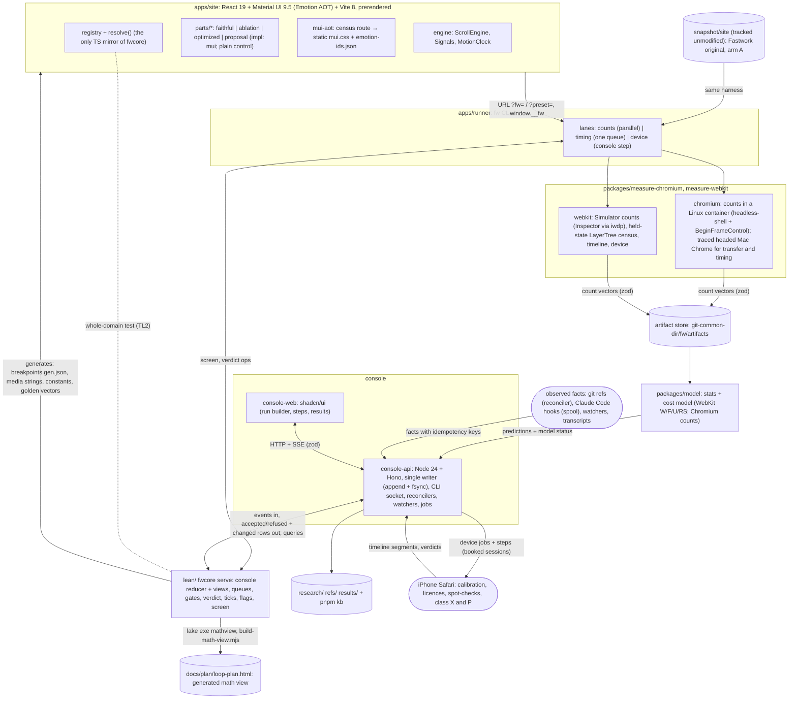
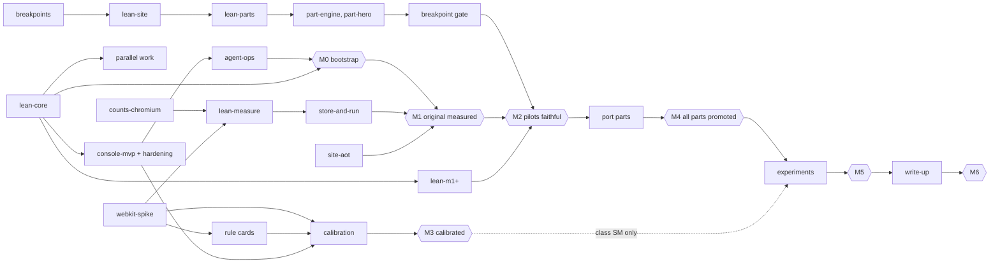

# v2 plan: a measurable, provable loop for the fastwork.com scroll experiment

This is the design for you to review. It merges the kickoff notes, cited as `[01]` to `[09]` with section numbers.
`[08]` is the forensics of v1's raw chat history (§2.3). `[09]` is the MUI zero-runtime study,
`research/kickoff/09-mui-zero-runtime/README.md`, and its sub-notes are cited as `[09.01]` to `[09.04]`. `[10]` is the
automation-and-proof study, `research/kickoff/10-automation-and-proof/README.md`, with sub-notes `[10.01]` to
`[10.04]`. `[11]` is the breakpoint inventory, `research/kickoff/11-breakpoints/README.md`. It also merges the
feasibility review, cited as `[FR]` (`research/notes/2026/10-17-v2-plan-feasibility-review.md`), and the device setup
note `[ENV]` (`research/notes/env-setup.md`). Where the notes disagree, Appendix A says which way this plan goes and
why. Appendix D logs every change. **Revision 4 applies your four decisions of 2026-10-17; revision 5 applies your
three requirements of the same day: nobody hand-writes console state, Lean wherever it can prove something, and math
you can read (§12.0). Revision 6 catches the plan up with about 105 commits (the catch-up log `[CU]`,
`docs/team/improvements/2026-10-17.md`): the repo is public with CI, the console core and the breakpoint gate run,
and the first measurements changed the M0 gate (§10.2).** Only the two open parts of Q1 remain, needed before the
first phone session. Work runs as a dependency graph, not a calendar (§10).

**Status words.** CONFIRMED = a note cites a source, doc or v1 record for it, or it was checked on this Mac today.
INFERRED = a design choice or expectation that a spike or measurement must still check. MEASURED = a number from a
run in this repo, with its commit. Targets and thresholds are proposals until you accept them.

## Glossary of labels (each prefix is used for one thing only)

| Label | Means | Where |
|---|---|---|
| **Q1 … Q33** | questions and defaults for you (Q2-Q4, Q12, Q16, Q22-Q24 and most of Q1 are answered; see §12.0); Q22-Q30 added in rev 5, Q31-Q33 in rev 6 | §12 |
| **M0 … M6** | milestone gates (exit states, not dates) | §10.2 |
| **G1 … G4** | outcome goals | §1.1 |
| **V-a … V-t** | method (validation) criteria | §1.2 |
| **TL0 … TL5** | test layers | §5.4 |
| **PL0 … PL6** | parity levels (rewrite vs original) | §6.6 |
| **N0 … N5** | styling-neutrality checks | §6.7 |
| **S1 … S13** | styling rules inside parts | §6.5 |
| **class W / SM / X / P** | landing classes: less **W**ork, **SM**oothness or mixed, device-only (**X**), **P**roposal | §9.2 |
| **SPK-a … SPK-u** | spikes (short experiments that answer one question) | Appendix B |
| **L1 / L1-cond / L2 / L3** | proof levels: proved in Lean; proved but with a named unprovable premise; Lean spec with Lean-generated code or golden vectors for TS; not provable | §5.1 |
| **tier T0 … T3** | v1's pixel-difference tiers | §6.6 |
| **K1 … K10** | calibration fixture pages: K1-K9 WebKit [04 §9]; K10 sheet mutation, both engines [09.03 §5.2] | §4.4 |
| **R1 … R32** | risks | §11 |
| stages | question → build → screen → review → (device) → land, always written as words; derived from evidence events, never set by hand (§9.2) | §9 |

## 0. The plan in one page

**v1's result, and why v2 is different.** v1 reached its goal: slow frames in your swipe fell from 20.1 % to 1.7 %,
and the end-of-page longest frame fell from 584 ms to 42 ms. It cost 10 days, 442 started agents (848 transcripts)
and about $11.4k at list price, recomputed per request (v1's own readout scaled to about $13.5k) [01 §0, 08 §3]. 231
of its 276 incidents were filed against its own tools, 45 of them feature requests rather than failures [01 §1,
08 §4]. Your three pain points all show in v1's data. v2 answers each one structurally:

| Pain point | v1 evidence | v2 answer |
|---|---|---|
| 1. The phone was needed for every measurement | ~111 of 276 incidents involve the iPhone or Simulator driver; phone blocks took 12-35 min plus cooling [01 §B.1] | **Two-speed loop.** The inner loop is deterministic engine **work counts** (Chromium headless-shell in a Linux container, and WebKit on the iOS Simulator) feeding a **cost model** that is calibrated on the phone. The phone becomes a scheduled outer loop (§4) |
| 2. Patching the minified Svelte build was slow | Retrospective cause C6; ~349 commits on the end-of-page line [01 §B.1] | **React rewrite as pluggable parts.** Each part has a `faithful` variant that copies the original's look and, for the parts we experiment on, its per-frame engine work, plus ablation, optimized and proposal variants picked by flags (§6) |
| 3. A coupled, bug-prone loop; every tool change re-ran everything | Full suite 250-280 s on every tooling commit; `lock.mjs` grew to 1,685 lines [01 §B.1, 06 §1] | **A proved core with a thin IO shell.** Every decision, queue and status view that can be proved lives in one Lean 4 project (`fwcore`), run as a long-lived process: the console reducer, the phone queue, the gates, the verdict, flags, screening and frame ticks (Lean-first, §5.1). TypeScript moves data. Tools are plugins. Results are content-addressed, so changing a tool re-runs only that tool's tests and artifacts. An explicit MVP tier keeps the tooling small (§3, §5) |

**What the chat history adds** (§2.3, [08]): v1's agents did their work well; the loop around them did not. v2 fixes
that with scripts, events and hooks, not with more agents or rules (§8.5). **Nobody writes status** (rev 5): in v1,
10.9 % of tool turns were console upkeep [10.01]; now every console view is a formula over one event log that only
console-api writes. **Lean first, and you read math, not Lean** (rev 5): everything reproducible is proved before it
is coded (§3.3), and every theorem carries its math on a generated page (§5.3).

**What to expect, plainly** (so you can judge pain points 1 and 2 with the right expectations):
- **The phone does not go away.** Before the model may stand in for the phone for one kind of change, it needs a
  calibration session and 5 of 5 blind swipe verdicts that agree with it. Expect **about 5-10 phone sessions before
  the first kind of change is licensed** (INFERRED [FR §1.8]). Changes that only the phone can see (backdrop/filter,
  toolbar, first-touch layer builds: class X) and look changes (class P) always need the phone. After that, phone use
  drops to calibration every 14 days or on a version change, plus one blind spot-check per 5 landings. That is far
  below v1, but it is not zero.
- **MUI everywhere, styles compiled ahead of time (decided 2026-10-17).** Material UI 9.5's Emotion styles are
  rendered at build time into one static CSS file, so no style is inserted after first paint ("Emotion AOT", §6.5).
  Pigment CSS is a paused alpha and only a fallback (CONFIRMED [09.01, 09.04]). A neutrality gate (§6.7) checks that
  MUI adds no sheet mutations, DOM writes, React commits or work counts against a plain twin.
- **Chromium is a development aid; the iPhone is the target.** The Chromium counts lane is fast and deterministic,
  but Chromium cannot predict iPhone Safari, so the cost model is calibrated for WebKit first (§4.4, Q8). There is
  no Android phone (decided 2026-10-17): the Android emulator gives Chrome-for-Android counts only, never timing.
- **Lean costs more up front:** the estimate was about 20 modules and $700-1,100 of Lean work (INFERRED [10.03 §7.1]);
  by 28b18ee `lean/Fw` holds 37 modules and 490 declarations went through math review round 5 (MEASURED). A module
  that costs much and catches nothing moves back to TypeScript (§5.1).

**Since revision 5 (rev 6, [CU]).** The repo is public under MIT with the Fastwork snapshot tracked unmodified, and
four GitHub Actions workflows run on pushes to `ci/**` and `main` (§5.4, §7.3). The console core runs on the Lean reducer through
`fwcore serve`, with hooks, `fw land` and a git reconciler (§3.2). All four pilot parts pass the PL0-PL2 cells of the
breakpoint gate in both engines; PL2b, PL3, the Simulator check and live flips are still to build (§6.6). The first count runs showed that whole count files are never byte-identical, so the M0 gate
now asks for per-type classes instead (§1.2 V-i, §10.2).

**Headline goal.** Rebuild the page and reproduce v1's outcome on the phone as flag arms, with a fraction of v1's
device time, tool bugs and elapsed time; cost reported, not capped; every claimed speed-up checked by your finger (§1).

**Order of work: a dependency graph, no calendar (decided 2026-10-17).** Workstreams start as soon as their inputs
exist (live status in the console). Milestones M0-M6 are gates: M1 the **original** measured in both engines, M2
three pilot parts, M3 the WebKit model calibrated, M4 all parts promoted, M5 experiments, M6 write-up (§10).

## 1. Goals and success criteria

Each criterion has a measurement and an owner. "Proposal" thresholds become binding once you accept them (Q9).

### 1.1 Outcome goals

| # | Goal | Metric | Target | Checked by |
|---|---|---|---|---|
| G1 | v2 reproduces v1's effect | On the iPhone in your swipe, the `original` preset is within v1's A/A band of the original site, and the `v2-best` preset is at or below v1's g0.0m | slow frames (> 34 ms) ≤ 1.7 %; end-of-page longest frame ≤ 42 ms; frames > 50 ms per 100 moving frames in the finger's zone no worse than g0.0m | phone block + blind A/B (§4.6) |
| G2 | Fewer device blocks, less device chore work for you | phone sessions, device incidents, chore steps per session | ≤ 10 phone sessions up to the first licensed class (INFERRED estimate 5-10); afterwards ≤ 1 block per landed class SM change and calibration ≤ 1 session per 14 days; device-driver incidents ≤ 10 % of incidents (v1: ~40 %); **≤ 1 get-ready step and 0 reactive chore steps per phone session** (v1: 82-105 of 166 steps were chores [08]) | console step log, bug ledger |
| G3 | Speed first, cost reported (decided 2026-10-17) | time to each gate (from git history); list-price dollars per milestone, role and day; Opus share; cold-wake share | **no hard caps or stop rules**. No dates are planned (§10); time to each gate is reported. Cost is reported daily against the §8.4 forecast. Soft alerts at 1.5× a milestone's forecast and at 60 % / 80 % of the weekly usage limit raise a one-line note, not a stop. Report the total against v1's $11.4k at M6 | `pnpm fw usage` [07 §8] |
| G4 | Write-up material | every landed experiment card has a plain one-paragraph summary and a reproducible clip or chart reference; cleanup never deletes listed evidence | all landed cards (v1: 74 of your messages were about evidence and the article [08]) | `kb lint`; M6 review |

### 1.2 Method goals

| # | Goal | Metric | Target (proposal) | Source |
|---|---|---|---|---|
| V-a | **Count transfer: Chromium** | container (Linux headless-shell) counts vs counts from a traced, non-timed headed Mac Chrome run, per count family | equal per family, or the family is marked "container-only" and never feeds a fitted coefficient | [FR §1.6] |
| V-b | **Count transfer: WebKit** | Simulator count equals phone count at the same held state | ≥ 95 % of states, per count type; failing types are marked "not transferable" | [04 §9] |
| V-c | **Ranking** | Spearman ρ, predicted vs measured cost per variant (holdout) | ρ ≥ 0.8 on the iPhone. Chromium: not scored, since there is no Android phone (Q1, Q8) | [03 §9.3, 04 §9] |
| V-d | **Decision agreement** | sign of predicted Δ vs measured Δ, where the prediction exceeds the noise band | ≥ 90 %, and 0 sign errors among "large" predictions | [03 §9.3, 04 §9] |
| V-e | **Magnitude** | median abs(log(pred/meas)) | ≤ 0.3. If missed, the model is "ranks only" and may not size a change | [04 §9] |
| V-f | **Feel agreement** | blind verdicts with predictions frozen first | 5 of 5, no sign disagreement, before the model can stand in for the device for a change class | v1 `stats-vs-finger.md` via [03 §9.3] |
| V-g | **Visual parity** of each `faithful` part | v1 tiers against a same-run original-vs-original (A/A) baseline | tier **T1** at PL0-PL3 (all parts) and PL4 (experiment parts) in Chromium and Playwright WebKit **at every breakpoint edge of the original** (§6.6; the core viewport matrix per PR); element boxes ≤ 0.5 CSS px; one Simulator check at 430×775 DPR 3 | [02 §4]; your requirement of 2026-10-17 |
| V-h | **Work parity** of each experiment part | PL5 bands per count family (§6.6) | within the band for every family; layers ±0; same compositor/main-thread split | [02 §4.6, FR §2] |
| V-i | **Determinism, per count type** (re-scoped in rev 6) | repeated counts-lane runs (`Fw/Measure/Classes`. Chromium: stable = at most kMax = 4 frames differ and run totals differ by at most tMax = 24 count units, p = (4, 24), 3 runs; WebKit: per-cell `absTol`/`relTol`, 2 passes in each of 2 boots) | each count type classified *deterministic* (equal in every run), *stable* (within a stated tolerance) or *quarantined* (never used). Whole files are never byte-identical (thread ids, GC, async work; MEASURED 70c3370), so the gate is per type. Chromium: every type used for screening is deterministic. WebKit: the deterministic set covers what the K1-K9 fixtures need; per-step Layout/Paint are quarantined, totals hold within 3-5 % (MEASURED 367fec2) | [03 §7.1, 04 §8.5], [CU] |
| V-j | **Time to adopt a tool** | new measurement plugin → first cached artifact | ≤ 1 agent-day; tests run = that plugin + `contracts` only; 0 other artifacts invalidated (shown by `fw run --dry`) | [06 §3] |
| V-k | **Test speed** | pre-commit gate; TL1 whole repo | pre-commit ≤ 30 s (affected packages); TL1 < 20 s cold | [06 §3.4] |
| V-l | **Bug ledger, per module** (replaces "share of logic proved") | every entry has `kind: request \| incident`, `module`, `level: L1 \| L1-cond \| L2 \| L3` and `caughtBy: proof \| build-mutant \| property-test \| adapter-test \| replay-monitor \| user \| escaped` | complete ledger; it drives the per-module demotion rule (§5.1), counting incidents only (v1 filed 45 requests as incidents [08]) | [FR §3.1], [10.03 §7.2] |
| V-m | **Bugs in proved areas** | logic incidents in any L1 module (the console reducer and views, queues, gates, verdict, flags, screening, ticks …) | 0 escaped logic incidents (adapter and L3-premise bugs are counted separately) | bug ledger |
| V-n | **Harness neutrality** | on fixtures, frame-stepped counts vs free-running counts, per family | equal per family; a family that fails is not used for screening in that engine. Compositor-only animations still cost 1 `UpdateLayoutTree` per frame in Chromium (Paint, Layout and commit are 0; MEASURED 70c3370), so "0 style work" is never the expected value | [FR §1.2], [CU] |
| V-o | **Timing parity** (PL6) | Mac Chrome per-stage time, rewrite vs original | rewrite within the original's A/A band (ABBA, n ≥ 4) per stage; plus one Simulator and one phone whole-page check at M4 | [FR §2] |
| V-p | **Transfer to the original** | the same change as an overlay on the original, in the counts lane | same sign of Δ per stage as on the rewrite, for every landing whose change can be overlaid | [FR §2] |
| V-q | **Styling neutrality** of MUI | N0-N5 (§6.7): N0/N1 in every counts run (all parts); N2/N3 on experiment parts (they need the `impl: plain` twin); N4 once per build; N5 per build at hydration | sheet mutations 0 after hydration; DOM-write and commit census and work counts equal to `impl: plain`; style shape within ±10 % of arm A (or a K-fixture parameter); 0 hydration diffs | [09.03 §2] |
| V-r | **Mutant kill rate** | each L1 module ships v1 bugs put back on purpose (`FwTest/Mutants/<module>/*.patch`: I-091, I-113, I-145, I-059, I-185, I-011 incl. head-of-line blocking, I-041, plus design mutants) | 100 % make `lake build` fail; a surviving mutant means the theorem has no teeth and blocks the module's next land | [10.03 §7.2] |
| V-s | **Math sign-off** | every `Fw` theorem and every definition marked user-facing has docstring math whose deep statement hash equals the signed hash | 0 missing, 0 stale, 0 unsigned at land; disagreements between the reviewer's own math and the docstring are counted and reported | [10.04 §2.3] |
| V-t | **No hand-written status** | console fields an agent can set directly; a replay of v1's status history through the v2 reducer | 0 directly settable fields (every agent input is a typed, refusable event in the §8.5 catalogue); the replay reports the share of v1 hand states that contradicted git or the steps at the time | [10.02 §6.5] |

## 2. What we keep and what we drop from v1

### 2.1 Keep (each with its v2 form)

| Keep | Why (v1 evidence) | v2 form |
|---|---|---|
| Frozen, hash-pinned baseline | The pin changed only twice, both on purpose [01 §B.2] | `snapshot.lock.json` pins the original; each rewrite build is pinned by commit + flag vector + `servedHash` |
| One change per arm | Overlays gave clean A/B arms | Overlays become **flag arms**; never bundle fixes in one arm (bundled builds hid causes) |
| A/A noise floor; "better" only with disjoint ranges; ±4 ms twins | g0.0l vs g0.0m was correctly called level [01 §B.2] | The landing verdict is **4 vs 4** runs with disjoint ranges (or v1's sequential ABBA rule). Its false-win rate under the null is at most 1/C(8,4) = 1/70 (exactly 1/70 when ties have probability 0), to prove in M0 (planned), and comparisons are counted per experiment (§5.1) |
| Prediction cards before data | 17 or more flagged prediction misses in 153 rows | The question card carries a pre-registered predicted Δ per stage and zone (§9) |
| Claim status words, engine-build applicability, "read source first" | Claim C1 (`layerPainted`) reached you as fact on two probes [01 §B.2] | Rule cards in `refs/rules/` with file:line@commit, status (incl. WEAKENED), builds [04 §11] |
| Pixel tiers T0-T3, screencast capture, frozen frames | False 0 % passes after a scroll (P14) | Parity levels PL0-PL6 (§6.6) |
| Element ablation with a fairness check | Showed end-of-page backgrounds cost a median 16 → 3 slow frames [02 §2.6] | Generated ablation variants per part (§6.2) |
| The validated feel metric: frames > 50 ms per 100 moving frames in the finger's zone | The only metric that agreed with you 7 of 7 [01 §A.4] | Primary device metric (§4.6) |
| Less-work landing rule | Gates sized to risk | Landing class W, now per-frame and over a declared-complete vector (§9.2) |
| Proposals with Try-it pages; blind swipe A/B; comment on anything | Look changes are your call; your thumb caught what Chrome missed. 41 proposals, median 10 min to your decision; 94 of 198 of your threads came from comment buttons [08] | The console Proposals view (shadcn); Try-it, comment-on-any-row and a preset gallery on Wi-Fi are M1 features; a second iPhone for free play (Q1) |
| Your coaching, as rules with enforcers | You re-taught the same management behaviour on 11 days; the lead said its role file never told it [08] | From the start, in the lead file and `CLAUDE.md`: the issue loop (cause from data, workaround, long-term fix with an owner), proactive by default, trace before asking, the answer format; each names its enforcer and is re-injected after compaction (§8.5) |
| Named spawns `<role>-<topic>`; one worktree per editor; one lander; ff-only | 0 merge commits in 2,483 [01 §B.2] | Same; the one lander is the lead, through `fw land` (ff-only, after the reducer accepts; §8.2), with a land-time gate [06 §6] |
| Quiet-host gate and contamination flag for timing runs | One overloaded evening voided all 9 A/Bs | Kept, for the **timing lane only**; the counts lane needs no lock |

### 2.2 Drop (each with what replaces it)

| Drop | Evidence | Replacement |
|---|---|---|
| A device run for every measurement | ~111 device incidents; 19 end-of-page phone blocks for 5 passes [01 §B.1] | Counts lane + WebKit cost model + validity table (§4) |
| Patching a minified bundle | Cause C6; a replace-all broke six SVG circles unseen [01 §B.1] | React parts with flags (§6) |
| The 6x CPU throttle as the model | One scalar, super-linear (6x costs 7.8x), GPU untouched, fitted on the unfixed page [03 §11] | Per-stage, per-count coefficients per device, with a page factor `ρ_page` [03 §9, FR §1.7] |
| A full test suite on every tooling commit | 250-280 s; ~22 h of serial suite time [01 §B.1] | `vitest --changed` per affected package; TL0-TL5 layers [06 §3.4] |
| Real time and the real host in tests | 75 of 143 s were sleeps [06 §1]; 44 flaky-test incidents and 14 port, process and temp-dir collisions on the shared host [08] | Clock port; a lint bans timers in the pure zone and real load, fixed ports, process-name matching and shared temp folders in tests; engine e2e tests run outside pre-commit; scratch paths per agent |
| Side effects at import; 8-24 copies of one parser; two different medians | [01 §B.1, 06 §1] | Pure zone enforced by a lint; one `model` package for stats |
| Many writers to many JSON stores; agents writing board state | 575 board writes a day; 8 stale-board incidents [01 §B.3] | One writer (console-api), one append-only event log, status as a projection computed by the Lean reducer. Agents have no write path to it (sandbox write-deny and deny rules on the gitignored `.fw-console/`, §8.3) and no command that sets a status field; their only inputs are typed, refusable requests (§8.5). v1: 10.9 % of all tool turns were console upkeep; 56 % of status writes were derivable [10.01] |
| A 9.7k-word rulebook loaded by every agent | ~8 % of all cache reads [01 §B.3] | Root `CLAUDE.md` under 300 words at the start, never above 1,500; each rule names its enforcer |
| Opus everywhere; the lead as router; 160 agents in 29 h; recurring check prompts | Opus ~97 %; 3,761 cron fires were 42 % of the lead's turns and 35 % of its dollars; the lead was first responder on 773 of 985 of your console messages [01 §C, 08] | Small roster, a model ladder with Opus where it speeds the work, a lead that decides and does not route, no LLM polling, scripts for checks and gates (§8.5) |
| Routing agents (mgmt-ops ×10, desks, clerk, devices, ops-readers) | 47 agents, $847; 47 % of their messages to the lead were land requests; 22 % of workers' consecutive instructions switched between two bosses [08] | `fwcore` decisions over `events.jsonl`: queue order, land queue, device dispatch, digests, card pre-data reads (§8.5) |
| Agents holding device leases; hand-moved queues | 40 scheduler incidents (median fix 2.2 h); ≈ 230 lead hand moves; 264 order-request messages [08] | A device job queue in console-api; priority is a proved Lean function of your list (§3.3, §4.1) |
| Shared ledger files that many agents edit | `ops-handover.md` 569 commits, `PREDICTIONS.md` 378; 94 `rebase --continue` [08] | Predictions in each `card.md`, handovers in per-agent notes, the board as a projection (§7.1) |
| Multi-step inline shell in worktree agents | 3,046 isolation refusals, 57 % of all v1 errors [08] | Committed `pnpm fw` verbs; one plain command per Bash call (§8.2) |
| Hand-built lock code (1,685 lines) | ~39-89 lock incidents depending on the count [01 §B.5, 05 §3] | No lock in the counts lane; one in-process queue in console-api for the timing lane. Many lock incidents were cross-process races that a single writer removes (INFERRED [FR §3.1]) |
| An 842-line git-guard hook | The guard drew its own incidents | git config + deny rules + a land-time path check in `fw gate`; one small spawn-guard hook (§8.3) |

**Rule for every new tool, hook or package:** it names the v1 incident class it prevents, or it waits until
something fails without it. An **enforcer** (alarm, lint, status board) reads only events, never agent self-reports,
ships with false-positive and false-negative golden tests, and reaches ≥ 90 % precision on a log replay before any
alarm reaches you (v1: 61 of 80 lead-made threads were alarms [08]). A new *agent* rule must cite an agent-mistake
incident; otherwise fix the tool (v1: 4 agent-mistake incidents against 139 tooling ones [08]).

### 2.3 What the chat history showed

[08] read v1's 848 raw transcripts (135k model requests): **a star, not a team** (64 % of 12,582 messages touched
the lead, which compacted 125 times); **woken by polls** (42 % of the lead's turns were cron fires); **home-made
coordination broke more than agents did** (139 tooling incidents against 4 agent mistakes; 57 % of errors were
worktree refusals of inline shell); **you were device technician and status bus** (82-105 of 166 steps were chores).
What worked: steps, Try-it proposals, comment buttons, fast replies, short fresh agents, one lander, ff-only.

## 3. Architecture

### 3.1 Overview



### 3.2 Modules and their narrow contracts

Rule: a module talks to another only through the contract in this table. Each contract is a zod schema in
`packages/contracts`, exported to JSON Schema and, where Lean reasons about it, mirrored in Lean with golden
fixtures [06 §2.5, 05 §6].

| From → to | Contract | Notes |
|---|---|---|
| runner → site | URL `?fw=part:variant,…`, `?impl=part:plain,…`, `?preset=<id>`, `seed`, `t0`, `rm`; page exposes `window.__fw = {config, configHash, scroll, clock, hydrated, styleMisses, markMeasureStart}` and `<meta name="fw-config">` | The same harness drives arm A (original) by injecting an equivalent `__fw.scroll`; `markMeasureStart()` is refused before `hydrated` [02 §3.5, 09.03 §2] |
| site build → runner | Vite `manifest.json` → `servedHash` per route | Edits to part X change the keys only of routes that serve X [06 §3.1] |
| runner → plugin | `MeasurePlugin {id, semantics, lane, input, output, run, reduce}` | count reduction runs in `fwcore` (§3.3); the plugin's TS keeps only I/O, or passes Lean golden vectors; an output that fails its schema is an incident, never a result [06 §2.4] |
| plugin → artifact store | key = `sha256(canonical JSON of {subject, tool{plugin,semantics}, engine{build,flags}, profile, protocol})` (sorted keys; full JCS later if needed) | Counts artifacts are reused; timing artifacts append samples [06 §3.1] |
| artifact store → model | count vector per (frame, part, zone) + coefficient set `(device, engine build, thermal class, ρ_page)` → `{stage p50/p90, missed vsyncs, status: uncalibrated | ranks-only | sizes}` | Pure; applied at report time, so a refit re-runs no measurement [06 §3.3] |
| TS → fwcore | `fwcore serve` is long-lived and **stateful**: it holds the reducer state, the queues and the gates. Ops: `console.apply` (one event → accepted \| refused(reason) + changed rows), `console.replay`, `console.query` (rows, steps, queues, plan), `console.reset`, `measure.*`, `ops.spawn/pathCheck/usage/meter/hook`, plus stateless decisions (`verdict`, `ticks`, `twins`, `flags.resolve`, `flags.enumerate`, `screen`, `samples`); `ops.admit` and `metrics.*` are next (§10.1) | Built in `Fw/Serve` (14152f1). Through console-api: apply round trip p50 40 µs, p90 100 µs; a query 40 ms; a 100,008-event replay 0.4 s against 36 s for the old list reducer (MEASURED [CU]). The state loop uses `modifyGet` (a get-then-set copy was 66× slower, MEASURED). **Hardening below** |
| console-web → console-api | typed HTTP + SSE; zod schemas shared from `contracts` | The UI never decides. **Previews always call console-api (and so `fwcore`)**, so the site resolver stays the only mirror |
| agent → device lane | job card `{kind, card, priority class}`; agents never hold the phone; long runs live in console-api, never in an agent's shell | v1: 40 scheduler incidents; runners died with their agent (I-221, I-240, I-256) [08] |
| console-api → status and steps | each status row is **computed, never written**: stage (from evidence keyed by commit), owner (whose move, by stage), next action (the exact next command or button), ETA (queue position × median duration, sample count shown), age and staleness (λ frozen at stage entry; a row with a live wait is never stale), and `needs-you: yes/no + the exact action` (an open step, proposal, decision, permission prompt or landing violation). Every cell has a "why" popover listing the events behind it. A step is shown only after a script checks it is ready, and has a retry | v1: 25 "what does this mean" asks, rows saying "waiting on you" with nothing to do [08]; 4,412 hand-written status entries [10.01] |
| agent → console-api | `pnpm fw <verb>` sends one typed request to `.fw-console/run/cli.sock`; a synchronous PreToolUse hook on `pnpm fw *` appends a single-use capability `HMAC(secret, agent_type ‖ tool_use_id ‖ sha256(cmd))`; console-api verifies it and stamps `actor` and `signedBy`; the reducer accepts or refuses; `fw` prints the outcome and exits non-zero on refusal | The socket never produces `user`, `script` or `git`. A request without a valid, unused capability is refused [10.02 §6.4] |
| observers → console-api | facts with an idempotency key built from fields the hook and the reconciler both see; Claude Code hooks write a spool file synchronously (< 100 ms, no stdout); git facts come only from console-api's ref reconciler; transcript usage is an upsert (last record per `message.id` wins); device states are keyed by transition | A key is marked seen only when its event is accepted, so a fact that arrived early is applied on re-send [10.02 §6.2] |
| any client → console-api | every request carries `contractsVersion`; a mismatch is refused with "rebase" | v1: worktrees on old tool code misread shared state (I-010, I-011, I-041, I-102) |
| everything → knowledge store | one frontmatter schema; `pnpm kb index | find | lint` | §7.2 |

**Hardening the TS ↔ `fwcore` glue** (each item is CONFIRMED as a real failure path in [FR §3.2]):
1. **Request ids.** `fwcore` echoes each request's `id` and replies to **every** line, a blank one included (the
   sketch skips it: `05-lean-sketch/Main.lean` l.7-10); a reply whose id does not match the oldest outstanding
   request kills the child and fails the call.
2. **Timeout and restart.** A per-call timeout (built as 10 s per call and 120 s per replay chunk, eacb660); on timeout or exit the client restarts `fwcore`, fails
   the outstanding calls (never a silent retry), and `fwcore serve` rebuilds its state from the log.
3. **Panics abort.** Always spawned with `LEAN_ABORT_ON_PANIC=1`, because a Lean panic otherwise returns a default
   value (lean4 v4.35.0 `src/runtime/object.cpp` l.76-82). Any stderr output is logged as an incident.
4. **No partial operations in the glue.** A grep gate fails the build on `get!`, `head!`, `[i]!`, `panic!` in
   `Fw/Wire.lean` and `Main.lean`.
5. **Numbers.** Counts cross as `Nat`, times as integer **ns**, fitted coefficients as `Rat` with the wire form
   `{"num":"<int>","den":"<positive int>"}` and golden round-trip tests. Never `Float`.

### 3.3 Where each decision runs (one place only)

- **Lean first for everything reproducible (your direction, 2026-10-17; `CLAUDE.md`).** Every pure piece of the
  console, the site, measurement and tooling (decisions, reducers, gates, breakpoint conditions, flag rules, motion
  curves, count reduction, verdicts, test matrices) is specified and proved in Lean **before** it is coded. Then
  (a) it runs in `fwcore`; or (b) Lean generates it (constants, CSS media strings, JSON such as
  `breakpoints.gen.json`, test matrices); or (c) the TS/React code must pass Lean-generated golden vectors. Only I/O,
  rendering and glue stay unproved, and they hold no decision. A TS stand-in is temporary and listed in the report.
- **Code that must run in the browser or stay in TS** (L2): media strings, motion curves, part logic, the flag
  resolver and the console's remaining TS stand-ins (§10.1, console M0 hardening) are generated by Lean or checked against Lean golden vectors. The
  flag resolver's TL2 test covers **every** single-part override of every preset (`fwcore flags.enumerate`; a finite
  domain, so as strong as a proof for that registry version), plus 2,000 fast-check multi-part cases [10.03 §2.10].
- **Bookkeeping too:** the console reducer and views, the queues, `fw plan`, cache prune, the path check, spawn-guard
  and usage dedupe are L1 modules (§5.1); v1 failed exactly there (hand-kept board, scheduler) [10.03 §1].
- **Priority is data you own.** One ordered list (`presets/priority.json`, or dragged in the console). Both queues read
  it through one proved Lean function of the list, the job class (user step > calibration > class X/P > spot-check)
  and the waiting time (aging, Q27); it starts the most urgent job **that fits** the booked window (no head-of-line
  blocking [10.03 §5]). Agents never set priority; a manual move is an event with a reason (v1: ≈ 230 hand moves [08]).
- **Numbers that are fitted, not decided** (coefficients) live in TS (`packages/model`). Lean proves the **screening
  rule** for the deployed model (§4.3), and an L1 checker accepts the coefficients (non-negative, exact fractions)
  before use [10.03, item cm.5].

### 3.4 MVP tier and later tier

| | MVP (built in M0-M2) | Later (only when a named failure needs it) |
|---|---|---|
| apps | `site`, `runner` (`fw`), `console-web`, `console-api` | — |
| packages | `contracts`, `measure-chromium`, `measure-webkit`, `model` (stats + cost model), `kb`, `fwcore-client` | split `measure-sdk`; separate `artifact-store`, `usage` packages; `core` |
| console storage | `.fw-console/` in the main checkout (gitignored; console-api is its only writer): `events.jsonl` (append + fsync, then apply) + snapshots, spool, CLI socket, secrets; the projection lives in `fwcore serve`; one run queue and one device job queue (Lean); reconcilers (git refs, spool, artifacts, transcripts) and three watchers (device, stall, notice coalescer, §8.5); daily exports to `results/console/` | SQLite read model (if queries get slow). The device lease is no longer "later": it is an M1 Lean module (§5.1, Q26) |
| Lean | Lean-first, by milestone (§5.1): `Fw/Site` and `Fw/Parts` (site breakpoints, pilot-part specs and goldens) from the start; M0 console core (reducer, authority, steps, needs-you, landing rule), phone queue, spawn-guard, path check, usage meter, budget, JSON decoders, Frames, Verdict; M1-M3 the rest of the L1 inventory | only what an incident or a new decision calls for (M5-M6); the optional Mathlib package `FwMath` (§5.2). No engine-rule data in Lean |
| hooks | Built in `apps/runner/hooks/` and installed in `.claude/settings.json` (3e67d48, 6756bb9): one observer emitter `emit.mjs` (spool-only, silent, ~47 ms median, MEASURED 3fe1876) on SessionStart, SubagentStart, SubagentStop, TeammateIdle, PreCompact, PostCompact, StopFailure, Notification, and async on PostToolUse/PostToolUseFailure; the capability hook `cap.mjs` on `PreToolUse(Bash)`; `PreToolUse(Agent)` spawn-guard, in shadow mode (logs, does not block) until its logged decisions are reviewed (§8.3). The `SessionStart` brief is not built yet. Not used: `http` hooks (lose events silently), `WorktreeCreate` (replaces git behaviour), `SessionEnd` as a source of truth (1.5 s timeout) | `TaskCreated`/`TaskCompleted` observers, `SubagentStart` role brief |
| repo tooling | pnpm workspaces, Biome, lefthook (one pre-commit), Vitest | Turborepo, knip, dependency-cruiser, ast-grep rule sets, REUSE.toml, JCS keys |
| knowledge store | 4 kinds (`note`, `decision`, `ref`, `rule`), 5 claim statuses | more kinds if the index needs them |

## 4. Measurement methodology

### 4.1 Three lanes

| Lane | Runs | Determinism | Gives | Never gives |
|---|---|---|---|---|
| **counts** | parallel, no lock. **Chromium:** Playwright's linux-arm64 `chromium-headless-shell` inside a Linux container (Docker Desktop is installed on this Mac, CONFIRMED locally), with BeginFrameControl. **WebKit:** Simulator Mobile Safari (`fw-iphone-27`) through `ios_webkit_debug_proxy`. **Chrome for Android (optional):** Chrome 133 on the Android emulator (AVD `fw-pixel`, DevTools over `adb forward`, CONFIRMED [ENV]) for count checks only, never timing | per count type (V-i): deterministic, stable or quarantined | work per virtual frame, per 100 px, per part and per scroll zone | milliseconds |
| **timing** | one at a time from the console-api queue: headed Mac Chrome with `PipelineReporter` tracing; Simulator Timeline with `Page.enable` first | statistical (ABBA, n ≥ 4) | per-stage ms on this host, for timing parity (PL6) and A/A bands | iPhone ms |
| **device** | iPhone Safari blocks as **jobs in a console-api queue**, run only inside a session window you book. Each session starts with `fw device check` (v1's named trap codes: link, unlock and UI Automation, tabs, proxy), which repairs what it can and then posts **one** get-ready step (usual USB port, unlocked, Auto-Lock Never, UI Automation on, same Wi-Fi, Do Not Disturb, one thermal profile); then the queued blocks run back to back | statistical | the truth for feel; iPhone coefficients; render-server time (Instruments) | anything at scale |

**Why a container.** Chromium refuses BeginFrameControl on macOS (`headless/lib/browser/protocol/target_handler.cc`
l.62-65 @317846d579b2, CONFIRMED [FR §1.1]). The container serves **every font from `snapshot/`** with no system
fallback, because fallback fonts change line breaks and so layout and paint counts (INFERRED). SPK-i ran
(70c3370): BeginFrameControl works in the container, but whole count files were never byte-identical, so V-i is
re-scoped to per-type classes (§1.2). Heavy trace categories are used in the counts lane only (v1 saw −17 fps from one such probe, CONFIRMED [03 §12]).

### 4.2 Step 1: deterministic work counts

**The harness must not change the mechanism it measures** (CONFIRMED [FR §1.2]). Playwright's `page.clock` fakes
`requestAnimationFrame`, so the app's rAF runs outside the rendering steps and loses a frame. Seeking an animation
(`setCurrentTime`) restarts compositor animations in Chromium (`animation.cc` l.576-618 @317846d5) and invalidates
style per animation per step in WebKit (`WebAnimation.cpp` l.587-620 @fba976461fc0). So neither is used in Chromium.

**One virtual frame in Chromium** (both arms):
1. **Driver:** `puppeteer-core` (or raw CDP) creates the target with `Target.createTarget({enableBeginFrameControl:
   true})` in headless-shell started with `--enable-begin-frame-control --run-all-compositor-stages-before-draw
   --disable-new-content-rendering-timeout --disable-checker-imaging --disable-image-animation-resync
   --num-raster-threads=2` (as built, 70c3370; `--deterministic-mode` and `--disable-threaded-animation` were dropped
   there, and 2 raster threads keep CI and the Mac alike).
2. **Clock shim** before any page script: `Date`, timers and `performance.now` from virtual time, the date pinned to
   `2026-10-01T00:00:00+07:00` (before the countdown target 2026-11-02). It **keeps native `requestAnimationFrame`**.
3. Apply the scroll step from a committed profile (the v1 scripted swipe, a fling, slow drags, v1 finger replays).
4. `HeadlessExperimental.beginFrame({frameTimeTicks})`: animations advance **without seeking**, and rAF callbacks
   fire inside the rendering steps as in real life. 5. Read the counter deltas.

**One held state in WebKit.** The Simulator has no BeginFrameControl, so WebKit stepping needs seeking plus "two
rAFs" (native rAF kept), and WebKit counts are classified per count type (V-i). Seek overhead is measured on a
fixture with N accelerated animations (seeked vs free-running) and the affected counts are tagged `harness-induced`.
Compositor status comes only from free-running `LayerTree` censuses. Time box 2 agent-days; the fallback is held-state
censuses plus timeline counts from a real gesture run, with a stated tolerance (*stable*, not *deterministic*).

`Math.random` is seeded (mulberry32); `t0` and the seed are part of the artifact key.

**What the first runs showed (rev 6).** Classes come from `Fw/Measure/Classes`. Chromium: policy p = (4, 24), so stable
means at most kMax = 4 frames differ and run totals differ by at most tMax = 24 count units, over 3 runs. WebKit:
per-cell `absTol`/`relTol`, 2 passes in each of 2 boots (`class-policy.md`).

| Finding | Engine | Source |
|---|---|---|
| Whole count files are never byte-identical (thread ids, GC, async); the deterministic types held under host load1 360-450 | Chromium | 70c3370 |
| Real runs: 28 deterministic, 14 stable, 8 quarantined types; the rewrite under `scrollTo`: all 43 types deterministic except MinorGC | Chromium | ddc91b2, 70c3370 |
| `HitTest` quarantined (touch-event delivery race); the original under touch wedges BeginFrame at the same frame 5 of 5 at low load (load1 ~8), not at ~400; deferred | Chromium | 70c3370 |
| A 10 ms barrier floor (`FW_BARRIER_MIN_MS`) cuts a rewrite run from 45 s to 7 s with identical classes (3 runs) | Chromium | 70c3370 |
| GitHub Linux runners (4 vCPU, 3 runs on separate runners): 33 deterministic, 20 stable, 9 quarantined; the files differ byte-wise, as on the Mac | Chromium | ee18c6b [CU] |
| Per-step Layout, Paint, InvalidateLayout, ObserverCallback quarantined; RecalculateStyles within 1; totals within 3-5 % | WebKit | 367fec2 |
| The first load after a Simulator boot differs (FireAnimationFrame 703-709 vs 729-739), so `--warmup 1` is the default and the Simulator stays booted | WebKit | 367fec2 |
| `RenderingFrame` reads 0 on iOS 27.0 (24A434) and ~60/s on 26.5; to compare with the CI xcode-27 image | WebKit | 367fec2 |
| Host load correlated with counts (r 0.55-0.81, n = 6) but was confounded with pass order; a quiet rerun was clean (INFERRED: load is not the cause) | WebKit | 367fec2 |
| The rewrite's hit-skip cuts RecalculateStyles 164 → 19, but its steps do not align with the original's (74 vs 107), so no Δ is claimed yet | WebKit | 367fec2 |

**What gets counted** (full catalogues in [03 §7.2] and [04 §4.1]):

| Family | Chromium (Blink/cc) | WebKit (Simulator, Inspector protocol) |
|---|---|---|
| **Sheet mutations** (new, rev 4) | page-side census N0 (CSSOM write wrappers + `MutationObserver` on `<style>`/`<link>`); engine side N1: `StyleEngine::updateActiveStyleSheets`, `scheduleInvalidationsForRuleSets`, font-update slices (`blink,blink_style`) | page-side census N0 (always); `CSS.styleSheetAdded/Removed/Changed` events (attribution runs only) |
| Script | rAF callbacks (`FireAnimationFrame`); script ms measured, not modelled | rAF count; script ms through page-side wrappers |
| Style | `UpdateLayoutTree` passes, `elementCount` | `RecalculateStyles` records (**no element count without WKTR**, see below) |
| Layout | passes, forced layouts (with JS stack), `dirtyObjects` | `Layout` records with root (Safari 27 adds the root node) |
| Paint and raster | `Paint` count (**not** area: the clip is the cull rect), raster-invalidation rects × dpr², tiles, paint ops | `Paint` clip area, ΔpaintCount per layer |
| Image decode | `decodedPx` per frame (new component) | `decodedPx` per frame (new component) |
| Layers | layer count, reasons, `drawsContent` | `LayerTree` count, `memory` (backing bytes), 29 reason flags |
| Compositor | `Animation` trace `compositeFailed` bitmask per animation (free-running only) | active accelerated animations × requested rate (80-120 Hz each, [04 §2.3]) as a component; layer reason `animation` from the free-running census |
| Frame outcome | `PipelineReporter` states (timing lane only) | `RenderingFrame` segments (timing lane only) |

Tile and raster counts in the container use software raster; headed Mac Chrome uses GPU raster with different tile
geometry (INFERRED [FR §1.6]). V-a compares them per family before any of them is used.

**Why sheet mutations are a family of their own.** In the [09.04] spike, inserting 100 CSS rules during the scroll
left every planned count unchanged; only style-recalc time differed (20-24 vs 8-10 ms, CONFIRMED, Chrome 155). One
insertion costs a full-document style rebuild in WebKit (`StyleScope.cpp` l.585-619 @77db40e2fa70) and, with
`@layer`, a rule-data rebuild in Blink (path CONFIRMED, cost INFERRED [09.03 §1]). The original reads 0 after load
(SPK-q). The family is in every declared-complete vector (§4.3); K10 prices it.

**WebKit element counts (decided now, Q10).** WebKit's largest model term is the restyled-element count, and Phase A
does not have it; v1's WebKit costs were dominated by restyle (custom-property restyle 2.2×, presence-flip layouts;
v1 `research/cpu-throttle-calibration/README.md` l.39). So, from M1:
- until a WKTR count exists, the WebKit model is at most `ranks-only` for style-affecting changes, and **class W is
  barred for any diff that touches selectors, classes or custom properties**;
- the 1-day WKTR spike runs on a rented cloud Mac at the start of M3: it needs about 120 GB free, and this Mac has
  16 GB RAM and had 38 GB free at 367fec2 (MEASURED [CU]); v1's cleanest less-work landings were CSS-only diffs [08], so if M1 ends early it moves up.

### 4.3 Step 2: the cost models

Both models are **monotone in counts with non-negative coefficients**, so removing work can never raise a
prediction. Lean proves that for the model as deployed (§5).

- **WebKit (the target)** [04 §7]: `W = J + Σ c·counts` (WebContent main thread);
  `F = max(s²·Ap/R_cg, Bn/R_alloc)` (GPU-process raster wait; the draft's `− overlap` term broke monotonicity and is
  replaced by `max`, [FR §1.4]); `U = c_ui·Nc` (UI-process apply); `dt ≈ max(T_req, W + F + U + δ)` with
  `T_req` = 16.67 ms (60 Hz page rendering, CONFIRMED in source); a separate render-server term `RS`, priced only by
  Instruments on the phone, with "active accelerated animations × requested rate" as its count. Seeds from v1, such
  as about 0.14 ms per repainted layer, are priors only.
- **Chromium (development aid)** [03 §9]: `T_s(f) = κ_s + Σ_j c_{s,j} · x_{s,j}(f)` per stage, checked against the
  scheduler's budget inequalities B1-B4, `k = max(1, ⌈T/I⌉)` vsyncs per frame. Used for mechanism and screening.
  Coefficients are not fitted: there is no Android phone (Q1, Q8). Near the B1 boundary the scheduler can switch
  mode, so a screen result there is reported as "mixed" (INFERRED [FR §1.3]).
- **Page factor.** Per-unit cost depends on the page (v1: custom-property restyle at 2.2× the blank-page cost,
  CONFIRMED, v1 `research/cpu-throttle-calibration/README.md` l.39). The fit is `T = θ_run · ρ_page · (κ + c·x)`, with
  `ρ_page` estimated on arm A in M3; until then fixture-only predictions are `uncalibrated`.
- **Fits are constrained to `c ≥ 0`**, including the τ = 0.9 quantile fit, and checked by the L1 certificate (§3.3).
- **Model status per output:** `uncalibrated` → `ranks-only` (passes V-c and V-d) → `sizes` (also passes V-e),
  per (engine, device, browser build, output).

**Screening without coefficients (class W).** If a variant's count vector is ≤ the baseline's **in every component
and in every frame**, and strictly lower somewhere, then the predicted cost of every frame is no higher under **any**
non-negative coefficients. This is a theorem, restated for the deployed model (with `κ`, indicator terms, `⌈T/I⌉`,
`max` and the p90 predictor), so a "dominates" result needs no calibration. Three conditions make it meaningful:
1. **Per frame, not per zone.** Batching can lower a zone's total while raising one frame's peak.
2. **Frames aligned by content anchor** (crossing coordinates), not by scroll y, so a variant that changes layout
   height compares the same content.
3. **The vector is declared complete for the mechanism class**, and a lint confirms the diff touches no family the
   vector does not count: images and assets, `filter`/`backdrop-filter`, new WAAPI or CSS animations, fonts. A diff
   that fails the lint is class SM. A diff that changes the styling-engine configuration (theme, layers, cache
   options, MUI version) is class SM until K10 has priced it (S11).

**Golden fixtures from v1.** `fwcore screen` is tested on two v1 hand rulings: case A (layout passes per frame
dominate → class W) and case B (paint moved 1-3 frames earlier, total equal, more memory → not W) [08]. Steps run at
60 Hz (the iPhone's page-rendering rate); Chromium budgets are also reported at 120 Hz (Q11).

### 4.4 Step 3: calibration

| | iPhone Safari (the target, first) | Mac Chrome (development aid) |
|---|---|---|
| Fixtures | the 9-page suite K1 restyle … K9 presence flip [04 §9], plus **K10 sheet mutation** (none / custom-property write / plain `insertRule` / `@layer` rule / `@keyframes` / appended tag / moved tag / growing sheet; ~2 min of phone time; decides whether MUI rules stay in `@layer mui` [09.03 §5.2]); style and layout fixtures take the original's rule count and custom-property count as **parameters** (restated numbers, never copied CSS) | ~8 synthetic micro-pages, each sweeping one count [03 §9.2], plus K10 |
| Page term | `ρ_page` fitted on arm A in M3 | not fitted |
| Timing truth | Timeline segments joined by `performance.mark`; Instruments for K7 (backdrop) and K8 (CA animations) | `PipelineReporter` + BlinkBreakdown per frame, used for timing parity (PL6) |
| Fit | NNLS on segments; thermal class recorded per run; a block whose thermal class changes mid-block is refused; ABBA order | none (no Android phone; the emulator gives counts, never timing) |
| Re-calibrate when | the Safari/iOS version changes, 14 days pass, or 2 spot-checks fall outside the band | — |
| Device time | ~10 min of fixtures per session, plus holdout scenarios | none |

All fixtures are our own pages in `fixtures/calibration/`. No Fastwork code goes in them.

### 4.5 Step 4: validation and the validity table

- **Pre-registration:** every candidate carries its predicted Δ by stage and zone before any device data (an L1
  check). **Holdout scenarios** (3-5 real page scenarios with flags) produce V-c to V-e.
- **Feel check:** v1's blind pairs rebuilt as flag configurations; 5 of 5 with no sign disagreement (V-f) before the
  model may stand in for the device for that change class.
- **Validity table** (`results/validity/*.jsonl`): one row per (model output, mechanism class, engine build); an
  output that disagrees with the device twice is retired [01 §A.4]. **Spot-check:** one blind device A/B per 5
  landings; any sign disagreement demotes the output.

### 4.6 What only the phone can tell us (honest limits)

| Limit | Why | Handling |
|---|---|---|
| **Work is not feel** | v1's cost card was right about the work and wrong about what you felt (CONFIRMED [03 §0]) | Decision agreement + blind feel (V-d, V-f); landing classes (§9.2) |
| **Render server / GPU** (backdrop-filter, filter passes, CA animation rate) | Off the rAF path; visible only to Instruments on the device (CONFIRMED [04 §2.2, §4.6]) | Class X: always on the device; `RS` is calibration-only |
| **Finger-only effects** | iOS toolbar resizes (775↔815), velocity-based tile coverage (`scrollTo` sets no velocity [04 §8.3]), 80 Hz runs, layout only while the scroll view is dragging | Replay toolbar steps in the counts lane; a Simulator WDA finger-drag counts profile (count types *stable*, with a stated tolerance) for drag-state mechanisms, as v1's case A used [08]; feel and timing on the device |
| **First-interaction layer builds, hydration** | Count-based predictions missed in the same direction five times in v1 [01 §A.4]; Svelte 5 and React 19 hydrate differently [02 §7]; Emotion still hashes styles on every styled render at hydration (JS only under AOT; ≈ +16 ms script, +27 kB gz in the [09.04] spike, directional) | Class X; `markMeasureStart()` only after `__fw.hydrated`; N5; the M4 whole-page PL6 check includes rest 6 s + first scroll; the `style-engine` A/B (SPK-s) prices the load cost |
| **Emergent dynamics** | Back-pressure, catch-up frames, coalesced layouts: a stepped harness removes them [04 §12] | The device outer loop must still see them |
| **Heat and Low Power Mode** | Coefficients drift; LPM halves rAF to 30 Hz (CONFIRMED [04 §2.3]) | Thermal class per run; θ factor; LPM recorded and refused for calibration |
| **Blink cannot see WebKit-only costs** | presence-flip layouts, `steps()`/`linear()` off the CA path, store discard on resize [01 §A.3] | A separate WebKit count vector and coefficients; never predict iPhone feel from Blink counts |
| **Version skew** | Phone iOS 27.0.1 with Safari 27 (your answer, Q1); Simulator runtime iOS 27.0 (24A434) with the device `fw-iphone-27` (iPhone 15 Pro Max) installed, iOS 26.5 kept; Xcode 27.1; host Safari 27.0.1 (CONFIRMED [ENV], [04 §12]). 27.0 vs 27.0.1 is a point-release gap | Every count and coefficient stored with (engine, family, platform, OS build); V-b checks Simulator vs phone per count type |
| **Experimental interfaces** | `HeadlessExperimental`, BeginFrameControl (Linux only), the Playwright webview backend [03 §12, 04 §4.3] | Pin versions and the container image digest; keep a thin raw Inspector client |

**Primary device metric:** frames > 50 ms per 100 moving frames in the finger's zone, from the swiped run (7 of 7 in
v1). Also reported: slow-frame % (> 34 ms) and the longest frame per zone, binned by **vsync ticks** (proved tick
math, `Fw.Frames.tickAt hz dtNs`, parameterised by refresh rate since 9367dea, so 60 Hz on the iPhone) and placed by **crossing coordinates**
(the nearest code threshold, not raw y).

## 5. Lean strategy

### 5.1 What is proved

**Lean-first (your requirement of 2026-10-17).** [10.03] places 87 console and tooling decisions, state machines and
pure functions at a proof level (site and part items are not counted yet, INFERRED). `lean/README.md` holds the
inventory; the math view (§5.3) shows each item's math.

| Level | Count | Meaning |
|---|---|---|
| **L1** | 54 | Implemented and proved in Lean, run through `fwcore`; inputs are the console's own events, ids and counts |
| **L1-cond** | 30 | Proved in Lean, but its real-world meaning needs a named L3 premise (for example: the counts are right, every spawn passes the hook, the declared dependencies are complete, the signer's identity) |
| **L2** | 3 in [10.03]; more to re-estimate | Lean spec; the shipped TS/React/CSS is generated by Lean or must pass Lean-generated golden vectors (§3.3 b, c): the site's flag resolver (exhaustive over its finite domain), JSON wire codecs, console-web's optimistic preview, and since the Lean-first rule also the media strings, motion curves, part logic and the console's temporary TS reducer |
| **L3** | 18 categories | Not provable; each names how it is checked and which L1 decision it feeds (below) |

Lean reaches the code in one of the three ways of §3.3: it runs in `fwcore`, it generates the artifact, or it emits
golden vectors. Site and measurement items are in scope too: the breakpoint model `Fw/Site/Breakpoints` (conditions,
edges, overlaps, the fractional-gap and pure-860-vs-C860 facts; it generates `breakpoints.gen.json`, the media
strings the parts import and the 124-load gate matrix), motion curves, and count reduction and verdicts (in `fwcore`).

**Modules by milestone** (P = proved in a kickoff sketch: `05-lean-sketch`, or `10-automation-and-proof/lean-scratch`):

| Milestone | Lean modules | v1 bug classes they remove |
|---|---|---|
| M0 | `Fw/Console` (reducer, authority table, steps, needs-you, replay, landing rule with violations, review independence, staleness; P in `ConsoleV2.lean` and `03-inventory/Auto/Console.lean`); `Fw/Spec/DeviceQueue` (priority with aging, no starvation, one job at a time, fits-the-window, no head-of-line blocking, hard stop at the window end; P); `Fw/Ops` (spawn-guard, path check, usage dedupe, budget alerts); `Fw/Wire` (hardened, + JSON decoders for hook payloads and usage records); `Fw/Spec/Frames`, `Fw/Spec/Verdict`, `Fw/Spec/Null` (`better_sound`, `better_sound_higher`, `land_null_prob` (L1-cond) and the multiplicity gate `multOk`, all proved, 9367dea); the math-view lint | hand-kept board (I-044, I-108, I-145, I-162, I-183, I-248), double-answered steps (I-059), scheduler (I-011, I-041, I-049, I-185), spawn storms |
| M1 | `Fw/Site` (the breakpoint model and generator; workstream lean-site); `Fw/Spec/ArtifactKey`, `Plan`, `Store` (P for keys and minimal invalidation); rows, threads, proposals, notices, stall watcher, digests; run queue, sessions, preflight, lease (Q26) and user step; stage lifecycle, prediction-before-data, land queue; determinism class; budgets and vsyncs | stale reuse, cherry-picking, lease mid-step (I-122, I-123), a renew that shortens (I-091), a re-queue that loses its place (I-113) |
| M2 | `Fw/Parts` (pilot-part specs and their golden vectors; workstream lean-parts); `Fw/Spec/Flags` + `Fw/Gen/Registry` (P), presets; parity bands and part lifecycle; `Cost`/`screen`, alignment, uncounted families, landing classifier, `land_requires` (full) | arms that changed more than the named thing; over-trusting proxies |
| M3 | model ladder, fit-certificate checker, WebKit model monotonicity, licence, spot-check schedule, validation metrics, block validity | a model used beyond its evidence |
| M4 | sequential ABBA, Hodges–Lehmann (in `FwMath` if it needs Mathlib, §5.2), union bound; **per-module evidence review** | — |

**Built by e4d9853** (the dependency graph ran ahead of the milestone order): `Fw/{Board, Console, Serve, Wire}`;
`Fw/Spec` (10 modules); `Fw/Site` (4) and `Fw/Parts` (5); `Fw/Measure` (6: classes, tolerances, zones, WebKit
reduction; 111 theorems, ddc91b2); `Fw/Ops` (6: spawn-guard, path check, usage, meter; 30e3264); `Fw/Sched` (admission
and parallel metrics, 100 theorems, 4bd850f; wired into `fwcore` as `ops.admit` and `metrics.*` with 53 Lean golden
cases, 49b7ff4). Not built yet: the mutants (V-r), the
lease, `ArtifactKey`-based store and the M3 model modules.

**Evidence, not a go/no-go.** Each L1 module ships with mutants (V-r) and is counted in the per-module bug ledger
(V-l). **Demotion rule:** a module moves from L1 to L2 by a decision record when its proofs cost more than 1
agent-day on each of two consecutive changes while the ledger shows 0 bugs caught by its proofs or mutants, or when
it blocks a console feature for more than 1 working day. The Lean spec then stays as the oracle for a TS
implementation. At M4 the lead reviews the per-module table; Lean as a whole is not on trial.

**Still dropped:** engine decision rules as Lean data and part geometry claims (a proof about our
transcription of an engine rule cannot catch a transcription error); engine rules get **table tests** instead.

**Not proved (L3), each with its check:** engine behaviour (table tests); work counts (V-a, V-b, V-i, V-n);
coefficient fitting (calibration, holdouts, the certificate checker); run independence (A/A, ABBA); sha256
collisions (an assumption); pixels (tiers vs A/A); the React parts (PL0-PL6); IO (contract suites, nightly `fwcore
replay`); YAML and CSS parsing (golden files); human and LLM judgement (blind protocol, typed commands); the UI
(Playwright); `fwcore` speed (a budget test); the clock (console-api stamps time); **completeness of observation**
(reconcilers); **actor identity** (the capability hook, SPK-t); **completeness of declared dependencies** (SPK-u);
**"answered / complete"** (your click or a typed close).

**Multiplicity.** Each experiment records how many comparisons it made (k). A landing needs `k · p_null ≤ 0.05`.
Under the null, Pr[better] ≤ 1/C(8,4) = 1/70 for 4v4 and ≤ 1/C(10,5) = 1/252 for 5v5, with equality iff ties have
probability 0 (premise: runs exchangeable; L1-cond). Proved: `land_null_prob` enumerates the 70 orderings (9367dea) and
`falseBetterProb_eq_pNull` covers any m, n (74ffd03), so 5v5 gives 1/252. 4v4 allows k ≤ 3 (`multOk`, proved);
above that use 5v5 or v1's sequential rule.

### 5.2 How TypeScript and Lean connect

- **Lean decides and holds the console state; TypeScript moves data** (architecture (B) of [10.03 §4]). `lean/`
  builds the native executable `fwcore`; `fwcore serve` is one long-lived, single-threaded process (JSON-lines,
  hardened as in §3.2). console-api stamps each event with an id and the time, appends and fsyncs it, sends it to
  `fwcore`, and publishes the changed rows over SSE; a refused event is logged with its reason. Nightly,
  `fwcore replay events.jsonl` must reproduce the live state hash.
- **One reducer, one data layout.** `Fw/Console` merges [10.02]'s semantics (actors, cards, authority, landing with
  violations, review independence, seen-on-accept) with [10.03]'s data structures (`Std.HashMap`/`HashSet`,
  `modifyGet`); the 100k-event speed test runs in `lake test` (budget < 1 s).
- **Mathlib-free core, optional `FwMath` (decided 2026-10-17).** Core Lean (`omega`, `decide`, `simp`, `grind`,
  `Rat`, `Lean.Json`) covered every kickoff sketch. A proof that needs Mathlib (Hodges–Lehmann, exact p-values beyond
  enumeration) goes in a separate `FwMath` package that `Fw` never imports, so Mathlib's several-GB cache stays
  optional [05 §0]; it follows the same math and sign-off rules.
- Types: zod is the source of truth (`packages/contracts`). Lean types derive `ToJson`/`FromJson`. `fwcore samples`
  emits golden JSON that zod must parse byte-for-byte, so the Lean JSON shape cannot drift [05 §2, 06 §2.5].
- TS copies: only L2 items (§3.3), each generated by Lean or held to Lean golden vectors in TL2.

### 5.3 How you read a theorem, and a worked example

**You read math, not Lean (decided 2026-10-17).** Every theorem, and every definition you are expected to read (for
example `may`, `stage`, `ready`, `stale`, `eff`), carries its math in its docstring: one English sentence, then one
`$$…$$` LaTeX block, using one notation table ([10.04 §3]). Lean checks the proof; the **math-reviewer** role checks
that the math says exactly what the Lean says; you check that it is what we mean. `#guard` lines are examples that
run at build time.

**The math view is generated, never hand-kept** ([10.04 §2]):

| Step | What happens |
|---|---|
| Export | `lake exe mathview` walks every `Fw` module and exports, per declaration: name, kind, file:line, the docstring's English and math, the Lean signature, a machine-made LaTeX form of the statement (no LLM), axioms (`sorryAx` = not proved), and a 64-bit **deep statement hash** (the statement plus the bodies of every `Fw` definition it reaches) |
| Page | `docs/plan/tools/build-math-view.mjs` renders the math into the explainer page `docs/plan/loop-plan.html` with KaTeX as **MathML** (`throwOnError: true`): no script, stylesheet or font files, so it opens in the console or as an Artifact. Per entry: math, English, chips (proved / sorry; signed / unsigned / stale), uses, the Lean collapsed. Sample: `research/kickoff/10-automation-and-proof/math-view-sample.html` |
| Sign-off | **Today (rev 6):** review records `research/notes/*/*-math-review-*.md` keyed by statement hash and math hash; the page marks each entry agree, disagree, stale or pending. **Planned:** an event, not a file edit: `pnpm fw math:sign <decl>` sends `math.signed {decl, stmtHash, mathHash}`; only the math-reviewer role and you (console-web) may cause it. console-api exports the signed set to `lean/math.lock.json` (generated, edits denied, checked at pre-commit), so an agent that edits a theorem cannot re-sign it |
| Lint | `lake exe mathview --lint` (TL0) fails on: missing math; `sorry` outside a `planned` allowlist; a deep hash that differs from the signed one; math changed since signing; a KaTeX parse error; a lock entry for a deleted declaration; an axiom other than `propext`, `Classical.choice`, `Quot.sound` |
| Review | The math-reviewer sees the signature, the machine-made math and the definitions, not the docstring; it writes its own math and compares clause by clause: ℕ vs ℤ, every hypothesis, ≤ vs <, rounding down and truncated subtraction, empty lists, ties, repeats, override and fold order, `= true` for Bool, the direction of ⇔/⇒. Agreement → it signs; disagreement → a second independent reviewer, then you (Q28) |
| Toolchain bump | `mathview accept --toolchain-bump` re-signs only entries whose signature and machine-made LaTeX are unchanged, in one reviewed PR (R24) |

**Review rounds so far (MEASURED).** A free-variable lint (00c09bf) cut flagged docstrings from 181 to 71.

| Round | Commit | Declarations | Agree | Disagree |
|---|---|---|---|---|
| r4 | 226c35b | 258 | 187 | 71 (fixed at 00c09bf) |
| r5 | 28b18ee | 490 | 428 | 62 (docstrings fixed at 69d7773) |

The 62 were docstring fixes, not wrong proofs, and no statement changed. The regenerated view (da5d49e, after the
Lean cache fix 67192ef) reads 1,175 agree, 0 disagree, 62 stale, 0 pending: the 62 wait for re-review (math-r6).

**Worked example** (committed: `lean/Fw/Spec/Verdict.lean` and `lean/Fw/Spec/Null.lean`, 9367dea; proofs elided):

```lean
/-- Soundness for lower-is-better: "better" means every variant run was strictly lower than every control run.
$$\forall C, V \in \mathbb{Z}^{*}:\quad \operatorname{verdict}(\mathrm{lower}, C, V) = \mathrm{better} \;\Rightarrow\; \forall y \in V,\ \forall x \in C:\ y < x$$ -/
theorem better_sound {ctl var : List Int} (h : verdict .lower ctl var = .better) :
    ∀ y ∈ var, ∀ x ∈ ctl, y < x := …

/-- 4 control vs 4 variant runs: if the 8 values are distinct and every labeling is equally likely (the L3
premise), a false "better" has probability exactly 1/70 (all 70 rank assignments enumerated through `verdict`).
$$\operatorname{falseBetterProb}(4, 4) = 1/70 = \operatorname{pNull}(4, 4)$$ -/
theorem land_null_prob : falseBetterProb 4 4 = 1 / 70 ∧ pNull 4 4 = 1 / 70 := by decide +kernel

#guard verdict .lower [5, 5, 5] [4, 4, 4] == .better
#guard verdict .lower [10, 11, 12] [9, 10, 8] == .noise
```

The JSON-lines op it backs (one line each way, the id echoed):
`{"id":"r-17","op":"verdict","dir":"lower","ctl":[21,19,23,20],"var":[4,3,5,2]}` →
`{"id":"r-17","verdict":"better","pNull":{"num":"1","den":"70"}}`

### 5.4 Test strategy per layer

| Layer | What | Tool | Runs when | Budget |
|---|---|---|---|---|
| TL0 | proofs, `#guard` examples, the math-view lint (missing / stale / unsigned math, sorry, axioms, KaTeX), mutant patches (each must break the build, V-r), the 100k-event speed budget, partial-op grep on `Wire`/`Main` | `lake build`, `lake test`, `lake exe mathview --lint`, grep for `sorry`, `native_decide`, `implemented_by`, `unsafe`, `!`-ops | `lean/` affected | 0.5 s per changed module (MEASURED) |
| TL1 | pure unit + property tests; no real time, host load, ports, process lists or shared temp folders (lint; 2 s per-test cap); engine rule table tests | Vitest + fast-check | pre-commit, affected packages | < 20 s whole repo |
| TL2 | contracts: zod ⇄ JSON Schema ⇄ Lean golden round trips (incl. the `Rat` wire form and every event `type@n` with its upcasters); recorded hook payloads and transcript records through the Lean decoders; the resolver test over its whole enumerated domain (+ 2,000 fast-check multi-part cases) | Vitest + `fwcore` | pre-commit, affected | < 30 s |
| TL3 | visual parity per part (PL0-PL4) | Playwright (Chromium + WebKit) | pre-land, affected parts | < 10 s per part per config |
| TL4 | measurement plugins on real engines, incl. harness-neutrality fixtures (V-n) | `fw run` (cached by artifact key) | on demand; pre-land for touched parts | 0 on a cache hit |
| TL5 | device + your finger | console steps | milestone gates and scheduled blocks | scheduled |

**Console fault injection (TL4, on demand and nightly):** golden event logs replayed with duplicates, drops followed
by a reconcile pass, reorders within a subject, a torn last line and skewed producer clocks must give the fault-free
state; v1's status history replayed through the v2 reducer measures V-t [10.02 §6.5].

**"Gate" means the local gate in M0-M1:** a lefthook pre-commit (planned for M0, not set up yet) + `pnpm fw gate`
(which also re-runs the checks at land, so a commit made with hooks skipped still cannot land). **Public CI (rev 6,
d70619d)** adds four GitHub Actions workflows on `ci/**` branches and `main`: `lean`, `chromium-counts`,
`breakpoint-gate` (8 shards) and `webkit-sim` (xcode-27 image). They run with read-only contents, actions pinned by
SHA and inputs passed through env. Timing and device lanes stay local, because shared runners give no stable time
([CU], `docs/team/public-ci-brief.md`). CI supplements the local gate; it never replaces `fw land`. First runs:
`breakpoint-gate` passed in 4 min 40 s (third run 5 min 06 s, no hang at ≥ 1000 px on real runners);
`chromium-counts` passed after ee18c6b (classes in §4.2); `lean` passed once, then failed on a Lake cache gap (an
`.olean` missing), fixed by `restoreAllArtifacts = true` (67192ef; green locally, the CI proof needs two runs);
`webkit-sim` is being fixed for the GitHub macOS image.

## 6. Pluggable parts and flags

### 6.1 Parts

The parts follow the page anatomy in [02 §2]: `nav`, `nav.hitTest`, `nav.langMenu`; `hero.{orbit, deck, exit,
accent, countdown, cue}`; `people.{card, o, deck, carousel}`; `pain`, `pain.notes`; `commission`,
`commission.typing`; `platform.{sweep, glint, entries, stageBg, marquee}`; `morph.{mount, tween, panel, countdown,
columns}`; `overlays.{signup, drawer}`; the cross-cutting parts `engine.scroll`, `engine.scene` and `images`; and,
added from the breakpoint inventory [11], the section shells `hero` and `platform`, the shared buttons `ui.shared`
(`sb-*`) and the root `theme.tokens` (with the 320 px floor) (about 36 in all).

**Every part with markup is built from Material UI components** (decided 2026-10-17: `Box`, `Stack`, `Typography`,
`Button`, `Link`, `AppBar`, `Card`, `Avatar`, `Dialog`, `Drawer`, `Menu`, `Tab` …). Looks come from CSS Modules that
restate the original's values; motion comes from our drivers (§6.5). MUI's wrapper elements (Paper, Backdrop, Portal
roots) are listed in each part's `parity.json` wrapper map, which PL0/PL1 and N3 use.

**Experiment parts** (the M5 backlog): `morph.*`, `people.*` (reveal and deck), avatars, `engine.scroll` and
`nav.hitTest` (scroll-engine reads), `hero.countdown`. Only these need full work parity (PL5-PL6). All other parts
need look parity only (PL0-PL3).

Dead CSS (about half of the Platform section's animation CSS never runs [02 §2.6]) is not ported as live rules. The
`faithful` preset can add it back as an **inert stylesheet** with the same rule count (restated, never copied), so
per-element style cost matches the original (INFERRED; decided after the M2 pilot measures the difference).

### 6.2 Registry and variants

Each part has a static `part.json`, which is the single source of truth. TS imports it, and codegen turns it into
`lean/Fw/Gen/Registry.lean`:

```jsonc
{ "id": "hero.countdown", "slot": "hero", "anchors": ["hero-countdown"], "experiment": true,
  "impls": ["mui", "plain"],              // mui = default everywhere; plain = control twin (experiment parts only)
  "muiStates": ["countdown-running"],     // ownerState values the AOT census must render (S2)
  "variants": {
    "faithful": { "kind": "faithful",  "tier": "T1", "layerBudget": 80 },
    "strip":    { "kind": "optimized", "tier": "T0", "provenance": {"v1Fix": "cd-strip"}, "layerBudget": 16 },
    "frozen":   { "kind": "ablation" }, "static": { "kind": "ablation" },
    "nopaint":  { "kind": "ablation" }, "box": { "kind": "ablation" } },
  "requires":  { "morph.countdown:strip": ["hero.countdown:strip"] },
  "conflicts": [] }
```

| Kind | Meaning | Gate |
|---|---|---|
| `faithful` | same DOM shape, the original's CSS values restated; for experiment parts, also the **same per-frame reads and writes**, including the bad ones (rect reads in rAF, a var written on a subtree, 10 layered faces per digit, the `elementFromPoint` hit test, the scroll-jack) | look parity PL0-PL3 (all); PL4-PL6 for experiment parts. **Time box:** 1 agent-day per part, 2 for `engine.*` and `morph.*`. After the time box the part may be promoted as **`faithful-with-delta`**, with the measured difference recorded in the validity table. Exempt from the compositor gate |
| `ablation` | generated per part: `frozen`, `static`, `nopaint`, `box`; `off` only when the preset says `"layoutChanging": true` | v1 fairness check: boxes equal, script and layout counts equal, only paint/raster lower |
| `optimized` | v1 fixes re-implemented from their READMEs (never copied from patches), and new ideas | declared tier verified; **compositor gate** (free-running): `compositeFailed = 0`, layer count = `layerBudget`, no pixel-moving filter animation, no scroll-linked JS style writes, unless the part declares a waiver (Q11) |
| `proposal` | look changes, such as finger-following end or instant People card | your decision via Try-it + blind A/B |
| `impl: plain` (an axis, not a kind) | the same variant with plain elements in place of MUI components, sharing the same CSS Module and drivers; experiment parts only; time box 0.25 agent-day | a measurement control for N3 (§6.7), never shipped in a preset |

**Presets** (`presets/*.json`, with `extends`): `original` (all `faithful`; the parity reference), `v1-best` (g0.0m
rebuilt as flags, including its two proposals), `ablation-<part>`, `v2-best`.

### 6.3 Resolution

- **Order:** URL `?fw=` → `?preset=` → registry default `faithful`. Unknown ids and violated `requires`/`conflicts`
  are an error page, never a fallback.
- The resolved config (variants and `impl`) is sorted and hashed. The hash goes into `window.__fw.configHash`, every
  artifact key and every capture. **A build ID is the commit + the flag vector + the style-engine build variant + the
  MUI/Emotion versions** (+ `servedHash` per route). The style engine is chosen at build time, never by URL.
- **Flags resolve at load, never per frame.** Flipping a flag in a running page re-creates v1's lesson 10 (subtree
  invalidation, `will-change` flips). If ever needed, that is a separate, named experiment.

### 6.4 Choosing what a run measures (the workflow)

From the command line (the same options exist in the console):

```sh
pnpm fw run --preset original --fw hero.countdown:strip --engines chromium,webkit --profile swipe-v1  # one part swapped
pnpm fw run --preset original --impl hero.countdown:plain --engines chromium,webkit     # N3: MUI vs plain twin
pnpm fw run --preset original --fw nav.hitTest:hit-skip --lane timing --abba 4          # timing lane, ABBA n=4
pnpm fw run --preset original --fw hero.countdown:strip --engines chromium --dry        # config, hash, cache hits
```

Output: raw artifacts go to the local store `<git-common-dir>/fw/artifacts/<key>/`; the run summary goes to
`results/runs/<date>-<configHash7>.json` (committed) with a line in `results/index/runs.jsonl`. `fw report <run>`
prints per-zone counts, the screen result (dominates / mixed / worse) and the model prediction with its status.

The console's Run builder does the same with ticks and pickers, and shows `fw run --dry` before queueing.

### 6.5 Runtime rules inside parts

1. **No per-frame value goes through React state, context, MUI `sx` or Emotion.** Drivers write refs, inline styles
   or CSS variables on the consuming element, or use WAAPI or scroll timelines.
2. All JS motion goes through the injectable `MotionClock` and the scroll source; no free-running rAF or timers.
3. `engine/Signals` gives each scroll threshold **one owner** (the faithful engine keeps the triple flip at 0.72).
4. The faithful `engine.scroll` is literal: one passive listener, one rAF, the original's callback and layout order.
5. The site is prerendered, as the original is. Only production builds are measured.
6. **Styling: MUI everywhere, Emotion AOT** (decided 2026-10-17; [09] README §1 has every source line). Material UI
   9.5.0 and Emotion 11.14.x, pinned exactly. A build-only **census route** renders every MUI component in every
   state the parts declare (`muiStates`); `extractCriticalToChunks` (`@emotion/server` 11.11.0) writes those styles
   to a static, linked `mui.[hash].css` in `@layer mui`, plus `emotion-ids.json`. The prerendered HTML has no `<style
   data-emotion>` tags. Before `hydrateRoot`, the client marks every census id in `cache.inserted`, so Emotion inserts
   nothing (mechanism CONFIRMED in Emotion's source; pipeline MEASURED in Chromium by SPK-r, WebKit pending). Measurement builds wrap
   `cache.insert`, and one miss fails the build. The static CSS declares `@layer reset, mui, parts, flags;` first.
   **Cache wiring** (CONFIRMED in source, rev 4 review): no `StyledEngineProvider` (in MUI 9.5.0 its own client-only
   cache would bypass the pre-marked one); one `createCache({ key: 'mui' })` per side through `CacheProvider`, the
   server one through `createEmotionServer`; the client cache copies MUI's insert wrapper so a miss lands in the layer. **Portals:** MUI `Portal` renders
   nothing on the server, so the census renders every overlay with `disablePortal`, closed (`keepMounted`) and open.
   **Build variants:** `style-engine: aot` (default); `runtime` (plain Emotion SSR, the negative control N0/N5 must
   catch); `pigment` (Pigment 0.0.30 with MUI 9.0.1 in its own workspace package; optional, SPK-s). **Fallbacks:** per
   part, Base UI 1.9.0 + CSS Modules when its census cannot be completed, an N0/N1/N5 incident cannot be fixed in its
   time box, or its N3 delta comes from styling (§6.7); whole site, `pigment` if SPK-r fails at the mechanism level.
   The rules below extend rules 1-5 (lint = an ESLint or ast-grep rule in `apps/site`; N = the gate in §6.7).

   | # | Rule | Prevents | Enforced by |
   |---|---|---|---|
   | S1 | No `sx`, no `styled()`, no Emotion `css`/`keyframes` under `src/parts/**`; style MUI through `className` and `slotProps.*.className` from CSS Modules in `@layer parts` | runtime insertion; class churn | lint; N0 |
   | S2 | Theme `styleOverrides`/`variants` branch only on props whose values are listed in `part.json` `muiStates` | a census miss = an insertion mid-run | census test; N5 |
   | S3 | Per-frame values only through `MotionClock` writers: a custom property on the *consuming* element, inline `transform`/`opacity`, WAAPI or scroll timelines; never React state, props, context or className | React commits, churn | rules 1-2; N2 |
   | S4 | Discrete flips (tab change, menu open, avatar swap) may re-render but must map to classes already in the static CSS | an insertion at a flip | N0 in W-trigger; N2 |
   | S5 | No MUI `Fade`/`Grow`/`Slide`/`Collapse`/`Zoom` on scroll-linked or always-mounted paths; overlays replace `slots.transition` with class-toggled keyframes restated from the original | forced reflow (`node.scrollTop`), rect reads, inline writes from JS | lint; PL4 in the overlay's own scenario |
   | S6 | Ripples off theme-wide (`disableRipple`, `disableTouchRipple` on `MuiButtonBase`); focus styles restated in CSS | a re-render, rect read and `@keyframes` insertion at the first touch of a swipe | theme unit test; N0 in the finger-replay profile |
   | S7 | Tabs: hide the built-in indicator (`slotProps.indicator`) and draw the original's in CSS; no scrollable Tabs; no `Popper`/`Tooltip`/`Autocomplete` on scroll paths. Hiding the indicator does **not** stop MUI `Tabs` from measuring: it reads `getBoundingClientRect` after **every** render (an effect with no deps) and on every window `resize` and tab `ResizeObserver` callback (`Tabs/Tabs.js` l.338-381, l.561-611, l.644-646 @9.5.0), so an iOS toolbar step (775↔815) triggers it mid-swipe. On parts present during scroll scenarios, use `ButtonBase` with `role="tab"` in a plain `role="tablist"` (or Base UI Tabs) instead of `Tabs`: in MUI 9.5.0 a `Tab` outside `Tabs` throws (`RovingTabIndexContext is missing`, MEASURED in `apps/site`); `Tabs`/`Tab` stay in the census only. **Avatar:** pass the `` as a child, never `src`/`srcSet`: with `src`, `useLoaded` creates an off-DOM `new Image()` and commits twice per mount (`Avatar/Avatar.js` l.115-145 @9.5.0), which N0-N3 cannot see | rect reads + `left`/`width` animation; resize-driven forced layouts; hidden commits and image loads | lint; PL5 forced layouts (exact); N2 commit count |
   | S8 | One theme, created at module scope; `cssVariables: true` with `disableStyleSheetGeneration` (variables emitted into the static CSS, trimmed), one colour scheme, nothing written on `<html>` at hydration; `cssVariables: false` if N4 finds too many root custom properties | `<Global>` insertion, root invalidation, consumer re-renders | N0/N1 in W-load/W-rest; N4; N5 |
   | S9 | No Emotion `<Global>` at runtime (`CssBaseline`, `GlobalStyles`, `enableColorScheme`); the reset is static CSS in `@layer reset` | `<Global>` bypasses `cache.inserted` and moves or flushes tags | lint; N0 |
   | S10 | No `useMediaQuery` or `useScrollTrigger` for looks; breakpoints live in CSS | commits on scroll and on toolbar resizes (775↔815) | lint with an allow-list |
   | S11 | Emotion configuration is fixed: production `speedy`, one own cache with key `mui` on server and client (no `StyledEngineProvider`, see cache wiring above), MUI rules in `@layer mui` (static wrap at build; kept unless K10 says otherwise), no `injectFirst`/`prepend`/`insertionPoint`; the configuration and MUI version are in the build ID; every MUI bump re-runs N0-N5 on all parts | an unpriced change to the styling engine | build-ID hash; K10 |
   | S12 | Overlays (`Dialog`, `Drawer`, `Menu`) are closed during scroll scenarios and mounted at load or `keepMounted`; `disableScrollLock` set to match the original at PL4. FocusTrap's 50 ms interval is an allowed exception to rule 2 while a modal is open, measured in the modal's own scenario. `Dialog` `maxWidth` and `Container` emit MUI's default `xs…xl` `@media` (1 rule in `mui.css`, MEASURED); they are replaced by conditions from `breakpoints.gen.json` before any part is promoted | insertion and body writes at the trigger; an unmeasured timer | N0 in W-trigger; PL5 in the modal scenario |
   | S13 | The theme uses the original's font families and metrics (no Roboto default) | layout and paint differences that look like styling cost | PL1/PL3; N4 lists `@font-face` |

   **Census ids:** the client marks **every** id the server inserted (`styled(Wrapper)` rules never reach the HTML;
   marking only HTML ids left 8 inserts on first overlay open, MEASURED). **Build gates** (every build): census test with 0 misses; no `@media` in `mui.css` that is not in
   `breakpoints.gen.json`; no `<style data-emotion>` in prerendered HTML; no
   `null`, `undefined` or `NaN` values in emitted CSS (the [09.04] spike saw Pigment emit `width:null%` with exit
   code 0); for `pigment` builds, no `data-emotion`, `insertRule` or `stylis` in the built JS.

### 6.6 Parity gate (rewrite vs original)

Arms: **A** = the snapshot served from `snapshot/`; **A2** = A loaded again (A/A, captured in every run); **R** = the
rewrite at preset `original`. Both arms load the same image and font bytes from the same paths.

| Level | Check | Gate | Applies to |
|---|---|---|---|
| PL0 | structure: the anchor set exists and counts match (`parity.json` maps `data-fw` ids to original selectors and lists MUI wrapper elements) | exact, wrappers excluded | all parts |
| PL1 | element boxes at each stop | ≤ 0.5 CSS px | all parts |
| PL2 | computed styles (a property list per anchor); plus N4, the static style-shape census, once per build | exact after normalisation; numeric ≤ 1e-3; N4 as in §6.7 | all parts |
| PL2b | accessibility tree and tab order at each stop | equal to the original's, also when a part hides content by opacity (v1's g0.0m needed a third revision for this [08]) | all parts |
| PL3 | still pixels at fixed stops, animations frozen | v1 tiers against A/A | all parts |
| PL4 | frame-by-frame pixels at 16.667 ms steps, plus motion paths | per frame as PL3; paths within 1 device px | experiment parts |
| PL5 | work counts per scenario (rest 6 s, scripted scroll, the part's trigger), per family; plus N0/N1 sheet mutations and the N2 DOM-write census; N3 against the part's `impl: plain` twin | rAF callbacks and forced layouts **exact**; style and layout passes and elements `|R−A| ≤ max(2, 5 %)`; paint/raster `|R−A| ≤ max(2, 10 %)`; layers ±0; compositor/main split exact; **sheet mutations 0 and N2 equal to the plain twin (exact)**. Bands are proposals, re-set once from the M2 pilot and then frozen (INFERRED) | experiment parts (N0 on all parts) |
| PL6 | timing parity: Mac Chrome timing lane, per stage, R within A's A/A band (ABBA, n ≥ 4); at M4 one Simulator Timeline and one phone whole-page check, including rest 6 s + first scroll, with N5 (hydration neutrality) | within band; N5 green | experiment parts; whole page at M4 |

**Transfer check (V-p), at every landing.** If the change can be an overlay on the original, the runner applies it to
arm A in the counts lane and requires the **same sign of Δ per stage** as on the rewrite; otherwise it is "transfer
unchecked" and cannot land as class W.

**Every breakpoint, identically, for every part (your requirement of 2026-10-17).** The inventory [11] found 30
distinct media conditions (29 in CSS, plus `(hover: none)` in JS only), 92 CSS `@media` blocks, 29 JS `matchMedia`
sites and 20 non-media gates, giving **18 edges** (CONFIRMED [11 §1]). `breakpoints.json` is generated from the
snapshot by an extractor (L3, golden files) and never edited by hand. The Lean breakpoint model (§5.1) generates
`breakpoints.gen.json`, the media strings and the gate matrix; the build fails unless it equals the extracted file.

| Edges (N → N+1) | Gated by |
|---|---|
| 319→320 (the root `min-width` floor), 400, 461, 480, 640, 720, 960, 1030, 1100, 1200, 1511 | CSS only |
| 600, 860, 1000, 1279 | CSS and JS |
| device-width 500; the touch arm `(hover: none) and (pointer: coarse) and (width <= 1200px)` | the OR-combos C860, C1000, C1030 (C1000-nodw, the countdown's, has no device-width arm) |
| pain-notes container width < 1100 | JS (the viewport width where it flips is still to be MEASURED) |

- **Pure 860 is not C860 (parity rule).** A touch tablet at 861-1200 or a phone in landscape (device-width ≤ 500)
  takes the desktop path for people.o, the pain layout, pain-dark and hidden notes, and the compact path for the deck,
  note drag and shrinks. The rewrite keeps the two conditions apart, and the gate tests both paths at 1024 (touch)
  and 932×430 (v1's README said tablets take the phone path; they take both [11 §5]).
- **Overlaps** (there C860 and `>=861` both match, as do C1000 and `>=1001`) keep the original's source order and
  specificity winner (visible outcome still to be MEASURED). **Fractional gaps** (600.5, 640.5, 860.5, 1000.5 match
  neither side) need exactly restated bounds. **JS gates** run the identical query with the same update style.

**Breakpoint lint** (in `fw gate --part`; the set check is an L1 decision in `fwcore`): per part and kind (CSS, JS),
the normalised conditions must **equal** the inventory's set (an extra, missing or shifted condition fails;
`useMediaQuery` for looks fails, S10), and per condition the rewrite must cover the original's property names.
**Breakpoint gate**, required before **any** part is promoted (`faithful-with-delta` never waives it): PL0-PL3,
original vs rewrite with a per-config A/A, in Chromium and Playwright WebKit, **124 loads per engine** (INFERRED
arithmetic [11 §4]): the 15 width pairs as desktop, desktop reduced-motion and touch (90), touch reduced (10), phone
landscape (2), the device-width arm alone (6), the hover × pointer cross (4), dark (2), the fractional gaps (4) and
height probes (6); plus one width inside each continuous band (clamp knees), and **live-resize sweeps** compared with
the original after the same sequence (1512 → 320 → 1512 across every edge, 430×932 ↔ 932×430, touch 1024 ↔ 1201,
v1's 1440 → 600 → 1440 pain sequence, live reduced-motion and touch flips). **Per PR**, the core matrix (430×932 and
430×775/815 at DPR 3 with touch; 375×667 and 1440×900 at DPR 2; reduced motion) is the fast subset; one Simulator
check closes promotion, because Playwright WebKit has no toolbar and no Conservative compositing policy [02 §7].

**Gate status at e4d9853 (MEASURED, e7fb102, d23cf7c and [CU]).** The gate runs on Mac Chrome 155 headless and Playwright
WebKit 27.2: 124 loads × 2 engines × 2 arms plus 4 sweeps, byte-identical across two runs.

| Item | Result |
|---|---|
| Pilot parts | all 4 pass all 14 cells in both engines; `hero.exit` failed first and passed after the anchor and hero fixes (95693f4, 2566949) |
| Covered | PL0, PL1, PL2 and the `matchMedia` truth |
| Not covered yet | PL2b, PL3 pixels, the Simulator check, live reduced-motion and touch flips |
| Not reachable | fractional gaps in either engine; WebKit's hover × pointer cross |
| Speed | a full run takes 554 s; `--parts` landed (d23cf7c) but saves no time yet (528 s vs 536 s: every probe applies to every part; gate-probe-scope will declare a probe scope per part); CI splits it into 8 shards (4 min 40 s) |
| Lean-first debt | the verdict rule `packages/gate-breakpoints/src/verdict.mjs` is still JS; it moves to `Fw/Site` or golden vectors |

### 6.7 Styling-neutrality gate (N0-N5)

This gate shows that MUI adds no style-sheet mutations, DOM writes, React commits or engine work counts compared with
arm A and with the part's `impl: plain` twin. If it passes, PL5 compares mechanisms, not styling engines [09.03 §2].
It cannot see JS time (Emotion still serialises and hashes on every styled render) or the per-element cost of a
differently shaped style sheet; those are left to N4 as a proxy and to PL6 timing parity (§12.3).

Windows: **W-load** = navigation → `__fw.hydrated`; **W-rest** = `__fw.hydrated` → `markMeasureStart()` (incl. the
6 s rest); **W-measure** = the scenario; **W-trigger** = an interaction scenario's own window.

| Check | What and how | Gate |
|---|---|---|
| **N0** sheet mutations, page side (every counts run, both engines, both arms) | an init script runs before any page script (Chromium: `Page.addScriptToEvaluateOnNewDocument`; WebKit over iwdp: `Page.setBootstrapScript`, present in WebKit main's `Page.json`; or the test server injects it as the first `<head>` script for both arms). It wraps the CSSOM write APIs: `insertRule`/`deleteRule`/`replace*` on sheets, grouping and keyframes rules, the `selectorText` setter, `adoptedStyleSheets`, the `StyleSheet.disabled` setter, `MediaList` mutators, and rule-level `setProperty`/`cssText` (only when `parentRule != null`, so MotionClock's inline writes stay allowed). One `MutationObserver` sees `<style>`/`<link>` adds, removes, **moves** and text edits anywhere in the tree. A hash of `[sheet count, rules per sheet]` is taken at every window edge | W-rest, W-measure, W-trigger: **0**. W-load: equal to arm A's (0) or recorded as a class X delta |
| **N1** sheet mutations, engine side | Chromium: `blink,blink_style` slices `StyleEngine::updateActiveStyleSheets`, `scheduleInvalidationsForRuleSets`, `InvalidateStyleAndLayoutForFontUpdates`. WebKit: `CSS.styleSheet*` events over iwdp, attribution runs only | W-rest and W-measure: **0**. Non-zero on arm A is a harness finding |
| **N2** DOM-write and commit census | per frame and per `data-fw` anchor: `class` and `style` attribute changes, childList mutations; plus React commits per frame per part (a `<Profiler>` counter in measurement builds, as [09.01 §7] proposed). Commits catch MUI work that writes nothing to the DOM (Avatar's `useLoaded`, Tabs' indicator state) | `impl: mui` = `impl: plain`, **exact per frame** for both; equal to arm A where `parity.json` maps the write |
| **N3** work counts, MUI vs plain | the PL5 families on the `impl` pair, same flags otherwise | passes, forced layouts and layers **exact**; `elementCount`/`dirtyObjects` within `max(2, w)`, where w = MUI wrappers in the invalidated subtree (wrapper map); paint/raster: the PL5 band. Until WKTR exists, a style-affecting diff cannot pass N3 on WebKit by counts alone (Q10) |
| **N4** static style shape (once per build, A and R) | at the end of W-rest, walk `document.styleSheets`. Count style rules, selectors by their rightmost compound, `:root` custom properties, `@property`, `@layer`, `@keyframes`, `@font-face`, and `@media` rules (how many match) | rule count and `:root` custom-property count within ±10 % of arm A, or the difference becomes a K-fixture parameter and is flagged for PL6 |
| **N5** hydration | the SSR `class`/`style` per anchor vs the DOM after `__fw.hydrated`; `cache.insert` misses | **0** attribute diffs, 0 misses, 0 style-tag moves |

A failed N0, N1 or N5 is an **incident against the part, never a result**; it is fixed inside the part's time box, or
the part moves to the Base UI fallback. A failed N2 or N3 makes the part `faithful-with-delta`, with the delta in the
validity table, or moves it to the Base UI fallback if the delta comes from MUI. N0 runs in the counts lane; in the
timing lane and on the phone only the end-of-run hash runs.

## 7. Repo layout and the knowledge store

### 7.1 Tree (MVP; "later" items are added only when needed, §3.4)

```
fastwork-com-web-optimize-lean/
├─ CLAUDE.md                  < 300 words at the start (≤ 1,500 ever): rules with "Enforced by", trust boundary, lanes
├─ LICENSE  NOTICE  README.md MIT for our code; NOTICE and README carry the Fastwork approval and snapshot source
├─ .github/workflows/         lean, chromium-counts, breakpoint-gate, webkit-sim (public CI, §5.4)
├─ .claude/                   settings.json (hooks, permissions, env), agents/*.md (14 roles, §8.2), skills/
├─ .mcp.json                  serena (TypeScript), serena-lean (from lean/), lean-lsp (search tools off); §8.1
├─ .serena/ lefthook.yml pnpm-workspace.yaml package.json biome.json snapshot.lock.json (id + hash, no content)
├─ breakpoints.json           GENERATED from the snapshot's CSS and JS: every breakpoint edge, per part (§6.6)
├─ apps/
│  ├─ site/                   React 19 + Material UI 9.5 + Vite 8, prerendered; /__harness/:part; /__census (build only)
│  │  └─ src/{engine/, registry/, theme/, mui-aot/, parts/<id>/{part.json, parity.json, faithful/, variants/<v>/}}
│  ├─ console-web/            shadcn/ui + Tailwind 4: run builder, steps, results (later: validity, proposals, usage)
│  ├─ console-api/            Node 24 + Hono; single writer; CLI socket; reconcilers, watchers; fwcore serve (§7.3)
│  └─ runner/                 `fw`: run | gate | land | screen | report | usage | snapshot | sim; hooks/ (emit, cap, spawn-guard)
├─ packages/
│  ├─ contracts/              zod + generated JSON Schema + golden fixtures (leaf)
│  ├─ measure-chromium/ measure-webkit/   container driver + counts; Simulator + iwdp, LayerTree census, timeline
│  ├─ model/                  stats + cost model (PURE: no fs, clock, random, browser)
│  └─ fwcore-client/ kb/      id-checked JSON-lines client; frontmatter schema, index, find, lint
├─ docker/counts-chromium/    Dockerfile pinned by digest, apt and npm pinned; fonts only from snapshot/site
├─ lean/                      Lake project fwcore (seeded from the 05 and 10 sketches); math.lock.json GENERATED
├─ fixtures/calibration/      our own micro-pages (WebKit K1-K9 first, K10 both engines, Chromium set)
├─ presets/  profiles/        flag presets, priority.json (yours); scroll scripts, viewport and toolbar replays
├─ research/                 kickoff/ (01-10, unchanged), notes/YYYY/MM-DD-<slug>.md, decisions/ (ADR), INDEX.md GENERATED
├─ refs/                     external/ (papers, docs), upstream/ (sources.lock.yaml, PINS.md, excerpts ≤ 40 lines,
│                            protocol/), rules/<engine>/<family>/*.yaml (with table tests), v1/ (pointers, never copies)
├─ results/                  experiments/<date>-<slug>/{card.md, result.json} (predictions only in card.md), runs/,
│                            index/, validity/, calibration/<device>/, bugs/ledger.jsonl, console/ daily event exports
├─ docs/                      plan/PLAN.md (this file), plan/loop-plan.html (explainer + GENERATED math view);
│                             team/ (token policy, parallel plan, CI brief, handoffs/, improvements/)
├─ .fw-console/               GITIGNORED: live console state, written only by console-api (§7.3, §8.3)
├─ snapshot/site/             the Fastwork original, tracked unmodified (269 files, 30.1 MB; tree id = lock), read-only;
│                             snapshot/site-pretty/ GITIGNORED
└─ .cache/                    GITIGNORED: sparse upstream clones, raw traces, kb.json
```

### 7.2 Frontmatter (one zod schema in `packages/kb`, checked by `pnpm kb lint`)

```yaml
id: 2026-10-17-webkit-presence-flip       # date-slug: no collisions across worktrees
kind: note | decision | ref | rule          status: draft | review | accepted | superseded
title: "..."   created: 2026-10-17   updated: 2026-10-17   authors: [agent:<role>-<topic>, user]
topics: [measurement, webkit]   engines: [webkit]   parts: [people.carousel]   # parts must exist in the registry
builds: ["webkit:7624/ios", "chromium:155.0.8059.80"]   # where the claims apply
links: { refs: [], sources: [], experiments: [], v1: [] }
claims: [{ text: "...", status: CONFIRMED | OBSERVED | INFERRED | WEAKENED | REFUTED, cite: "<id|url>" }]
```

A **rule card** (`kind: rule`) adds `statement`, `source {repo, commit, path, lines}`, `counts`, `test` (its table
test) and `mechanism`; `kb lint` fails when two live cards share a mechanism with opposite statuses [08], and
`fw refs:drift` flags changed cited lines at a new engine tag (it would have caught 7624 → 7625 [04 §11]).

### 7.3 Public repo: what enters git and what never does

- No Fastwork code outside `snapshot/site/`. The repo is **public** (your decision of 2026-10-17, MIT for our code):
  Fastwork approved publishing its compiled homepage, fonts included, so the snapshot is tracked unmodified with its
  source in `NOTICE` (9492807, 53ca23e). Assets are served from it, pinned by tree id (`snapshot.lock.json`), and
  the server refuses to start on a mismatch. An analytics token inside Fastwork's own `index.html` stays as shipped.
- No screenshots, diff images or raw traces. They stay in the local artifact store; git gets index lines and
  summaries only (Q15). Simulator frames may be captured; phone-screen frames only for named recording sets made with
  Do Not Disturb on (Q19; v1 changed this rule three times mid-investigation [08]).
- No personal data: no emails, names, LAN IPs, device ids or home paths (the pre-publish grep was clean, 454cbe0).
  `.local/` (v1 chat digests) is gitignored.
- The live console state: `.fw-console/` in the main checkout (event log, snapshots, spool, socket, secrets),
  gitignored (a `.gitignore` entry) and written only by console-api (Q23; protection in §8.3). Git gets daily
  exports only (`results/console/`).

The ported copy and design values in `apps/site/src/parts/**` count as Fastwork-derived: CSS values are restated,
never copied. Enforced today by the `git add -f`/`--force` and `--no-verify` deny rules (`.claude/settings.json`),
the one-time pre-publish grep (454cbe0) and Serena `ignored_paths` for `snapshot/**`. Planned for M0: a lefthook
pre-commit path and personal-data scrub check and a `kb lint` rule. Only you push `main`, add remotes or create repos; agents may push `ci/*`
branches only (§8.2).

## 8. Agent teams

### 8.1 Verified mechanics this design relies on

Checked against Claude Code 2.1.301 docs on 2026-10-17 [07 §2, FR §5]; re-verify on upgrade.
- In-process teammates honour the definition's `model`, `effort`, `tools`, `disallowedTools` and
  `autoCompactWindow` (CONFIRMED; split-pane ones do not). One team per session, no nested teams; `/resume` drops
  teammates. Teammates never call `EnterWorktree` (v1 I-272).
- Code-editing roles run as **named worktree subagents**: `name` plus `isolation: "worktree"` **on the call**; without
  `isolation` on the call a named spawn becomes a teammate in the main checkout (CONFIRMED); spawn-guard flags that.
  `CLAUDE_CODE_MAX_CONCURRENT_SUBAGENTS` does not count teammates (CONFIRMED), so spawn-guard will cap teammates.
- Task tools need `CLAUDE_CODE_ENABLE_TODO_TOOLS=1` in the settings `env` (SPK-a answered). Agent permission rules
  match literal call parameters only, so Fable is behind an `Agent(model:*fable*)` ask rule **and** a lint that
  forbids `fable` in role files (CONFIRMED).
- **Observed in v1** [08]: a finished background task did not wake an idle teammate (I-274); a long foreground
  command left an agent deaf; 20 sends failed on guessed lead names. SPK-p: the v2 lead address is `team-lead`
  (33 of 33 sends); the wake test is open, and the stall watcher (§8.5) covers the gap.
- **Measured in v2 (rev 6, [CU]).** Every subagent and teammate cache write is 5-minute (18.0M tokens); only the lead
  writes 1-hour cache. 2.9-3.0M tokens were cold rewrites after longer idles. Agent "API stalls" were the Mac
  sleeping; one `caffeinate -i -w <claude pid>` now keeps the Mac awake while the session runs.
- **Code tools (rev 6).** Serena 2.0.0 (GPL-3.0, run only as a tool via `uvx`, 5c18b73, d797c60) serves TypeScript
  from the root and Lean from `lean/` (`serena-lean`; it works only from the Lake root, SPK-k). `lean-lsp-mcp` 0.31.0
  runs with its remote search tools off, `lean_hammer_premise` included (SPK-l). Upstream engine source is read from
  pinned sparse clones in `.cache/upstream/` (b65e983), never through WebFetch.

**Bootstrap.** Writing `.claude/**` prompts you (an `ask` rule), so the lead batches settings changes into planned
sittings. No second Claude Code session for side tasks (v1's was nothing but approvals [08]).

### 8.2 Roster

Models are pinned to full IDs: `opus` = `claude-opus-5-5`, `sonnet` = `claude-sonnet-5-5`, `haiku` = `claude-haiku-5-5`,
`fable` = `claude-fable-5-1`. The 14 files in `.claude/agents/` are the truth; this table restates them at 28b18ee.
Helper roles and their rules come from the token policy (`docs/team/token-policy.md`, D1-D7, applied at a0b9053).

| Role | Runs as | Model / effort | Spawned when | Writes |
|---|---|---|---|---|
| lead (main session) | session | opus / medium; `high` when it speeds a decision | always; no `CronCreate`; delegates multi-file reading | lands on `main` (ff-only); commits (rule below) |
| part-builder (`part-<slug>`) | named worktree subagent | sonnet / medium; opus/high per call for `engine.*`, hero exit, morph, the MUI theme and AOT census, and a part that failed its gate once | one part or variant; time box 1 agent-day (2 for engine/morph) | `apps/site/src/parts/<slug>/**` |
| console-builder (`console-<feature>`) | named worktree subagent | sonnet / medium | console features, paired with the `lean-<module>` that owns the behaviour | `apps/console-*/**`, `apps/runner/**` |
| measure-engineer (`meas-<plugin>`) | named worktree subagent | sonnet / high; opus/high per call for the fit, harness neutrality and N0-N5 | one plugin or fit | `packages/measure-*`, `packages/model` |
| lean-prover (`lean-<module>`) | named worktree subagent | opus / high; fable per call (ask) for a stuck theorem | one Lean module; up to 3 alive in M0-M2 | `lean/**`, golden fixtures |
| reviewer (`review-<topic>`) | subagent, fresh, read-only | opus / medium | every change's review stage and every new theorem statement; never the card's owner | nothing (its reply) |
| math-reviewer (`mathrev-<module>`) | subagent, fresh, read-only | opus / high | stale or unreviewed math-view entries; a second instance on a disagreement | a review record (§5.3) |
| researcher, plan-editor | teammate | opus / high | one question per task; plan changes (the only writer of this file) | `research/notes/**`; `docs/plan/PLAN.md` |
| env-ops, page-writer | teammate | sonnet / medium | installs (Homebrew first); explainer pages, never the generated math | toolchain notes; named page files |
| **scout** · **runner** | helper subagent, read-only | haiku / low | a search/read sweep whose answer fits in 1k tokens · build/test runs that need several runs or a diagnosis | nothing (≤ 1k tokens back to its spawner) |
| **checker** · **patcher** | helper subagent | sonnet / medium · sonnet / low | checklist judgement over > 20 KB · a small named edit (lead-spawned only) | nothing · the named files |
| *(no agent)* | scripts + hooks | — | gates, usage meter, device runs, watchers, queue order, land queue, digests (§8.5) | `results/index`, console log |

Not written, and not needed so far: engine-researcher, source-locator, ref-librarian and an Explore override (scout
covers search) and experiment-owner (it arrives with M5).

**Helpers and concurrency (token policy).** lean-prover, researcher, measure-engineer, console-builder and
plan-editor may spawn scout, runner and checker; only the lead spawns patcher. Each parent runs one helper at a time
(two if the lead has at most three direct agents). Spawn depth stays 2. The session cap is 10 subagents
(`CLAUDE_CODE_MAX_CONCURRENT_SUBAGENTS`), shared across depths; teammates are not counted, so spawn-guard will cap them
at 5 and at 10 spawns per 10 minutes per spawner (shadow mode logs only, §8.3; v1: one agent made 133 spawns in an hour [08]). The parallel
study (5b8a2b1) measured a peak of 12 busy agents, a speedup of 4.9 and the lead busy 46 % of the time; the real limit
is this Mac (16 GB RAM, one Simulator, one timing queue), so the admission rule `Fw/Sched` (§10.1) decides what starts.

**Cache TTL and resumes (resolved in rev 6).** Revision 5 gave most roles a 1h cache. MEASURED: only the lead gets
1h; every subagent and teammate writes 5-minute cache, and no role file sets a TTL. The plan follows the measurement:
the lead is 1h, every agent is 5m, and no new 1h setting is added (token policy D6). So an agent is resumed only while
it has been idle less than 5 minutes or its context is under 30k tokens; otherwise the lead stops it (`TaskStop`, no
model turn) and spawns a fresh agent of the same role from its handoff note `docs/team/handoffs/<name>.md`. A context
over 250k is never resumed (124a614).

**Who commits.** Teammates never commit: they report their changed files and the lead commits them. Named worktree
subagents commit only on their own branch in their own worktree (`git add -- <paths>`, `git commit -m`). Every change
reaches `main` only through the lead's `fw land` (ff-only, built at 840f7d6, §9.2); any other move of `main` is
detected by the git reconciler and shown to you as a violation. Only you push `main`, add remotes or create repos;
agents may push `ci/*` branches to trigger CI (never force, never delete).

### 8.3 `.claude/settings.json` (committed; the file is the truth)

| Part | As built (3e67d48, 6756bb9, a0b9053) | Still planned |
|---|---|---|
| env | agent teams and task tools on; spawn depth 2; 10 concurrent subagents; Bash output ≤ 16,000 characters; Read ≤ 8,000 tokens; never `CLAUDE_CODE_EFFORT_LEVEL` | — |
| session | `teammateMode: in-process`; worktrees from `head` | — |
| allow | 47 verb patterns: `pnpm fw/kb/test/exec`, `lake build/test/exe`, read-only git, `git add -- *`, `git commit -m *`, `git push origin ci/*`, `gh run list/view/watch/download`, lean-lsp and Serena read tools | more read-only commands after a prompt count (SPK-o) |
| ask | `git remote add`, `git config remote.*`, `Agent(model:*fable*)`, `Agent(general-purpose)`, `Agent(fork)`, `CronCreate`, edits to `.claude/**` and `CLAUDE.md` | — |
| deny | pushes to `main`, force, delete, mirror, `--all`, `+refs`, `git -C * push`; `git add -f`; `--no-verify` and `-n`; `gh api`, `gh pr`, `gh repo create`, releases, gists; the v1 repo; `.local/` | edits to `snapshot/**`, `.fw-console/**`, `.cache/upstream/**`, generated files; `git clean` |
| hooks | `emit.mjs`, `cap.mjs`, `spawn-guard.mjs` in `apps/runner/hooks/` (§3.4) | `session-brief.mjs` on SessionStart and after compaction |
| sandbox | none yet | `denyWrite .fw-console`, `denyRead .fw-console/secret`, the CLI socket as the only door (SPK-t) |

**Spawn rule (resolved in rev 6).** Revision 5 had spawn-guard deny every unnamed call, while §8.1 and the token
policy need unnamed read-only helpers. The lead decided (30e3264, `Fw/Ops/SpawnGuard`): unnamed read-only subagents
are allowed (`caps.unnamedReadOnly = true`); a name is still required for anything that edits, and a name in use, an
editing role without worktree isolation, a 6th teammate or a spawn burst is refused. Spawn-guard runs in **shadow
mode** (it logs its decision and blocks nothing) until you approve blocking (Q31). In shadow mode it sends empty
`alive` and `recent` lists (no liveness feed yet), so its logs cannot yet show name-in-use, 6th-teammate or burst
refusals. The Lean decision is proved; the switch is a setting change.

Notes:
- Bash patterns are a convenience, not the guard. The real guards: the snapshot hash refusal at serve time, `fw land`
  re-running the checks (so a commit made with `-n` cannot land), and the land-time path check (`Fw/Ops/PathCheck`,
  proved sound and complete: the diff's paths ⊆ the role's write globs). No `Write(path)` rules: Claude Code never
  reads them; `Edit(path)` rules cover every writing tool (A22).
- The console folder sits inside the project (Q23), so it needs the planned sandbox entries: deny rules do not cover
  a Node or Python process that opens files itself (CONFIRMED, permissions doc). SPK-t checks the paths from worktree
  subagents; the fallback is console-api as a separate macOS user owning `.fw-console/` at mode 0700.
- Prompts: the lead counts permission prompts per hour and adds read-only commands that still prompt. SPK-o measured
  8.4 % of worktree Bash calls refused (2d33185). `cap.mjs` maps a missing agent type to the main session; it should
  refuse instead (console M0 hardening).

### 8.4 Cost reporting (speed first, no hard caps)

**Decision of 2026-10-17: speed over token savings.** Removed: the project, milestone and daily caps, their stop
rules, and the Opus share limit. Kept: reporting, a forecast to report against, and soft alerts.

- **v1's bill was context and idling, not thinking** (MEASURED [08 §3], list price, $11.4k): cache reads 44 % of
  dollars, cache writes 41 %, output 14 %; cold rewrites after 5-60 min idle cost 24 %; 19 agents alive over 24 h 36 %.
- **Rules kept because they make the work faster or better, not only cheaper:** (1) do not idle: agents run on the
  5-minute cache, so a longer wait ends with a handoff note and a fresh agent (§8.2); (2) no recurring LLM polling (v1: 42 % of the lead's turns);
  (3) fresh, short agents with `maxTurns` and 200k caps; (4) scripts, not agents, for routing and the device, results
  peer to peer; (5) search and test runs on Haiku helpers (scout, runner); (6) Bash and Read output caps (§8.3).
- **Loosened for speed:** Opus or `high` effort wherever it shortens the path (§8.2); 5 teammates and 10 subagents;
  up to 5 experiment owners in M5.
- **Forecast, not caps** (rev 3 bottom-up, list-price USD; role split at 931aa35): M0 370 · M1 1,165 · M2 775 ·
  M3 785 · M4 1,450 · M5 1,070 · M6 115 · **total ≈ 5,730**, plus 20-40 % for rev 4's Opus use and $700-1,100 of
  Lean work in place of $280, minus $200-300 of console TS (INFERRED [10.03 §7.1]).
- **Soft alerts, no stops** (a gate above 1.5× its forecast, a day above 2× the average, cold wakes above 10 %).
  **The weekly usage limit is the one real stop** (the provider's; v1 hit it three times [08]): alerts at 60 % and 80 %.
- **Reporting.** `pnpm fw usage` (transcript tailer, deduped by `message.id`, an L1 decision): tokens and dollars per
  gate, role and day; cache-read and cold-wake shares; compactions, refusals and resumes per role; the lead's
  counterparts and inbound messages per hour (alarms at 10 and 60; v1's p90 was 13 and 80).

### 8.5 Coordination rules (from the v1 chat history)

Each rule cites the v1 evidence in [08] and is enforced by a script, hook or lint, not by a memory note. They exist
for speed and quality (a lead free of polls decides faster); their savings are a side effect.

| Area | Rule | Enforced by | v1 evidence [08] |
|---|---|---|---|
| **Topology** | The lead decides and lands; it does not route. A worker sends its result to its consumer (reviewer, exp-* owner) and gives the lead ≤ 300 characters plus a file path. Reports live in notes and cards, never in messages. Each worker has one manager (its spawner); others send FYIs | role files; spawn prompts name "reports to"; the meter's span alarms | 64 % of messages touched the lead, 16 % went peer to peer; hand-backs ≈ 4k characters; 22 % two-boss switches |
| **No routing agents** | Queue order, land queue, device dispatch, check-in digests and card pre-data reads are `fwcore` decisions over `events.jsonl`. A status or catch-up question in a thread gets a board-rendered reply with no LLM; recognising the question is only a suggestion, and your "not answered" click escalates to the lead (Q29). Only judgement questions wake the lead | §2.2 Drop; console-api | 10 mgmt-ops hub instances; the lead first on 78 % of your console messages |
| **Nobody writes status** | Every status field is derived (§3.2). Stage changes come from evidence events (built, screened, reviewed, swiped, landed); an owner is "waiting" whenever its card's stage is someone else's move. Agents' only console inputs are the typed commands below, each refusable by the Lean reducer; an optional note (≤ 200 characters) is shown but never read by the reducer. The lead reads the projection instead of asking and sends one message per hand-back | sandbox + deny rules (§8.3); the CLI socket's authority table `may` and capability check; the reducer (Lean, proved: `unauthorized_rejected`, `only_user_answers`, `review_independent`, `land_requires`) | v1: 4,412 hand status writes, 10.9 % of all tool turns on upkeep [10.01]; 39 "crossed" messages, 55 status nags, 1,334 back-to-back lead sends [08] |
| **No LLM polling** | No recurring prompt checks the device, agent liveness or queues. `CronCreate` is `ask`, and `CLAUDE.md` forbids `/loop` status checks. console-api runs three watchers: device (usbmux, WDA, proxy, lock state, Wi-Fi; one status and at most one open re-plug step), stall (a finished background task plus a silent agent gets one wake message), and a coalescer for repeated "finished" and Monitor notices. `pnpm fw status --watch` posts deltas only | §8.3 `ask`; console-api | 3,761 cron fires (42 % of lead turns, 35 % of its $), 864 of them lead-created; 214 wake-gap matches; one "finished" notice repeated 83 times |
| **Waiting** | Waits are foreground with a bounded timeout, never a silent background wait or a sleep-poll. Every agent keeps `docs/team/handoffs/<name>.md` current (≤ 30 lines); idle past its 5-minute cache with over 30k context, it is stopped and a fresh agent starts from the note (§8.2) | `CLAUDE.md`; token policy; the planned `session-brief` | $2,763 of cold rewrites; a device owner idled 11 h 26 min, then rebuilt its cache |
| **Lifetime and compaction** | `maxTurns` on every role; time boxes as request counts the meter checks; no agent lives across two gates without a handoff note; after every compaction `session-brief` re-injects the roster, the lead address and the naming rule (≤ 15 lines) | role files; `SessionStart` on `compact` (planned) | 19 agents over 24 h = 36 % of $; the naming rule lost at a compaction, 9 unnamed spawns |
| **Names and addresses** | Spawn-guard will refuse names in use and unnamed editing spawns (shadow mode logs only; unnamed read-only helpers are allowed, §8.3); restarts are `<role>-<topic>-<n>`; peer directories are generated from the live roster; one verified lead address | spawn-guard (unit tests); SPK-p | 45 failed sends (20 to guessed lead addresses); 6 same-name reuses |
| **Your attention** | The console is your channel from the first phone or Simulator step (§10.1). Every status row shows "needs you" plus the exact action and the age of its last event (§3.2). One digest per experiment-card stage change, on the card page, not in a thread. Alarms go to an ops log; you see one counter. One question per thread, closed by your "answered" click or a typed close with a reason; long topics become pages. A landing that bypassed the console shows as a violation on your needs-you list. Priority is your list (§3.3). Device chores are batched into sessions you book (§4.1) | console-api; console-web | 132 catch-up regex matches; 61 of 80 lead-made threads were alarms; 82-105 of 166 steps were chores; a 500-message thread |
| **Coaching** | Your rules go into role files and `CLAUDE.md` from the start, with their enforcers (§2.1), not into memory notes | `kb lint` on role files | the same asks on 11 days; 4 rules broken after they were written |

**The judgement commands that remain** (the one catalogue, from [10.01 §5]; each is one typed event, refused when
invalid):

| Who | Commands |
|---|---|
| you (console-web only) | step answer / cancel; proposal decision; priority list; session booking; decision answer; best-build pick when more than one candidate remains; thread posts and "answered / not answered"; `math:sign` |
| lead | card approve; `fw land` (refused unless the card is land-ready); card drop with an enum reason; rulings (`decision.answer` on `decision.requested`); queue move with a reason |
| owner | card open; `fw park --until <typed predicate>`; `fw wait --on agent:<id> --for answer\|review\|artifact`; `fw ask-lead --kind go-ahead\|pick\|sign-off\|other`; hand-back result `landed\|no-gain\|refuted\|blocked`; optional note |
| reviewer | `fw review --sha --accept\|--reject --reasons` (refused if the reviewer owns or built the card, or the sha is not the head) |
| math-reviewer | `fw math:sign <decl>` |
| any agent | `fw screen\|gate\|run\|device` job requests (console-api runs the job and emits the result fact as `script`); kb and bug commands |

## 9. Loop protocol v2

### 9.1 Tracks

| Track | Purpose | Stages |
|---|---|---|
| **fidelity** | make a part `faithful` | port → PL0-PL3 (all) → PL4-PL6 (experiment parts) → Simulator check → promoted, or `faithful-with-delta` after the time box |
| **calibration** | keep the model honest | fixtures on device → fit (with `ρ_page`) → holdout → validity table update |
| **experiment** | change a part and land it | **question → build → screen → review → (device) → land**, below |

Time boxes are request counts the meter checks. The part time box (1-2 agent-days) also applies to a **page region**
as a whole (all parts of the end-of-page morph together); going past it needs a decision record (v1: the end-of-page
line took 37 agents and 10.8 % of all cache reads in 78 h [08]).

### 9.2 Experiment stages, gates and signatures

| Stage | What happens | Artifact | Gate | Signed by |
|---|---|---|---|---|
| **question** | hypothesis, part, variants, mechanism (rule cards cited), **pre-registered predicted Δ** per stage and zone, landing class, number of planned comparisons k; order from your priority list (§3.3); for a part whose behaviour is contested, first a class P decision on the behaviour | `results/experiments/<date>-<slug>/card.md` | card schema valid; prediction present before any data | experiment-owner writes, **lead** approves |
| **build** | the variant behind its flag | commit on `<role>/<topic>`; config hash; parity report | `fw gate --part`: typecheck, TL1/TL2, styling lint (S1-S13), breakpoint lint and build gates (AOT census, CSS values), declared parity level, compositor gate (optimized, free-running), N0 (+ N2/N3 for experiment parts), path check | script |
| **screen** | counts lane, both engines, original preset vs variant; ablations where needed for attribution; transfer overlay on arm A | artifact keys + `screen.json` (dominates / mixed / worse, per frame on aligned steps; model prediction + status; transfer sign) | determinism per count type; uncounted-family lint; `fwcore screen` | script |
| **review** | fresh-context check: does the result match the card; attribution (positive and negative ablation); no cherry-picking; the `kb lint` mechanism check | `review.md` | reviewer verdict `accept` | **reviewer** (independent: not the owner, not a builder of the card; enforced by the reducer) |
| **device** (only when the class requires it) | a job card queued for the next session you book; preflight first; phone block C V V C, warm-up, sentinel; blind A/B for feel; the owner hands off and exits while it waits | device record + `fwcore verdict` (4v4, k recorded) | verdict `better` or `level` as declared; validity row written | **you** (the swipe) + script |
| **land** | preset updated; validity table updated with prediction vs outcome | `result.json`; `results/index` line | the lead's land request is accepted by the Lean reducer only when the card is ready (`landReq_ready`); `fw land` then fast-forwards `main` (ff-only); the git reconciler emits `landed`, and a move of `main` that no accepted land request explains is recorded as a landing **with a violation** (detected, not prevented); `land_requires` (landed ∧ no violation ⇒ all evidence at the landed commit) holds over every log (proved, M0) | **lead** (`fw land`, ff-only) |

**Landing classes** decide whether the device stage is needed:

| Class | When | Device needed? |
|---|---|---|
| **W** less work | per-frame componentwise dominance on anchor-aligned steps in both engines, over a vector declared complete for the mechanism class (sheet mutations included, and 0); the uncounted-family lint passes; the diff touches no selector, class or custom property (until WKTR, §4.2) and no styling-engine configuration (S11); the transfer check has the same sign; parity level met; layers within budget | No. Lands on counts; part of the 1-in-5 spot-check sample |
| **SM** smoothness claim or mixed counts | trades one cost for another, claims a feel improvement, or fails any W condition | No, if the model output for this mechanism class has status `sizes` and a valid licence (V-f passed); otherwise yes |
| **X** device-only mechanism | the lint finds `filter`, `backdrop-filter`, `mix-blend-mode` or group opacity changes; toolbar or first-interaction effects; heat | Always |
| **P** proposal | changes the look | Your decision on a Try-it page + blind A/B |

Rules carried over from v1: one change per arm; stalls belong in the slow landing of an eased motion; a single probe
never becomes a rule. **Every stage is derived from evidence events keyed by the build commit:** a new build sends
the card back to screen and voids older screen, review and device evidence (`built_resets`); between device and land
the state is `landReady` (the lead's move). So the console shows stage, owner, next action and ETA unwritten (§8.5).

## 10. Roadmap: a dependency graph, not a calendar

**No dates (your decision of 2026-10-17).** A workstream starts as soon as its inputs exist; independent ones run in
parallel, each in its own worktree. Milestones M0-M6 are **gates** (exit states). Time is measured, not planned: git
history is the timeline, and the meter reports time and cost per gate (G3, §8.4). The tools are installed [ENV].

### 10.1 Workstreams

Work started on 2026-10-17. This table holds no status: the live state is in the console. "Landed" lists commits on
`main` (checked at e4d9853); "Left" is what the workstream still has to deliver. Task-level dependencies live in
`docs/team/work-graph.json` (eeaf853; tasks with deps, milestones, files and devices, status derived); this table is
the stream-level view.

| Workstream (where) | Blocked by | Landed | Left, and what it unblocks |
|---|---|---|---|
| **lean-core** (`lean/`) | — | 9367dea (Lake project, `Spec`, `Verdict`, `Null`, `Frames`), 14152f1 (stateful `Fw/Serve`), 30e3264 (`Fw/Ops`) | mutants (V-r); `math:sign` and `math.lock.json` → M0 |
| **console-mvp + M0 hardening** (`apps/console-*`, `apps/runner`, `packages/contracts`) | lean-core | 8bec088 (MVP), 3fe1876 (hooks, spool, capabilities), eacb660 (Lean board, capability door), 840f7d6 (`fw land`, git reconciler) | Lean ops for the last TS stand-ins (`summarize`, the observation key, an op for actor `script`, `console.landReadiness`); `cap.mjs` refuses a missing agent type; the step queue before any device step asks you; the console Plan view over the work graph (lean-plan, then con-plan) → M0 |
| **agent-ops** (`.claude/`, `apps/runner/hooks/`) | console-mvp | 3e67d48 (hooks), 6756bb9 (spawn-guard, shadow), a0b9053 (token policy, helpers), 124a614 (cache-aware resumes) | sandbox block (SPK-t); the lefthook pre-commit path and personal-data scrub check (§7.3); a liveness feed for spawn-guard, then blocking (Q31); `session-brief`; SPK-o, SPK-p → M0 |
| **counts-chromium** (`packages/measure-chromium`) | the snapshot | e01f9e5, 70c3370 | Lean specs for `snapshotCounts` and the class thresholds in `classes.mjs`; SPK-j; the original's touch stall; V-a → M1 |
| **webkit-spike** (`packages/measure-webkit`) | — | 1d6c88c, 367fec2 | the WebKit harness onto `fwcore` reduction; specs for `compositeCuts` and `reduceWindows`; SPK-m; iOS 27.0 vs the CI image → M1, calibration |
| **lean-measure** (`lean/Fw/Measure/`) | counts lanes | ddc91b2 | — (zone sums, classes and tolerances run in `fwcore`) → store-and-run |
| **store-and-run** (`packages/contracts`, `apps/runner`) | counts lanes, lean-measure | — | the artifact store; `fw run` with `--fw`, `--preset`, `--engines`, `--dry`; V-j; harness-neutrality fixtures (V-n); per-zone baselines of the original → M1 |
| **site-aot** (`apps/site`) | — | d380999 | the extractor fix, SPK-r in WebKit, the styling decision record → pilot parts |
| **breakpoints** (`research/kickoff/11-breakpoints/`) | the snapshot | a3e1e9c | — → lean-site |
| **lean-site** (`lean/Fw/Site/`) | breakpoints | ee04fc4, 8bd00aa | the gate's verdict rule (`verdict.mjs`) into Lean or golden vectors → breakpoint gate |
| **breakpoint gate** (`packages/gate-breakpoints`) | lean-site, pilot parts | e7fb102, 95693f4, d23cf7c (`--parts`) | a Lean-checked probe scope per part so `--parts` saves time (gate-probe-scope); PL2b, PL3, the Simulator check, live flips → M2 |
| **lean-parts** (`lean/Fw/Parts/`) | lean-site, lean-core | 4d179c3 | specs for the parts still to port → port parts |
| **part-engine** (`engine.scroll`, `nav.hitTest`) | site-aot, lean-parts; M1 baseline for PL5 | a2e1ced, 30c814b, 95693f4 | PL3-PL6, N0-N5 against M1 baselines → M2 |
| **part-hero** (`hero.countdown`, `hero.exit`) | as part-engine | 50e5cd1, 88a4302, 4421679, 2566949 | as part-engine. Four pilot parts are built; three must pass M2, and the bands are frozen from them |
| **public CI** (`.github/workflows/`) | publishing (454cbe0, 53ca23e) | d70619d, eb807a4, ee18c6b, 67192ef (Lake cache gap) | two green `lean` runs on CI to prove 67192ef; `webkit-sim` on the GitHub macOS image → a remote check on every `ci/*` push |
| **parallel work** (`lean/Fw/Sched/`, `scripts/`) | `Fw/Ops` | 5b8a2b1 (study), 4bd850f (`Fw/Sched`), 7d22517 (wt-prep), c0bf898 (Lake artifact cache), 49b7ff4 (`ops.admit`, `metrics.*` on `fwcore`) | the A/B bench (Q32) → admission in console-api |
| **math review** (review records, `docs/plan/loop-plan.html`) | each Lean module | 226c35b and 00c09bf (r4), 28b18ee (r5), 69d7773 (the 62 r5 fixes), da5d49e (view regenerated) | re-review the 62 stale entries (math-r6) → M0 |
| **explainer page** (`docs/plan/loop-plan.html`) | this plan | — | the revision 6 page |
| **math-to-lean study page** (`research/kickoff/12-math-to-lean/`) | the math view | 2923d9f | — |
| **lean-m1+** (`lean/`) | lean-core | — | the M1-M3 Lean modules of §5.1, each when its consumer needs it |
| **rule cards** (`refs/rules/**`) | counts lanes | — | v1's 16 WebKit rules and Chromium's `compositeFailed` reasons with table tests; K1-K10 drafts → calibration |
| **calibration** (fixtures, phone) | webkit counts, K fixtures, the WKTR spike (cloud Mac, Q10), booked phone sessions (Q1) | — | iPhone K1-K10, `ρ_page`, holdouts, validity table v0 → M3 |
| **port parts** | M2 | — | every other part; whole-page PL6 with N5 → M4 |
| **experiments** | M4 for the parts they touch; M3 for any class SM landing | — | the end-of-page decision first, then the [01 §A.1] backlog → M5 |
| **write-up** | M5 | — | G4 material, transfer results, cost report → M6 |



**Critical path** (INFERRED, re-checked for rev 6). The breakpoint gate's PL0-PL2 cells pass for all four pilot
parts; its PL2b, PL3, Simulator check and live flips stay a parallel M2 input, likely shorter than the M1 chain
(INFERRED). M2 also waits on PL5 and N0-N5, which need the original's per-zone baselines (M1). So the
path is store-and-run and the M0 closures (SPK records, console hardening, mutants) → M1 → pilot PL3-PL6 (M2) → port
parts (M4) → experiments (M5) → write-up. Calibration (M3) is the second chain, gated by your booked phone sessions
and the cloud-Mac WKTR spike; class W experiments do not wait for it. Added only when their absence causes a failure:
Turborepo, knip, dependency-cruiser, ast-grep rule sets, REUSE.toml, JCS keys, `kb lint` beyond the schema, and the
later hooks (§3.4).

### 10.2 Gates (exit states)

| Gate | Reached when |
|---|---|
| **M0 Bootstrap** (re-worded in rev 6) | every Chromium count type of the original classified deterministic, stable or quarantined over repeated runs (V-i, §1.2), with SPK-i recorded as "byte-identical files not reachable" and the re-scope signed (`spk-i.md`, `class-policy.md`); a pre-commit scrub check; `fwcore serve` behind console-api with the M0 Lean modules agreed in the math view (0 disagree, 0 stale) and every M0 mutant killed; the step queue live; SPK-a…e, i, j, k, l, o, p, t answered as decision records (SPK-t passed, or the separate-user fallback set up) |
| **M1 Original measured** | Chromium: all used count types deterministic; N0/N1 read 0 on arm A (SPK-q); WebKit: the deterministic + stable set covers what K1-K9 need; per-zone baselines for the original; V-j shown; SPK-r passed, or a fallback chosen; V-t replay and the stall alarm precision (≥ 90 %) reported |
| **M2 Pilots faithful** | of the 4 pilot parts built, 3 `faithful` (V-g, V-h, V-o, V-q), each through the breakpoint gate; `breakpoints.json` generated and the breakpoint lint green; PL5 and N3 bands re-set from pilot data and frozen; `cssVariables` and inert-dead-CSS decisions made; optional SPK-s run |
| **M3 Calibrated** | V-b and V-c on the phone; model status per output recorded; `@layer mui` kept or dropped from K10; first V-f attempt scheduled |
| **M4 All parts promoted** | every part `faithful` or `faithful-with-delta` through the full breakpoint gate (§6.6); Simulator check passed; console validity, proposals and usage views; **per-module Lean evidence review** (§5.1) |
| **M5 Experiments** | the end-of-page decision made (class P, Try-it: faithful tween vs finger-following proposal); the backlog run as flag arms by v1's measured impact, each known v1 outcome also a **postdiction test**; G1 reached; V-d/V-e/V-f on ≥ 10 changes |
| **M6 Distill** | G4 met; report published (your call) |

SPK-q moved from M0 to M1 in rev 6 (revision 5 listed it in both): it reads the original's sheet mutations, which is
a measurement of the original and so M1's job.

## 11. Risks and mitigations

| # | Risk | Likelihood / impact | Mitigation |
|---|---|---|---|
| R1 | The React port looks right but does different engine work (reconciliation, effect order, DOM depth, hydration), so findings do not transfer | medium / high | PL5 bands + PL6 timing parity for experiment parts; the transfer check on arm A at every landing; prerender; DOM shape kept close |
| R2 | The model looks precise and steers wrong (v1: right about work, wrong about feel; one 4-5x over-prediction) | medium / high | Decision and feel agreement before any stand-in; "ranks-only" status; class X always on device; spot-checks; retire outputs after 2 misses |
| R3 | WebKit-only and render-server costs are invisible off the device | certain / high | Separate WebKit counts; CA-rate component; `RS` priced by Instruments; class X |
| R4 | Experimental interfaces break (`HeadlessExperimental`, Playwright webview backend, agent-team fields) | medium / medium | Pin versions and the container digest; re-verify fields on each Claude Code upgrade |
| R5 | Coefficients are unidentifiable (collinear flag designs) or drift (heat, LPM, versions) | medium / medium | Micro-fixtures; fractional factorial designs; θ per run; `ρ_page`; re-calibration triggers |
| R6 | Wrong spec, correct proof | medium / high | Math-reviewer back-translation without the docstring, a second reviewer on disagreement, you on a remaining disagreement (§5.3); deep statement hashes so a definition change marks its theorems stale; `#guard` examples from v1 data; mutants (V-r); no proofs about transcribed engine rules. Verification of the kickoff notes found 8 math-translation errors and 4 design faults that compiled fine [10] |
| R7 | Over-engineering before the first measurement (v1 day 1 was 38 % process) | high / medium | M0 is a vertical slice; MVP tier (§3.4); every new tool names the incident class it prevents; a new agent rule must cite an agent-mistake incident, otherwise fix the tool |
| R8 | Port size: ~11.8k lines of CSS, half dead; Platform visual mapping only inferred; every breakpoint of every part must match (your requirement), which multiplies PL0-PL3 runs | high / medium | Full work parity only for experiment parts; time box per part; `faithful-with-delta` for work and pixel deltas but never for breakpoints; a generated breakpoint inventory and lint, so no edge is found late; the core matrix per PR, the full breakpoint gate only before promotion |
| R9 | MUI everywhere pollutes measurements: Emotion inserts or moves style sheets (a WebKit full style rebuild per frame; invisible to the planned counts, CONFIRMED [09.04]), class churn, theme re-renders | high if unconstrained | Emotion AOT (§6.5); rules S1-S13 with lint; N0-N5 (§6.7) with `impl: plain` twins; K10 prices one insertion; SPK-r first; `runtime` build as a negative control |
| R10 | Legal scope of a public port of copy and design values (public by your decision of 2026-10-17, 1594cd5; publish prep 454cbe0) | low / high | Fastwork's approval covers the compiled site, fonts included (README, NOTICE); the snapshot is tracked unmodified; our code restates CSS values and copies no Fastwork code (§7.3); the pre-publish personal-data grep was clean (454cbe0) |
| R11 | Toolchain churn (Lean monthly, TS 7 native port vs tools, MUI minors) | medium / low | Pin `lean-toolchain` to `leanprover/lean4:v4.35.0`, `typescript@6.0.3` and exact MUI/Emotion versions; bump in one deliberate PR; an MUI bump re-runs N0-N5 on all parts (S11) |
| R12 | `servedHash` under-invalidates (runtime-fetched assets) | low / medium | Assets only through Vite imports; the runner refuses a result whose requests leave the manifest closure |
| R13 | Shared caches in the git common dir fill the disk (v1 I-095); `.lake` is ~603 MB logical per worktree (APFS clone, ~0 extra until written, MEASURED, parallel-capacity note); 38 GB free at 367fec2 | medium / medium | `wt-prep` clones `main`'s `.lake` into a new worktree (0-1 s; first build 4.05 s, 7d22517); the Lake artifact cache (fresh-tree build 80 s → 0.18 s, c0bf898); `fw cache prune` + size caps |
| R14 | Spend surprises or hitting the weekly usage limit (more likely now that caps are gone) | medium / medium | Daily cost reporting against the forecast; soft alerts; 60 % / 80 % weekly-limit alerts; 200k context caps; the lead on 1h cache, agents on 5m; idle agents over 30k context stopped and respawned from handoff notes, none over 250k resumed (§8.2); handoff-and-exit, `maxTurns` (§8.4) |
| R15 | The harness changes the mechanism it measures | CONFIRMED / high | No seeking in Chromium; native rAF; seek overhead measured in WebKit; V-n per family |
| R16 | Container counts differ from Mac Chrome (fonts, software raster) | medium / medium | Fonts from `snapshot/` only; V-a per family; Chromium as a development aid |
| R17 | Device link instability: v1 had 36 USB, WDA and Wi-Fi incidents, never root-caused, and a toolchain update broke its compiled link shim [08] | high / high | Device watcher logs every attach and detach from the first device step; preflight before each session; SPK-n link soak with a cable and port swap; no compiled native shims, or a pinned toolchain |
| R18 | Agents stall or go deaf: a background notice does not wake an idle teammate; long foreground commands block messages [08] | medium / medium | Stall watcher in console-api; bounded foreground waits; re-checked by SPK-p on each Claude Code upgrade |
| R19 | The lead becomes the hub again (polls, relays, first responder) [08] | medium / high | §8.5: no LLM polling, no routing agents, results peer-first, span alarms at 10 counterparts and 60 messages an hour |
| R20 | You become the device technician and status bus again [08] | medium / high | G2 chore target; booked sessions with one get-ready step; "needs you" set only by events; status questions answered by script |
| R21 | Emotion AOT fails as a whole: server and client class hashes differ, states the census cannot reach, Popper styles, hydration mismatches that production React does not patch [09.02, 09.03] | medium / high | SPK-r in M1 before any part is built; `cache.insert` miss counter fails the build; per-part Base UI fallback; whole-site Pigment fallback on MUI 9.0.1 (paused alpha, Vite 6 peer range, a build about 25× slower, silent miscompile caught by the CSS-value gate) |
| R22 | MUI behaviour, not styling, breaks parity: Tabs indicator layout animation, transitions with forced reflow, FocusTrap's 50 ms interval, Modal scroll lock, wrapper elements in PL0/PL1/PL5 [09.01 §6] | high / medium | S5-S7, S12; `parity.json` wrapper map; N3 wrapper allowance; per-part Base UI fallback; `faithful-with-delta` |
| R23 | The uniqueness trap: a stateful Lean loop that reads then writes the state copies the whole map per event (66× slower, MEASURED [10.03 §4.2]) | medium / medium | `modifyGet` in the ~30-line IO loop; `seen` as a `HashSet`; a 100k-event speed budget in `lake test` |
| R24 | A toolchain bump changes statement hashes and marks many math entries stale | high on a bump / low | `mathview accept --toolchain-bump` re-signs only entries whose signature text and machine-made LaTeX are unchanged; one reviewed PR per bump (R11) |
| R25 | The strict Bash sandbox (Q22; not applied yet, SPK-t unmet) breaks builds or tests for worktree agents, or its project-relative paths resolve to a worktree instead of the main checkout's `.fw-console/` | medium / medium | SPK-t (agent-ops) before the team relies on it; absolute paths in the gitignored `settings.local.json` if needed; fallback: console-api as a separate macOS user under launchd owning `.fw-console/` at mode 0700 (a one-time setup by you) |
| R26 | A fact producer misses events (a hook does not fire, a commit is made with hooks off, `SessionEnd` is cut at 1.5 s) and the console is briefly wrong | high / low | reconcilers re-read git refs, transcripts and artifacts every 2-60 s and are the only git producer; agent end = latest of `SubagentStop` and transcript idle; seen-on-accept keys make re-sends converge (`reorder_converges`, to prove) |
| R27 | Role claims on the CLI socket are forged, so a builder reviews its own work or an agent acts as lead | medium / high | the capability hook binds each request to Claude Code's agent identity before acceptance (SPK-t); the reducer refuses a review by the owner or a builder regardless of role (`review_independent`); facts and your decisions can never come from the socket |
| R28 | The console folder lives inside the project (Q23): `main` can be moved outside `fw land` (a teammate or the lead commits on it by habit), or the folder is damaged by `git clean -x` or an unsandboxed tool | medium / medium | the git reconciler records every move of `main` without an accepted land request as a violation on your needs-you list (`land_requires` holds only for violation-free landings); sandbox write-deny, `Edit` deny rules and a `git clean` deny on `.fw-console/`; snapshots plus daily exports to `results/console/` to rebuild from |
| R29 | Public CI leaks a secret or runs untrusted code, or a commit makes personal data public | low / high | `contents: read`; actions pinned by SHA; inputs through env, never inline; actionlint clean; agents push only `ci/*` (§5.4, §8.3); the pre-commit scrub check (planned for M0, §7.3) |
| R30 | Host load and sleep disturb runs and agents (load1 is no gauge on macOS; Simulator re-boots collapse CPU idle; the Mac slept mid-run) | high / medium | `caffeinate -i -w <pid>`; `scripts/sim-lock.sh` for the one Simulator; per-type classes (V-i) instead of byte identity; the A/B bench with no agents alive (Q32) |
| R31 | An agent kills the wrong process (one ran `pkill -f "Google Chrome"` and closed your browser) | happened / medium | `CLAUDE.md` (6fba06c): kill only PIDs your run started, separate browser profile dirs, clean up your own process groups |
| R32 | Lean-first debt grows: TS stand-ins outlive their Lean spec (`verdict.mjs`, `snapshotCounts`, the class thresholds, `compositeCuts`, `reduceWindows`, four console ops) | medium / medium | each is a "Left" item of a §10.1 workstream; agents list stand-ins in every report; reviewed at each gate |

## 12. Decisions

### 12.0 Decisions made 2026-10-17

| # | Question | Your decision | Applied in |
|---|---|---|---|
| Q1 (most) | Devices | **iPhone 15 Pro Max on iOS 27.0.1 with Safari 27; Developer Mode allowed; no Android phone.** The iOS 27.0 Simulator runtime and `fw-iphone-27` are installed to match. Chromium stays a development aid (Q8); the Android emulator (`fw-pixel`, Chrome 133) is used for Chrome-for-Android counts only, never timing [ENV]. Session windows and the free-play phone are still open (§12.1) | §0, §1.2 V-c, §4.1, §4.3, §4.4, §4.6, §10.2 |
| Q2 | Install the Lean toolchain? | **Yes.** elan 4.2.4 (Homebrew `elan-init`) and Lean 4.35.0 are installed (CONFIRMED [ENV]). `lean-toolchain` pins `leanprover/lean4:v4.35.0` | §3.2, §10, R11 |
| Q3 | Repo visibility (changed later the same day, 1594cd5) | **Public, with history, MIT for our code.** Fastwork approved publishing its compiled site, fonts included; the snapshot is tracked unmodified. The chat forensics and session trailers stay. Only you push `main`; agents may push `ci/*` to run CI | §5.4, §7.1, §7.3, §8.2, R10, R29 |
| Q4 | MUI scope | **MUI everywhere.** You remembered that CSS-in-JS can be compiled to static CSS. MUI's tool for that is Pigment CSS, which is paused and does not build with MUI 9.1 or later. So the site uses **Emotion AOT** on MUI 9.5, which reaches the same end state: static CSS and no style inserted at runtime. SPK-r and the N0-N5 gate check it. The fallbacks are Base UI per part and Pigment on MUI 9.0.1 for the whole site ([09] README) | §0, §3.1, §4.2, §4.4, §6.1-§6.7, §9.2, R9, R21, R22 |
| Q12 | Lean scope | **Lean-first** (your requirement): every decision, queue and status view that can be proved is an L1 module, by milestone; mutants and a per-module demotion rule replace the M4 go/no-go | §0, §1.2, §3.3, §3.4, §5.1, §10.1, R6 |
| Q16 | Budget | **Looser: speed over token savings.** Hard caps and stop rules are removed. Cost reporting, the forecast and soft alerts stay. Opus or `high` effort is used where it speeds the work, and concurrency is higher. The anti-waste rules that also save time stay | §1.1 G3, §8.2-§8.5, R14 |
| Q22 | Sandbox for every agent | **Yes, strict** (no unsandboxed retry); not in `settings.json` yet, waiting on SPK-t | §8.3, R25, SPK-t |
| Q23 | Where the console lives, and who moves `main` | **Inside the repo**, in the gitignored `.fw-console/`, protected by a sandbox write-deny, `Edit` deny rules and console-api as its single writer. **`main` stays a normal branch** (no bare repo); the lead lands with `fw land` (ff-only), and a commit on `main` that did not come through it is detected from events and flagged as a violation | §2.2, §3.2, §3.4, §7, §8.2, §8.3, §9.2, R28, A21 |
| — | Breakpoints | **The rewrite supports every breakpoint of the original identically, for every part**: a generated `breakpoints.json`, a breakpoint lint, and a breakpoint gate (PL0-PL3 at both sides of every edge, input-mode combinations, JS-gated widths, live resizes) before any part is promoted | §1.2 V-g, §6.6, §9.2, §10.1 M2/M4, R8, Q5 |
| — | Schedule | **No calendar:** a dependency graph run as soon as possible in parallel; milestones are gates, not dates; time is reported per gate | §0, §10, G3 |
| Q24 | Lean first, everywhere reproducible | Console (so Q24: `fwcore` is the console brain), site, measurement and tooling: specified and proved in Lean before coding; Lean runs it, generates it, or provides golden vectors; only I/O, rendering and glue stay unproved | §3.1, §3.3, §5.1, §6.6, §10.1 |
| — | Console upkeep | **Nobody writes status** (your requirement): every view is derived from the event log; agents have no write path; judgement is a typed command | §0, §2.2, §3.2, §7, §8.3, §8.5, §9.2, §10.2 |
| — | Reading proofs | **You read math, not Lean** (your requirement): docstring math, a generated math view, a build gate on unsigned or stale math, a math-reviewer role | §0, §5.3, §5.4, §8.2 |
| — | Lean packaging | **Mathlib-free core, optional `FwMath`** for proofs that need Mathlib; `Fw` never imports it | §3.4, §5.1, §5.2 |
| — | Installs | **Homebrew** (`brew install` / `--cask`) whenever a formula or cask exists; otherwise the lead is asked first | §8.2 env-ops, §10 |
| — | Agent operations | **Token policy r2 approved** (a0b9053: helper roles, output caps, concurrency 10) and **hooks installed** (3e67d48); project-level Serena 2.0.0 (d797c60) | §8.1-§8.3 |

### 12.1 Open questions for you (Q1 before the first phone session; Q31-Q33 added in rev 6)

**Q1 (the open part). Phone sessions.** Phone work runs only in **session windows you book** in the console, each
starting with one get-ready step. Which times of day suit you, and how long can a session be? May the second iPhone
stay a free-play device for Try-it and best builds, kept out of measurement? **Recommend:** a few fixed windows a
week; yes to the free-play phone.

**Q31. Spawn-guard from shadow to blocking.** It now logs what it would refuse (§8.3), but without a liveness feed
its logs cannot show name-in-use, 6th-teammate or burst refusals. Switching it to block changes
`.claude/settings.json`, which asks you. **Recommend:** yes, after (a) a liveness feed fills `alive`/`recent`, (b) one
day of logs with that feed shows no wrong refusal, and (c) the A/B bench (Q32), as work-graph task `spawn-enforce`.

**Q32. A window for the A/B bench.** The parallel-work bench (8 blocks, a random labeling out of 70) must run with no
agent alive: about 96 minutes plus baselines (`docs/team/parallel-plan.md`). It tests whether admission control
beats the current free spawning. **Recommend:** one evening slot after M0, when no device session is booked.

**Q33. Breakpoint cells the harness cannot reach.** Your rule is every breakpoint identically (§12.0), but the gate
cannot reach the fractional gaps in either engine or WebKit's hover × pointer cross (§6.6). Accept "not reachable in
the harness" for these cells, or require a Simulator or device check for them? **Recommend:** a Simulator check for
the hover × pointer cross (the phone's real input mode) and accept the fractional gaps, recorded as a known gap.

### 12.2 Defaults we will use unless you object (one line each)

- **Q5 Fidelity:** look + work parity (PL0-PL6) for experiment parts; look parity (PL0-PL3) for the rest; every breakpoint for all parts (decided); time box per part, then `faithful-with-delta`.
- **Q6 Parity reference:** the snapshot `b1789284481295-a455e793`; the faithful morph is the original 680 ms scroll-jacked tween; g0.0m is the preset `v1-best`, and its look changes are proposals.
- **Q7 Device budget:** iPhone 15 Pro Max on iOS 27.0.1 (Safari 27) is the target; expect 5-10 phone sessions before the first licensed class; classes X and P always use the phone; calibration every Safari/iOS change, every 14 days, or after 2 out-of-band spot-checks.
- **Q8 Chromium's role:** a development aid (counts, mechanism, screening, timing parity), with no fitted coefficients, since there is no Android phone; the Android emulator adds Chrome-for-Android counts, never timing.
- **Q9 Acceptance bands:** V-a to V-t as in §1.2; a licence is per change class, never for all changes at once.
- **Q10 WebKit element counts:** from now, no class W for style-affecting diffs and ranks-only for style changes; a 1-day WKTR spike on a rented cloud Mac at the start of M3 (it needs about 120 GB free and this Mac had 38 GB; one day's rental, cloud Macs often have a 24-hour minimum, INFERRED). Work-graph task wktr-ci is checking whether GitHub macOS runners can replace the rental.
- **Q11 Optimized variants:** compositor gate (free-running), layer budget, no pixel-moving filter animation, no scroll-linked JS style writes unless waived; 60 Hz canonical, 120 Hz also reported for Chromium.
- **Q13 Landing verdict:** 4 vs 4 runs with a null false-win rate ≤ 1/70 (proved, `land_null_prob`, 9367dea); comparisons counted per experiment; 5v5 or sequential when k > 3.
- **Q14 Loop protocol:** question → build → screen → review → (device) → land, with classes W/SM/X/P (§9).
- **Q15 Raw traces:** local artifact store only; git gets index lines and summaries.
- **Q17 Agent-team operation and helper tools:** the lead writes one decision record after the M0 spikes, starting from the draft in Appendix C.
- **Q18 Waiting:** the lead on the 1h cache, every agent on 5m (MEASURED); an agent idle past 5 minutes with over 30k context is stopped and respawned from its handoff note, and an agent over 250k is never resumed (§8.2, §8.5).
- **Q19 Screen capture:** Simulator frames allowed; phone-screen frames only for named recording sets made with Do Not Disturb on, kept in the local artifact store.
- **Q20 Supervision:** no recurring LLM check prompts; `CronCreate` asks you first; console-api watchers wake agents only on a change (§8.5).
- **Q21 MUI fallbacks and the style-engine A/B:** SPK-r decides. A part falls back to Base UI 1.9.0 + CSS Modules, one at a time, when its census cannot be completed, an N0/N1/N5 incident cannot be fixed in its time box, or its N2/N3 delta comes from MUI (§6.7). The whole site moves to Pigment on MUI 9.0.1 only if SPK-r fails at the mechanism level. The optional Pigment arm (SPK-s, 1 agent-day, M2) runs once unless you say skip.
- **Q25 Math view placement and scope:** a tab in console-web that shows the generated page (also openable on its own); math required on every theorem and on every definition you read, not only on theorems. Default: both.
- **Q26 Lease starvation:** the device lease can be renewed forever today (MEASURED [10.04 §5]). Default: no renewing while someone is waiting, plus a cap on total hold time, with a bounded-wait theorem; alternatives: the cap only, or a fairness assumption stated in the theorem.
- **Q27 Aging step:** a waiting job rises one priority level every A = 300 s, so a spot-check overtakes newly arriving user steps only after about 25 h. Default: a tighter bound, every job starts within 2 h of a booked window that fits it. (The agent admission rule `Fw/Sched` has its own, proved aging bound: an aged job is admitted before $t + (1+\Psi)\cdot d_{max}$, where $\Psi$ counts older queued jobs that can fit; the first, simpler bound was false, 4bd850f.)
- **Q28 Math disagreements:** when the math-reviewer's own math and the docstring disagree, a second independent reviewer decides first; you see only what stays unresolved. Alternative: ask you every time.
- **Q29 Status questions in threads:** answered automatically from the board (no agent), with a "not answered" button that escalates to the lead. Default: yes.
- **Q30 Small defaults:** class W cards still need the lead's `fw land` (no auto-land); knowledge-base read receipts (v1: 1,006 acks) are dropped, and "read by" is derived from read events; an ETA, if an agent has one, goes in its note and is shown with its age, never used by the scheduler; the best build is the set of versions no head-to-head comparison beats, and you pick when there is more than one.

### 12.3 Open items from the revision 4 review (styling), with recommendations

| Item | Recommendation |
|---|---|
| Base UI vs Pigment as the fallback | Base UI per part first; Pigment for the whole site only if SPK-r fails at the mechanism level (Q21): Pigment is a paused alpha |
| Neutrality-gate blind spots (Emotion's per-render JS, style-sheet shape cost) | N4 and PL6 for now; if SPK-h finds Chromium's selector-stats trace, add its match-attempt count as a deterministic N4 family |
| MUI behaviours replaced (S5-S7, S12: transitions, Tabs indicator, Avatar `src`, ripples) | Accept, and list each in `part.json`, so the write-up can say how much of MUI ran |
| N4: gate or parameter (it cannot fail today; a shape difference beyond ±10 % becomes a K-fixture parameter) | Keep it a parameter that flags the part for PL6; a gate only if K10 shows shape alone moves frame cost |

## Appendix A. Conflicts between the kickoff notes, and how this plan resolves them

| # | Conflict | Resolution | Why |
|---|---|---|---|
| A1 | **Where decisions run.** [05]: Lean decides at runtime via `fwcore`. [06]: TS `core` with differential tests | [05]'s rule, widened by [10.03]: decisions **and** bookkeeping in `fwcore` (Lean-first); a TS mirror only in the browser (the flag resolver, tested on its whole domain) (§3.3) | One implementation; the round trip costs microseconds, and v1's failures were in the bookkeeping |
| A2 | **Console storage.** [05]: `events.jsonl` + snapshots. [06]: Hono + SQLite | The event log is the truth; SQLite only later, as a disposable read model | MVP tier |
| A3 | **MUI.** [06] and [07] write "React + MUI" for parts; [02] limits MUI after reading its source; [09.04] puts Pigment first, [09.01]-[09.03] put Emotion first | MUI everywhere (your decision, rev 4) with Emotion AOT; Base UI per part and Pigment on MUI 9.0.1 as fallbacks | The engines then see static CSS as with Pigment, on a supported MUI; the remaining confounds are MUI behaviours (S5-S7, S12) and are gated by N0-N5 |
| A4 | **Copying the original.** [07]'s part-builder says never copy class names or CSS. [02] maps anchors to original selectors and restates CSS values | Parts use their own class names; `parity.json` may name original selectors as locators; design values are restated; code and assets are never copied | Parity needs locators and values; the legal line is code and assets |
| A5 | **Serena `rename_symbol`.** [06] enables it; [07]'s draft denies it | `ask` until the Q17 decision record | Your call |
| A6 | **Teammate effort.** [01] (v1, 2.1.286): teammates ignore `effort`. [07] (2.1.301 docs): in-process teammates honour it | [07]; CONFIRMED again by [FR §5] | Newer docs |
| A7 | **Acceptance thresholds.** [03] and [04] propose different sets | Merged into V-a to V-p (§1.2), with the Chromium fit made optional | They measure different things |
| A8 | **The compositor gate vs faithful variants.** | The gate applies to `optimized` variants only | Faithful variants exist to reproduce costs |
| A9 | **Lifecycle.** [05]'s sketch proves v1's R→I→D→F→V→L | v2's question → … → land (§9), derived from evidence keyed by commit and proved in M0 (`Fw/Console`); [05]'s R/I/D/F/V/L cards become sections of `card.md`, not stage transitions | Engine-stat measurement changes the gates, as [05 §7 Q4] anticipated |
| A10 | **Reference store paths.** [01] `references/`; [04] `refs/webkit/…`; [06] `refs/upstream/…` | `refs/upstream/` for pins, excerpts and protocol; `refs/rules/<engine>/<family>/` for rule cards | One store for both engines |
| A11 | **Spec-reviewer model.** [05]: mid-tier is enough. [07]: Opus high/xhigh | Opus medium; `high`/`xhigh` per call for theorem statements and neutrality-gate rulings (§8.2) | Wrong spec is the main Lean risk (R6); effort where it speeds a correct ruling (§8.4) |
| A12 | **An `ask` rule on every measurement-code edit** ([07] draft) | Dropped; the golden-semantics gate and the review stage guard it | It would interrupt you without adding a check |
| A13 | **Snapshot location.** [02]: `FW_SNAPSHOT_DIR`. [06]: gitignored `snapshot/` | `snapshot/site/`, tracked unmodified since the repo went public (rev 6), read-only and verified against `snapshot.lock.json` | One path for tools; Fastwork approved publishing it |
| A14 | **Where the cost model lives.** [05]: `Cost.lean`. [06]/[03]: TS `cost-model` | Fitting and evaluation in TS (`packages/model`); the screening theorem in Lean (`fwcore screen`); an L1 checker accepts the coefficients (non-negative, exact fractions) before deployment | Fitting is numeric; the landing decision is not |
| A15 | **Bootstrap order.** [06]: site skeleton first. [03], [04]: counts first | Counts on the **original snapshot** from the start (counts-chromium), in parallel with the other workstreams | Baseline first; de-risks the method (R7) |
| A16 | **Cache TTL.** [08]'s lenses: "1h for waiting roles" vs "keep 5m for device-blocked owners"; rev 5 set 1h on most roles | Rev 6: the lead 1h, every agent 5m; idle past 5 minutes with over 30k context → stop and respawn from the handoff note (§8.2) | MEASURED: agents only ever write 5-minute cache; resuming them later re-reads the whole context |
| A17 | **Three stage models.** [10.01] stage cards closed by judgement; [10.02] stages derived from evidence; [10.03] a third list | [10.02]'s evidence-derived `Stage`, used by every module | No stage command to forget; a rebuild voids old evidence by itself |
| A18 | **Three manual-input catalogues.** [10.01 §5], [10.02 §5] (13 inputs), [10.03] (`note` events) | One catalogue (§8.5, from [10.01 §5]) | One list to enforce in the `may` table |
| A19 | **Numbers that differ across notes 10.01-10.03** (status writes, upkeep turns, round trip) | One canonical value each, with its command, in the "Canonical numbers" table of `docs/plan/rev5-delta.md`; this plan quotes only those | Each figure has one command |
| A20 | **Math sync.** [10.02] `math:` lines + regenerated `MATH.md`; [10.03] `#math_doc` tags; [10.04] deep hash + lock + reviewer | [10.04] (§5.3), with the sign-off as an event | The other two passed a retag alone, missed definition bodies or skipped imported modules (MEASURED) |
| A21 | **Who lands.** Rev 4: the lead runs `git merge --ff-only`. [10.02]: console-api merges in its own bare repo, with state outside the repo | the lead lands on the normal `main` branch with `fw land` (ff-only, only after the reducer accepts the request); state in the gitignored `.fw-console/` (your Q23); a move of `main` outside `fw land` is detected and flagged as a violation (§8.2 "Who commits") | Your choice: one normal repo is simpler to work with. The cost: `main` is not unwritable, so the guard is detection, not prevention (R28) |
| A22 | **`Write(path)` rules.** Rev 4 §8.3 and the revision 5 delta list `Write(...)` allow and deny rules; the config review found Claude Code never consults them | `Edit(...)` rules only (§8.3) | A rule that is never read gives false comfort |
| A23 | **Unnamed spawns.** Rev 5 §8.3: spawn-guard denies every unnamed call; §8.1 and the token policy: unnamed read-only helpers | Unnamed read-only allowed (`caps.unnamedReadOnly`), shadow mode first (§8.3) | Helpers need no name or worktree; a name still guards every editing spawn |
| A24 | **M0 determinism.** Rev 5: two byte-identical Chromium vectors. SPK-i: whole files never match | Per-type classes (V-i, §10.2) | The deterministic types do match; byte identity fails on thread ids, GC and async work, which feed no model |

## Appendix B. Spikes (each answer becomes a decision record)

Rev 6 statuses come from the decision-record drafts (`research/notes/2026/10-17-spk-drafts/`, 2d33185) and later commits.

| Spike | Question | Status |
|---|---|---|
| SPK-a | Does `CLAUDE_CODE_ENABLE_TODO_TOOLS` take effect from the project `env`? | ANSWERED (MEASURED, 2d33185) |
| SPK-b | Does `name` + `isolation: "worktree"` on one Agent call give a named, messageable worktree subagent? | ANSWERED (MEASURED: 28 agents, 50 sends, 0 errors) |
| SPK-c | Do hooks inside in-process teammates carry `agent_type`, or only `agent_id`? | partial: docs say `agent_id`; no real payload seen yet |
| SPK-d | Does `Agent(model:*fable*)` match (wildcards in parameter values)? | partial: docs say yes; one observed firing missing |
| SPK-e | Where do teammate transcripts live, for the usage meter? | ANSWERED (MEASURED: `<session>/subagents/agent-<id>.jsonl`) |
| SPK-f | Do per-package `CLAUDE.md` files load when an agent works in that package? (Turborepo `cacheDir` moves to the later tier) | open |
| SPK-g | Can `xctrace` System Trace attached to macOS Safari decode WebKit kdebug trace points by name [04 §4.6]? | open |
| SPK-h | Do the Chromium trace argument paths (`elementCount`) and the invalidation-rect categories hold on the pinned build [03 §7.4]? Do the N1 slices (`StyleEngine::updateActiveStyleSheets`, `scheduleInvalidationsForRuleSets`, font-update) exist there, and what does the `blink_style` category cost [09.03 §6.4]? | open; before SPK-q relies on N1 |
| SPK-i | Does linux-arm64 headless-shell in a container accept BeginFrameControl with the three flags, with fonts only from `snapshot/`, and give byte-identical count vectors? | partial: works with snapshot fonts only; whole files never byte-identical, so V-i is re-scoped (§10.2) |
| SPK-j | Harness neutrality: clock shim with native rAF vs free-running (Chromium); seek overhead per accelerated animation (WebKit) | partial: WebKit seek adds 122 style records, independent of N; Chromium shim vs free-running open |
| SPK-k | Does Serena's `lean4` language server answer `find_symbol` on a Lean file? (`lean4` is in Serena's language list, CONFIRMED in `.serena/project.yml`.) If not: Serena for TypeScript only, lean-lsp-mcp for Lean | ANSWERED (MEASURED): works only from the `lean/` project (`serena-lean`) |
| SPK-l | lean-lsp-mcp: exact local tool names, and a launch flag that disables its remote search tools | ANSWERED: `--disable-tools`, 5 local tools in 0.31.0; `lean_hammer_premise` disabled too (2d33185) |
| SPK-m | WebKit determinism per count type (stepped vs held-state) | answered in part (367fec2): per-step Layout/Paint quarantined, totals within 3-5 % (§4.2) |
| SPK-n | Device link soak: one hour idle with an attach/detach logger, then a cable and port swap; do WDA, the proxy and UI Automation survive a re-plug? | open; first booked phone session (M3 at the latest) |
| SPK-o | Can a named `isolation: "worktree"` subagent run `pnpm fw gate --part x`, `git add -- p` and `git commit -m` with zero isolation refusals? | partial: 8.4 % of worktree Bash calls refused; plain add and commit work |
| SPK-p | On the v2 Claude Code version: the lead's SendMessage address; does a finished background task wake an idle teammate; does `SessionStart` fire with source `compact` so `session-brief` can re-inject the roster? | partial: lead address `team-lead` 33 of 33; wake test open |
| SPK-q | Styling-neutrality baseline: do N0/N1 read 0 on arm A in W-rest and W-measure, in both engines? | open (moved to M1): the lanes do not record N0/N1 yet; needs SPK-h |
| SPK-r | Emotion AOT: with Button, Dialog, Menu, Tabs and Drawer in the harness, are there 0 insertions and 0 tag moves after hydration in Chromium and WebKit, nothing inserted when an overlay opens, equal closed-overlay scroll counts and commit counts for `impl: plain` and `impl: mui`, and a green N5? Also checks the §6.5 cache wiring (own `mui` cache, no `StyledEngineProvider`, `createEmotionServer` compat), the census with `disablePortal` overlays, and the `runtime` variant as the negative control (N0/N5 must flag it). Also records trace `UpdateLayoutTree` ms for `aot` vs `runtime` (ABBA, n ≥ 4): in the [09.04] spike a build with 0 scroll insertions (`emotion-v7cv`) still showed 13-15 ms against Pigment's 8-10 ms per scroll phase, while CDP `RecalcStyleDuration` showed no gap (2 runs, unexplained) | **Chromium half MEASURED, pass** (d380999, `apps/site/README.md`; Mac Chrome 155 headless, 430×932, 3 runs, no variance): `aot` 0 CSSOM insertions in scroll and triggers, 0 `cache.insert` after the mark, no hydration errors; the `runtime` control caught (69 insertions, 23 `cache.insert`). Open: WebKit, N5, the `impl: plain` vs `mui` equality, `UpdateLayoutTree` timing, and the extractor fix for intermediate `styled(Wrapper)` rules (8 first-open misses) |
| SPK-s | `style-engine` A/B: Pigment 0.0.30 with MUI 9.0.1 vs AOT on the pilot parts. What are the load and hydration script ms, the heap, the bytes, and N0-N3? | MUI 9.0.1 builds unpatched with Pigment 0.0.30 (Vite 6.4.4) and 0.0.31 (Vite 8.3.4, outside peer ranges); 0 insertions observed for 9.0.1 + 0.0.31 in Chrome only [09.01 §2.2]; WebKit 0 insertions observed for Pigment on 7.3.11 and patched 9.5.0, not on 9.0.1 [09.04] (so 9.0.1 + 0.0.30 at runtime is INFERRED); M2, 1 agent-day, optional (Q21) |
| SPK-t | With the sandbox on (`allowUnsandboxedCommands: false`, `allowUnixSockets` = the CLI socket, `denyWrite` = `.fw-console`), from a teammate in the main checkout and from a named worktree subagent: (a) a named worktree subagent can run `pnpm fw gate`, the tests and `git commit` with zero refusals (with SPK-o); (b) `node -e "fs.appendFileSync(<state>/events.jsonl,'x')"` from that agent fails; (c) the Edit/Write tools there are denied; (d) `pnpm fw screen` reaches the socket; (e) the deny paths resolve to the main checkout's `.fw-console/` from a worktree, and a commit put on `main` outside `fw land` shows as a violation on your needs-you list within one reconcile pass; (f) the capability hook adds `--cap`, and console-api refuses a missing, wrong or reused capability; (g) `emit.mjs` finishes in < 100 ms and prints nothing | partial: (f), (g) unit-tested; no sandbox block yet |
| SPK-u | Hermetic dependency recording: can a measurement plugin's run record the files and env it actually read (e.g. `fs` tracing in Node, `sandbox-exec` read logs), so that "declared deps ⊇ actual reads" is checked for artifact keys? | open; M1, with the artifact store |

## Appendix C. Draft for the Q17 decision record (agent-team operation and helper tools)

The lead finalises after the spikes: permission mode `default` with the lane allow list (§8.3), not `acceptEdits` or
`auto` (v1's auto mode refused 211 calls [08]); `CronCreate` and Fable behind `ask`; the lead on Opus `medium`, 200k
cap; in-process teammates; pnpm workspaces, `typescript@6.0.3`; Serena with `rename_symbol` behind `ask`; lean-lsp-mcp
with remote search off; chrome-devtools-mcp for exploration only (`--isolated --no-usage-statistics`).

## Appendix D. Review log

### Revision 6 delta (catch-up to 28b18ee, extended to e4d9853 by the review; rev 5 was c04c8ef)

Source: the catch-up log `[CU]` (`docs/team/improvements/2026-10-17.md`), each claim checked against its commit,
note or handoff. Status words: MEASURED (a run in this repo), CONFIRMED (a file or doc), INFERRED.

| # | Change | Where | Source |
|---|---|---|---|
| 1 | Repo public with history, MIT for our code; snapshot tracked unmodified; fonts in git; agents may push `ci/*`; Q3 changed from Private; R10 rewritten, R29 added (CONFIRMED) | §3.1, §7.1, §7.3, §8.2, §11, §12.0, A13 | 1594cd5, 454cbe0, 9492807, 53ca23e |
| 2 | Public CI: four workflows on `ci/**` and `main`; CI supplements the local gate; first-run results (MEASURED) | §5.4, §10.1 | d70619d, eb807a4, ee18c6b, `public-ci-brief.md` |
| 3 | Token policy: helper roles scout, runner, checker, patcher; output caps; concurrency 10; page-writer on Sonnet; roster restated from the 14 role files; never-written roles named (CONFIRMED) | §8.2, §8.3, §8.4 | a0b9053, `token-policy.md` |
| 4 | Cache TTL contradiction resolved: the lead 1h, every agent 5m; stop and respawn from handoff notes (MEASURED); Q18 and A16 updated | §8.2, §8.4, §8.5, §12.2, A16 | 124a614, [CU] |
| 5 | §8.3 vs §8.1 resolved: unnamed read-only subagents allowed; spawn-guard in shadow mode; Q31 asks you about blocking; A23 | §8.1, §8.3, §8.5, §12.1 | 30e3264, 6756bb9 |
| 6 | Hooks as built in `apps/runner/hooks/`; `session-brief` and the sandbox block marked planned; §8.3 sketch replaced by an as-built table (CONFIRMED) | §3.4, §8.3, §11 R25, §12.0 Q22 | 3e67d48, 3fe1876 |
| 7 | Serena 2.0.0 (TypeScript and Lean servers), lean-lsp 0.31.0 with remote tools off, pinned upstream clones; measured cache and sleep facts | §7.1, §8.1 | d797c60, 5c18b73, b65e983, [CU] |
| 8 | Console M0 core: stateful `Fw/Serve` (40 µs p50 apply, 0.4 s for 100k events, MEASURED), capability door, `fw land`, git reconciler; four TS stand-ins left | §3.2, §3.3, §10.1 | 14152f1, eacb660, 840f7d6 |
| 9 | Parallel work: study (peak 12, speedup 4.9), `Fw/Sched` with the restated aging bound, wt-prep, Lake artifact cache; A/B bench as Q32; R13, R30 | §8.2, §10.1, §11, §12 | 5b8a2b1, 4bd850f, 7d22517, c0bf898 |
| 10 | Measurement: per-type classes, flags as built, findings table, `UpdateLayoutTree` in V-n, WKTR disk 38 GB (MEASURED) | §1.2, §4.1, §4.2, §12.2 Q10 | 70c3370, 367fec2, ddc91b2 |
| 11 | M0 gate re-worded from byte-identical vectors to per-type classes, pending the lead's signature on `spk-i.md` and `class-policy.md`; SPK-q moved to M1; A24 | §1.2 V-i, §10.2, App A, App B | 2d33185 |
| 12 | Lean: `Fw/Measure`, built-module list, `land_null_prob` and `multOk` proved (no longer "planned"), worked example from committed Lean, `tickAt`, math view in `loop-plan.html`, review rounds r4/r5 (MEASURED) | §5.1, §5.3, §4.6, §12.2 Q13 | 9367dea, 74ffd03, ddc91b2, 226c35b, 00c09bf, 28b18ee |
| 13 | Breakpoint gate results: 4 pilot parts pass the 14 PL0-PL2 cells in both engines; coverage gaps; `verdict.mjs` as Lean-first debt (R32) | §6.6, §10.1, §11 | e7fb102, 95693f4, 2566949 |
| 14 | Roadmap: a "Landed" column with commits; new workstreams (console M0 hardening, lean-measure, breakpoint gate, public CI, parallel work, math review); critical path re-checked (M1 baselines lead; the rest of the breakpoint gate runs alongside, review fix) | §10.1 | git log to 28b18ee |
| 15 | Process safety: kill only own PIDs (R31) | §11 | 6fba06c |
| 16 | Fixes: the §3.1 math-view node pointed at `docs/math` (now `docs/plan/loop-plan.html`); a blank line split the §11 risk table; §12.3 became a table | §3.1, §11, §12.3 | this revision |

Not taken from `[CU]`: its "zoneSums still to spec" is outdated (`Fw.Measure.zoneSums` runs in `fwcore`, ddc91b2).
To make room, the §8.3 settings sketch, the part-builder file and the rev 2-5 item tables moved to git history (the
role files and `settings.json` are the truth), and §0, §7.1, §8.4 and Appendix C were shortened. The file is still
about 1,460 lines, above the ~1,300 target: the rest is dense tables a later revision can split out.

### Revision 6 review (two reviewers, facts and consistency lenses; 15 findings, all checked against the repo)

The working tree sits on `main` at e4d9853, so the catch-up moved there instead of being deferred (no rebase needed).
Live status (wave ready-1, the console on port 8787) stays out of the plan: the console and the work graph hold it.

| Finding | Severity | Applied as | Where |
|---|---|---|---|
| The 62 r5 disagreements were called open; they were fixed (69d7773) and the view regenerated (da5d49e: 62 stale, 0 disagree); the open step is the re-review math-r6 (2 findings) | high, medium | r5 row, view sentence, math-review row; M0 gate asks for 0 stale too | §5.3, §10.1, §10.2 |
| §7.3 listed guards that do not exist (lefthook, scrub check, `kb lint`) | high | split into enforced today (`git add -f` and `--no-verify` denies, the 454cbe0 grep, Serena `ignored_paths`, which does list `snapshot/**`) and planned for M0; scrub check added to agent-ops, the M0 gate and R29 | §5.4, §7.3, §10.1, §10.2, §11 |
| The class policy was read as "k ≤ 4 runs" | medium | Chromium kMax = 4 frames, tMax = 24 count units, 3 runs (`Classes.lean:160`); WebKit's per-cell tolerances named | §1.2 V-i, §4.2 |
| Catch-up items after 28b18ee were missing; the plan was stale against `main` (2 findings) | medium | CI third run (33/20/9), `breakpoint-gate` 5 min 06 s, 67192ef, 49b7ff4, d23cf7c, the work graph (eeaf853) and its tasks lean-plan, con-plan, gate-probe-scope, wktr-ci | header, §4.2, §5.1, §5.4, §6.6, §10.1, Q10 |
| "The breakpoint gate passes" overstated PL0-PL2 results and took the gate off the critical path | medium | PL0-PL2 named; the rest stays a parallel M2 input; Q33 asks about the unreachable cells | §0, §10.1, Q33 |
| Spawn-guard caps were written as enforced; Q31's test could not see the refusals it was meant to check | medium | "will cap (shadow mode logs only)"; empty `alive`/`recent` stated; Q31 matches work-graph `spawn-enforce`; liveness feed added to agent-ops | §8.1, §8.2, §8.3, §8.5, Q31 |
| Small facts: workflows also run on `main`; one `caffeinate` per session; `.lake` 603 MB; the 45 s → 7 s run was a rewrite run; R10 cited a LICENSE commit; R14 kept the dropped "TTL by expected wait" | low | each corrected; Q18 gains "never resume over 250k" | §0, §4.2, §8.1, §11, Q18 |

Not changed: §3.4 keeps lefthook in the MVP tool list, since it lists planned tools, not built ones.

### Revisions 2 to 5 (item tables in git history: 032ed71, 931aa35, c04c8ef)

Revision 5 (your requirements: automated console, Lean-first, math view) applied [10] from `docs/plan/rev5-delta.md`
after a verification pass that fixed 4 design faults and 8 math-translation errors; it added the event-log console,
the L1-L3 inventory, the math view, the device answers [ENV], breakpoints for every part [11], the dependency-graph
roadmap and Q22-Q30. Revision 4 (your four decisions, [09]): MUI everywhere with Emotion AOT, S1-S13, N0-N5, V-q,
`impl: plain` twins, K10. Revision 3 applied the 18 improvements of [08]; revision 2 the 34 items of [FR].
