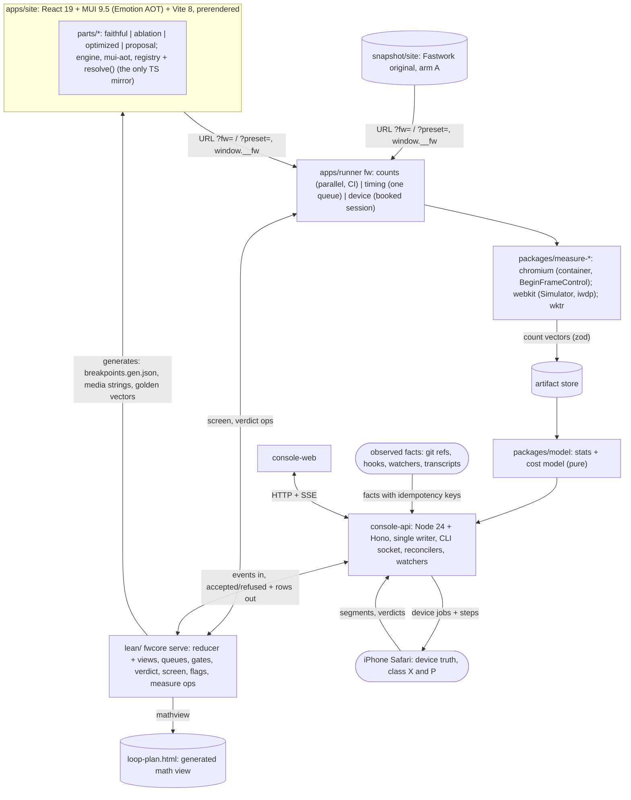

# v2 plan: a measurable, provable loop for the fastwork.com scroll experiment

This is the design for you to review. It merges the kickoff notes, cited as `[01]` to `[11]` with section numbers
(`[08]` the v1 chat forensics, `[09]` the MUI zero-runtime study with sub-notes `[09.01]`-`[09.04]`, `[10]` automation
and proof with `[10.01]`-`[10.04]`, `[11]` the breakpoint inventory), the feasibility review `[FR]`, the device note
`[ENV]`, the catch-up log `[CU]` (`docs/team/improvements/2026-10-17.md`) and the evidence note `[EV]`
(`research/notes/2026/10-17-plan-evidence.md`, cited by section), which holds the findings, history and worked
examples that left the plan in revision 8. Appendix A says which way the plan goes where the notes disagree;
Appendix D logs every change.

**Revision 9 is the 3-day revision.** You decided (2026-10-17, 23:13 +0700; recorded in ad5eeea) that the whole
experiment may take no more than 3 days, counted from the first commit (931aa35, 2026-10-17 13:15 +0700, MEASURED
`git log`), so it ends with a report by **2026-10-20 13:15 +0700**. §10 holds the frame: the minimum experiment, the
engines, four checkpoints with fallbacks, the cut list and what you do when. **Revision 9.1** (2026-10-18 00:15)
records your answers (Q34 c, Q35 a, Q36 shells first, then every section ported in parallel; Q37 open with default
a), the C1 WebKit GO, and restructures the graph so independent work runs at once (§10.5). Open for you: Q37
(§12.1) and two phone sessions (§10.3). Work still runs as a dependency graph; the checkpoints are the only dates,
and each exists because the deadline does.

**Status words.** CONFIRMED = a note cites a source, doc or v1 record for it, or it was checked on this Mac today.
INFERRED = a design choice or expectation that a spike or measurement must still check. MEASURED = a number from a
run in this repo, with its commit. Targets and thresholds are proposals until you accept them.

## Glossary of labels (each prefix is used for one thing only)

| Label | Means | Where |
|---|---|---|
| **Q1 … Q37** | questions and defaults for you (answered ones in §12.0); Q34-Q35 added in rev 7, Q36-Q37 in rev 9 | §12 |
| **M0 … M6** | milestone gates (exit states); M4 is out of scope for v2 since rev 9 | §10.2 |
| **MX** | the work-graph milestone that holds the tasks cut in revision 9; nothing in it is started | §10.4 |
| **T+Nh** | hours after the 3-day decision (T0 = 2026-10-17 23:15 +0700); the report is due at T+62h | §10 |
| **G1 … G4** | outcome goals | §1.1 |
| **V-a … V-t** | method (validation) criteria | §1.2 |
| **TL0 … TL5** | test layers | §5.4 |
| **PL0 … PL6** | parity levels (rewrite vs original) | §6.6 |
| **N0 … N5** | styling-neutrality checks | §6.7 |
| **S1 … S13** | styling rules inside parts | §6.5 |
| **class W / SM / X / P** | landing classes: less **W**ork, **SM**oothness or mixed, device-only (**X**), **P**roposal | §9.2 |
| **SPK-a … SPK-u** | spikes (short experiments that answer one question) | Appendix B |
| **L1 / L1-cond / L2 / L3** | proof levels: proved in Lean; proved but with a named unprovable premise; Lean spec with Lean-generated code or golden vectors for TS; not provable | §5.1 |
| **tier T0 … T3** | v1's pixel-difference tiers | §6.6 |
| **K1 … K10** | calibration fixture pages: K1-K9 WebKit [04 §9]; K10 sheet mutation, both engines [09.03 §5.2] | §4.4 |
| **R1 … R35** | risks | §11 |
| swap check | the check a section port passes to replace its shell: PL1 boxes + look tier at every breakpoint, one part, Chromium on CI; cheaper than the full gate | §10.5 |
| task ids (`class-freeze`, `port-morph` …) | tasks in `docs/team/work-graph.json`; a task id is also the agent name and the console card id | §10.4 |
| stages | question → build → screen → review → (device) → land, always written as words; derived from evidence events, never set by hand (§9.2) | §9 |

## 0. The plan in one page

**v1's result, and why v2 is different.** v1 reached its goal: slow frames in your swipe fell from 20.1 % to 1.7 %,
and the end-of-page longest frame fell from 584 ms to 42 ms. It cost 10 days, 442 started agents (848 transcripts)
and about $11.4k at list price, recomputed per request (v1's own readout scaled to about $13.5k) [01 §0, 08 §3]. 231
of its 276 incidents were filed against its own tools, 45 of them feature requests rather than failures [01 §1,
08 §4]. Your three pain points all show in v1's data. v2 answers each one structurally:

| Pain point | v1 evidence | v2 answer |
|---|---|---|
| 1. The phone was needed for every measurement | ~111 of 276 incidents involve the iPhone or Simulator driver; phone blocks took 12-35 min plus cooling [01 §B.1] | **Two-speed loop.** The inner loop is deterministic engine **work counts** (Chromium headless-shell in a Linux container; WebKit when a lane is green) feeding a **cost model** that is calibrated on the phone. The phone becomes a scheduled outer loop (§4) |
| 2. Patching the minified Svelte build was slow | Retrospective cause C6; ~349 commits on the end-of-page line [01 §B.1] | **React rewrite as pluggable parts.** Each part has a `faithful` variant that copies the original's look and, for the parts we experiment on, its per-frame engine work, plus ablation, optimized and proposal variants picked by flags (§6) |
| 3. A coupled, bug-prone loop; every tool change re-ran everything | Full suite 250-280 s on every tooling commit; `lock.mjs` grew to 1,685 lines [01 §B.1, 06 §1] | **A proved core with a thin IO shell.** Every provable decision, queue and status view runs in one long-lived Lean 4 process, `fwcore` (§5.1); TypeScript moves data. Results are content-addressed, so a tool change re-runs only that tool's tests (§3) |

**What the chat history adds** (§2.3, [08]): v1's agents did their work well; the loop around them did not. v2 fixes
that with scripts, events and hooks, not with more agents or rules (§8.5). **Nobody writes status** (rev 5): every
console view is a formula over one event log that only console-api writes. **Lean first, and you read math, not
Lean** (rev 5): everything reproducible is proved before it is coded (§3.3), and every theorem carries its math on a
generated page (§5.3).

**What to expect, plainly:**
- **The phone does not go away.** In the full design the model needs 5-10 phone sessions before it may stand in for
  the phone for one kind of change (INFERRED [FR §1.8]). **In v2's 3 days there are two sessions** (§10.3), so no
  stand-in licence is reached: the phone verifies the one decision directly, and the model stays `uncalibrated`.
- **MUI everywhere, styles compiled ahead of time** (decided 2026-10-17): Material UI 9.5's Emotion styles are
  rendered at build time into one static CSS file ("Emotion AOT", §6.5); a neutrality gate (§6.7) checks that MUI
  adds no sheet mutations, DOM writes, React commits or work counts against a plain twin.
- **Chromium is a development aid; the iPhone is the target.** Chromium counts are fast and classed per type (V-i),
  but cannot predict iPhone Safari. There is no Android phone (decided 2026-10-17).
- **Lean:** the generated math view at ad5eeea lists 2,171 reviewed entries in 51 modules; the 4 disagreements of
  review round 10 were fixed in 25b68d2 (MEASURED, generated page). A module that costs much and catches nothing
  moves back to TypeScript (§5.1).

**State at ad5eeea (T0 + 5 min; MEASURED unless marked).**
- **Progress:** 78 of 104 work-graph tasks done: M0 20/21, M1 20/30, M2 11/15, M3 4/8, M4-M6 0 (console
  `/api/plan`); 372 commits on `main` in 10 hours (`git rev-list --count main`).
- **Chromium:** counts run on CI; the original (A) and the rewrite (R) are measured side by side (R far quieter,
  §4.2). The touch race is fixed (c38088e: R deterministic and A stable on swipe-touch-v1, 0 wedges in 3 CI runs).
  Zone sums of the original are stored from CI run 39048702153 (c719d73); the cross-run baseline waits on `refreeze`
  and the Lean op `measure.zoneBaseline` (both running). Counts exist per virtual frame and per scroll zone (12 zones:
  rest, y00000 … y04500, tail), not per part (§4.1).
- **WebKit:** the Simulator lane still fails on the free `xcode-27` runner (host load 401-836,
  `10-17-sim-speed.md`; last completed run failed, one in progress, `gh run list` at 23:20). Paid runners and rented
  Macs are out (your decision; `10-17-macos-rent.md`). WKTR is green on `macos-26`, but only its two harness-cadence
  counts are deterministic; every style, layout and compositing count is quarantined (`packages/measure-wktr/README.md`).
- **Breakpoint gate:** green; a part's probe scope cuts its gate to 10.8 job-minutes (`gate-probe-scope`); the gaps
  lane reaches 8 of 8 cells in Chromium, and WebKit's cells are `unreachable` as the Lean model predicts (Q33).
- **Waiting on you:** phone session 1 (on demand); Q37 only if you want something other than the default (a).

**The 3-day frame (rev 9; the full argument is §10).** The minimum experiment that still answers the study's question
is the **end-of-page region**: the 4 pilot parts already built plus the 5 `morph.*` parts, ported `faithful` through
the breakpoint gate; every other section ships first as a static **shell** of the original's height, then is ported
`faithful` in parallel and replaces its shell once a cheaper swap check passes (Q36, §10.5). The inner loop
is Chromium counts on CI; the iPhone is the WebKit truth in two booked sessions; the Simulator lane joins only if it
is green at T+12h. The experiment is v1's end-of-page decision as flag arms, screened by the proved dominance rule
(§4.3) and verified by your finger (blind 4 vs 4, §5.1). Checkpoints: T+12h WebKit go/no-go, T+24h region faithful
and session 1, T+48h decision and session 2, T+62h report. Everything else is cut or deferred with a reason (§10.4).

**Headline goal, as v2 answers it.** Rebuild the end-of-page region and reproduce v1's outcome there on the phone as
flag arms, with a fraction of v1's device time, tool bugs and elapsed time; cost reported, not capped; the one claimed
speed-up checked by your finger (§1).

## 1. Goals and success criteria

Each criterion has a measurement and an owner. "Proposal" thresholds become binding once you accept them (Q9).

### 1.1 Outcome goals

| # | Goal | Metric | Target | Checked by |
|---|---|---|---|---|
| G1 | v2 reproduces v1's effect | On the iPhone in your swipe, the `original` preset is within v1's A/A band of the original site, and the `v2-best` preset is at or below v1's g0.0m | slow frames (> 34 ms) ≤ 1.7 %; end-of-page longest frame ≤ 42 ms; the feel metric (§4.6) ≤ g0.0m | phone block + blind A/B (§4.6) |
| G2 | Fewer device blocks, less device chore work for you | phone sessions, device incidents, chore steps per session | in v2: 2 booked sessions (§10.3), no licence claimed; then ≤ 1 block per class SM landing; device incidents ≤ 10 % (v1 ~40 %); **≤ 1 get-ready step, 0 chore steps per session** (v1: 82-105 of 166 [08]) | console step log, bug ledger |
| G3 | Speed first, cost reported (decided 2026-10-17) | time to each gate (from git history); list-price dollars per milestone, role and day; Opus share; cold-wake share | **no hard caps or stop rules**; one date, the 3-day deadline 2026-10-20 13:15 +0700, with checkpoints (§10). Cost reported daily against the §8.4 forecast; soft alerts at 1.5× a milestone's forecast and at 60 % / 80 % of the weekly limit; total against v1's $11.4k at M6 | `pnpm fw usage` [07 §8] |
| G4 | Write-up material | every landed experiment card has a plain one-paragraph summary and a reproducible clip or chart reference; cleanup never deletes listed evidence | all landed cards (v1: 74 of your messages were about evidence and the article [08]) | `kb lint`; M6 review |

### 1.2 Method goals

| # | Goal | Metric | Target (proposal) | Source |
|---|---|---|---|---|
| V-a | **Count transfer: Chromium** | container counts vs a traced, non-timed headed Mac Chrome run, per family | equal per family, or the family is "container-only" and never feeds a coefficient | [FR §1.6] |
| V-b | **Count transfer: WebKit** | Simulator count equals phone count at the same held state | ≥ 95 % of states per type; failing types "not transferable". Not reached in v2 (no Simulator lane unless C1 is GO) | [04 §9] |
| V-c | **Ranking** | Spearman ρ, predicted vs measured cost per variant (holdout) | ρ ≥ 0.8 on the iPhone; Chromium not scored. Not reached in v2 (Q37) | [03 §9.3, 04 §9] |
| V-d | **Decision agreement** | sign of predicted Δ vs measured Δ above the noise band | ≥ 90 %, 0 sign errors among large predictions. In v2: reported for the one decision | [03 §9.3, 04 §9] |
| V-e | **Magnitude** | median abs(log(pred/meas)) | ≤ 0.3, else "ranks only". Not reached in v2 | [04 §9] |
| V-f | **Feel agreement** | blind verdicts with predictions frozen first | 5 of 5 before a stand-in licence; in v2 one blind 4 vs 4 in session 2 | v1 `stats-vs-finger.md` via [03 §9.3] |
| V-g | **Visual parity** of each `faithful` part | v1 tiers against a same-run A/A baseline | tier **T1** at PL0-PL3 and PL4 in Chromium and Playwright WebKit **at every breakpoint edge** (§6.6; shells excepted, Q36); boxes ≤ 0.5 CSS px | [02 §4]; your requirement |
| V-h | **Work parity** of each experiment part | PL5 bands per count family (§6.6) | within band for every family; layers ±0; same compositor/main split | [02 §4.6, FR §2] |
| V-i | **Determinism, per count type** | repeated CI runs classified by Lean `measure.classify` (`Fw/Measure/Classes`) | every type *deterministic*, *stable* or *quarantined*; screening uses only the first two (rules below) | `spk-i.md`, [03 §7.1, 04 §8.5] |
| V-j | **Time to adopt a tool** | new measurement plugin → first cached artifact | ≤ 1 agent-day; 0 other artifacts invalidated (`fw run --dry`). Reported, not gated, in v2 | [06 §3] |
| V-k | **Test speed** | pre-commit gate; TL1 whole repo | pre-commit ≤ 30 s; TL1 < 20 s cold | [06 §3.4] |
| V-l | **Bug ledger, per module** | every entry has `kind`, `module`, `level` and `caughtBy` | complete; drives the demotion rule (§5.1) | [10.03] |
| V-m | **Bugs in proved areas** | logic incidents in any L1 module | 0 escaped logic incidents | bug ledger |
| V-n | **Harness neutrality** | frame-stepped vs free-running counts, per family | equal per family, else not screened in that engine; compositor-only animations still cost 1 `UpdateLayoutTree` per frame in Chromium (MEASURED 70c3370) | [FR §1.2], [CU] |
| V-o | **Timing parity** (PL6) | Mac Chrome per-stage time, rewrite vs original | within the original's A/A band (ABBA, n ≥ 4) per stage | [FR §2] |
| V-p | **Transfer to the original** | the same change as an overlay on the original, counts lane | same sign of Δ per stage, for every landing that can be overlaid | [FR §2] |
| V-q | **Styling neutrality** of MUI | N0-N5 (§6.7) | sheet mutations 0 after hydration; DOM-write and commit census equal to `impl: plain`; style shape within ±10 % | [09] |
| V-r | **Mutant kill rate** | each L1 module ships v1 bugs put back on purpose (`FwTest/Mutants/<module>/*.patch`) | 100 % make `lake build` fail; a survivor blocks the module's next land | [10.03] |
| V-s | **Math sign-off** | docstring math whose deep statement hash equals the signed hash | 0 missing, 0 stale, 0 unsigned at land (`math-final` before the report) | [10.04 §2.3] |
| V-t | **No hand-written status** | console fields an agent can set directly; a replay of v1's status history through the v2 reducer | 0 directly settable fields; the replay share reported, not gated, in v2 | [10.02] |

**V-i rules** (SPK-i, decided 6b4237e; `research/notes/2026/10-17-spk-drafts/spk-i.md`). No byte identity: whole
count files never match (thread ids, GC, async work; MEASURED 70c3370), so classes are per count type. **Chromium
policy** p = (kMax 4 frames, tMax 24 units), 3 runs: *deterministic* = no frame differs; *stable(k, t)* = ≤ 4 frames
differ and totals differ by ≤ 24; else *quarantined* (CONFIRMED `Classes.lean`); pixel-area types use
max(tMax, ⌊min |total| / 1000⌋) (proved `classifyU_sound`, 5879861). **Use:** deterministic types frame by frame;
stable types only as totals with margin 2t (`margin_exact`); quarantined never (`quarantined_unsound`).
`trace.Paint` is quarantined in the frozen table, so Chromium paint is not screened. **Signed class** = the worst
over ≥ 3 CI runs with the image pinned (`measure.freeze`, bc2e28a); one run's classes are never signed. **WebKit:**
per-cell tolerances, 2 passes in each of 2 boots; per-step Layout/Paint quarantined, totals within 3-5 % (367fec2).

## 2. What we keep and what we drop from v1

### 2.1 Keep (each with its v2 form; the v1 evidence for each row is in [EV §2])

| Keep | v2 form |
|---|---|
| Frozen, hash-pinned baseline; one change per arm | `snapshot.lock.json` pins the original; each rewrite build is pinned by commit + flag vector + `servedHash`; overlays become **flag arms**, never bundled |
| A/A noise floor; "better" only with disjoint ranges | The landing verdict is **4 vs 4** runs with disjoint ranges; false-win rate under the null ≤ 1/70 (§5.1); comparisons counted per experiment |
| Prediction cards before data; claim status words; "read source first" | Pre-registered predicted Δ per stage and zone on the question card (§9); rule cards in `refs/rules/` with file:line@commit and status [04 §11] |
| Pixel tiers T0-T3; element ablation with a fairness check | Parity levels PL0-PL6 (§6.6); generated ablation variants per part (§6.2) |
| The validated feel metric: frames > 50 ms per 100 moving frames in the finger's zone; the less-work landing rule | Primary device metric (§4.6); landing class W, per frame over a declared-complete vector (§9.2) |
| Proposals with Try-it pages; blind swipe A/B; comment on anything | The console Proposals view; a second iPhone for free play (Q1) |
| Your coaching, as rules with enforcers; named spawns; one worktree per editor; one lander; ff-only | In the lead file and `CLAUDE.md` from the start, each rule naming its enforcer (§8.5); the one lander is the lead through `fw land` (§8.2) |
| Quiet-host gate and contamination flag for timing runs | Timing lane only; the counts lane needs no lock |

### 2.2 Drop (each with what replaces it; the v1 evidence is in [EV §2])

| Drop | Replacement |
|---|---|
| A device run for every measurement; the 6x CPU throttle as the model | Counts lane + a per-stage, per-count cost model with a page factor `ρ_page` + validity table (§4) |
| Patching a minified bundle | React parts with flags (§6) |
| A full test suite on every tooling commit; real time and the real host in tests | `vitest --changed` per affected package; TL0-TL5 layers; a clock port and a lint that bans timers, real load, fixed ports and shared temp folders in the pure zone (§5.4) |
| Side effects at import; 8-24 copies of one parser; two different medians | Pure zone enforced by a lint; one `model` package for stats |
| Many writers to many JSON stores; agents writing board state; shared ledger files | One writer (console-api), one append-only event log, status as a Lean projection; agents' only inputs are typed, refusable requests (§8.3, §8.5) |
| A 9.7k-word rulebook loaded by every agent | Root `CLAUDE.md` under 300 words at the start, never above 1,500; each rule names its enforcer |
| Opus everywhere; the lead as router; recurring check prompts; routing agents | A small roster, Opus where it speeds the work, a lead that decides and does not route, no LLM polling; `fwcore` decides queue order, land queue, device dispatch and digests (§8.5) |
| Agents holding device leases; hand-moved queues; hand-built lock code (1,685 lines); an 842-line git-guard hook | A device job queue in console-api with a proved priority function; no lock in the counts lane; git config + deny rules + a land-time path check; one small spawn-guard hook (§8.3) |
| Multi-step inline shell in worktree agents | Committed `pnpm fw` verbs; one plain command per Bash call (§8.2) |

**Rule for every new tool, hook or package:** it names the v1 incident class it prevents, or it waits until
something fails without it. An **enforcer** reads only events, never agent self-reports, ships with golden tests and
reaches ≥ 90 % precision on a log replay before any alarm reaches you. A new *agent* rule must cite an agent-mistake
incident; otherwise fix the tool (v1: 4 agent-mistake incidents against 139 tooling ones [08]).

### 2.3 What the chat history showed

[08] read v1's 848 raw transcripts: **a star, not a team** (64 % of 12,582 messages touched the lead); **woken by
polls** (42 % of the lead's turns were cron fires); **home-made coordination broke more than agents did** (139 tooling
incidents against 4 agent mistakes); **you were device technician and status bus** (82-105 of 166 steps were chores).
What worked: steps, Try-it proposals, comment buttons, fast replies, short fresh agents, one lander, ff-only.

## 3. Architecture

### 3.1 Overview



### 3.2 Modules and their narrow contracts

Rule: a module talks to another only through the contract in this table. Each contract is a zod schema in
`packages/contracts`, exported to JSON Schema and, where Lean reasons about it, mirrored in Lean with golden
fixtures [06 §2.5, 05 §6].

| From → to | Contract | Notes |
|---|---|---|
| runner → site | URL `?fw=part:variant,…`, `?impl=part:plain,…`, `?preset=<id>`, `seed`, `t0`, `rm`; the page exposes `window.__fw = {config, configHash, scroll, clock, hydrated, styleMisses, markMeasureStart}` | The same harness drives arm A by injecting an equivalent `__fw.scroll`; `markMeasureStart()` is refused before `hydrated` |
| site build → runner | Vite `manifest.json` → `servedHash` per route | Edits to part X change only the keys of routes that serve X |
| runner → plugin | `MeasurePlugin {id, semantics, lane, input, output, run, reduce}` | count reduction runs in `fwcore` (§3.3); an output that fails its schema is an incident, never a result |
| plugin → artifact store | key = `sha256(canonical JSON of {subject, tool, engine, profile, protocol})` | counts artifacts are reused; timing artifacts append samples |
| artifact store → model | **count vector per (frame, zone)**: 12 scroll zones per run (rest, y00000 … y04500, tail), no per-part attribution (A31) + coefficient set → `{stage p50/p90, missed vsyncs, status}` | pure; applied at report time, so a refit re-runs no measurement |
| TS → fwcore | `fwcore serve` is long-lived and **stateful**; ops below | `Fw/Serve` (14152f1): apply round trip p50 40 µs; a 100,008-event replay 0.4 s (MEASURED [CU]) |
| console-web → console-api | typed HTTP + SSE; zod schemas from `contracts` | the UI never decides; previews always call console-api |
| agent → device lane | job card `{kind, card, priority class}`; agents never hold the phone | v1: 40 scheduler incidents; runners died with their agent [08] |
| console-api → status and steps | each status row is **computed, never written**; every cell has a "why" popover listing its events; a step shows only after a script checks it is ready | v1: rows said "waiting on you" with nothing to do |
| agent → console-api | `pnpm fw <verb>` sends one typed request to `.fw-console/run/cli.sock`; the hook `cap.mjs` adds a single-use capability (HMAC over agent type, id, tool-use id, command hash); the reducer accepts or refuses | the socket never trusts a self-declared role (R27) |
| observers → console-api | facts with an idempotency key; hooks write a spool file (< 100 ms); git facts come only from the ref reconciler | a key is marked seen only when its event is accepted |
| any client → console-api | every request carries `contractsVersion`; a mismatch is refused with "rebase" | v1: worktrees on old tool code misread shared state |
| everything → knowledge store | one frontmatter schema; `pnpm kb index | find | lint` | §7.2 |

**`fwcore` ops** (each a Lean function; TS only sends and prints): console `console.apply/replay/query/reset/
landReadiness/actor`; work graph `task.*`, `milestone.define`, `plan.trailers`; gates and decisions `gate.*`,
`verdict`, `ticks`, `twins`, `flags.resolve/enumerate`, `screen`, `samples`; measurement `measure.*` incl.
`.classify`, `.selfCheck`, `.snapshotCounts`, `.freeze`, **`.zoneBaseline`** (running), `store.ciRun` (running);
operations `ops.spawn/pathCheck/usage/meter/hook/obs/admit`, `metrics.*`, `obs.health`.

**Hardening the TS ↔ `fwcore` glue** (each CONFIRMED as a real failure path in [FR §3.2]): `fwcore` echoes each
request's `id` and replies to every line, and a mismatched id kills the child; 10 s per call, 120 s per replay chunk,
restart on timeout with the outstanding calls failed (never a silent retry); `LEAN_ABORT_ON_PANIC=1`, because a Lean
panic otherwise returns a default value (lean4 v4.35.0 `src/runtime/object.cpp` l.76-82); a grep gate bans `get!`,
`head!`, `[i]!`, `panic!` in the wire layer; counts cross as `Nat`, times as integer ns, coefficients as `Rat`
(`{"num","den"}`), never `Float`.

### 3.3 Where each decision runs (one place only)

- **Lean first for everything reproducible (your direction, 2026-10-17; `CLAUDE.md`).** Every pure piece of the
  console, the site, measurement and tooling (decisions, reducers, gates, breakpoint conditions, flag rules, motion
  curves, count reduction, verdicts, test matrices) is specified and proved in Lean **before** it is coded. Then it
  runs in `fwcore`, or Lean generates it (constants, CSS media strings, `breakpoints.gen.json`, test matrices), or the
  TS/React code passes Lean-generated golden vectors. Only I/O, rendering and glue stay unproved, and they hold no
  decision. A TS stand-in is temporary and listed in the report (`selectCiRun` and `searchConfig` are the two open
  ones at ad5eeea, task `store-cirun`).
- **Browser-side code** (L2): media strings, motion curves, part logic and the flag resolver are generated by Lean or
  checked against golden vectors; the resolver's TL2 test covers every single-part override of every preset
  (`fwcore flags.enumerate`, a finite domain) plus 2,000 fast-check multi-part cases [10.03 §2.10].
- **Bookkeeping too:** reducer and views, queues, `fw plan`, cache prune, the path check, spawn-guard and usage dedupe
  are L1 modules (§5.1); v1 failed exactly there (hand-kept board, scheduler) [10.03 §1].
- **Priority is data you own:** one ordered list (`presets/priority.json`); both queues read it through one proved
  Lean function of the list, the job class and the waiting time (aging, Q27), starting the most urgent job **that
  fits** the booked window. A manual move is an event with a reason.
- **Fitted numbers** (coefficients) live in TS (`packages/model`); Lean proves the screening rule (§4.3) and an L1
  checker accepts coefficients before use. In v2 none are fitted (Q37).

### 3.4 MVP tier and later tier

| | MVP (built in M0-M2) | Later (only when a named failure needs it) |
|---|---|---|
| apps | `site`, `runner` (`fw`), `console-web`, `console-api` | — |
| packages | `contracts`, `measure-chromium`, `measure-webkit`, `model` (stats + cost model), `kb`, `fwcore-client` | split `measure-sdk`; separate `artifact-store`, `usage` packages; `core` |
| console storage | `.fw-console/` in the main checkout (gitignored; console-api its only writer): `events.jsonl` (append + fsync, then apply), snapshots, spool, CLI socket, secrets; projection in `fwcore serve`; reconcilers and watchers (§8.5) | SQLite read model (if queries get slow) |
| Lean | Lean-first, by milestone (§5.1): site and parts from the start; M0 console core, queues, spawn-guard, gates, verdict, work graph; M1-M3 the rest of the L1 inventory | only what an incident or a new decision calls for; the optional Mathlib package `FwMath` (§5.2) |
| hooks | Built in `apps/runner/hooks/` (3e67d48, 6756bb9): observer `emit.mjs` (spool-only, ~47 ms median, MEASURED 3fe1876) on session, subagent, compaction and tool events; `cap.mjs` on `PreToolUse(Bash)`; spawn-guard on `PreToolUse(Agent)` in shadow mode, plus `SubagentStart` so workflow spawns are logged too (2a43e6e) | `TaskCreated`/`TaskCompleted` observers, `SubagentStart` role brief |
| repo tooling | pnpm workspaces, Biome, Vitest; one pre-commit hook via `core.hooksPath` running `scripts/scrub.mjs` (0.17 s, d2574b0; not lefthook) | Turborepo, knip, dependency-cruiser, ast-grep rule sets, REUSE.toml, JCS keys |
| knowledge store | 4 kinds (`note`, `decision`, `ref`, `rule`), 5 claim statuses | more kinds if the index needs them; `kb lint` beyond the schema |

## 4. Measurement methodology

### 4.1 Three lanes

| Lane | Runs | Determinism | Gives | Never gives |
|---|---|---|---|---|
| **counts** | parallel, no lock, **on GitHub Actions** (below). Chromium headless-shell in a Linux container with BeginFrameControl; WebKit Simulator Mobile Safari through `ios_webkit_debug_proxy`; WKTR (§4.2); optional Chrome on the Android emulator, counts only | per count type (V-i) | work per virtual frame and per scroll zone (12 zones per run; **not per part**, A31) | milliseconds |
| **timing** | one at a time from the console-api queue: headed Mac Chrome with `PipelineReporter` tracing; Simulator Timeline with `Page.enable` first | statistical (ABBA, n ≥ 4) | per-stage ms on this host, for timing parity (PL6) and A/A bands | iPhone ms |
| **device** | iPhone Safari blocks as **jobs in a console-api queue**, run only in a session you book. Each session starts with `fw device check` (repairs what it can, then posts **one** get-ready step); the queued blocks then run back to back | statistical | the truth for feel; iPhone coefficients; render-server time | anything at scale |

**Measure on CI, not on this Mac** (your direction, 417d90d; `CLAUDE.md`; §12.0). An agent pushes its `ci/<task>`
branch and reads the result with `gh run view` / `gh run download`. Chromium runs in the container on
`ubuntu-24.04-arm`; WebKit Simulator counts on the `xcode-27` image (iOS 27.0, 24A434; `webkit-sim.yml`; go/no-go at C1, §10.2); WKTR is
planned for `macos-26` (iOS 26.5). A local run is a debug run, never a result. Each workflow has a `paths:` filter
and cancels stale runs on `ci/**` only (21 of 28 runs touched no input; MEASURED, 6723de2); macOS jobs share one
pool of 5 (our tier INFERRED; MEASURED, 56fe6c9; budget in R33). Full figures: [EV §3.1].

**Why a container.** Chromium refuses BeginFrameControl on macOS (`headless/lib/browser/protocol/target_handler.cc`
l.62-65 @317846d579b2, CONFIRMED [FR §1.1]). The container serves **every font from `snapshot/`** with no system
fallback, because fallback fonts change line breaks and so layout and paint counts (INFERRED). SPK-i ran
(70c3370): BeginFrameControl works in the container, but whole count files were never byte-identical, so V-i uses
per-type classes (§1.2). Heavy trace categories are used in the counts lane only (v1 saw −17 fps, CONFIRMED [03 §12]).

### 4.2 Step 1: deterministic work counts

**The harness must not change the mechanism it measures** (CONFIRMED [FR §1.2]). Playwright's `page.clock` fakes
`requestAnimationFrame`, so the app's rAF runs outside the rendering steps; seeking an animation restarts compositor
animations in Chromium and invalidates style per animation per step in WebKit ([EV §3.2]), so Chromium never seeks.
- **One virtual frame in Chromium** (both arms): `puppeteer-core` with BeginFrameControl in headless-shell (flags in
  [EV §3.2]; 70c3370, 25bd9f4); a clock shim gives `Date`, timers and `performance.now` virtual time (pinned to
  `2026-10-01T00:00:00+07:00`) and **keeps native `requestAnimationFrame`**; each scroll step comes from a committed
  profile; `HeadlessExperimental.beginFrame` advances animations without seeking; then the counter deltas are read.
- **One held state in WebKit:** no BeginFrameControl, so seeking plus "two rAFs"; counts classed per type (V-i);
  seek overhead measured on an N-animation fixture and tagged `harness-induced`; compositor status only from
  free-running `LayerTree` censuses.
- `Math.random` is seeded (mulberry32); `t0` and the seed are part of the artifact key.

**What the runs showed** (classes and their use: the V-i rules, §1.2; all rows, run ids and superseded results in
[EV §3.3]).

| Result | Engine | Status, source |
|---|---|---|
| **Frozen table** (worst class over 3 workflow runs, 62 types), det/stable/quar: swipe-v1 27/25/10, swipe-touch-v1 16/27/19; `trace.Paint` quarantined in both | Chromium | MEASURED, da287ff; being regenerated for A and R (`refreeze`) |
| The freeze rule runs in Lean (`measure.freeze`: order-independent, monotone, idempotent; refuses < 3 runs, a repeated run, a mixed image) | Chromium | CONFIRMED `Fw/Measure/Freeze.lean`, bc2e28a |
| **Touch race fixed**: the rewrite deterministic and the original stable on swipe-touch-v1, **0 wedges in 3 CI runs** (earlier fix 25bd9f4: 0 wedges in 9 jobs) | Chromium | MEASURED, c38088e (lead, 2026-10-17) |
| Original vs rewrite on CI, det/stable/quar per run: swipe-v1 A 27/25/10, R 37/6/1; swipe-touch-v1 A 31/20/11, R 40/0/4 (62 vs 44 types: reported, not compared) | Chromium | MEASURED, fee88b2 |
| **Zone sums of the original stored** from CI run 39048702153 (12 zones: rest, y00000 … y04500, tail); the cross-run baseline waits on `refreeze` + the Lean op `measure.zoneBaseline` | Chromium | MEASURED, c719d73 |
| Per-step Layout, Paint, InvalidateLayout, ObserverCallback quarantined; totals within 3-5 %; rewrite steps not yet aligned with the original's (`step-align`, conditional on C1) | WebKit | MEASURED locally (debug), 367fec2 |
| CI Simulator runs take 10-38 min and fail at warm-up under host load 401-836; no paid runner | WebKit | MEASURED, `10-17-sim-speed.md`; go/no-go at C1 (§10.2) |

**What gets counted** (full catalogues in [03 §7.2] and [04 §4.1]):

| Family | Chromium (Blink/cc) | WebKit (Simulator, Inspector protocol) |
|---|---|---|
| **Sheet mutations** | page-side census N0 (CSSOM write wrappers + `MutationObserver` on `<style>`/`<link>`); engine side N1: `StyleEngine::updateActiveStyleSheets`, `scheduleInvalidationsForRuleSets`, font-update slices | census N0 (always); `CSS.styleSheet*` events (attribution runs only) |
| Script | rAF callbacks (`FireAnimationFrame`); script ms measured, not modelled | rAF count; script ms through page-side wrappers |
| Style | `UpdateLayoutTree` passes, `elementCount` | `RecalculateStyles` records (no element count without WKTR) |
| Layout | passes, forced layouts (with JS stack), `dirtyObjects` | `Layout` records with root |
| Paint and raster | `Paint` count (not area), raster-invalidation rects × dpr², tiles, paint ops | `Paint` clip area, ΔpaintCount per layer |
| Image decode, layers | `decodedPx` per frame; layer count, reasons, `drawsContent` | `decodedPx`; `LayerTree` count, `memory`, 29 reason flags |
| Compositor | `Animation` trace `compositeFailed` bitmask (free-running only) | accelerated animations × requested rate [04 §2.3]; layer reason `animation` |
| Frame outcome | `PipelineReporter` states (timing lane only) | `RenderingFrame` segments (timing lane only) |

Container tiles and raster use software raster; headed Mac Chrome uses GPU raster (INFERRED [FR §1.6]); V-a compares
per family. **Sheet mutations are a family of their own:** inserting 100 rules during a scroll left every planned
count unchanged and only style-recalc time moved (20-24 vs 8-10 ms, CONFIRMED [09.04], Chrome 155); one insertion
is a full-document style rebuild in WebKit (`StyleScope.cpp` l.585-619 @77db40e2fa70). The original reads 0 after
load (SPK-q); the family is in every declared-complete vector (§4.3).

**WebKit element counts (Q10).** WebKit's largest model term is the restyled-element count, which the Inspector
protocol does not give; v1's WebKit costs were dominated by restyle. So class W is barred for any diff that touches
selectors, classes or custom properties unless WebKit evidence exists; **in v2 that evidence is the phone** (§10.1).
WKTR from WebKit's prebuilt iOS-Simulator archive runs on `macos-26` (`wktr-local`, MEASURED), but only its two
harness-cadence counts are deterministic and its build is trunk 324039, not shipped iOS 27; it is not modelled in v2
and stays the route for a later study (A26).

### 4.3 Step 2: the cost models

Both models are **monotone in counts with non-negative coefficients**, so removing work can never raise a
prediction; Lean proves that for the model as deployed (§5). **In v2 no coefficient is fitted (Q37):** the models
stay `uncalibrated` and the decision rests on the coefficient-free screen below plus the phone.

- **WebKit (the target)** [04 §7]: `W = J + Σ c·counts` (WebContent main thread); `F = max(s²·Ap/R_cg, Bn/R_alloc)`
  (GPU-process raster wait; `max` keeps monotonicity, [FR §1.4]); `U = c_ui·Nc`; `dt ≈ max(T_req, W + F + U + δ)` with
  `T_req` = 16.67 ms (60 Hz page rendering, CONFIRMED in source); a render-server term `RS` priced only by
  Instruments on the phone. v1 seeds (about 0.14 ms per repainted layer) are priors only.
- **Chromium (development aid)** [03 §9]: `T_s(f) = κ_s + Σ_j c_{s,j} · x_{s,j}(f)` per stage, against the
  scheduler's budget inequalities B1-B4, `k = max(1, ⌈T/I⌉)` vsyncs per frame; used for mechanism and screening;
  never fitted (no Android phone, Q1, Q8). Near the B1 boundary a screen result is reported as "mixed" (INFERRED
  [FR §1.3]).
- **Page factor.** `T = θ_run · ρ_page · (κ + c·x)`; v1 saw custom-property restyle at 2.2× the blank-page cost
  (CONFIRMED, v1 `research/cpu-throttle-calibration/README.md` l.39). Fits, when they happen, are constrained to
  `c ≥ 0` and checked by the L1 certificate (§3.3); status per output: `uncalibrated` → `ranks-only` → `sizes`.

**Screening without coefficients (class W).** If a variant's count vector is ≤ the baseline's **in every component
and in every frame**, and strictly lower somewhere, the predicted cost of every frame is no higher under **any**
non-negative coefficients (`Fw/Spec/Screen`, proved for the deployed model with `κ`, indicator terms, `⌈T/I⌉`,
`max` and the p90 predictor), so "dominates" needs no calibration. Three conditions make it meaningful:
1. **Per frame, not per zone total.** Batching can lower a zone's total while raising one frame's peak; zones
   (12 per run, §4.1) group frames for reporting and for the faithful check.
2. **Frames aligned by content anchor**, not by scroll y, so a variant that changes layout height compares the same
   content.
3. **The vector is declared complete for the mechanism class**, and a lint confirms the diff touches no family the
   vector does not count (images, `filter`/`backdrop-filter`, new animations, fonts); otherwise class SM. A diff that
   changes the styling-engine configuration is class SM until priced (S11).

**Golden fixtures from v1.** `fwcore screen` is tested on two v1 hand rulings: case A (layout passes per frame
dominate → class W) and case B (paint moved 1-3 frames earlier, total equal, more memory → not W) [08]. Steps run at
60 Hz; Chromium budgets are also reported at 120 Hz (Q11).

### 4.4 Step 3: calibration

**Not run in v2 (Q37, rev 9):** two phone sessions cannot fit K1-K10 and a holdout; the design below stays for a
later study, and the v2 report says the model is `uncalibrated`.

| | iPhone Safari (the target, first) | Mac Chrome (development aid) |
|---|---|---|
| Fixtures | the 9-page suite K1 restyle … K9 presence flip [04 §9], plus **K10 sheet mutation** (8 kinds, ~2 min of phone time [09.03 §5.2]); style and layout fixtures take the original's rule and custom-property counts as **parameters** (never copied CSS) | ~8 synthetic micro-pages, each sweeping one count [03 §9.2], plus K10 |
| Page term | `ρ_page` fitted on arm A in M3 | not fitted |
| Timing truth | Timeline segments joined by `performance.mark`; Instruments for K7 (backdrop) and K8 (CA animations) | `PipelineReporter` + BlinkBreakdown per frame, used for timing parity (PL6) |
| Fit | NNLS on segments; thermal class recorded per run; a block whose thermal class changes mid-block is refused; ABBA order | none (no Android phone; the emulator gives counts, never timing) |
| Re-calibrate when | the Safari/iOS version changes, 14 days pass, or 2 spot-checks fall outside the band | — |
| Device time | ~10 min of fixtures per session, plus holdout scenarios | none |

All fixtures are our own pages in `fixtures/calibration/`. No Fastwork code goes in them.

### 4.5 Step 4: validation and the validity table

Every candidate carries its **pre-registered Δ** by stage and zone before any device data (an L1 check). The
**validity table** (`results/validity/*.jsonl`) has one row per (model output, mechanism class, engine build); an
output that disagrees with the device twice is retired [01 §A.4]. Holdout scenarios (V-c to V-e), the blind feel
check (V-f, 5 of 5) and the 1-in-5 spot-check are the design for a calibrated model; **in v2 the table records
prediction vs the two phone sessions only, and the model stays `uncalibrated` (Q37)**.

### 4.6 What only the phone can tell us (honest limits)

| Limit | Why | Handling |
|---|---|---|
| **Work is not feel** | v1's cost card was right about the work and wrong about what you felt (CONFIRMED [03 §0]) | decision agreement + blind feel (V-d, V-f); landing classes (§9.2); in v2 the end-of-page decision goes to the phone (session 2) |
| **Render server / GPU** (backdrop-filter, filter passes, CA animation rate) | off the rAF path; visible only to Instruments on the device (CONFIRMED [04 §2.2, §4.6]) | class X: always on the device |
| **Finger-only effects** | toolbar resizes (775↔815), velocity-based tile coverage (`scrollTo` sets no velocity [04 §8.3]), 80 Hz runs, layout only while dragging | toolbar steps replayed in the counts lane; the swiped phone run is the primary metric |
| **First-interaction layer builds, hydration** | count predictions missed in the same direction five times in v1 [01 §A.4]; Emotion hashes styles at hydration (≈ +16 ms script, [09.04], directional) | class X; `markMeasureStart()` only after `__fw.hydrated`; N5 |
| **Emergent dynamics** | back-pressure, catch-up frames, coalesced layouts: a stepped harness removes them [04 §12] | the device outer loop must still see them |
| **Heat and Low Power Mode** | LPM halves rAF to 30 Hz (CONFIRMED [04 §2.3]) | thermal class per run; LPM recorded and the run refused |
| **Blink cannot see WebKit-only costs** | presence-flip layouts, `steps()`/`linear()` off the CA path, store discard on resize [01 §A.3] | a separate WebKit count vector; never predict iPhone feel from Blink counts |
| **Version skew** | phone iOS 27.0.1; CI Simulator iOS 27.0 (24A434, MEASURED [CU]); WKTR is WebKit trunk 324039@main (CONFIRMED [ENV]) | every count stored with its engine build; no cross-build comparison |

**Primary device metric:** frames > 50 ms per 100 moving frames in the finger's zone, from the swiped run (7 of 7 in
v1). Also reported: slow-frame % (> 34 ms) and the longest frame per zone, binned by **vsync ticks** (proved tick math
`Fw.Frames.tickAt hz dtNs`, 60 Hz on the iPhone) and placed by **crossing coordinates** (the nearest code threshold,
not raw y).

## 5. Lean strategy

### 5.1 What is proved

**Lean-first (your requirement of 2026-10-17).** [10.03] places 87 console and tooling decisions, state machines and
pure functions at a proof level (site and part items not counted, INFERRED). `lean/README.md` holds the inventory;
the math view (§5.3) shows each item's math.

| Level | Count | Meaning |
|---|---|---|
| **L1** | 54 | Implemented and proved in Lean, run through `fwcore`; inputs are the console's own events, ids and counts |
| **L1-cond** | 30 | Proved, but its real-world meaning needs a named L3 premise (the counts are right, every spawn passes the hook, declared dependencies are complete, the signer's identity) |
| **L2** | 3 in [10.03]; more to re-estimate | Lean spec; the shipped TS/React/CSS is generated by Lean or passes Lean golden vectors (§3.3): flag resolver, wire codecs, optimistic preview, media strings, motion curves, part logic |
| **L3** | 18 categories | Not provable; each names how it is checked and which L1 decision it feeds (below) |

Lean reaches the code in one of the three ways of §3.3: it runs in `fwcore`, it generates the artifact, or it emits
golden vectors. Site and measurement items are in scope: the breakpoint model `Fw/Site/Breakpoints` (conditions,
edges, overlaps, the fractional-gap facts; it generates `breakpoints.gen.json`, the media strings and the 124-load
gate matrix), motion curves, count reduction and verdicts.

**Modules by milestone** (rev 9 scope; P = proved in a kickoff sketch):

| Milestone | Lean modules | v1 bug classes they remove |
|---|---|---|
| M0 | `Fw/Console` (reducer, authority, steps, needs-you, landing rule); `Fw/Spec/DeviceQueue`; `Fw/Ops`; `Fw/Wire`; `Fw/Spec/{Frames, Verdict, Null}`; `Fw/Gate`; `Fw/Plan`; the math-view lint | hand-kept board, double-answered steps, scheduler, spawn storms |
| M1 | `Fw/Site`; `Fw/Spec/{ArtifactKey, Store}`; `Fw/Measure` (classes, tolerances, zones, the freeze rule, **`measure.zoneBaseline`**, `store.ciRun`); run queue, sessions, lease (Q26); stage lifecycle, land queue | stale reuse, cherry-picking, lease mid-step, a lost queue place |
| M2 | `Fw/Parts` (part specs and golden vectors for the 9 end-of-page parts); `Fw/Spec/Flags` + `Fw/Gen/Registry` (P), presets; parity bands; `Fw/Spec/Screen` (dominance, proved sound for class W), uncounted families, landing classifier, `land_requires` | arms that changed more than the named thing; over-trusting proxies |
| M3 (rev 9: device truth) | block validity and the thermal-class refusal for phone blocks; **no model ladder, fit checker or licence in v2** (Q37; they stay specified for a later study) | a device block used beyond its validity |
| M5-M6 | sequential ABBA and Hodges–Lehmann only if the verdict needs them (`FwMath`, §5.2); the per-module evidence table for the report | — |

**Built by ad5eeea** (each module with its commits: [EV §4]): `Fw/{Board, Console, Serve, Wire}`, `Fw/Spec` (10),
`Fw/Site` (4), `Fw/Parts` (5), `Fw/Sched`, `Fw/Measure`, `Fw/Gate` (51 theorems, `Fw/Gate/Reach`), `Fw/Store`,
`Fw/Console/Alert`, `Fw/Plan`, `Fw/Obs/Health`, `Fw/Ops`; 51 modules on the math view. **Mutants (V-r) for M0:** 625
mutants, 621 killed, 1 stillborn, 3 equivalent, 0 survived (MEASURED 8074907); the killers run in `lake test`
(`mutants-ci`, `mutant-ids-stable` on CI).

**Evidence, not a go/no-go.** Each L1 module ships with mutants (V-r) and is counted in the per-module bug ledger
(V-l). **Demotion rule:** a module moves from L1 to L2 by a decision record when its proofs cost more than 1
agent-day on two consecutive changes while the ledger shows 0 bugs caught, or when it blocks a console feature for
more than a working day; the Lean spec then stays the oracle for a TS implementation. The per-module table is
reviewed for the report (M6; was M4). **Still dropped:** engine decision rules as Lean data and part geometry claims
(a proof about our transcription cannot catch a transcription error); engine rules get table tests.

**Not proved (L3), each with its check:** engine behaviour (table tests); work counts (V-a, V-b, V-i, V-n);
coefficient fitting (none in v2); run independence (A/A, ABBA); sha256 collisions (assumed); pixels (tiers vs A/A);
the React parts (PL0-PL6); IO (contract suites, `fwcore replay`); YAML and CSS parsing (golden files); human and LLM
judgement (blind protocol, typed commands); the UI (Playwright); `fwcore` speed (a budget test); the clock
(console-api stamps time); completeness of observation (reconcilers); actor identity (the capability hook, SPK-t);
completeness of declared dependencies (SPK-u, out of scope for v2); "answered / complete" (your click or a typed
close).

**Multiplicity.** Each experiment records how many comparisons it made (k); a landing needs `k · p_null ≤ 0.05`.
Under the null, Pr[better] ≤ 1/C(8,4) = 1/70 for 4v4 and 1/C(10,5) = 1/252 for 5v5, with equality iff ties have
probability 0 (premise: runs exchangeable; L1-cond). Proved: `land_null_prob` (9367dea) and `falseBetterProb_eq_pNull`
for any m, n (74ffd03); 4v4 allows k ≤ 3 (`multOk`). The end-of-page experiment makes k = 2 comparisons (§10.1).

### 5.2 How TypeScript and Lean connect

- **Lean decides and holds the console state; TypeScript moves data** (architecture (B) of [10.03 §4]). `lean/`
  builds the native executable `fwcore`; `fwcore serve` is one long-lived, single-threaded process (JSON-lines,
  hardened as in §3.2). console-api stamps each event with an id and the time, appends and fsyncs it, sends it to
  `fwcore`, and publishes the changed rows over SSE; a refused event is logged with its reason. Nightly,
  `fwcore replay events.jsonl` must reproduce the live state hash.
- **One reducer, one data layout.** `Fw/Console` merges [10.02]'s semantics (actors, cards, authority, landing with
  violations, review independence, seen-on-accept) with [10.03]'s data structures (`Std.HashMap`/`HashSet`,
  `modifyGet`); the 100k-event speed test runs in `lake test` (budget < 1 s).
- **Mathlib-free core, optional `FwMath` (decided 2026-10-17).** Core Lean (`omega`, `decide`, `simp`, `grind`,
  `Rat`, `Lean.Json`) covered every kickoff sketch. A proof that needs Mathlib (Hodges–Lehmann, exact p-values beyond
  enumeration) goes in a separate `FwMath` package that `Fw` never imports, so Mathlib's several-GB cache stays
  optional [05 §0]; it follows the same math and sign-off rules.
- Types: zod is the source of truth (`packages/contracts`). Lean types derive `ToJson`/`FromJson`. `fwcore samples`
  emits golden JSON that zod must parse byte-for-byte, so the Lean JSON shape cannot drift [05 §2, 06 §2.5].
- TS copies: only L2 items (§3.3), each generated by Lean or held to Lean golden vectors in TL2.

### 5.3 How you read a theorem, and a worked example

**You read math, not Lean (decided 2026-10-17).** Every theorem, and every definition you are expected to read (for
example `may`, `stage`, `ready`, `stale`, `eff`), carries its math in its docstring: one English sentence, then one
`$$…$$` LaTeX block, in one notation table ([10.04 §3]). Lean checks the proof; the **math-reviewer** checks that the
math says exactly what the Lean says; you check that it is what we mean. `#guard` lines are examples that run at
build time.

**The math view is generated, never hand-kept** ([10.04 §2]). `lake exe mathview` exports per declaration: name,
file:line, the docstring's English and math, the signature, a machine-made LaTeX form of the statement (no LLM),
axioms (`sorryAx` = not proved) and a 64-bit **deep statement hash** (the statement plus every `Fw` definition it
reaches). `docs/plan/tools/build-math-view.mjs` renders it into `docs/plan/loop-plan.html` with KaTeX as MathML; per
entry: math, English, chips (proved / sorry; signed / unsigned / stale), the Lean collapsed. Sign-off: review records
`research/notes/*/*-math-review-*.md` keyed by statement and math hash (planned: an event only the math-reviewer and
you may cause, exported to `lean/math.lock.json`). The lint (`lake exe mathview --lint`, TL0) fails on missing math,
`sorry` outside an allowlist, a hash or math changed since signing, a KaTeX error, or an axiom other than `propext`,
`Classical.choice`, `Quot.sound`. The math-reviewer sees the signature, the machine-made math and the definitions,
not the docstring, writes its own math and compares clause by clause (ℕ vs ℤ, ≤ vs <, truncated subtraction, empty
lists, ties, ⇔ vs ⇒); disagreement goes to a second reviewer, then you (Q28). A toolchain bump re-signs only
unchanged entries (`mathview accept --toolchain-bump`, R24).

**Review status (MEASURED).** No round found a wrong proof; every disagreement was a docstring fix (rounds r4-r10,
commits in [EV §5.1]). Round 10's 4 disagreements were fixed in 25b68d2; the page at ad5eeea lists 2,171 entries in
51 modules. In the 3-day frame the last round is `math-final` by T+52h (§10.2); a theorem added after that is
unsigned in the report and says so.

**Short example** (`lean/Fw/Spec/Verdict.lean`, 9367dea; proof elided; the full worked example in [EV §5.2]):

```lean
/-- Soundness for lower-is-better: "better" means every variant run was strictly lower than every control run.
$$\forall C, V \in \mathbb{Z}^{*}:\quad \operatorname{verdict}(\mathrm{lower}, C, V) = \mathrm{better} \;\Rightarrow\; \forall y \in V,\ \forall x \in C:\ y < x$$ -/
theorem better_sound {ctl var : List Int} (h : verdict .lower ctl var = .better) :
    ∀ y ∈ var, ∀ x ∈ ctl, y < x := …

#guard verdict .lower [5, 5, 5] [4, 4, 4] == .better
```

### 5.4 Test strategy per layer

| Layer | What | Tool | Runs when | Budget |
|---|---|---|---|---|
| TL0 | proofs, `#guard` examples, the math-view lint (missing / stale / unsigned math, sorry, axioms, KaTeX), mutant patches (each must break the build, V-r), the 100k-event speed budget, partial-op grep on `Wire`/`Main` | `lake build`, `lake test`, `lake exe` | pre-commit on `lean/**`; mutants on CI (`mutants-ci`) | < 3 min warm |
| TL1 | pure unit + property tests; no real time, host load, ports or shared temp folders (lint; 2 s per-test cap) | Vitest + fast-check | pre-commit, affected packages | < 20 s whole repo |
| TL2 | contracts: zod ⇄ JSON Schema ⇄ Lean golden round trips (every event `type@n` with upcasters); the flag resolver over its whole domain (+ 2,000 fast-check cases) | Vitest + `fwcore` | pre-commit | < 60 s |
| TL3 | visual parity per part (PL0-PL4) | Playwright (Chromium + WebKit) | pre-land, affected parts | < 10 s per part per config |
| TL4 | measurement plugins on real engines, incl. harness-neutrality fixtures (V-n); console fault injection (duplicates, drops, reorders, torn last line, skewed clocks must give the fault-free state) | `fw run` (cached by artifact key) | on demand; pre-land for touched parts | 0 on a cache hit |
| TL5 | device + your finger | console steps | the two booked sessions (§10.3) | scheduled |

**The local gate:** a pre-commit hook (`scripts/scrub.mjs` through `core.hooksPath`; blocks emails, home paths, LAN
IPs, device ids and secrets in staged files, 0.17 s, d2574b0) + `pnpm fw gate` (re-runs the checks at land).

**CI** (d70619d, 6723de2): `lean`, `chromium-counts`, `breakpoint-gate` (8 shards, ~5 min), `webkit-sim` on `main`,
`wktr` on its branch; read-only contents, actions pinned by SHA. CI is where measurement runs (§4.1); CI never
replaces `fw land`. `webkit-sim` takes 10-38 min and fails under host load (R33); its go/no-go is C1 (§10.2).

## 6. Pluggable parts and flags

### 6.1 Parts

The parts follow the page anatomy in [02 §2]: `nav`, `nav.hitTest`, `nav.langMenu`; `hero.{orbit, deck, exit,
accent, countdown, cue}`; `people.{card, o, deck, carousel}`; `pain`, `pain.notes`; `commission`,
`commission.typing`; `platform.{sweep, glint, entries, stageBg, marquee}`; `morph.{mount, tween, panel, countdown,
columns}`; `overlays.{signup, drawer}`; the cross-cutting parts `engine.scroll`, `engine.scene` and `images`; and,
added from the breakpoint inventory [11], the section shells `hero` and `platform`, the shared buttons `ui.shared`
(`sb-*`) and the root `theme.tokens` (with the 320 px floor) (about 36 in all).

**Every part with markup is built from Material UI components** (decided 2026-10-17: `Box`, `Stack`, `Typography`,
`Button`, `Link`, `AppBar`, `Card`, `Avatar`, `Dialog`, `Drawer`, `Menu`, `Tab` …). Looks come from CSS Modules that
restate the original's values; motion comes from our drivers (§6.5). MUI's wrapper elements (Paper, Backdrop, Portal
roots) are listed in each part's `parity.json` wrapper map, which PL0/PL1 and N3 use.

**Experiment parts** (the full backlog): `morph.*`, `people.*` (reveal and deck), avatars, `engine.scroll` and
`nav.hitTest` (scroll-engine reads), `hero.countdown`; only these need full work parity (PL5-PL6). **Rev 9 scope
(§10.1):** the 9 end-of-page parts (`engine.scroll`, `hero.countdown`, `hero.exit`, `nav.hitTest`, `morph.{mount,
tween, panel, countdown, columns}`) are ported `faithful` through the gate; every other section is a shell first,
then ported `faithful` in parallel behind the swap check (Q36, §10.5); the `people.*` reveal experiments, avatars
and the rest of the experiment backlog are out of scope for v2.

Dead CSS (about half of the Platform section's animation CSS never runs [02 §2.6]) is not ported as live rules.
Whether `faithful` adds it back as an **inert stylesheet** with the same rule count is **open (Q35)**. The
recommendation is no: MUI's static CSS already puts the rewrite above the original's rule count, so N4's difference
becomes a K-fixture parameter instead (`10-17-css-decisions.md`).

### 6.2 Registry and variants

Each part has a static `part.json`, the single source of truth; TS imports it and codegen turns it into
`lean/Fw/Gen/Registry.lean`:

```jsonc
{ "id": "hero.countdown", "slot": "hero", "anchors": ["hero-countdown"], "experiment": true,
  "impls": ["mui", "plain"],              // mui = default; plain = control twin (experiment parts only)
  "muiStates": ["countdown-running"],     // ownerState values the AOT census must render (S2)
  "variants": {
    "faithful": { "kind": "faithful",  "tier": "T1", "layerBudget": 80 },
    "strip":    { "kind": "optimized", "tier": "T0", "provenance": {"v1Fix": "cd-strip"}, "layerBudget": 16 },
    "frozen":   { "kind": "ablation" }, "static": { "kind": "ablation" } },
  "requires":  { "morph.countdown:strip": ["hero.countdown:strip"] }, "conflicts": [] }
```

| Kind | Meaning | Gate |
|---|---|---|
| `faithful` | same DOM shape, the original's CSS values restated; for experiment parts also the **same per-frame reads and writes**, bad ones included (rect reads in rAF, the hit test, the scroll-jack) | PL0-PL6 (§6.6); time box 3 h in v2, then `faithful-with-delta` with the delta named |
| `shell` (rev 9, Q36) | a static section with the original's box height per breakpoint and static text; no drivers | PL1 outer box only; no breakpoint gate |
| `ablation` | generated per part: `frozen`, `static`, `nopaint`, `box` | v1 fairness check: boxes equal, script and layout counts equal, only paint/raster lower |
| `optimized` | v1 fixes re-implemented from their READMEs (never copied from patches), and new ideas | declared tier; **compositor gate** (free-running): `compositeFailed = 0`, layers = `layerBudget`, no pixel-moving filter animation, no scroll-linked JS style writes unless waived |
| `proposal` | look changes (finger-following end, instant People card) | your decision via Try-it + blind A/B |
| `impl: plain` (an axis) | the same variant with plain elements in place of MUI, sharing CSS Module and drivers; experiment parts only | a measurement control for N3 (§6.7), never shipped |

**Presets** (`presets/*.json`, with `extends`): `original` (all `faithful`; the parity reference), `v1-best` (g0.0m
rebuilt as flags), `ablation-<part>`, `v2-best`.

### 6.3 Resolution

Order: URL `?fw=` → `?preset=` → registry default `faithful`; unknown ids and violated `requires`/`conflicts` are an
error page, never a fallback. The resolved config is sorted and hashed into `window.__fw.configHash`, every artifact
key and every capture. **A build ID is the commit + the flag vector + the style-engine variant + the MUI/Emotion
versions** (+ `servedHash` per route). **Flags resolve at load, never per frame** (flipping a flag in a running page
re-creates v1's lesson 10).

### 6.4 Choosing what a run measures

```sh
pnpm fw run --preset original --fw hero.countdown:strip --engines chromium --profile swipe-touch-v1  # one part swapped
pnpm fw run --preset original --impl hero.countdown:plain --engines chromium        # N3: MUI vs plain twin
pnpm fw run --preset original --fw nav.hitTest:hit-skip --lane timing --abba 4      # timing lane, ABBA n=4
pnpm fw run --preset original --fw hero.countdown:strip --engines chromium --dry    # config, hash, cache hits
```

Raw artifacts go to the local store `<git-common-dir>/fw/artifacts/<key>/`; the run summary to
`results/runs/<date>-<configHash7>.json` with a line in `results/index/runs.jsonl`; `fw ci` pulls a CI run's
artifacts into the store under `fwcore` keys (`store.ciRun`). `fw report <run>` prints per-zone counts, the screen
result (dominates / mixed / worse) and the model status. The console's Run builder does the same with pickers.

### 6.5 Runtime rules inside parts

1. **No per-frame value goes through React state, context, MUI `sx` or Emotion.** Drivers write refs, inline styles
   or CSS variables on the consuming element, or use WAAPI or scroll timelines.
2. All JS motion goes through the injectable `MotionClock` and the scroll source; no free-running rAF or timers.
3. `engine/Signals` gives each scroll threshold **one owner** (the faithful engine keeps the triple flip at 0.72).
4. The faithful `engine.scroll` is literal: one passive listener, one rAF, the original's callback and layout order.
5. The site is prerendered, as the original is. Only production builds are measured.
6. **Styling: MUI everywhere, Emotion AOT** (decided 2026-10-17; [09] README §1 has every source line). MUI 9.5.0
   and Emotion 11.14.x, pinned exactly. A build-only **census route** renders every MUI component in every state the
   parts declare (`muiStates`); `extractCriticalToChunks` writes those styles to a static `mui.[hash].css` in
   `@layer mui` plus `emotion-ids.json`; the prerendered HTML has no `<style data-emotion>`. Before `hydrateRoot` the
   client marks every census id in `cache.inserted`, so Emotion inserts nothing (mechanism CONFIRMED in Emotion's
   source; MEASURED in Chromium by SPK-r); measurement builds wrap `cache.insert` and one miss fails the build. Cache
   wiring: no `StyledEngineProvider`; one `createCache({ key: 'mui' })` per side through `CacheProvider`. Portals:
   the census renders every overlay with `disablePortal`, closed and open. Build variants: `aot` (default) and
   `runtime` (the negative control N0/N5 must catch); `pigment` is out of scope for v2 (Q21). Fallback per part: Base
   UI 1.9.0 + CSS Modules (§6.7). Rules S1-S13 extend rules 1-5 (lint = an ESLint or ast-grep rule in `apps/site`):

   | # | Rule | Prevents | Enforced by |
   |---|---|---|---|
   | S1 | No `sx`, `styled()`, Emotion `css`/`keyframes` under `src/parts/**`; style MUI through `className` and `slotProps.*.className` from CSS Modules in `@layer parts` | runtime insertion; class churn | lint; N0 |
   | S2 | Theme `styleOverrides`/`variants` branch only on props listed in `part.json` `muiStates` | a census miss = an insertion mid-run | census test; N5 |
   | S3 | Per-frame values only through `MotionClock` writers (custom property on the consuming element, inline `transform`/`opacity`, WAAPI, scroll timelines) | React commits, churn | rules 1-2; N2 |
   | S4 | Discrete flips may re-render but must map to classes already in the static CSS | an insertion at a flip | N0 in W-trigger; N2 |
   | S5 | No MUI `Fade`/`Grow`/`Slide`/`Collapse`/`Zoom` on scroll-linked or always-mounted paths; overlays use class-toggled keyframes restated from the original | forced reflow, rect reads, inline writes | lint; PL4 |
   | S6 | Ripples off theme-wide; focus styles restated in CSS | a re-render, rect read and `@keyframes` insertion at first touch | theme unit test; N0 |
   | S7 | On scroll paths: no MUI `Tabs` (reads `getBoundingClientRect` on every render and resize), `Popper`, `Tooltip`, `Autocomplete`; `Avatar` gets its `` as a child, never `src` (two commits per mount) | rect reads; forced layouts; hidden commits | lint; PL5; N2 |
   | S8 | One theme at module scope, one colour scheme, nothing written on `<html>` at hydration; `cssVariables: false` (Q34 = c, decided 2026-10-18) | `<Global>` insertion, root invalidation, consumer re-renders | N0/N1 in W-load/W-rest; N4; N5 |
   | S9 | No Emotion `<Global>` at runtime (`CssBaseline`, `GlobalStyles`, `enableColorScheme`); the reset is static CSS in `@layer reset` | `<Global>` bypasses `cache.inserted` | lint; N0 |
   | S10 | No `useMediaQuery` or `useScrollTrigger` for looks; breakpoints live in CSS | commits on scroll and toolbar resizes (775↔815) | lint with an allow-list |
   | S11 | Emotion configuration fixed (production `speedy`, one cache `mui`, `@layer mui`, no `injectFirst`); config and MUI version in the build ID; every MUI bump re-runs N0-N5 | an unpriced styling-engine change | build-ID hash |
   | S12 | Overlays closed during scroll scenarios, mounted at load or `keepMounted`; `disableScrollLock` matches the original; MUI's default `@media` replaced by `breakpoints.gen.json` conditions | insertion and body writes at the trigger | N0 in W-trigger; census |
   | S13 | The theme uses the original's font families and metrics (no Roboto default) | layout and paint differences that look like styling cost | PL1/PL3; N4 |

   **Build gates** (MUI source details and census numbers in [EV §6]): the client marks every id the server inserted
   (marking only HTML ids left 8 inserts on first overlay open, MEASURED); every build runs the census test with 0
   misses; no `@media` in `mui.css` that is not in `breakpoints.gen.json`; no `<style data-emotion>` in prerendered
   HTML; no `null`, `undefined` or `NaN` in emitted CSS.

### 6.6 Parity gate (rewrite vs original)

Arms: **A** = the snapshot served from `snapshot/`; **A2** = A loaded again (A/A, captured in every run); **R** = the
rewrite at preset `original`. Both arms load the same image and font bytes from the same paths.

| Level | Check | Gate | Applies to |
|---|---|---|---|
| PL0 | structure: the anchor set exists and counts match (`parity.json` maps `data-fw` ids to original selectors and lists MUI wrapper elements) | exact, wrappers excluded | ported parts |
| PL1 | element boxes at each stop | ≤ 0.5 CSS px | ported parts; **shells: the outer box only** (Q36) |
| PL2 | computed styles (a property list per anchor); N4, the static style-shape census, once per build | exact after normalisation; numeric ≤ 1e-3; N4 as in §6.7 | ported parts |
| PL2b | accessibility tree and tab order at each stop | equal to the original's, also when content hides by opacity | ported parts |
| PL3 | still pixels at fixed stops, animations frozen | v1 tiers against A/A | ported parts |
| PL4 | frame-by-frame pixels at 16.667 ms steps, plus motion paths | per frame as PL3; paths within 1 device px | experiment parts |
| PL5 | work counts per scenario (rest 6 s, scripted scroll, the part's trigger), per family; N0/N1 sheet mutations, N2 DOM writes; N3 against the `impl: plain` twin | bands below | experiment parts (N0 on all) |
| PL6 | timing parity: Mac Chrome timing lane, per stage, R within A's A/A band (ABBA, n ≥ 4) | within band | experiment parts |

In rev 9 "ported parts" = the 9 end-of-page parts, all of which are experiment parts (§10.1); the whole-page
Simulator and phone check of rev 8's M4 is replaced by the phone sessions (§10.3).

**PL5 bands** (proposals, re-set once from the pilots, then frozen by `bands-freeze`; INFERRED): rAF callbacks and
forced layouts **exact**; style and layout passes and elements `|R−A| ≤ max(2, 5 %)`; paint/raster `|R−A| ≤ max(2,
10 %)`; layers ±0; compositor/main split exact; sheet mutations 0; N2 equal to the plain twin. Only deterministic and
stable count types take part, stable ones as totals with margin 2t (V-i). **Counts are per frame and per scroll
zone, not per part** (A31), so the faithful check for the region compares zones y04000, y04500 and tail of R against
A; the shells' zones are reported (R quieter than A, as expected) and not gated.

**Transfer check (V-p), at every landing.** If the change can be an overlay on the original, the runner applies it to
arm A in the counts lane and requires the **same sign of Δ per stage** as on the rewrite; otherwise it is "transfer
unchecked" and cannot land as class W.

**Every breakpoint, identically, for every part (your requirement of 2026-10-17; rev 9 waiver for shells, Q36).**
The inventory [11] found 30 distinct media conditions, 92 CSS `@media` blocks, 29 JS `matchMedia` sites and 20
non-media gates, giving **18 edges** (CONFIRMED [11 §1]): CSS-only edges at 319→320, 400, 461, 480, 640, 720, 960,
1030, 1100, 1200, 1511; CSS-and-JS edges at 600, 860, 1000, 1279; device-width 500 and the touch arm
`(hover: none) and (pointer: coarse) and (width <= 1200px)` through the OR-combos C860, C1000, C1030; and the
pain-notes container width < 1100 (JS). `breakpoints.json` is generated from the snapshot by an extractor (L3,
golden files); the Lean model (§5.1) generates `breakpoints.gen.json`, the media strings and the gate matrix, and the
build fails unless they agree. Rules: **pure 860 is not C860** (a touch tablet at 861-1200 or a landscape phone takes
the desktop path for some parts and the compact path for others; the gate tests both at 1024 touch and 932×430);
**overlaps** keep the original's source order and specificity winner; **fractional gaps** (600.5, 640.5, 860.5,
1000.5) need exactly restated bounds; **JS gates** run the identical query.

**Breakpoint lint** (in `fw gate --part`; the set check is an L1 decision in `fwcore`): per part and kind, the
normalised conditions must **equal** the inventory's set, and per condition the rewrite must cover the original's
property names. **Breakpoint gate**, required before any ported part is promoted (`faithful-with-delta` never waives
it): PL0-PL3, original vs rewrite with a per-config A/A, in Chromium and Playwright WebKit, 124 loads per engine
(INFERRED [11 §4]; the load matrix in [EV §7.1]), plus one width inside each band and live-resize sweeps; a part's
declared probe scope cuts this to 10.8 job-minutes (`gate-probe-scope`, MEASURED). **Status:** all 4 pilots pass all
14 cells in both engines (byte-identical across two runs, [EV §7.2]); the verdict runs in Lean (0d02aff,
`verdict-to-lean`); PL2b, PL3 pixels and live flips are not yet covered and stay so in v2 (reported, not gated).

**Cells no engine can reach (Q33).** WebKit cannot produce the fractional gaps or the hover × pointer cross;
Chromium reaches both (MEASURED and CONFIRMED in source; [EV §7.3]). The gate has a cell state **`unreachable`**
(`gate-unreachable`, 3a8c263); `gap-harness` checks the Simulator against Lean's expected values (the gaps lane
reaches 8 of 8 Chromium cells, WebKit `unreachable` as predicted), and the 2-load device probe runs in phone session
1 (§10.3; was `gap-device`).

### 6.7 Styling-neutrality gate (N0-N5)

This gate shows that MUI adds no style-sheet mutations, DOM writes, React commits or engine work counts compared with
arm A and with the part's `impl: plain` twin; if it passes, PL5 compares mechanisms, not styling engines [09.03 §2].
It cannot see JS time or the per-element cost of a differently shaped sheet; N4 is the proxy, PL6 the timing check
(§12.2). Windows: **W-load** navigation → `__fw.hydrated`; **W-rest** → `markMeasureStart()`; **W-measure** the
scenario.

| Check | What and how | Gate |
|---|---|---|
| **N0** sheet mutations, page side (every counts run, both engines, both arms) | an init script before any page script (`Page.addScriptToEvaluateOnNewDocument` / `Page.setBootstrapScript`) wraps the CSSOM write APIs (`insertRule`, `deleteRule`, `replace*`, `selectorText`, `adoptedStyleSheets`, `disabled`, `MediaList`, rule-level `setProperty`/`cssText` with `parentRule != null`) and a `MutationObserver` watches `<style>`/`<link>`; a sheet hash at the end of each window | **0** mutations in W-measure; hash unchanged across W-rest and W-measure |
| **N1** sheet mutations, engine side | Chromium `blink_style` slices (`updateActiveStyleSheets`, `scheduleInvalidationsForRuleSets`); WebKit `CSS.styleSheet*` events | 0 in W-measure |
| **N2** DOM-write and commit census | per frame and per `data-fw` anchor: `class`/`style` changes, childList mutations, React commits per part (`<Profiler>`) | `impl: mui` = `impl: plain` per anchor |
| **N3** work counts, MUI vs plain | the PL5 families on the `impl` pair, same flags otherwise | passes, forced layouts, layers **exact**; `elementCount`/`dirtyObjects` within `max(2, w)`, w = MUI wrappers in the anchor |
| **N4** static style shape (once per build, A and R) | at the end of W-rest, walk `document.styleSheets`: rules, selectors by rightmost compound, custom properties, `@property`, `@layer`, `@keyframes` | reported, not gated; a large delta is named in the parity report |
| **N5** hydration | SSR `class`/`style` per anchor vs the DOM after `__fw.hydrated`; `cache.insert` misses | **0** attribute diffs, 0 misses, 0 style-tag moves |

A failed N0, N1 or N5 is an **incident against the part, never a result**: fixed inside the part's box or the part
moves to the Base UI fallback. A failed N2 or N3 makes the part `faithful-with-delta` with the delta in the validity
table. N0 runs in the counts lane; on the phone only the end-of-run hash runs. **In v2 N2-N4 run for the 9 ported
parts only; shells (Q36) have no twin.**

## 7. Repo layout and the knowledge store

### 7.1 Layout (MVP; "later" items are added only when needed, §3.4)

| Path | Holds |
|---|---|
| `CLAUDE.md`, `LICENSE`, `NOTICE`, `README.md` | rules with "Enforced by" (< 300 words at the start, ≤ 1,500 ever); MIT for our code; the Fastwork approval and snapshot source |
| `.github/workflows/` | lean, chromium-counts, breakpoint-gate, webkit-sim; wktr on its branch (§4.1, §5.4) |
| `.claude/`, `.mcp.json`, `.serena/` | settings (hooks, permissions, env), 14 agent roles (§8.2), skills; serena, serena-lean, lean-lsp |
| `apps/site/` | React 19 + MUI 9.5 + Vite 8, prerendered; `/__harness/:part`, `/__census`; `src/parts/<id>/{part.json, parity.json, faithful/, variants/}` |
| `apps/console-web/`, `apps/console-api/`, `apps/runner/` | shadcn/ui + Tailwind 4; Node 24 + Hono single writer with `fwcore serve` (§7.3); the `fw` CLI and hooks |
| `packages/` | `contracts` (zod + schema + goldens), `measure-chromium`, `measure-webkit`, `measure-wktr`, `model` (pure stats), `fwcore-client`, `kb` |
| `docker/counts-chromium/` | Dockerfile pinned by digest; fonts only from `snapshot/site` |
| `lean/` | the Lake project `fwcore`; `math.lock.json` GENERATED |
| `breakpoints.json`, `fixtures/calibration/`, `presets/`, `profiles/` | GENERATED breakpoint inventory (§6.6); our own K1-K10 pages; flag presets; scroll scripts and replays |
| `research/`, `refs/`, `results/`, `docs/` | kickoff notes, dated notes, ADRs; upstream pins and rule cards; experiment cards, runs, validity, console exports; this plan, the explainer, team files |
| `snapshot/site/` | the Fastwork original, tracked unmodified (269 files, 30.1 MB; tree id = lock), read-only |
| `.fw-console/`, `.cache/`, `.local/`, `snapshot/site-pretty/` | GITIGNORED: live console state (console-api only), upstream clones and raw traces, v1 digests, pretty-printed snapshot |

### 7.2 Frontmatter (one zod schema in `packages/kb`, checked by `pnpm kb lint`)

```yaml
id: 2026-10-17-webkit-presence-flip       # date-slug: no collisions across worktrees
kind: note | decision | ref | rule          status: draft | review | accepted | superseded
title: "..."   created: 2026-10-17   updated: 2026-10-17   authors: [agent:<role>-<topic>, user]
topics: [measurement, webkit]   engines: [webkit]   parts: [people.carousel]   # parts must exist in the registry
builds: ["webkit:7624/ios", "chromium:155.0.8059.80"]   # where the claims apply
links: { refs: [], sources: [], experiments: [], v1: [] }
claims: [{ text: "...", status: CONFIRMED | OBSERVED | INFERRED | WEAKENED | REFUTED, cite: "<id|url>" }]
```

A **rule card** (`kind: rule`) adds `statement`, `source {repo, commit, path, lines}`, `counts`, `test` (its table
test) and `mechanism`; `kb lint` fails when two live cards share a mechanism with opposite statuses [08], and
`fw refs:drift` flags changed cited lines at a new engine tag (it would have caught 7624 → 7625 [04 §11]).

### 7.3 Public repo: what enters git and what never does

- **No Fastwork code outside `snapshot/site/`.** The repo is public (your decision of 2026-10-17, MIT for our code);
  Fastwork approved publishing its compiled homepage, fonts included, so the snapshot is tracked unmodified with its
  source in `NOTICE` (9492807, 53ca23e), pinned by tree id (`snapshot.lock.json`); the server refuses to start on a
  mismatch. The ported parts in `apps/site/src/parts/**` restate CSS values, never copy them.
- **No screenshots, diff images or raw traces** in git: index lines and summaries only (Q15); phone-screen frames only
  for named recording sets with Do Not Disturb on (Q19).
- **No personal data:** no emails, names, LAN IPs, device ids or home paths; the pre-commit scrub (`scripts/scrub.mjs`
  through `core.hooksPath`, d2574b0) checks every commit, and the `git add -f` / `--no-verify` deny rules keep it on.
- **Console state** `.fw-console/` is gitignored and written only by console-api (Q23); git gets exports only.
- Only you push `main`, add remotes or create repos; agents may push `ci/*` branches only (§8.2).

## 8. Agent teams

### 8.1 Verified mechanics this design relies on

Checked against Claude Code 2.1.301 docs on 2026-10-17 [07 §2, FR §5]; re-verify on upgrade; evidence in [EV §8.1].
- In-process teammates honour the definition's `model`, `effort`, `tools` and `autoCompactWindow` (CONFIRMED); one
  team per session; `/resume` drops teammates.
- Code-editing roles run as **named worktree subagents** (`name` plus `isolation: "worktree"` on the call), or the
  spawn lands in the main checkout (CONFIRMED; spawn-guard flags it). Teammates do not count toward
  `CLAUDE_CODE_MAX_CONCURRENT_SUBAGENTS`, so spawn-guard caps them.
- Permission rules match literal call parameters only, so Fable sits behind an `Agent(model:*fable*)` ask rule and a
  lint on role files (CONFIRMED). Agents write only 5-minute cache (MEASURED [CU]; resume rule in §8.2).
- Forks carry no role (SPK-c, MEASURED 2e0d21b): lead iff the hook payload has no `agent_id` (`Fw/Ops/Identity`,
  proved); every spawn is logged through `SubagentStart` (618c1b6); `cap.mjs` fails closed.
- Code tools: Serena 2.0.0 for TypeScript and Lean (SPK-k); `lean-lsp-mcp` 0.31.0 (SPK-l); upstream source from
  pinned sparse clones in `.cache/upstream/`, never through WebFetch.

**Bootstrap.** Writing `.claude/**` prompts you (an `ask` rule), so the lead batches settings changes. No second
Claude Code session for side tasks (v1's was nothing but approvals [08]).

### 8.2 Roster

Models are pinned to full IDs: `opus` = `claude-opus-5-5`, `sonnet` = `claude-sonnet-5-5`, `haiku` = `claude-haiku-5-5`,
`fable` = `claude-fable-5-1`. The 14 files in `.claude/agents/` are the truth; this table restates them. Helper roles
and their rules come from the token policy (`docs/team/token-policy.md`, D1-D7, a0b9053).

| Role | Runs as | Model / effort | Spawned when | Writes |
|---|---|---|---|---|
| lead (main session) | session | opus / medium; `high` when it speeds a decision | always; no `CronCreate`; delegates multi-file reading | lands on `main` (ff-only) |
| part-builder (`part-<slug>`) | named worktree subagent | sonnet / medium; opus/high for `engine.*`, morph, the MUI theme and a part that failed its gate once | one part, variant or the shells; time box 3 h per part in v2 | `apps/site/src/parts/<slug>/**` |
| console-builder (`console-<feature>`) | named worktree subagent | sonnet / medium | console features, paired with the `lean-<module>` that owns the behaviour | `apps/console-*/**`, `apps/runner/**` |
| measure-engineer (`meas-<plugin>`) | named worktree subagent | sonnet / high; opus/high for harness neutrality and N0-N5 | one plugin or lane | `packages/measure-*`, `packages/model` |
| lean-prover (`lean-<module>`) | named worktree subagent | opus / high; fable per call (ask) for a stuck theorem | one Lean module; up to 3 alive | `lean/**`, golden fixtures |
| reviewer, math-reviewer | subagent, fresh, read-only | opus / medium · opus / high | every review stage and new theorem statement · stale or unreviewed math entries; a second instance on a disagreement | nothing · a review record (§5.3) |
| researcher, plan-editor | teammate | opus / high | one question per task; plan changes (the only writer of this file) | `research/notes/**`; `docs/plan/PLAN.md` |
| env-ops, page-writer | teammate | sonnet / medium | installs (Homebrew first); explainer pages, never the generated math | toolchain notes; named page files |
| scout · runner · checker · patcher | helper subagents | haiku / low · haiku / low · sonnet / medium · sonnet / low | a search sweep whose answer fits in 1k tokens · build/test runs needing a diagnosis · checklist judgement over > 20 KB · a small named edit (lead-spawned only) | nothing (≤ 1k tokens back) · the named files |
| *(no agent)* | scripts + hooks | — | gates, usage meter, device runs, watchers, queue order, land queue, digests (§8.5) | `results/index`, console log |

**Helpers, concurrency and resumes** (D1-D7; `CLAUDE.md`). lean-prover, researcher, measure-engineer,
console-builder and plan-editor may spawn scout, runner and checker; only the lead spawns patcher; one helper per
parent at a time; spawn depth 2; session cap 10 subagents. Spawn-guard will cap teammates at 5 and 10 spawns per 10
minutes per spawner (shadow mode, §8.3; v1: 133 spawns in an hour [08]). The parallel study (5b8a2b1) measured a peak
of 12 busy agents and a speedup of 4.9; the real limit is this Mac, so `Fw/Sched` decides what starts. Only the lead
gets 1h cache (MEASURED, D6): an agent is resumed only while idle < 5 minutes or under 30k context, never over 250k
(124a614); otherwise the lead stops it and spawns a fresh agent of the same role from `docs/team/handoffs/<name>.md`.
From the Fable team review (`10-17-team-review-fable.md`): editing work goes to named worktree agents; a finished
agent is stopped at once; lean-prover runs a 6-item checker pass before math review; the lead owns team problems.

**Who commits.** Teammates never commit; the lead commits what they report. Named worktree subagents commit only on
their own branch (`git add -- <paths>`, `git commit -m`). Every change reaches `main` only through the lead's
`fw land` (ff-only, 840f7d6, §9.2); any other move of `main` is a violation. Only you push `main`, add remotes or
create repos; agents may push `ci/*` branches to trigger CI (never force, never delete). Rev 7.1 wording: [EV §8.2].

### 8.3 `.claude/settings.json` (committed; the file is the truth)

| Part | As built (3e67d48, 6756bb9, a0b9053) | Still planned |
|---|---|---|
| env | agent teams and task tools on; spawn depth 2; 10 concurrent subagents; Bash output ≤ 16,000 characters; Read ≤ 8,000 tokens | — |
| session | `teammateMode: in-process`; worktrees from `head` | — |
| allow | 47 verb patterns: `pnpm fw/kb/test/exec`, `lake build/test/exe`, read-only git, `git add -- *`, `git commit -m *`, `git push origin ci/*`, `gh run list/view/watch/download`, lean-lsp and Serena read tools | more read-only commands after a prompt count |
| ask | `git remote add`, `git config remote.*`, `Agent(model:*fable*)`, `Agent(general-purpose)`, `Agent(fork)`, `CronCreate`, edits to `.claude/**` and `CLAUDE.md` | — |
| deny | pushes to `main`, force, delete, mirror; `git add -f`; `--no-verify`; `gh api`, `gh pr`, `gh repo create`; the v1 repo; `.local/`; `pkill`, `killall` (b205acc) | edits to `snapshot/**`, `.fw-console/**`, `.cache/upstream/**`, generated files |
| hooks | `emit.mjs`, `cap.mjs`, `spawn-guard.mjs` in `apps/runner/hooks/` | `session-brief.mjs` on SessionStart and after compaction |
| sandbox | none yet | `denyWrite .fw-console`, the CLI socket as the only door (SPK-t; out of scope for v2 unless it blocks nothing) |

**Spawn rule.** Unnamed read-only subagents are allowed (`caps.unnamedReadOnly = true`, 30e3264,
`Fw/Ops/SpawnGuard`); a name is required for anything that edits, and a name in use, an editing role without
worktree isolation, a 6th teammate or a spawn burst is refused. Spawn-guard runs in **shadow mode** (logs, blocks
nothing; every spawn logged, 618c1b6). Q31's blocking is deferred past v2 with the A/B bench (§10.4).

Notes: Bash patterns are a convenience, not the guard; the real guards are the snapshot hash refusal at serve time,
`fw land` re-running the checks, and the land-time path check (`Fw/Ops/PathCheck`, proved sound and complete: the
diff's paths ⊆ the role's write globs). No `Write(path)` rules (A22). The console folder sits inside the project
(Q23), so deny rules do not cover a process that opens files itself; the sandbox entries are the fix (SPK-t). SPK-o
measured 8.4 % of worktree Bash calls refused (2d33185). Never kill by name (R31).

### 8.4 Cost reporting (speed first, no hard caps)

**Decision of 2026-10-17: speed over token savings.** No project, milestone or daily caps, no stop rules, no Opus
share limit. Kept: reporting, a forecast to report against, soft alerts, and the rules that make work faster: no
idling past the 5-minute cache (§8.2), no LLM polling, short agents with `maxTurns`, scripts for routing and the
device, Haiku helpers for searches and test runs, Bash and Read output caps (§8.3), measurement on CI (§4.1).
v1's bill was context and idling, not thinking (MEASURED [08 §3]: cache reads 44 %, cache writes 41 %, output 14 %;
cold rewrites after idling 24 %).

| | |
|---|---|
| Forecast (rev 3, list-price USD) | M0 370 · M1 1,165 · M2 775 · M3 785 · M5 1,070 · M6 115 (M4 out of scope); plus 20-40 % for Opus use and Lean work (INFERRED [10.03 §7.1]) |
| Soft alerts, no stops | a gate above 1.5× its forecast; cold wakes above 10 %; the provider's weekly limit is the one real stop (v1 hit it three times [08]): alerts at 60 % and 80 % |
| Reporting | `pnpm fw usage` (transcript tailer, deduped by `message.id`, L1): tokens and dollars per gate, role and day; cache-read and cold-wake shares; compactions, refusals and resumes per role |

### 8.5 Coordination rules (from the v1 chat history)

Each rule is enforced by a script, hook or lint, not by a memory note; the v1 evidence is in [EV §8.3].

| Rule | Enforced by |
|---|---|
| **Topology.** The lead decides and lands; it does not route. A worker reports to its consumer and gives the lead ≤ 300 characters plus a file path | role files, "reports to" |
| **No routing agents.** Queue order, land queue, device dispatch and digests are `fwcore` decisions over `events.jsonl`; a status question gets a board-rendered reply with no LLM (Q29) | console-api |
| **Nobody writes status.** Every status field derives from evidence events; `fw land --task <id>` writes the `Task:` trailer that marks a work-graph task done (`plan.trailers`, af618a6) | deny rules, the reducer (proved: `unauthorized_rejected`, `only_user_answers`, `review_independent`, `land_requires`) |
| **No LLM polling.** `CronCreate` is `ask`; watchers are scripts: `fw watch` (`obs.health`: 5 agent states, 14 alert codes, 0877f7a) | settings, console-api |
| **Slow work.** Work that runs long against its estimate is named; a load spike moves a task to CI (§5.4); **in the 3-day frame a task past its checkpoint is cut, not extended (§10.2)** | lead, `obs.health` |
| **Waiting and lifetime.** Waits are foreground with a bounded timeout; every agent keeps `docs/team/handoffs/<name>.md` (≤ 30 lines); `maxTurns` on every role | role files, spawn-guard |
| **Names.** Spawn-guard refuses names in use and unnamed editing spawns (shadow mode in v2, Q31 deferred); restarts are `<role>-<topic>-<n>` | `Fw/Ops/SpawnGuard` |
| **Your attention.** The console is your channel: "needs you" plus the exact action; one question per thread; device chores batched into the two sessions (§10.3) | console-web |

**Judgement commands** (each a typed event, refused when invalid): **you** (console-web): step answer / cancel,
proposal decision, priority list, session booking, decision answer, best-build pick, `math:sign`. **Lead:** card
approve, `fw land [--task <id>]`, card drop with a reason, rulings, queue move with a reason. **Owner:** card open,
`fw park`, `fw wait`, `fw ask-lead`, hand-back `landed | no-gain | refuted | blocked`. **Reviewer:** `fw review
--accept | --reject` (refused if the reviewer owns or built the card). **Any agent:** `fw screen | gate | run | device`
job requests, kb and bug commands.

## 9. Loop protocol v2

### 9.1 Tracks

| Track | Purpose | Stages |
|---|---|---|
| **fidelity** | make a part `faithful` | port → PL0-PL3 → PL4-PL6 → promoted, or `faithful-with-delta` after the time box (3 h per part in v2; the end-of-page region as a whole has one 12 h box) |
| **calibration** | keep the model honest | fixtures on device → fit → holdout → validity table; **not run in v2** (Q37) |
| **experiment** | change a part and land it | **question → build → screen → review → (device) → land**, below |

### 9.2 Experiment stages, gates and signatures

| Stage | What happens | Gate | Signed by |
|---|---|---|---|
| **question** | hypothesis, part, variants, mechanism, **pre-registered predicted Δ** per stage and zone, landing class, planned comparisons k (`card.md`) | card schema valid; prediction before any data | owner |
| **build** | the variant behind its flag; commit on `<role>/<topic>`; config hash; parity report | `fw gate --part`: typecheck, TL1/TL2, lints S1-S13, breakpoint lint, build gates, parity level, compositor gate, N0 (+ N2/N3), path check | script |
| **screen** | counts lane on CI, original preset vs variant; ablations for attribution; transfer overlay on arm A | V-i rules; uncounted-family lint; `fwcore screen` (dominates / mixed / worse) | script |
| **review** | fresh-context check: does the result match the card; attribution; no cherry-picking; `kb lint` | reviewer verdict `accept` | **reviewer** (not the owner or a builder; enforced by the reducer) |
| **device** (when the class requires it) | a job card for the next booked session; preflight; phone block C V V C, warm-up, sentinel; blind A/B for feel | `fwcore verdict` `better` or `level` (4v4, k recorded) | script + your blind verdict |
| **land** | preset updated; validity table updated with prediction vs outcome | the reducer accepts the land request only when the card is ready (`landReq_ready`); `fw land` fast-forwards `main`; any other move of `main` is a landing **with a violation** | lead |

**Landing classes** decide whether the device stage is needed:

| Class | When | Device needed? |
|---|---|---|
| **W** less work | the W conditions below all hold | No; part of the 1-in-5 spot-check sample. **In v2 the end-of-page decision goes to the phone anyway (session 2), because the report's claim is a felt one** |
| **SM** smoothness claim or mixed counts | trades one cost for another, claims a feel improvement, or fails a W condition | yes in v2 (no licensed model exists) |
| **X** device-only mechanism | `filter`, `backdrop-filter`, `mix-blend-mode`, group opacity; toolbar or first-interaction effects; heat | always |
| **P** proposal | changes the look | your decision on a Try-it page + blind A/B |

**W conditions:** per-frame componentwise dominance on anchor-aligned steps in every measured engine, over a vector
declared complete for the mechanism class (sheet mutations included, and 0); the uncounted-family lint passes; no
touched selector, class or custom property without WebKit evidence (§4.2) and no styling-engine change (S11);
same-sign transfer check; parity level met; layers within budget.

**Land rule.** The git reconciler emits `landed`; a move of `main` that no accepted land request explains is a
landing with a violation (detected, not prevented). `land_requires` (landed ∧ no violation ⇒ all evidence at the
landed commit) holds over every log (proved, M0). Rules carried over from v1: one change per arm; a single probe
never becomes a rule. **Every stage is derived from evidence events keyed by the build commit:** a new build sends
the card back to screen and voids older evidence (`built_resets`); between device and land the state is `landReady`.

## 10. Roadmap: a dependency graph inside a 3-day frame

**One deadline, no calendar (your decisions of 2026-10-17).** Work still starts as soon as its inputs exist and runs
in parallel, one worktree per task; milestones are gates, and git history is the timeline (G3). Revision 9 adds the
one date you set: the whole experiment takes at most 3 days from the first commit, so **the report is due
2026-10-20 13:15 +0700**. Hours below count from T0 = 2026-10-17 23:15 +0700 (two minutes after your decision);
T+62h is the deadline. The live task state is the console Plan tab; the graph is `docs/team/work-graph.json`
(`Fw/Plan`, `fw plan sync`), which carries the same deadline in its `deadline` field.

### 10.1 The minimum experiment that still answers the question

The study asks whether a measurable, provable loop can reproduce v1's end-of-page outcome with a fraction of v1's
device time, tool bugs and elapsed time (§1). Every item below is the smallest thing that keeps that answer honest.

| Piece | Rev 8 design | Rev 9 (3 days) | Why this is enough |
|---|---|---|---|
| Parts ported `faithful` | all ~36, each through the full breakpoint gate (M4) | **the end-of-page region**: the 4 pilots (`engine.scroll`, `hero.countdown`, `hero.exit`, `nav.hitTest`) plus `morph.{mount, tween, panel, countdown, columns}`, 9 parts through the probe-scoped gate (10.8 job-min each, MEASURED `gate-probe-scope`) | v1's decision and all of its measured effect sit in the end-of-page zones; the pilots are built and the scroll engine is shared |
| Every other section | ported, look parity PL0-PL3 | **shells first** (the original's box height per breakpoint, static text, no gate), **then ported `faithful` in parallel** off the critical path; a port replaces its shell when the swap check passes (Q36, §10.5) | the shells make the page complete by C2, so zone sums compare; the ports give you the whole homepage rewritten and identical-looking with faster animations, which is your stated goal; any section still a shell at C3 is listed in the report |
| Inner loop | Chromium + WebKit Simulator counts on CI | **Chromium counts on CI** (green, A and R side by side); the Simulator lane only if it passes the T+12h go/no-go (§10.2) | Chromium is deterministic per type and already stores zone sums; the Simulator lane has failed every run under host load 401-836 (MEASURED `10-17-sim-speed.md`) and paid runners are out |
| WebKit truth | Simulator counts + WKTR counts + a calibrated phone model (M3) | **the iPhone itself** in two booked sessions (§10.3); WKTR not modelled (only `renderingUpdates` and `layerFlushes` are deterministic, MEASURED `packages/measure-wktr/README.md`) | with two sessions no model can be calibrated (5-10 needed, INFERRED [FR §1.8]); the phone can still verify one decision directly, and that is the claim we make |
| Cost model | K1-K10 fits, licence per change class | **stays `uncalibrated`** (Q37); the proved dominance screen (`Fw/Spec/Screen`: every count type ≤, at least one <) and the 4 vs 4 verdict (`Fw/Spec/Verdict`, 1/70) decide | class W needs no coefficients (§9.2); it needs counts and a proof that the comparison rule is sound, which exist |
| Experiments | the end-of-page decision plus the backlog as flag arms, ≥ 10 changes | **the end-of-page decision only**: `faithful` (the 680 ms scroll-jacked tween) against v1's `v1-best` arm and one ablation arm, as flags on R | one pre-registered comparison, screened on counts in zones y04000, y04500, tail, then felt blind on the phone |
| Report | distilled write-up after M5 | the same, written from T+48h, text frozen at T+60h | G4 needs every landed card summarised; there will be one |

### 10.2 Checkpoints (each a gate with a "must be true" and a fallback)

| Checkpoint | Local time | Must be true | Fallback if not |
|---|---|---|---|
| **C1 WebKit go/no-go** | **T+12h = 2026-10-18 11:15** | **GO** only if two consecutive `webkit-sim` runs on `ci/webkit-green` completed with their determinism step in ≤ 45 min each (healthy job 33-43 min, CONFIRMED `handoffs/ci-webkit.md`). Also: the cross-run Chromium zone baseline exists (`measure.zoneBaseline` + `refreeze`); `shells` and the morph ports started; Q34-Q37 answered or their defaults applied. **Outcome: GO** (lead, 2026-10-18; `webkit-green` f03e94b: runs 39048376821 in 19 min and 39050061299 in 24 min, MEASURED); `webkit-quiet`, `step-align` and `zone-baselines-webkit` run as parallel lanes | **NO-GO** (not taken): `webkit-quiet`, `zone-baselines-webkit` and `step-align` move to MX; WebKit truth is the phone only; no further agent time on the Simulator lane |
| **C2 Region faithful** | **T+24h = 2026-10-18 23:15** | M1 closed (Chromium only if NO-GO); M2: shells landed and the 9 parts `faithful` through the gate, `faithful-checks` green on zones y04000/y04500/tail in Chromium, PL5 and N3 bands frozen; section ports running (§10.5); phone session 1 held | a part past its 3 h time box lands `faithful-with-delta` with the delta named; no session → session 1's checks move into session 2 and the report says so |
| **C3 Decision** | **T+48h = 2026-10-19 23:15** | M5: the three arms screened on counts (dominance per zone); phone session 2 held: blind A/B, 4 vs 4, the feel metric (§4.6) per arm; the verdict recorded by `fwcore`; every section port landed or listed as still a shell | no session → a counts-only decision, reported as class W without device truth (a stated gap, not a hidden one) |
| **C4 Report** | **T+62h = 2026-10-20 13:15** | M6: report published; math view 0 disagree, 0 stale (`math-final` by T+52h); `fw usage` totals per milestone in the report | nothing: the deadline is yours; what is not in the text at T+60h is listed as "not done" |

**Gates, retargeted.** M0 closes with `mutant-ids-stable` (non-blocking after C1). **M1** = Chromium zone baselines
of the original across runs (plus WebKit only on GO). **M2** = the 9 end-of-page parts `faithful` (was: 3 of 4
pilots, then all parts at M4). **M3** = *device truth*: two phone sessions held with their checks recorded (was:
calibrated model). **M4** = **out of scope for v2** (all parts promoted; nothing in the 3 days depends on it). **M5**
= the end-of-page decision made and verified. **M6** = report by the deadline. The `faithful` rule per part is
unchanged (§6.6); the waiver is only that shells need no gate (Q36).

**Critical path (INFERRED, rev 9.1).** `css-decide` (done) → the five `port-morph-*` tasks (in parallel; the
slowest one sets the pace) → `faithful-checks` → `bands-freeze` → `experiments` → `phone-session-2` → `write-up`.
The Chromium baseline chain (`refreeze`, `zone-baseline-lean`, `zone-baselines-chromium`) runs beside it and must
finish before `faithful-checks`. `shells` and the section ports (§10.5) are off the critical path. The WebKit lane
joined at C1 (GO) and stays off the path. **Parallelism does not shorten this serial chain**; it only makes sure
nothing else waits behind it.

### 10.3 What you do, and when

| When (local) | What | Why it is you |
|---|---|---|
| done 2026-10-18 00:15 | you answered **Q34 (c), Q35 (a), Q36 (shells, then parallel ports)**; Q37 stays open with default (a), and the phone sessions verify it | they fix the CSS and the scope every part is built against |
| **session 1**, 45 min, between 2026-10-18 13:00 and 23:00 | `fw device check` (one get-ready step); the Q33 gap probe (`gap-device`, run inside the session); original vs rewrite swipes A/A and A/R with frames > 50 ms recorded | the real engine; the only WebKit truth if C1 is NO-GO |
| **session 2**, 45 min, between 2026-10-19 14:00 and 23:00 | blind A/B of the end-of-page arms, 4 vs 4, in your swipe (§4.6) | the claim of the report is checked by your finger |
| optional session 3, 2026-10-20 09:00-11:00 | a repeat of any block that was refused (thermal class change, link loss) | only if session 2 left a hole |
| at T+62h | read the report; it is yours to publish or not (M6) | your study |

**Device tasks (`needs: ["device"]`, marked by `device-lane-lean`; each needs the iPhone and you).** `q1-phone`: decided. `gap-device` (the Q33 gap probe): ready when `gap-harness` lands; run in session 1. `phone-session-1`: ready when `gap-harness` and `shells` land (window above). `swipe-baseline` (original vs rewrite swipes on the phone) and `gap-light` (a shorter gap probe): defined by `device-lane-lean`, ready as it says (INFERRED names). `phone-session-2`: ready when `experiments` is screened (window above). `calibration`: cut (Q37).

A session is booked by a console step; the lead posts the ready step when the device work is queued (Q1). Keep the
second iPhone for free play; it is not part of any measurement.

### 10.4 The work graph after revision 9

**Cut, with reasons (moved to milestone MX, deps cleared, never started):**

| Task | Reason |
|---|---|
| `port-parts` | replaced by `shells` + one `port-<section>` task per section behind the swap check (§10.5); the full breakpoint gate for all 36 parts (M4) does not fit |
| `calibration` | two sessions cannot calibrate K1-K10 (Q37); replaced by the direct checks in `phone-session-1/2` |
| `wktr-readme-fix` | trivial or not at all; `wktr-ci-lane` is **kept** (rev 9.1: it was running, so it finishes; its counts are reported, not modelled) |
| `vj-vt` (WebKit half) | the Chromium half is kept as `vj-vt-chromium` (rev 9.1): V-j shown and V-t replay precision from the Chromium baseline runs |
| `ab-bench`, `spawn-enforce` | Q31/Q32 deferred: a 96-minute no-agent window does not exist in a 3-day frame |
| `webkit-quiet` (with `webkit-table-regen`), `zone-baselines-webkit`, `step-align` | were conditional on C1; **C1 was GO**, so they run as parallel lanes (rev 9.1) |

**Kept running (started tonight, finish or cut at C1):** `refreeze` and `zone-baseline-lean` (the cross-run zone
baseline, needed by `faithful-checks`), `store-cirun` (Lean op for `fw ci`), `ci-paths-guard` (saves macOS slots),
`mutant-ids-stable` (non-blocking; finishes or stops at C1), `webkit-green` (done, f03e94b), `wktr-ci-lane`.
`gap-device` is not cut: it runs inside `phone-session-1` as the Q33 gap probe.

**Added (rev 9):** `webkit-gonogo` (lead, M1, C1 decision), `zone-baseline-lean` (lean-prover, M1), `shells`
(part-builder, M2), `phone-session-2` (lead, M5, after `experiments`), `math-final` (math-reviewer, M6).
**Added (rev 9.1):** `port-morph-{mount, tween, panel, countdown, columns}` (part-builder, M2, each after
`css-decide`, `breakpoint-lint`, `verdict-to-lean`; **not** after `shells`), `port-{nav, hero, people, pain,
commission, platform, overlays}` (part-builder, M2, each after `shells`, `part-anchors`, `css-decide`),
`vj-vt-chromium` (measure-engineer, M1). `port-morph` stays as an umbrella that closes when its five ports land, so
the tasks behind it keep their dependency.
**Re-wired:** `faithful-checks` no longer waits for WebKit; `experiments` waits for `port-morph`, `faithful-checks`
and `bands-freeze`; `write-up` waits for `experiments`, `phone-session-2` and `math-final`; `phone-session-1` waits
for `gap-harness`, `port-morph` and Q1 in the graph; rev 9.1 asks the lead to drop `port-morph` there (session 1
swipes whatever has landed) when `device-lane-lean` lands its device marks on the phone tasks. Lean-first holds for everything that remains: `zone-baseline-lean`,
`store-cirun`, `verdict-to-lean` and the frozen classes are the Lean ops the remaining tasks run through; a TS
stand-in is listed in the task's report (R32).

### 10.5 Parallel lanes (rev 9.1): what runs at once

**Each task writes only its own files.** A morph port writes `apps/site/src/parts/morph.<x>/**`; a section port
writes the directories of its parts (listed in the graph); the registry, presets and shared styles are merged by the
lead. A section port **replaces its shell when the swap check passes**: `gate-breakpoints --parts <id>` restricted to
PL1 boxes (every breakpoint, both arms) plus the V-g look tier (T1 screenshots at each stop), Chromium on CI, verdict
from `Fw/Gate` (`verdict-to-lean`). It is cheaper than the full gate because it runs one part (the `--parts` filter,
`gate-part-filter`) and no work-parity probes (PL5/PL6); the 9 end-of-page parts still take the full probe-scoped
gate. The original's section list is [02 §2]: P0 nav, P1 hero, P2 people, P3 pain, P4 commission, P5 platform, P6
morph (end-of-page), plus the overlays.

| Lane | Tasks (at once) | Starts when | Limit that binds |
|---|---|---|---|
| morph ports (critical path) | `port-morph-mount`, `-tween`, `-panel`, `-countdown`, `-columns` | now (`css-decide` done; `breakpoint-lint`, `verdict-to-lean` landed) | the slowest port (3 h box each) |
| shells | `shells` | now | one agent; lands before C2 |
| section ports (off path) | `port-nav`, `-hero`, `-pain`, then `-people`, `-commission`, `-platform`, `-overlays` | when `shells` lands | lead review rate and Mac load (below) |
| Chromium baseline | `zone-baselines-chromium`, `vj-vt-chromium`, `store-cirun` | running | ~20 Linux CI jobs; not binding |
| WebKit (GO) | `webkit-quiet` + `webkit-table-regen`, `step-align`, then `zone-baselines-webkit` | running | **5 macOS CI slots** shared with `wktr-ci-lane` and the gate's WebKit half |
| Lean / math | `freeze-refuse`, `mutant-ids-stable`, `math-final` later | running | none |

**Limits and estimate (INFERRED unless marked).** GitHub free plan: 5 concurrent macOS jobs, 20 Linux (CONFIRMED,
GitHub docs; R33), so the swap check runs Chromium on Linux and WebKit only where a macOS slot is free. On the Mac
each port agent builds `apps/site` and runs tests; the mutation pass drove load to ~500 (R30, MEASURED), so **6-8
port agents at once** is the working limit, set as much by the lead's review rate (~3-4 landings per hour) as by load.
12 ports in two waves: wave 1 = the 5 morph ports + `nav`, `hero`, `pain` (3 h box each + a ~10 min swap check +
review), about 4 h; wave 2 = `people`, `commission`, `platform` (the heaviest [02 §2.6]) and `overlays`, 4-6 h. If
`shells` lands by T+18h (2026-10-18 17:15), every section is ported by about **T+28h to T+32h** (2026-10-19
03:15-07:15), well before C3; the morph ports gate `faithful-checks` at about T+22h, which C2 needs. **None of this
shortens the serial chain** `faithful-checks` → `bands-freeze` → `experiments` → `phone-session-2` → `write-up`.

## 11. Risks and mitigations

| # | Risk | Likelihood / impact | Mitigation |
|---|---|---|---|
| R1 | The React port looks right but does different engine work (reconciliation, effect order, DOM depth, hydration), so findings do not transfer | medium / high | PL5 bands + PL6 timing parity for experiment parts; the transfer check on arm A at every landing; prerender; DOM shape kept close |
| R2 | The model looks precise and steers wrong (v1: right about work, wrong about feel; one 4-5x over-prediction) | medium / high | Decision and feel agreement before any stand-in; "ranks-only" status; class X always on device; spot-checks; retire outputs after 2 misses |
| R3 | WebKit-only and render-server costs are invisible off the device | certain / high | Separate WebKit counts; CA-rate component; `RS` priced by Instruments; class X |
| R4 | Experimental interfaces break (`HeadlessExperimental`, Playwright webview backend, agent-team fields) | medium / medium | Pin versions and the container digest; re-verify fields on each Claude Code upgrade |
| R5 | Coefficients are unidentifiable (collinear flag designs) or drift (heat, LPM, versions) | medium / medium | Micro-fixtures; fractional factorial designs; θ per run; `ρ_page`; re-calibration triggers |
| R6 | Wrong spec, correct proof | medium / high | Math-reviewer back-translation without the docstring (§5.3); deep statement hashes; `#guard` examples from v1 data; mutants (V-r: 0 of 625 survived in M0); no proofs about transcribed engine rules. The kickoff check found 8 translation errors that compiled fine [10] |
| R7 | Over-engineering before the first measurement (v1 day 1 was 38 % process) | high / medium | M0 is a vertical slice; MVP tier (§3.4); every new tool names the incident class it prevents; a new agent rule must cite an agent-mistake incident, otherwise fix the tool |
| R8 | Port size: ~11.8k lines of CSS, half dead; Platform visual mapping only inferred; every breakpoint of every part must match (your requirement), which multiplies PL0-PL3 runs | high / medium | Full work parity only for experiment parts; time box per part; `faithful-with-delta` never for breakpoints; a generated breakpoint inventory and lint; the core matrix per PR, the full gate before promotion |
| R9 | MUI everywhere pollutes measurements: Emotion inserts or moves style sheets (a WebKit full style rebuild per frame; invisible to the planned counts, CONFIRMED [09.04]), class churn, theme re-renders | high if unconstrained | Emotion AOT (§6.5); rules S1-S13 with lint; N0-N5 (§6.7) with `impl: plain` twins; K10 prices one insertion; SPK-r first; `runtime` build as a negative control |
| R10 | Legal scope of a public port of copy and design values (public by your decision of 2026-10-17, 1594cd5; publish prep 454cbe0) | low / high | Fastwork's approval covers the compiled site, fonts included (README, NOTICE); the snapshot is tracked unmodified; our code restates CSS values and copies no Fastwork code (§7.3); the pre-publish personal-data grep was clean (454cbe0) |
| R11 | Toolchain churn (Lean monthly, TS 7 native port vs tools, MUI minors) | medium / low | Pin `lean-toolchain` to `leanprover/lean4:v4.35.0`, `typescript@6.0.3` and exact MUI/Emotion versions; bump in one deliberate PR; an MUI bump re-runs N0-N5 on all parts (S11) |
| R12 | `servedHash` under-invalidates (runtime-fetched assets) | low / medium | Assets only through Vite imports; the runner refuses a result whose requests leave the manifest closure |
| R13 | Shared caches fill the disk (v1 I-095); `.lake` is ~603 MB logical per worktree (APFS clone, MEASURED); 22 GB free at d41aef0 | medium / medium | `wt-prep` clones `main`'s `.lake` (7d22517); the Lake artifact cache (c0bf898); measurement on CI; WKTR needs ~3 GB, not a WebKit build; `fw cache prune` + size caps |
| R14 | Spend surprises or hitting the weekly usage limit (more likely now that caps are gone) | medium / medium | Daily cost reporting; soft alerts; 60 % / 80 % weekly-limit alerts; agents on 5-minute cache, stopped and respawned from handoff notes (§8.2); `maxTurns` (§8.4) |
| R15 | The harness changes the mechanism it measures | CONFIRMED / high | No seeking in Chromium; native rAF; seek overhead measured in WebKit; V-n per family |
| R16 | Container counts differ from Mac Chrome (fonts, software raster) | medium / medium | Fonts from `snapshot/` only; V-a per family; Chromium as a development aid |
| R17 | Device link instability: v1 had 36 USB, WDA and Wi-Fi incidents, never root-caused, and a toolchain update broke its compiled link shim [08] | high / high | Device watcher logs every attach and detach from the first device step; preflight before each session; SPK-n link soak with a cable and port swap; no compiled native shims, or a pinned toolchain |
| R18 | Agents stall or go deaf: a background notice does not wake an idle teammate; long foreground commands block messages [08] | medium / medium | Stall watcher in console-api; bounded foreground waits; re-checked by SPK-p on each Claude Code upgrade |
| R19 | The lead becomes the hub again (polls, relays, first responder) [08] | medium / high | §8.5: no LLM polling, no routing agents, results peer-first, span alarms at 10 counterparts and 60 messages an hour |
| R20 | You become the device technician and status bus again [08] | medium / high | G2 chore target; booked sessions with one get-ready step; "needs you" set only by events; status questions answered by script |
| R21 | Emotion AOT fails as a whole: server and client class hashes differ, states the census cannot reach, Popper styles, hydration mismatches that production React does not patch [09.02, 09.03] | medium / high | SPK-r before any part is built; a `cache.insert` miss fails the build; per-part Base UI fallback; whole-site Pigment fallback on MUI 9.0.1 (paused alpha, a build about 25× slower) |
| R22 | MUI behaviour, not styling, breaks parity: Tabs indicator layout animation, transitions with forced reflow, FocusTrap's 50 ms interval, Modal scroll lock, wrapper elements in PL0/PL1/PL5 [09.01 §6] | high / medium | S5-S7, S12; `parity.json` wrapper map; N3 wrapper allowance; per-part Base UI fallback; `faithful-with-delta` |
| R23 | The uniqueness trap: a stateful Lean loop that reads then writes the state copies the whole map per event (66× slower, MEASURED [10.03 §4.2]) | medium / medium | `modifyGet` in the ~30-line IO loop; `seen` as a `HashSet`; a 100k-event speed budget in `lake test` |
| R24 | A toolchain bump changes statement hashes and marks many math entries stale | high on a bump / low | `mathview accept --toolchain-bump` re-signs only entries whose signature text and machine-made LaTeX are unchanged; one reviewed PR per bump (R11) |
| R25 | The strict Bash sandbox (Q22; not applied yet, SPK-t unmet) breaks worktree builds, or its relative paths resolve to a worktree instead of the main checkout | medium / medium | SPK-t before the team relies on it; absolute paths in `settings.local.json`; fallback: console-api as a separate macOS user owning `.fw-console/` at 0700 |
| R26 | A fact producer misses events (a hook does not fire, a commit is made with hooks off, `SessionEnd` is cut at 1.5 s) and the console is briefly wrong | high / low | reconcilers re-read git refs, transcripts and artifacts every 2-60 s and are the only git producer; agent end = latest of `SubagentStop` and transcript idle; seen-on-accept keys make re-sends converge (`reorder_converges`, to prove) |
| R27 | Role claims on the CLI socket are forged, so a builder reviews its own work or an agent acts as lead | medium / high | `cap.mjs` binds each request to the agent id; lead iff no agent id (proved, dec2d82; it once mapped forks to the lead, SPK-c); `review_independent`; your decisions never come from the socket |
| R28 | The console folder lives inside the project (Q23): `main` moves outside `fw land`, or `git clean -x` damages the folder | medium / medium | every unexplained move of `main` is a violation on your needs-you list; deny rules on `.fw-console/`; snapshots plus daily exports to rebuild from |
| R29 | Public CI leaks a secret or runs untrusted code, or a commit makes personal data public | low / high | `contents: read`; actions pinned by SHA; inputs through env; agents push only `ci/*` (§5.4, §8.3); the pre-commit scrub on every commit (d2574b0, §7.3) |
| R30 | Host load and sleep disturb runs and agents (load1 is no gauge on macOS; the Mac slept mid-run; the mutation pass drove load to ~500) | high / medium | measurement on CI (§4.1); `caffeinate`; `scripts/sim-lock.sh`; per-type classes (V-i); mutation runs on CI; the A/B bench (Q32) |
| R31 | An agent kills the wrong process (one ran `pkill -f "Google Chrome"` and closed your browser) | happened / medium | `CLAUDE.md` (6fba06c): kill only own PIDs; `pkill` and `killall` denied (b205acc) |
| R32 | Lean-first debt grows: TS stand-ins outlive their Lean spec | medium / low | console stand-ins are gone (acc5d83); left: `compositeCuts`, `reduceWindows` in the WebKit harness; agents list stand-ins in every report |
| R33 | CI capacity: WebKit Simulator runs take 10-38 min and fail under host load 401-836 on the free `xcode-27` runner (MEASURED `10-17-sim-speed.md`); 5 concurrent macOS jobs shared by `xcode-27` and `macos-26` and filled by our own jobs (MEASURED, 56fe6c9); paid runners are out | high / medium | `paths:` filters, stale-run cancel (6723de2) and `ci-paths-guard`; the C1 go/no-go (§10.2) caps the agent time the lane may cost; WebKit truth from the phone; one short local debug run allowed (§4.1) |
| **R34** | **The 3-day deadline is missed**: a part overruns its box, a phone session is not held, or the write-up starts late | medium / high | checkpoints with named fallbacks (§10.2); a task past its checkpoint is cut, not extended; writing starts at T+48h and the text freezes at T+60h; a missed item is listed as not done, never hidden |
| **R35** | **Shells hide work the original does** outside the region, so a whole-page comparison of R against A is not like for like | certain / medium | the faithful check and the decision use the end-of-page zones only (§6.6, §10.1); shell zones are reported as such; section ports replace shells as their swap check passes (§10.5), and the report lists what was still a shell at C3 (Q36) |

## 12. Decisions

### 12.0 Decisions made 2026-10-17 and 2026-10-18

| # | Question | Your decision | Applied in |
|---|---|---|---|
| — | **Time frame** (23:13 +0700, ad5eeea) | **The whole experiment takes at most 3 days** from the first commit (931aa35, 13:15 +0700), so the report is due **2026-10-20 13:15 +0700**; rev 9 is the plan that fits | §0, §10, G3, R34 |
| — | **No paid runners or rented Macs** (`10-17-macos-rent.md`) | free GitHub runners only; the Simulator lane gets a go/no-go instead of money (C1) | §4.1, §10.2, R33 |
| Q34 | MUI `cssVariables` (chat, 2026-10-18 00:15) | **(c) `false`** (`css-decide` done; applied in `apps/site/src/theme.ts`, 7efa3df) | §6.5 S8, N4 |
| Q35 | The original's dead CSS (same) | **(a) no inert sheet**; the N4 rule-count difference stays a K-fixture parameter | §6.1, §6.7 |
| Q36 | Shells or ports (same) | **Shells first, then every section ported `faithful` in parallel.** Your goal is the whole homepage rewritten, identical-looking, with faster animations. Shells land first so the page is complete and zone sums compare by C2; each port then replaces its shell once the swap check passes at every breakpoint (§10.5); a section still a shell at C3 is listed in the report | §0, §6.1, §10.1, §10.5, A29 |
| Q1 | Devices and sessions | **iPhone 15 Pro Max on iOS 27.0.1 (Safari 27); no Android phone.** Chromium stays a development aid (Q8). Phone sessions on demand (rev 7); rev 9 books two (§10.3). The second iPhone stays free-play | §0, §1.2 V-c, §4.1, §4.6, §10.3 |
| Q2 | Install the Lean toolchain? | **Yes.** elan 4.2.4 and Lean 4.35.0 via Homebrew (CONFIRMED [ENV]); `lean-toolchain` pins `leanprover/lean4:v4.35.0` | §3.2, R11 |
| Q3 | Repo visibility (1594cd5) | **Public, with history, MIT for our code.** Fastwork approved publishing its compiled site; the snapshot is tracked unmodified. Only you push `main`; agents may push `ci/*` | §5.4, §7.1, §7.3, R10, R29 |
| Q4 | MUI scope | **MUI everywhere**, compiled to static CSS with **Emotion AOT** on MUI 9.5 (Pigment paused). SPK-r and N0-N5 check it; fallbacks: Base UI per part, Pigment on MUI 9.0.1 ([09] README) | §0, §3.1, §6, R9, R21, R22 |
| Q12 | Lean scope | **Lean-first**: every decision, queue and status view that can be proved is an L1 module, by milestone; mutants and a per-module demotion rule replace the M4 go/no-go | §0, §1.2, §3.3, §3.4, §5.1, R6 |
| Q16 | Budget | **Looser: speed over token savings.** No hard caps or stop rules; cost reporting, forecast and soft alerts stay; Opus or `high` effort where it speeds the work | §1.1 G3, §8.2-§8.5, R14 |
| Q22 | Sandbox for every agent | **Yes, strict**; not in `settings.json` yet, waiting on SPK-t | §8.3, R25, SPK-t |
| Q23 | Where the console lives; who moves `main` | **Inside the repo** in gitignored `.fw-console/`, console-api its single writer. **`main` stays a normal branch**; the lead lands with `fw land` (ff-only); any other commit on `main` is a violation | §2.2, §3.2, §7, §8.3, §9.2, R28, A21 |
| — | Breakpoints | **The rewrite supports every breakpoint of the original identically, for every part**: generated `breakpoints.json`, a lint and a gate before promotion. Rev 9 waiver: shells carry no gate (Q36) | §1.2 V-g, §6.6, §10.1, R8 |
| — | Schedule | **No calendar:** a dependency graph run in parallel; milestones are gates. Rev 9: inside the 3-day frame, with four checkpoints | §0, §10, G3 |
| Q24 | Lean first, everywhere reproducible | Console, site, measurement and tooling: specified and proved in Lean before coding; Lean runs it, generates it, or provides golden vectors | §3.1, §3.3, §5.1, §6.6 |
| — | Console upkeep | **Nobody writes status**: every view is derived from the event log; judgement is a typed command | §0, §2.2, §3.2, §7, §8.3, §8.5, §9.2 |
| — | Reading proofs | **You read math, not Lean**: docstring math, a generated math view, a build gate on unsigned or stale math, a math-reviewer role | §0, §5.3, §5.4, §8.2 |
| — | Lean packaging | **Mathlib-free core, optional `FwMath`**; `Fw` never imports it | §3.4, §5.1, §5.2 |
| — | Installs | **Homebrew** whenever a formula or cask exists; otherwise the lead asks first | §8.2 |
| — | Agent operations | **Token policy r2** (a0b9053) and **hooks installed** (3e67d48); project-level Serena 2.0.0 (d797c60) | §8.1-§8.3 |
| — | Measure on CI | **Counts and gates run on GitHub Actions, not on this Mac** (417d90d); this Mac keeps phone sessions, one short debug run, and lanes CI cannot run yet | §4.1, §5.4, R30, R33 |
| — | Kill by name | **`pkill` and `killall` denied** after an agent closed your browser (b205acc) | §8.3, R31 |
| Q31 | Spawn-guard blocking | **Yes**, after a liveness feed, a day of clean logs and the A/B bench. Rev 9: deferred past v2 with Q32 (`spawn-enforce` cut) | §8.3, §10.4 |
| Q33 | Breakpoint cells the harness cannot reach | **A Simulator or device check for both** the fractional gaps and the hover × pointer cross; the gate has an `unreachable` state. Rev 9: the device check is the Q33 probe in phone session 1 | §6.6, §10.3 |
| — | Count-type classes (SPK-i) | **Stable types count as totals with margin 2t; the signed class is the worst over ≥ 3 CI runs** (6b4237e; `class-freeze`) | §1.2 V-i, §4.2 |

### 12.1 Open questions for you (Q37 only; the default applies at T+12h = 2026-10-18 11:15 unless you say otherwise)

**Q37. No calibrated WebKit model in the v2 report (rev 9; still open).** You answered Q34-Q36 on 2026-10-18 and did
not pick (a) here, so Q37 stays open. With two phone sessions the cost model stays `uncalibrated`; the report
claims a counts-screened, phone-verified decision, not a model that stands in for the phone. (a) accept, (b) spend
session 2 on K1-K10 fixtures instead of the blind A/B (then the decision has counts but no device truth).
**Default a**, and the two phone sessions are what verify it: if session 2's blind A/B agrees with the counts, the
claim holds without a model; if it does not, the report says so.

**Q32 (deferred past v2).** The A/B bench needs a 96-minute no-agent window (`docs/team/parallel-plan.md`); none
exists in the 3-day frame. Q31's blocking waits with it.

### 12.2 Defaults we will use unless you object (one line each)

- **Q5 Fidelity:** look + work parity (PL0-PL6) for the 9 end-of-page parts; every other section a shell first, then ported with look parity behind the swap check (Q36, §10.5); a 3 h time box per part, then `faithful-with-delta` with the delta named.
- **Q6 Parity reference:** the snapshot `b1789284481295-a455e793`; the faithful morph is the original 680 ms scroll-jacked tween; `v1-best` is v1's g0.0m as a preset, its look changes are proposals.
- **Q7 Device budget:** iPhone 15 Pro Max on iOS 27.0.1; two booked sessions in v2 (§10.3); classes X and P always use the phone; the "5-10 sessions to a licence" rule is for a longer study.
- **Q8 Chromium's role:** a development aid (counts, mechanism, screening, timing parity), no fitted coefficients; no Android phone.
- **Q9 Acceptance bands:** V-a to V-t as in §1.2; a licence is per change class, and none is reached in v2 (Q37).
- **Q10 WebKit element counts:** no class W for style-affecting diffs without WebKit counts; in v2 the WebKit evidence is the phone (§10.1). WKTR on `macos-26` stays the route for a later study (`wktr-local` done; `wktr-ci-lane` cut), the cloud Mac out (your decision).
- **Q11 Optimized variants:** compositor gate (free-running), layer budget, no pixel-moving filter animation, no scroll-linked JS style writes unless waived; 60 Hz canonical, 120 Hz also reported for Chromium.
- **Q13 Landing verdict:** 4 vs 4 runs, null false-win rate ≤ 1/70 (proved, `land_null_prob`, 9367dea); comparisons counted per experiment.
- **Q14 Loop protocol:** question → build → screen → review → (device) → land, classes W/SM/X/P (§9).
- **Q15 Raw traces:** local artifact store only; git gets index lines and summaries.
- **Q17 Agent-team operation:** the lead's decision record stands as practised: permission mode `default` with the lane allow list (§8.3), `CronCreate` and Fable behind `ask`, in-process teammates, pnpm workspaces, `typescript@6.0.3`, Serena `rename_symbol` behind `ask`, lean-lsp remote search off, chrome-devtools-mcp exploration only.
- **Q18 Waiting:** the lead on the 1h cache, every agent on 5m (MEASURED); idle past 5 minutes with over 30k context → stop and respawn from the handoff note; never resume over 250k (§8.2, §8.5).
- **Q19 Screen capture:** Simulator frames allowed; phone-screen frames only for named recording sets with Do Not Disturb on, kept locally.
- **Q20 Supervision:** no recurring LLM check prompts; `CronCreate` asks you first; watchers wake agents only on a change (§8.5).
- **Q21 MUI fallbacks:** a part falls back to Base UI 1.9.0 + CSS Modules when its census cannot complete, an N0/N1/N5 incident cannot be fixed in its time box, or its N2/N3 delta comes from MUI (§6.7); the whole-site Pigment fallback and the SPK-s arm are out of scope for v2.
- **Q25 Math view:** a tab in console-web showing the generated page; math on every theorem and on every definition you read.
- **Q26 Lease starvation:** no renewing while someone waits, plus a cap on total hold time, with a bounded-wait theorem.
- **Q27 Aging step:** a waiting job rises one level every A = 300 s; default a tighter bound, every job starts within 2 h of a booked window that fits it. (`Fw/Sched` has its own proved bound: an aged job is admitted before $t + (1+\Psi)\cdot d_{max}$; the first, simpler bound was false, 4bd850f.)
- **Q28 Math disagreements:** a second independent reviewer decides first; you see only what stays unresolved.
- **Q29 Status questions in threads:** answered from the board by script, with a "not answered" button that escalates to the lead.
- **Q30 Small defaults:** class W cards still need the lead's `fw land`; "read by" is derived from read events; an ETA is shown with its age, never scheduled on; the best build is the set no head-to-head beats, and you pick when there is more than one.
- **Styling items from the rev 4 review (was §12.3):** Base UI per part before Pigment; N4 and PL6 cover the neutrality blind spots until SPK-h finds Chromium's selector-stats trace; replaced MUI behaviours (S5-S7, S12) are listed per `part.json`; N4 stays a parameter that flags a part for PL6.

## Appendix A. Conflicts between the sources, and how this plan resolves them

| # | Conflict | Resolution (why) |
|---|---|---|
| A1 | Where decisions run: [05] Lean at runtime; [06] TS `core` | Decisions **and** bookkeeping in `fwcore` (Lean-first); a TS mirror only in the browser flag resolver (one implementation; v1's failures were in the bookkeeping) |
| A2 | Console storage: [05] event log; [06] SQLite | The event log is the truth; SQLite only later as a disposable read model |
| A3 | MUI: [06]/[07] yes; [02] limited; [09.04] Pigment first | MUI everywhere with Emotion AOT (your decision); Base UI per part and Pigment as fallbacks |
| A4 | Copying the original: [07] never; [02] restate values | Own class names; `parity.json` may name original selectors as locators; values restated, code and assets never copied |
| A5 | Serena `rename_symbol`: [06] on; [07] denied | `ask` (Q17) |
| A6 | Teammate `effort`: [01] ignored; [07] honoured | [07], CONFIRMED again by [FR §5] (newer docs) |
| A7 | Acceptance thresholds: [03] vs [04] | Merged into V-a … V-p (§1.2); the Chromium fit optional |
| A8 | Compositor gate vs faithful variants | The gate applies to `optimized` variants only; faithful ones reproduce costs |
| A9 | Lifecycle: [05]'s R→I→D→F→V→L | v2's question → … → land (§9), derived from evidence and proved (`Fw/Console`) |
| A10 | Reference store paths: [01], [04], [06] differ | `refs/upstream/` for pins and excerpts; `refs/rules/<engine>/<family>/` for rule cards |
| A11 | Spec-reviewer model: [05] mid-tier; [07] Opus high | Opus medium; `high`/`xhigh` per call for theorem statements and neutrality rulings (R6) |
| A12 | An `ask` on every measurement-code edit ([07]) | Dropped; the golden-semantics gate and review stage guard it |
| A13 | Snapshot location: [02] env var; [06] gitignored | `snapshot/site/`, tracked unmodified since the repo went public, verified against `snapshot.lock.json` |
| A14 | Where the cost model lives: [05] Lean; [06]/[03] TS | Fitting in TS (`packages/model`); the screening theorem in Lean (`Fw/Spec/Screen`); an L1 checker accepts coefficients. In v2 no fit happens (Q37) |
| A15 | Bootstrap order: [06] site first; [03]/[04] counts first | Counts on the original first, in parallel with the rest (R7) |
| A16 | Cache TTL: 1h vs 5m | The lead 1h, every agent 5m (MEASURED: agents only write 5-minute cache) |
| A17 | Three stage models [10.01-10.03] | [10.02]'s evidence-derived `Stage` for every module |
| A18 | Three manual-input catalogues | One (§8.5, from [10.01 §5]) |
| A19 | Numbers that differ across [10.01-10.03] | One canonical value each in `docs/plan/rev5-delta.md` |
| A20 | Math sync: three schemes | [10.04]: deep hash + lock + reviewer, sign-off as an event (§5.3) |
| A21 | Who lands: rev 4 ff-only merge; [10.02] console-api's bare repo | The lead lands on the normal `main` with `fw land` (Q23); other moves flagged (R28) |
| A22 | `Write(path)` rules | `Edit(...)` rules only: Claude Code never consults `Write` rules |
| A23 | Unnamed spawns | Unnamed read-only allowed (`caps.unnamedReadOnly`), shadow mode first |
| A24 | M0 determinism: byte-identical vectors vs SPK-i | Per-type classes (V-i): deterministic types match; byte identity fails on thread ids, GC, async work |
| A25 | Which classes M1 accepts | Stable types too, as totals with margin 2t (6b4237e); "deterministic only" would drop Layout, RasterTask, LayoutCount |
| A26 | Where WKTR runs: cloud Mac vs prebuilt on CI | Prebuilt on `macos-26` (`wktr-local`); the cloud Mac out (your decision); in v2 WKTR is not modelled (§10.1) |
| A27 | Unreachable breakpoint cells | Your Q33: an `unreachable` state, then a Simulator or device check per cell; in v2 the device check is in session 1 |
| A28 | Where counts are measured: local vs CI | CI (§4.1); local runs are debug only |
| **A29** | **Every breakpoint for every part (your rule) vs the 3-day frame (your decision)** | **Rev 9.1: shells first, then every section ported in parallel; a port replaces its shell only after a check at every breakpoint (PL1 boxes + look), cheaper than the full gate (§10.5).** The 9 end-of-page parts pass the full probe-scoped gate. The waiver is now only that the other sections skip the work-parity probes, not the breakpoints; the deadline decides the depth, your rule decides the breadth |
| **A30** | **Rev 8 M3 "calibrated" vs two phone sessions** | **M3 becomes device truth (two sessions, checks recorded); the model stays `uncalibrated` (Q37).** 5-10 sessions were needed for a licence (INFERRED [FR §1.8]); the report claims only what the phone verified |
| **A31** | **The §3.2 "count vector per (frame, part, zone)" vs what Chromium records** | **Counts exist per frame and per scroll zone only (12 zones); no per-part counts (MEASURED, lead 2026-10-17).** The plan now says so (§3.2, §4.1); per-part attribution would need a probe harness that is out of scope for v2 |

## Appendix B. Spikes (each answer becomes a decision record)

Statuses at ad5eeea; full rows, evidence and the SPK-r and SPK-t details in [EV §11]. **Answered or decided:** SPK-a,
SPK-b, SPK-c, SPK-e, SPK-k, SPK-l (MEASURED, 2d33185 and later), SPK-i (DECIDED, 6b4237e; V-i rules in §1.2), SPK-m (367fec2: per-step
Layout/Paint quarantined, totals within 3-5 %), SPK-r Chromium half (d380999: `aot` 0 insertions, the `runtime`
control caught). **Partial:** SPK-d (wildcard matching; one firing missing), SPK-j (WebKit seek adds 122 style
records; Chromium shim open), SPK-o (8.4 % worktree Bash refusals; plain add and commit work), SPK-p (lead address
`team-lead` 33 of 33; wake test `spk-p-wake`), SPK-t (checks (f), (g) unit-tested; no sandbox block yet).
**Open, in scope for v2 only where named:** SPK-h (Chromium trace paths and N1 slices; before SPK-q), SPK-q (N0/N1
read 0 on arm A; Chromium only in v2), SPK-n (device link soak; session 1 start). **Out of scope for v2 (rev 9):**
SPK-f (per-package `CLAUDE.md`), SPK-g (`xctrace` kdebug), SPK-r's WebKit half, N5 and timing arms, SPK-s (the
Pigment A/B), SPK-u (hermetic dependency recording). An out-of-scope spike keeps its id and question for a later
study; nothing in the 3-day path waits on it.

## Appendix C. (folded into Q17, §12.2, in revision 9)

## Appendix D. Review log

### Revision 9.1 (parallel implementation; state at a0b5a1d; rev 9 was 5b57aa4)

Task `plan-rev9-1`, by Fable. Your answers in chat (2026-10-18 ~00:15 +0700) and the lead's C1 facts, applied.

| Change | Where |
|---|---|
| Q34 = c, Q35 = a (`css-decide` done, evidence "user chat 10-18: Q34 c, Q35 a", applied 7efa3df); Q36 = shells, then parallel ports; Q37 left open with default (a), verified by the phone sessions | §0, §12.0, §12.1, §10.3 |
| C1 WebKit **GO** recorded (`webkit-green` f03e94b, two green runs in 19 and 24 min); `webkit-quiet` (+ `webkit-table-regen`), `step-align`, `zone-baselines-webkit` run as parallel lanes | §10.2, §10.4, work graph |
| Graph restructured for parallel work: `port-morph` split into five independent tasks (no shell dependency; `port-morph` kept as an umbrella); one `port-<section>` task per remaining section (nav, hero, people, pain, commission, platform, overlays) after `shells` + `part-anchors`, writing only its own part directories; `vj-vt-chromium` added; `wktr-ci-lane` kept; `gap-device` restored inside `phone-session-1`; `phone-session-1` no longer waits for the morph ports | §10.4, §10.5, work graph |
| New §10.5: lanes that run at once, the limits (5 macOS slots, ~20 Linux jobs, Mac load, lead review rate, 6-8 port agents), the swap check a port passes to replace its shell, and an INFERRED wall-clock estimate (ports done by about T+28h to T+32h); the serial chain is not shortened | §10.5, §10.1 |
| A29 restated (breadth from your rule, depth from the deadline); R35 mitigation names the ports; Q5 default; glossary row for the swap check | App A, §11, §12.2, glossary |

**Which way the plan goes.** Rev 9 said shells only; you said shells, then ports. The plan follows you: the
shells stay because they make C2 comparable, the ports come because the goal is the whole page; neither waits for
the other, and the report names what is still a shell.

### Revision 9 (the 3-day frame; state at ad5eeea; rev 8 was 54aa9d7)

Task `plan-rev9`, by Fable. Your decision at 23:13 +0700: the whole experiment takes at most 3 days from the first
commit, so the report is due 2026-10-20 13:15 +0700. The plan went from 1,537 lines to 1,313.

| Change | Where |
|---|---|
| The 3-day frame, the minimum experiment (end-of-page region, 9 parts), engines (Chromium inner loop; the phone as WebKit truth; Simulator lane only on GO), four checkpoints with fallbacks, the cut list with reasons, your actions and session slots | §0, §10 (rewritten), G3 |
| New decisions and questions: time frame and no paid runners (§12.0); Q36 shells, Q37 uncalibrated model (defaults by T+12h); Q32 and Q31's blocking deferred; §12.3 folded into §12.2; Appendix C folded into Q17 | §12, glossary |
| Milestones retargeted: M2 = 9 end-of-page parts; M3 = device truth; M4 out of scope for v2; M6 = report by the deadline; MX = cut tasks | §5.1, §10.2, work graph |
| Chromium counts are per frame and per scroll zone, not per part (lead, MEASURED); the §3.2 vector and the §4.1 lane row corrected; A31 | §3.2, §4.1, App A |
| Lead facts added: touch race fixed (c38088e, 0 wedges in 3 CI runs); zone sums of the original stored from CI run 39048702153 (c719d73); cross-run baseline waits on `refreeze` + `measure.zoneBaseline`; tasks started tonight kept or cut at C1 | §0, §4.2, §10.4 |
| Risks R34 (deadline) and R35 (shells hide work the original does) | §11 |
| Conflicts A29-A31 | App A |
| Length: §2 tables, §7.1 tree, §12.0 and §12.2 shortened; §3.3, §4.5-4.6, §5.4, §6.7, §7.3, §8.1-8.5, §9 compressed (rules as tables, same content); §4.4 and §6.1 carry a one-line rev 9 note; Appendix A one column shorter; Appendix B as prose; rev 7-8 log entries compressed; nothing decided or open was dropped (every Q, R, A, SPK id of rev 8 still appears) | throughout |

**Which way the plan goes.** The sources now disagree in three places and the plan picks a side each time: your
breakpoint rule against your deadline (A29: the deadline is later and the question narrower, so shells); a calibrated
model against two sessions (A30: device truth, no model claim); and the plan's per-part vector against the measured
harness (A31: the harness wins; the text was wrong).

### Revisions 2 to 8 (item tables in [EV §12] and git history)

Rev 8 (54aa9d7): cut to 1,537 lines, evidence moved to [EV]. Rev 7.1 (7d564e2): rev 7 review applied; frozen
classes; the rewrite on the Chromium CI lane. Rev 7 (d41aef0): measure on CI; SPK-i decided (A25); WKTR on GitHub
macOS; Q1, Q31, Q33 answered. Rev 6 (e4d9853): repo public; public CI; token policy; cache-TTL rule; console M0 core;
per-type classes (A24). Rev 5: console, Lean-first, math view (`rev5-delta.md`); Q22-Q30. Rev 4: MUI everywhere with
Emotion AOT, S1-S13, N0-N5. Rev 3: the 18 improvements of [08]. Rev 2: the 34 items of [FR].

