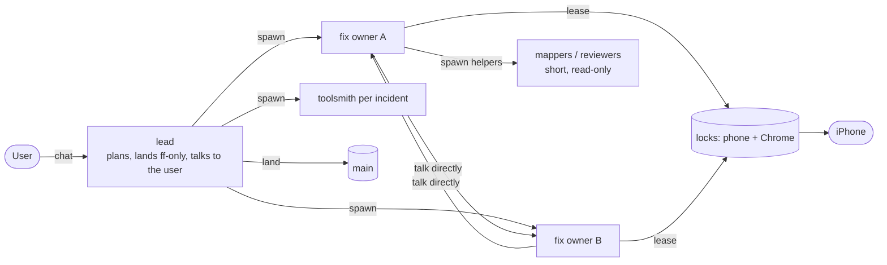
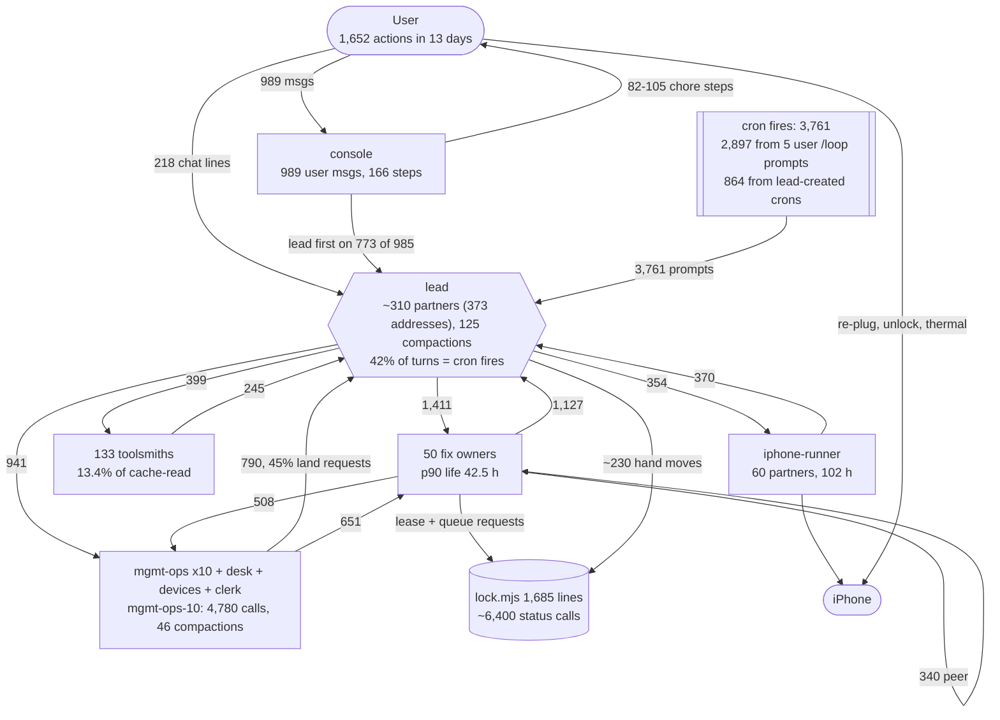
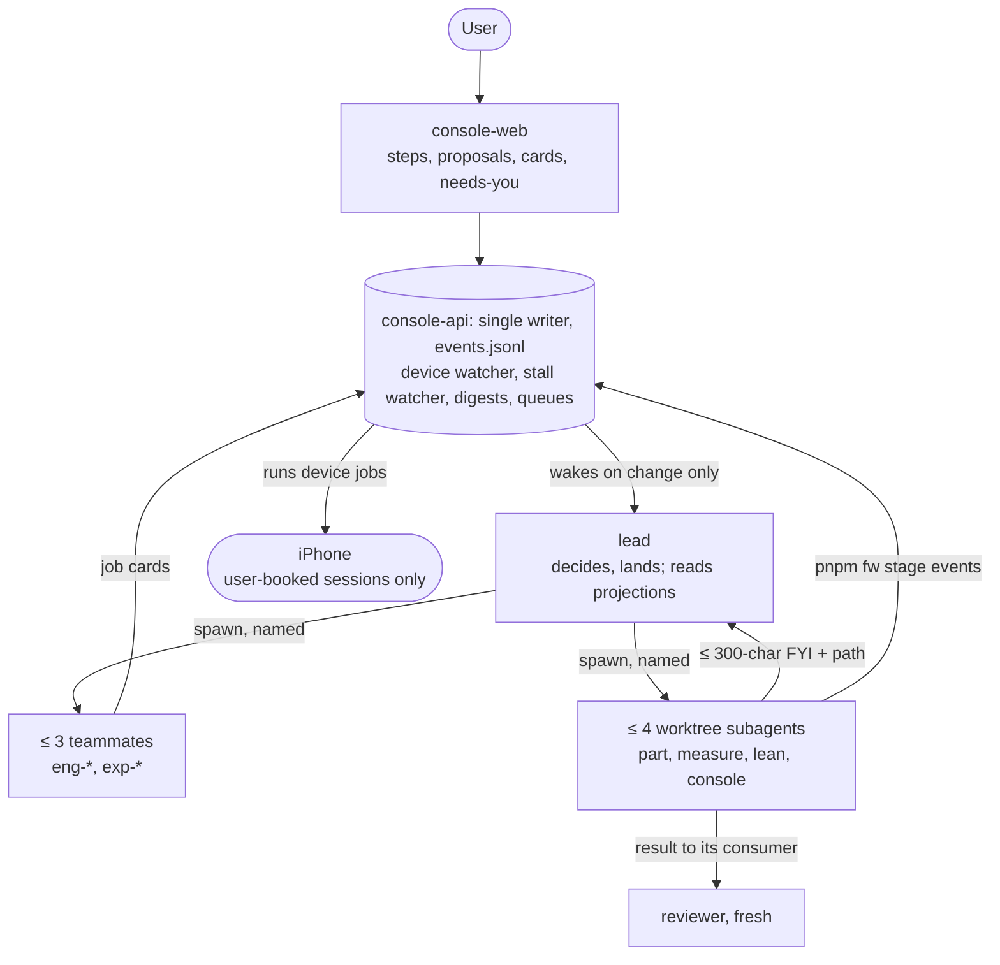

# How the v1 loop actually worked: chat forensics

This note brings together five lens notes. Each one read v1's raw chat transcripts, the pre-extracted digest and the
v1 console:

| Lens | Question it answers |
|---|---|
| [01 user timeline](01-user-timeline.md) | What did the user do, wait for, correct and value? |
| [02 coordination graph](02-coordination-graph.md) | Who talked to whom, how agents were woken and replaced, and where coordination broke |
| [03 cost and efficiency](03-cost-efficiency.md) | What the tokens bought, and what PLAN §8.4 gets wrong |
| [04 failures and conflicts](04-failures-conflicts.md) | Error and incident root causes, and conflicts between agents |
| [05 case studies](05-case-studies.md) | Four topics traced end to end, and what v2 would change on each one |

**Status words.**
- **MEASURED**: computed from data by a command, either in a lens note (cited as `[02 A3]`, `[01 R6]` and so on) or
  in Appendix B of this note.
- **INFERRED**: a reading, an estimate or a recommendation.
- **QUOTED**: a short quote from the user, the lead or a v1 file.

Where two lenses give different numbers for the same thing, Appendix A says why and which one to use.

**Privacy.** No personal data and no Fastwork code. The user is "the user". Quotes are short; everything else is
paraphrased. Paths are relative: the digest is `.local/v1-chat-digest/out`, and the raw transcripts are
`~/.claude/projects/<v1-project>/`.

---

## 1. The answer on one page

### 1.1 How the team actually worked together

- **v1 was a star with the user as its supervisor, not a team of peers.**
  - In the main session, 64 % of the 12,582 SendMessage calls started or ended at the lead [02 A3].
  - 31 % touched one of the `mgmt-ops` hubs. Only 16 % went from worker to worker [02 A3].
  - The lead spoke with about 310 distinct agents (311 once raw agent ids are mapped to names; 373 distinct address
    strings), up to 38 in one hour, and compacted 125 times, about once an hour [B13, 02 A4, A12]. (MEASURED)
- **The lead held almost every job at once** (MEASURED):
  - planner and spawner: 544 of 823 spawns [Appendix B, B6];
  - router: 47 % of mgmt-* → lead messages were land requests (45 % for the mgmt-ops hubs alone), because only the
    lead could land [02 §1.3];
  - reviewer: it signed every card in cases A and B [05];
  - queue scheduler: about 230 hand moves of the phone and Mac queue (229 `lock.mjs repair --move` calls) [B14];
  - first responder on 773 of 985 user console messages [Appendix B, B9];
  - and the only voice to the user.
- **The lead's turns were mostly polls and interruptions, not decisions** (MEASURED [02 §1.5]). Of the 8,948 turns
  in the main session:
  - 42 % were started by cron fires (3,761; 1,889 of them "check iphone connection"), and another 2 % by goal
    check-ins and other meta prompts (44 % in all);
  - 30 % by a teammate message or subagent hand-back;
  - 24 % by a task notification;
  - 2 % by the user typing in chat.
  - 43 % of the messages sent to the lead arrived in the middle of another turn (INFERRED: from `ctx.mjs`, which
    [02 B1] gives only as pseudocode).
- **Workers were long-lived Opus contexts that spent much of their time waiting.**
  - 50 fix owners ran a median 4.9 h and a p90 of 42.5 h [02 A6].
  - Agents ran `lock.mjs status` in about 6,400 tool calls (6,424 unique tool-use ids) [B14]. (MEASURED)
  - 21 % of all sends had to resume an agent that had stopped [02 F1]. (MEASURED)
  - The I-274 signature (a finished background job's notice reaches an idle agent only when something else wakes
    it) matched 214 times in 65 agents [02 F2] (MEASURED, heuristic). That is up to about 33 agent-hours of waiting;
    how much of it delayed work is not known (INFERRED upper bound).
- **The user spoke through the console, not chat** (MEASURED [01 §1]):
  - 1,652 recorded actions in 13 days: 218 chat lines, 989 console messages and 445 step clicks;
  - 185 of the 218 chat lines came in the first two days.
- **Cost per landing fell as the team got smaller** (numbers MEASURED [03 §1.4]; the causal reading INFERRED):
  - 30 Sep-5 Oct: 44-291 active agents a day, about $922 per best-build step.
  - 6-10 Oct: 25-46 agents a day, measured gates and the less-work rule, about $206 per step.
  - Team size, code gates, the less-work rule and step size all changed together, so the data show co-occurrence,
    not cause. Later steps were also smaller, so 4.5× is an upper bound on the efficiency gain.

### 1.2 The five biggest problems

| # | Problem | Key numbers (MEASURED unless marked) | Lens |
|---|---|---|---|
| P1 | **The lead was a polling hub, and the user had to pull it and re-teach it.** Supervision ran on recurring prompts. Agents and the user had to come and ask for state. | 3,761 cron fires = 42 % of lead turn starts (44 % with goal check-ins and other meta prompts), $656 = 35 % of the lead's dollars; 2,897 fires came from 5 user `/loop` prompts, 864 from crons the lead created [B12]. 132 catch-up regex matches (114 without the bare word "progress"); 39 priority overrides. 36 "delegate / you are the bottleneck" asks on 11 days. The lead QUOTED: "you asked me for this loop at least 15 times today" | 01 §3, 02 §1.5, 03 §2.2 |
| P2 | **Idle, long-lived Opus contexts.** Agents waited on the phone, builds and peers on a 5-minute cache, then woke up cold. | 2,924 cold rewrites after 5-60 min idle cost $2,763 (24 % of $11,395). 19 agents that lived more than 24 h cost 36.1 %; with the lead, 20 contexts made up 52 % of spend. 85 agents' last message says waiting or queued (their lifetime spend is $1,816; the idle share of it was not measured) | 03 §2.1, §2.4, §2.5 |
| P3 | **The phone needed a human babysitter.** Device chores, not judgments, filled the user's step queue, and the USB link was never root-caused. | 82-105 of 166 console steps were device chores; 41 were perception tests. Environment and phone caused 19 of the 34 blocking incidents. 36 link incidents. One re-plug step waited 11 h 41 min overnight and stalled a landing. 9 steps waited over 60 min (2,573 min in total) | 01 §6, 04 §4.3, 05 D |
| P4 | **Home-made coordination tooling broke more than the agents did.** A lock, queue and lease scheduler, alarms, a board, lints and shared ledgers were all written by hand. | 93 coupled-tooling and 46 enforcement-tool incidents (139 of 276, 50 %), against 4 agent mistakes (hand-labelled, so INFERRED; reproducible via `inctax.mjs`). 40 scheduler incidents had the slowest median fix (2.2 h). 133 toolsmiths used 13.4 % of all cache-read. Four shared ledgers took 1,194 commits | 04 §3, §5.1 |
| P5 | **Mechanical harness friction.** Isolation checks, wake gaps, addressing and naming. | 3,046 worktree-isolation refusals (57 % of 5,393 errors): 233 identifiable attempts on the shared checkout and 2,813 commands the checker could not verify (likely harmless, INFERRED). 214 I-274 signature matches. 2,741 resumed sends (21 %). 20 sends failed on a guessed lead address. 9 unnamed spawns right after one compaction cut peers off | 02 §4, 04 §2 |

### 1.3 The five biggest things that worked

| # | What worked | Evidence (MEASURED unless marked) | Lens |
|---|---|---|---|
| W1 | **The outcome, as judged by the user's own thumb.** v1 converged in the phase when the team was small and gates were code (co-occurrence; that the smaller team caused it is INFERRED). | The user QUOTED: "we did it" (6 Oct) and "all done" (9 Oct). Slow frames fell 20.1 % → 1.7 % (QUOTED, PLAN §0). 21 best-build landings. Case A went from question to landing in 5 h 58 min, led by counts, with one clean phone block | 01 §5, 03 §1.4, 05 A |
| W2 | **The console's Try-it proposals, comment buttons and step buttons.** | 41 proposals and 64 decisions, median 10 min from revision to decision. 94 of 198 user threads were opened from comment buttons. Console replies came in a median 40 s. The console went from the user's ask to first use in about 70 min | 01 §5, §8 |
| W3 | **Message delivery itself.** The platform's messaging was not the problem. | 0.35 % of sends failed and 0.15 % were duplicates. Messages reached the lead in a median 0-7 s | 02 F10 |
| W4 | **Short, fresh agents.** They were cheap and did not duplicate each other. | 645 agents that lived under an hour cost 11.1 %. Reviewers cost 2.2 % (median $2.8). A spawn's first cache write cost about $0.17 and a cold wake's rewrite $0.94 (MEASURED); the $0.17 leaves out the requests a fresh agent spends rebuilding its working context, so "spawn is cheaper than wake" is INFERRED. 291 agents on 30 Sep cost $519. Duplicate research was about $1 | 03 §1.2, §2.5 |
| W5 | **Branch, landing and claim discipline.** | One worktree per editor and ff-only landing by one lander: code edits rarely collided (13 `checkout --theirs/--ours` in 10 days). 375 findings had only 4 refuted and 9 corrections, and 7 of the 9 were self-corrected within 2 h. 40 user rules were captured in 13 days, each tied to its thread. The privacy guard was legit on all 18 blocks | 04 §2.2, §5.1, §5.2; 01 §4 |

**In one sentence (INFERRED):** v1's agents did their work well, but the loop around them was a single overloaded
lead, long-lived idle contexts, home-made shared-state tooling and a human used as a device and status bus. Almost all
of that is fixable with scripts, events and hooks, not with more agents or more rules.

---

## 2. Topology: intended vs actual

**Intended in v1.** This is the shape the user designed on 30 Sep (subagents per topic in worktrees, Agent Teams "so
agents can talk", one shared iPhone; [01 P0]). It is also the roster in v1's `fixes/AGENT_ROLES.md` (paraphrased): fix
owners as teammates that talk to each other, helpers spawned by owners, the lead as the one lander and the only
voice to the user, and locks to serialize the devices.



**Actual in v1** (main session `391f6dee`; edge counts are SendMessage calls by role class, [02 A2] filtered to the
main session; other numbers as labelled; all MEASURED):



How to read the difference (INFERRED from the numbers above):
- **The peer edge was meant to carry most traffic. It carried 16 %.** Every hub (the lead, mgmt-ops-10,
  iphone-runner) became a 4,000-plus-call context with 30-46 compactions [02 §5].
- **A second hub was added to unload the first and doubled the paths.** 22 % of consecutive instructions to 102
  workers switched between the lead and an mgmt agent within 30 minutes [02 F8].
- **The device became a person.** The lock serialized agents, but a human cable, unlock and thermal loop sat under
  it, and the user was on that loop.
- **Supervision became a prompt.** Two user-started `/loop` prompts are the single largest edge into the lead (2,877
  fires). The lead then added crons of its own for check-ins, usage and an hourly report (864 fires) [B12].

**v2 target** (PLAN rev 2 plus Section 5 of this note):



---

## 3. Cost anatomy

All dollars are list-price estimates; v1 ran on a subscription. They come from `cost-pass.mjs` and `cost-report.js`
in [03 App A-B], which dedupe requests by `message.id` and keep the final stream record. The digest's own output total
(23.5 M) is undercounted 3.6×; the real figure is 84.3 M [03 §1.1].

### 3.1 By token type (MEASURED [03 §1.1])

| Token type | Tokens | $ | Share of $ |
|---|---:|---:|---:|
| Cache read | 25.73 B | 5,053 | 44.3 % |
| Cache write, 5 min (subagents) | 903.6 M | 4,374 | 38.4 % |
| Cache write, 1 h (lead only) | 40.9 M | 327 | 2.9 % |
| Output, thinking included | 84.3 M | 1,640 | 14.4 % |
| **Total** (135,449 requests; 97.6 % of $ on Opus, 99.6 % at effort `high`) | | **11,395** | |

### 3.2 By mechanism

The rows overlap, so they do not add up. Each row names the v2 lever that addresses it (ranked in Section 5).

| Cost driver | Size | Share | Source | v2 lever (Section 5 rank) |
|---|---|---|---|---|
| Cold rewrites after 5-60 min idle | 2,924 requests, $2,763 | 24 % of $ | 03 §2.1 | 1h TTL for waits under an hour; exit with a handoff for longer waits (#1). Counterfactual −15 % |
| Agents alive more than 24 h | 19 agents, $4,108 | 36.1 % of $ | 03 §2.4 | lifetime and iteration boxes (#4) |
| The lead (10 sessions) | 27,533 requests, $1,868 | 16.4 % of $ | 03 §1.2 | — |
|   of which cron-started turns | 3,761 fires, $656 | 35 % of the lead, 5.8 % of total | 03 §2.2 | no LLM polling (#2) |
|   of which "check iphone connection" chains | 4,381 requests, 1.06 B cache-read | 18 % of the lead's cache-read (upper bound) | 05 D | device watcher (#2, #3) |
| Wakes by task notifications | $1,618 agents + $472 lead | ≈ 18 % of $ | 03 §2.2 | console-api coalesces notices (#2) |
| Requests with a prompt above 200k | 58,886 requests, $6,497 | 57 % of $ | 03 §1.3 | 200k cap (PLAN already has it; worth about 8 %) |
| Fix owners | 50 agents, $3,810 | 33.4 % of $ | 03 §1.2 | Sonnet builders with Opus per call (PLAN already has it; about 15 %) |
| Toolsmiths (mostly tooling for failures) | 133 agents (`^(ts\|tool)`), $1,777; 3.44 B cache-read | 15.6 % of $; 13.4 % of cache-read | 03 §1.2, B8 | fewer home-made tools (#13, #14) |
| mgmt / ops routing | 47 agents, $847 | 7.4 % of $ | 03 §1.2 | no routing agents (#5) |
| Device agents | 9 agents, $571 | 5.0 % of $ | 03 §1.2 | device lane in console-api (#3) |
| Agents whose last message says waiting or queued | 85 agents, $1,816 lifetime spend | 15.9 % of $ (lifetime, not idle cost; the idle share was not measured) | 03 §2.5 | "do not idle" (#1) |
| End-of-page line (by spawn window) | 37 agents, 2.78 B cache-read | 10.8 % of cache-read (3.06 B, 11.9 %, for the region by name over all time; Appendix A) | 05 C, 04 §5.3 | region time box; decide behaviour first (#4, #15) |
| Coordination traffic in the lead's context | ≈ 0.49 B cache-read | 18.2 % of the lead's re-reads (INFERRED: `ctx.mjs` is pseudocode in [02 B1], not a runnable script) | 02 §2 | peer-first results, one-line FYIs (#11) |
| Re-injected rules, memory and skills in the lead | — | 30 % of the lead's re-reads (INFERRED, same caveat) | 02 §2 | `CLAUDE.md` under 300 words (PLAN §2.2 already) |
| All 5,393 error records | ≈ 1.0 B context tokens | 3.8 % of context | 04 §2 | `pnpm fw` verbs (#6) |
| Compaction | 822 compactions, ≈ $500 | ≈ 4.4 % of $ | 03 §2.3 | a budget line (#12) |
| Output (the effort lever) | $1,640 | 14.4 %; a 25 % cut saves 3.6 % | 03 §2.6 | minor (#12) |

**Lever ranking measured on v1** (INFERRED counterfactuals from [03 §4.2]):
1. no idling, or a 1h TTL: 15-24 %;
2. Sonnet for builders: about 15 %;
3. scripts for mgmt, device and cron work: about 13 %;
4. a 200k context cap: about 8 %;
5. effort: about 3.6 %.

PLAN §8.4 ranks "keep the lead lean" and the context cap first and does not list idling at all.

**Budget check** (INFERRED [03 §3]): v2's roster applied to v1's workload is about $6.2-7.2k for 12 days, or
$520-600 a day. PLAN §8.4 budgets $127 a day. It gives the lead 51 % of the budget (v1 measured 16 %) and measuring
7 % (v1 toolsmiths 15.6 %).

---

## 4. Conflict and failure taxonomy

"Found by" says who noticed first. Rank numbers point to the fixes in Section 5.

| Class | Kind | Size (MEASURED) | Typical example | Root cause (INFERRED) | Found by | Fix (rank) |
|---|---|---|---|---|---|---|
| **Polling instead of events** | failure | 3,761 cron fires (42 % of lead turn starts): 2,897 from 5 user `/loop` prompts (1,889 "check iphone connection", 988 "check all agents"), 864 from lead-created crons (365 mgmt check-ins, 334 usage checks, 164 hourly reports, 1 reset) [B12] | `/loop 5m check iphone connection` fired 1,889 times | No watcher emitted state changes, so an LLM was asked on a timer [02 §1.5, 04 §4.5] | nobody flagged it as a cost; the user started the largest loops and the lead added more | #2 |
| **Wake gaps and deafness** | failure | 214 I-274 signature matches in 65 agents (heuristic; up to ≈ 33 agent-h, max 103 min, an upper bound); a cluster at the 10-min foreground cap; 2,741 resumed sends (21 %) | ts-i268 waited 103 min on a finished job | A background notice does not wake an idle agent; long foreground commands block messages [02 F1-F3] | diagnosed only on day 13 (I-274) | #2, #11 |
| **Lead overload and relays** | conflict | ≈ 310 partners (373 address strings); 43 % of inbound messages mid-turn (INFERRED, `ctx.mjs`); 47 % of mgmt-* → lead messages were land requests (45 % for mgmt-ops); 39 "crossed" messages, 55 status-row nags, 1,334 back-to-back sends | P-174 signed three times; three "start F" messages in one minute | Only the lead could land, sign, spawn and answer; owner state lived in messages [02 §1.3, 05 cross-case 3] | the user, on day 1: the lead was being interrupted a lot (paraphrased) | #5, #11 |
| **Two bosses** | conflict | 22 % of consecutive instructions to 102 workers switched between the lead and mgmt within 30 min | "One user message got two different answers" (QUOTED, v1 memory) | A second hub with overlapping authority [02 F8] | v1 memory note | #5 |
| **Hub churn** | failure | mgmt-ops ran as 10 hub instances (incl. the unnamed -8; 6 context handovers) plus a short-lived mgmt-ops-11 editor; mgmt-ops-10 ran 52.7 h with 46 compactions | mgmt-ops-8 unreachable by name, replaced 7 min later | A routing role is a context sink [02 §3] | the lead | #5, #9 |
| **Addressing and naming** | failure | 45 failed sends: 20 to a guessed lead address (19 `lead`, 1 `team-lead`; it was `main`), 13 to ended agents, 8 to deleted worktrees, 4 to reused names; 9 + 3 unnamed spawns after compactions; 6 same-name reuses | the user: unnamed teammates could not reach each other (paraphrased) | The naming rule was lost on compaction; no generated peer directory [02 F5, F6] | the user | #9 |
| **Scarce device: priority fights** | conflict | ≈ 230 lead hand moves (229 `repair --move` calls [B14]); 264 agent order-request messages; 39 user priority overrides | the user asked why only one fix showed as top priority (T-159, paraphrased) | Agents held leases; priority was settled by messages; the user set priority by hand [04 §5.4, 01 §3] | the user (T-058, T-149) | #3, #8 |
| **Scheduler bugs** | failure | 40 lock, queue and lease incidents (median fix 2.2 h, 6 unresolved); 0.34 B in their `ts-iNNN` fixers, 0.72 B with the 10 named lock toolsmiths [04 §3] | I-049 → I-097 → I-207 → I-210: each fairness fix starved another class | Hand-built multi-process lease logic over shared state [04 §4.2] | agents and the user | #3, #8 |
| **Shared-file conflicts** | conflict | 4 ledgers with 1,194 commits; 94 `rebase --continue`; board rows overwritten | a fix agent's "parked" overwrote the lead's "landed" | Coordination state in hand-edited shared files [04 §5.1] | the lead | #13 |
| **Coupled tests and processes** | failure | 44 flaky tests on the shared host (10 unresolved); 14 port, process-name and temp-dir collisions; 9 races and version-skew incidents | I-041: unlanded lock code granted co-holds on the live lock for 17 min | Tests read the real host; each worktree had its own copy of the tools on one shared state [04 §3.1, §4.2] | toolsmiths | #13 |
| **Enforcers that misfired** | failure | 46 incidents (17 %); 0.12 B in their `ts-iNNN` fixers, 0.61 B with the 18 named board, console, lint and guard toolsmiths [04 §3]; 135 lint refusals of agents' own drafts; 61 of 80 lead threads were alarms | I-144: the idle alarm called the user's own hand test idle | Each complaint produced a new enforcer that read stale self-reports [04 §4.4, 01 §8] | the user: 15 of the 46 | #14 |
| **Environment and phone** | failure | 57 incidents, 19 of 34 blocking; 36 link incidents, never root-caused; 82-105 of 166 user steps were chores | C-140 re-plug waited 11 h 41 min | A cabled phone, Xcode heat states and WDA each fail alone; detected inside long blocks; preflight only on day 7 [04 §4.3, 05 D] | the user | #3 |
| **Harness isolation checks** | friction | 3,046 refusals (57 % of errors): 233 identifiable attempts on the shared checkout, 2,813 commands the checker could not verify (likely harmless, INFERRED); 211 auto-mode classifier outages; 71 denials | `cd main && git …` to land one's own work | No committed verb layer; ad hoc shell glue [04 §2.1] | the harness | #6, #17 |
| **Agent runtime limits** | failure | runners died with their agent's API error (I-221) or at the 30-min background cap (I-240, I-256); the weekly limit stopped the lead plus 5, 1 and 4 agents in three episodes (18 errors, 11 distinct transcripts) | a phone block voided mid-run | Long device runs lived in agents' shells [04 §2.3] | agents | #3, #17 |
| **Contradictory findings** | conflict | 4 refuted and 9 corrections of 375 findings; 7 of the 9 self-corrected within 2 h | `scrollY` layout read: fix-scroll-cb vs int-v8 | No "same mechanism" key, so cross-agent contradictions surfaced only through managers or auditors [04 §5.2] | auditor roles, managers | #18 |
| **Duplicated effort** | conflict | 23 agents and 3.06 B on one page region (by name, all time); 11 duplicate incidents; 7 peer messages flagging overlap | successive end-of-page owners re-derived the same engine context | A shared engine region with no part boundary and no region time box [04 §5.3] | nobody, in real time | #4, #15 |
| **Moving product target** | conflict (user vs build) | end-of-page line: finger-following accepted 3 times, rolled back once; 37 agents, 2.78 B (10.8 %), 17 of 41 proposals, 34 fix folders | the rollback followed a 4 px row rise on a build that had passed its phone check | Behaviour was decided after optimizing, on stacked builds [05 C] | the user, by hand | #15 |
| **User re-teaching the lead** | conflict (user vs lead) | 132 catch-up regex matches (114 without the bare word "progress"; 68 say "catch up"); 36 delegate/bottleneck asks on 11 days; 31 issue-loop re-asks; 25 "what does it mean"; 4 rules broken after they were written | the user told the lead, again, that it was the bottleneck (T-105, paraphrased) | Coaching lived in memory notes, not in role files, hooks or the status surface [01 §3-4] | the user | #7, #9, #10 |
| **Not failures** | ledger noise | 45 of 276 incidents were feature requests (0.60 B in their `ts-iNNN` fixers, the most `ts-iNNN` fixer spend of any label); only 4 agent mistakes (hand labels) | — | One ledger for requests and incidents [04 §3] | — | #14 |

**The pattern (INFERRED).**
- Conflicts between agents were about **scarce shared things**: the phone, the lead's attention, the land queue and
  shared files. They were not about code or findings.
- Failures were mostly in the **tooling built to manage those scarce things**.
- The user found the important classes first: idle phones, stale status, the bottleneck and device chores.

---

## 5. Improvements for v2, ranked by expected impact

The five lens notes propose 63 improvements: 14, 13, 10, 14 and 12. Here they are merged into 18 and ranked by
expected impact, in three kinds:
- **$**: tokens and dollars;
- **U**: the user's attention;
- **B**: bugs and incidents prevented.

Impact figures are v1 measurements of the problem each change targets. The saving itself is INFERRED unless a
counterfactual is cited.

| Rank | Change | Main impact | PLAN.md sections changed |
|---|---|---|---|
| 1 | Wait policy: 1h TTL for waits under an hour, handoff and exit for longer ones | $ −15 to −24 % | §8.4 lever 3; §8.2 Cache TTL column (lead row too); §9; §8.3 `session-brief` |
| 2 | No LLM polling; console-api watchers wake agents only on change | $, U | §8.4 lever 1; §8.2 lead row; §8.3 ask list and hooks; §3.2; §8.1; §11 |
| 3 | The device lane belongs to console-api; sessions are user-booked; preflight first | U, B | §4.1; §3.2; §5.1; §4.6; §9.2; §1.1 G2; §11 R17; App. B; §12.1 Q1; §12.2 Q7 |
| 4 | Bound lifetime and iterations per agent, per experiment and per region | $ | §8.2; §8.4; §9.1; §9.2 |
| 5 | No routing agents; one manager per worker; owner state from events | $, B | §2.2 Drop; §3.3; §8.2 roster; §3.2 |
| 6 | `pnpm fw` verbs; one plain command per Bash call in worktrees | B, $ | §8.2 role bodies; §8.3 allow list; App. B spike; §8.4 Reporting |
| 7 | The console is the user's channel from the first phone touch, with push, not pull | U | §10.2 (Day 3-4, Day 9); §10.1 M0/M1; §3.1; §3.2; §8.4 Reporting; §9.2 |
| 8 | Priority is data the user owns; queues read it through a tested function | U, B | §9.1/§9.2 question stage; §5.1; §3.3 |
| 9 | The user's coaching goes into role files and hooks on Day 1, and is re-injected after compaction | U | §8.2; §2.1 Keep; §2.2 rulebook row; §8.3 `session-brief`; §8.1 cW |
| 10 | Spawn and address hygiene in spawn-guard | B | §8.1; §8.3 spawn-guard |
| 11 | Message budget: results go peer-first, the lead gets one line; meters for span and resumes | $ | §8.2; §8.4 levers and Reporting; §9.2 |
| 12 | Re-derive the budget and fix the meter | $ | §8.4 table, levers and Reporting; §8.3 `usage-record`; §1.1 G3 |
| 13 | Decouple tooling: tests never read the host; a versioned console-api protocol; no shared ledgers | B | §5.4; §2.2; §3.2; §7.1; §8.2 |
| 14 | Discipline for enforcers; requests kept out of the incident ledger | B, U | §2.2 tool rule; §1.2 V-l; §7.2; §11 R7; Q12 |
| 15 | Decide behaviour (class P) before optimizing a contested part; add accessibility and focus parity | $, U | §10.1 M5; §9.2; §6.2; §6.6 |
| 16 | Measurement-lane gaps found by the case studies | $, U | §4.2; §4.3; §4.6; §5.4; Q10; §10.1 |
| 17 | Harness settings: permissions, approvals, capture policy, device runs, usage alert | U, B | App. C; §10.2 Day 1; §8.1; §8.3 Notes; §12.2; §7.3; §8.4 |
| 18 | Keep what worked as first-class; make the write-up an outcome; key claims by mechanism | U | §2.1; §10.1 M1/M6; §12.1 Q1; §1.1 (new G4); §7.2; §7.3; §9.2 |

### Details

1. **Choose by expected wait: stay warm on a 1h TTL, or hand off and exit.**
   - *Change:*
     - A role that waits under an hour on gates, builds or peers uses `experimental.cacheTtl: 1h`: part-builder,
       measure-engineer, lean-prover, eng-* and exp-*.
     - An agent whose wait is an hour or more, or unknown (a device session, the user), writes a handoff note to
       `research/notes/` and exits. The script that ends the wait spawns a fresh agent with the note.
     - Keep 5m only for fresh, short roles: reviewer, source-locator, librarian and Explore.
     - Keep the **lead at 1h**. PLAN §8.2 sets it to 5m, but v1's lead ran on the 1h cache and lost only $3 to idle
       rewrites.
     - `session-brief` lists live agents with their idle minutes and context size.
   - *Evidence:*
     - $2,763 (24 %) of cold rewrites after 5-60 min idle; a 1h counterfactual for subagents comes to −15 %
       [03 §2.1].
     - A cold wake's rewrite costs about $0.94 and a spawn's first cache write about $0.17; the two are not
       like-for-like, because a fresh agent also rebuilds its working context over later requests (INFERRED).
     - 85 agents' last message says waiting or queued (lifetime spend $1,816; idle share unmeasured) [03 §2.5].
     - An 11 h 26 min device wait cost 1 request and then a cache rebuild [05 B].
   - *Reconciles* 03 #1-2 (1h TTL), which said "use 1h", with 05 #12, which said "keep 5m for device-blocked owners".
     A 1h TTL cannot span an overnight device wait, and an agent should not be alive during one.
   - *PLAN:* §8.4 lever 3 (rewrite), §8.2 Cache TTL column (including the lead row), §9 (add a "do not idle" rule),
     §8.3 `session-brief`.
2. **No recurring LLM checks. console-api watches and wakes agents only on a change.**
   - *Change:*
     - No `CronCreate` in the lead; add `CronCreate` to `ask`. `CLAUDE.md` forbids `/loop` status checks.
     - console-api runs three watchers:
       - a device watcher (usbmux, WDA, proxy, lock state, Wi-Fi) with one status and at most one open re-plug
         step;
       - a stall watcher: a finished background task plus a silent agent gets one wake message;
       - a coalescer for repeated "Agent … finished" and Monitor notices.
     - `pnpm fw status --watch` posts only deltas.
     - Add "a background notice does not wake an idle teammate" to §8.1 as a verified limit, and to §11 as a risk.
       Re-check it on every Claude Code upgrade.
   - *Evidence:*
     - 3,761 fires were 42 % of lead turn starts and $656, 35 % of the lead's dollars [02 §1.5, 03 §2.2]. 864 of
       them came from crons the lead created itself, so a rule against user `/loop` alone is not enough [B12].
     - The iphone-check chains alone came to 4,381 lead requests and 1.06 B cache-read [05 D].
     - 214 I-274 signature matches (heuristic) [02 F2].
     - One agent's "finished" notice reached the lead 83 times [03 §2.2].
   - *Merges:* 01 #4, #12; 02 #3, #6; 03 #5; 04 #3; 05 #1.
   - *PLAN:* §8.4 lever 1 (from a lever to a rule), §8.2 lead row, §8.3 ask list and hooks, §3.2 console-api, §8.1,
     §11.
3. **The device lane is a job queue owned by console-api. Sessions happen only in windows the user books, and each
   starts with one preflight.**
   - *Change:*
     - Agents submit job cards and never hold phone leases.
     - Long device runs live in console-api, never in an agent's shell.
     - The device lane accepts runs only inside a window the user opens.
     - Each session starts with `fw device check`, using v1's named trap codes. It runs **before** anything is
       posted, repairs what it can, and then posts one bundled get-ready step: the usual USB port, unlocked,
       Auto-Lock Never, UI Automation on, the same Wi-Fi, Do Not Disturb, one thermal profile. After that, the queued
       blocks run back to back.
     - G2 gains "≤ 1 get-ready step and 0 reactive chore steps per phone session". This reconciles 01's "≤ 2" with
       04's "≤ 1".
     - Add R17 "device link instability" and a spike SPK-n: a one-hour link soak with an attach/detach logger and a
       cable and port swap. Avoid compiled native shims, or pin the toolchain.
     - Q1 settles thermal-state control before M3.
   - *Evidence:*
     - User steps: 82-105 of 166 were chores; 19 of 34 blocking incidents came from the environment.
     - Scheduler: 40 incidents (median fix 2.2 h), ≈ 230 hand moves and 264 order requests.
     - Waits: 9 steps over 60 min (2,573 min), and C-140 at 11 h 41 min.
     - Runner deaths: I-221, I-240, I-256. 36 link incidents were never root-caused. The preflight arrived only on
       day 7.
     - [01 §6, 04 §4.2-4.3, 05 B, D]
   - *Merges:* 01 #5-7; 04 #4, #5, #12; 05 #2, #3.
   - *PLAN:* §4.1, §3.2 (agent → device lane contract), §5.1 (the priority function), §4.6, §9.2 device stage,
     §1.1 G2, §11 (R17), Appendix B (SPK-n), §12.1 Q1, §12.2 Q7.
4. **Bound lifetime and iterations, not only context.**
   - *Change:*
     - `maxTurns` goes on every role file, teammates included.
     - Time boxes are stated as request counts the meter checks.
     - An exp-* owner gets 1 agent-day or 3 build iterations per question. Then it writes the measured deltas in the
       card and passes review before another round.
     - The part time box (1-2 agent-days) also applies to a **page region** as a whole. Going past it needs a
       decision record.
     - No agent lives across two milestone days without a handoff note.
   - *Evidence:*
     - 19 agents alive more than 24 h made up 36.1 % of spend. The top fix owner made 4,603 requests in 119 h
       [03 §2.4].
     - `arch-compositor-morph` made 2,793 requests, went through 13 compactions and left 13 diff variants in 28 h
       [05 C].
     - The end-of-page line drew 37 agents and 2.78 B cache-read (10.8 %) in about 78 h [05 C].
   - *Merges:* 03 #3, #10; 04 #13; 05 #7.
   - *PLAN:* §8.2 (roster and agent files), §8.4, §9.1, §9.2.
5. **No agent whose only job is routing. Owner state comes from events, and each worker has one manager.**
   - *Change:*
     - §2.2 Drop names mgmt-ops, desk, clerk, devices and ops-readers explicitly.
     - The following become `pnpm fw` scripts over `events.jsonl`: queue order, the land queue, device dispatch,
       check-in digests, card pre-data reads and console first response to status questions.
     - `fw` stage commands emit events, and the lead reads the projection instead of nagging.
     - Hand-backs carry `waiting-for: lead|device|user`, and the lead sends one message per hand-back.
     - The roster gets a "reports to" field.
   - *Evidence:*
     - 10 mgmt-ops hub instances ($645 with the mgmt-ops-11 editor); all mgmt/ops agents cost $847 [02 §3,
       03 §1.2].
     - 47 % of mgmt-* → lead messages were land requests (45 % for mgmt-ops). Two-boss switches ran at 22 %.
     - 39 "crossed" messages, 55 nags and 1,334 back-to-back sends [05 cross-case 3].
     - The desk answered first only 68 of 985 times [02 §1.6].
   - *Merges:* 02 #4, #7, #12; 03 #7; 05 #11.
   - *PLAN:* §2.2 Drop and the "status as a projection" row, §3.3, §8.2 roster, §3.2.
6. **Every multi-step operation is a committed `pnpm fw` verb. Worktree agents run one plain command per Bash call.**
   - *Change:*
     - No `node -e`, `sed` on variables, `python -c`, `cd` or `git -C <main>`.
     - `pnpm fw git …` acts on the agent's own worktree.
     - A spike checks that a named `isolation: worktree` subagent can run gate and commit with zero refusals.
     - The meter reports isolation refusals per 100 turns per role.
   - *Evidence:* 3,046 refusals, 57 % of all errors; 2,813 of them were commands the checker could not verify; 358
     agents hit the check; about 0.57 B context tokens [04 §2.1, 02 F7]. Every v2 editing role is a worktree
     subagent, so v2 would hit the same check.
   - *Merges:* 02 #8; 04 #1.
   - *PLAN:* §8.2 role bodies (part-builder and others), §8.3 allow list, Appendix B (new spike), §8.4 Reporting.
7. **Make the console the user's channel from the first phone touch. Push state; do not make the user pull it.**
   - *Change:*
     - A minimal step queue (post, Start, answer, Done) ships before the first device or Simulator step. The console
       skeleton moves from Day 9 to Day 3-4, with steps only.
     - Every status row shows "needs you: yes/no + the exact action" and the age of its last event. Only an open step
       or proposal event can set "needs you".
     - One digest per experiment-card stage change: stage, owner, next step, ETA.
     - Alarms go to an ops log owned by a script; the user sees one counter.
     - One question per thread, auto-closed. Long topics become pages.
     - A `pnpm fw usage` badge in the header.
     - Status questions are answered by a script; only judgement questions wake the lead.
   - *Evidence:*
     - 132 catch-up regex matches; 25 "what does it mean"; 61 of 80 lead threads were alarms.
     - Thread T-170 reached 500 messages. The user read out usage by hand 12 times.
     - The lead was first responder on 78 % of console questions.
     - [01 §3, §8; 02 §1.6]
   - *Merges:* 01 #1-4, #12, #13; 02 #12.
   - *PLAN:* §10.2 (Day 3-4, Day 9), §10.1 M0/M1, §3.1 console-web, §3.2 contract, §8.4 Reporting, §9.2 (a visible
     stage and ETA).
8. **Priority is data the user owns.**
   - *Change:*
     - One ordered list (`presets/priority.json` or a console list) that the user drags. The experiment queue and the
       device queue both read it.
     - Agents never set priority.
     - The device order is a pure, table-tested function of that list and the job class.
     - A manual move is a logged event with a reason.
   - *Evidence:*
     - 39 user priority overrides [01 §3].
     - ≈ 230 lead hand moves and 264 agent order requests; the scheduler fairness cascade I-049 → I-210 [04 §4.2,
       §5.4, B14].
   - *Merges:* 01 #9; 04 #4 (its priority clause).
   - *PLAN:* §9.1/§9.2 (the question stage reads the list), §5.1, §3.3.
9. **The user's coaching goes into role files and hooks on Day 1, and survives compaction.**
   - *Change:*
     - The lead file and `CLAUDE.md` carry four v1 rules, each naming its enforcer:
       - the issue loop (cause, workaround, long-term fix with an owner);
       - proactive by default;
       - trace before asking;
       - the answer format.
     - A post-compaction hook re-injects the roster, the lead address and the naming rule in ≤ 15 lines.
     - A new *agent* rule must cite an incident whose root cause is an agent mistake. Otherwise, fix the tool.
   - *Evidence:*
     - 36 delegate/bottleneck asks on 11 days and 31 issue-loop re-asks.
     - The lead QUOTED: "at least 15 times today".
     - 4 rules were broken after they were written [01 §3].
     - The naming rule was lost at a compaction [02 F6].
     - 4 agent-mistake incidents against 139 tooling and enforcement incidents [04 §3] (hand labels, INFERRED).
   - *Merges:* 01 #8; 02 #9; 04 #14.
   - *PLAN:* §8.2 (lead row and role files), §2.1 Keep, §2.2 rulebook row, §8.3 `session-brief` trigger list, §8.1
     cW, §11 R7.
10. **Spawn and address hygiene in spawn-guard.**
    - *Change:*
      - One fixed lead address, recorded in §8.1 and checked by `session-brief`. Peer directories are generated
        from the live roster.
      - Spawn-guard denies an unnamed `Agent` call, and a name that resolves to a live or resumable agent. Restarts
        are named `<role>-<topic>-<n>`.
      - At most 6 spawns per 10 minutes per spawner. Depth-2 spawns are read-only helpers only.
    - *Evidence:*
      - 20 sends to the wrong lead address; 9 unnamed spawns after one compaction; mgmt-ops-8 unreachable.
      - 6 same-name reuses.
      - One agent made 133 spawns; 190 agents were alive in one hour.
      - [02 F5, F6, §1.4]
    - *Merges:* 02 #1, #2, #13.
    - *PLAN:* §8.1, §8.3 spawn-guard (new deny rules with unit tests).
11. **A message budget: results go to their consumers, and the lead gets one line.**
    - *Change:*
      - A worker sends its result to its consumer and gives the lead ≤ 300 characters plus a file path.
      - Reports live in notes or cards, never in messages.
      - The meter adds counterparts per hour and messages in per hour, with alarms at 10 and 60.
      - It also counts resumes per role, with a ceiling.
      - An agent is either "ended" or "waiting in the foreground", never a silent background wait.
    - *Evidence:*
      - Coordination was 18.2 % of the lead's re-reads (≈ 0.49 B), and hand-backs had a median of 4.1k characters
        (both INFERRED: they come from `ctx.mjs`, which [02 B1] gives only as pseudocode).
      - Messages to the lead had a median of 1.1-1.4k characters (MEASURED [02 A15]).
      - 43 % of inbound messages arrived mid-turn (INFERRED, `ctx.mjs`).
      - 21 % of sends were resumes.
      - The lead's p90 was 13 counterparts and 80 messages an hour.
      - [02 §1.5, §2]
    - *Merges:* 02 #5, #10, #11.
    - *PLAN:* §8.2 (role contract line, Caps), §8.4 (a "message budget" lever, Reporting), §9.2 artifacts.
12. **Re-derive the budget and fix the meter before trusting it.**
    - *Change:*
      - Size §8.4's table from measured requests per day and average prompt per role.
      - Add compaction (≈ 4 %) and cold-wake lines.
      - Move about $1,000 from the lead to builders and measuring.
      - Give part-builder Opus escalations their own line.
      - State that $127 a day means about a quarter of v1's daily activity.
      - Correct the cited figures: reviewers 2.2 % of $, the lead 16.4 %, cache reads 44 % of $ (96 % of tokens).
      - Re-rank the levers as in Section 3.
      - Treat effort as a minor lever.
      - `usage-record.mjs` dedupes by `message.id`, keeps the final stream record and splits 5m from 1h writes, with a
        two-record unit test.
      - Add an alert at 80 % of the weekly usage limit.
    - *Evidence:*
      - $520-600 a day estimated against $127 budgeted.
      - The digest undercounts output 3.6×.
      - The weekly limit stopped the lead plus 5, 1 and 4 agents in three episodes (11 distinct transcripts).
      - [03 §3-4, 04 §2.3]
    - *Merges:* 03 #4, #6, #8, #9; 04 #12 (alert).
    - *PLAN:* §8.4 (table, levers, Reporting), §8.3 `usage-record`, §1.1 G3.
13. **Decouple the tooling.**
    - *Change:*
      - Tests never read the real host: no real load, no fixed or real ports, no process-name matching, no shared
        temp folders. A lint enforces this.
      - Engine e2e tests run outside pre-commit.
      - Scratch paths are per agent.
      - Every request to console-api carries `contractsVersion`, and the server refuses a mismatch.
      - Only console-api, run from `main`, writes shared state.
      - No shared ledger files: predictions live in each `card.md`, handovers in per-agent notes, and the board is a
        projection.
    - *Evidence:*
      - 44 flaky-test incidents (10 unresolved) and 14 collisions.
      - Version skew: I-010, I-011, I-041, I-102.
      - 1,194 ledger commits and 94 `rebase --continue`.
      - [04 §3.1, §4.2, §5.1]
    - *Merges:* 04 #6-8.
    - *PLAN:* §5.4, §2.2 ("Real time in tests" and single-writer rows), §3.2, §7.1, §8.2.
14. **Discipline for enforcers, and a clean incident ledger.**
    - *Change:*
      - Every enforcer reads only events.
      - It ships with false-positive and false-negative golden tests.
      - An alarm that reaches the user must reach ≥ 90 % precision on an event-log replay before it is enabled.
      - The ledger has `kind: request | incident`, so the M4 Lean go/no-go counts failures only.
    - *Evidence:*
      - 46 enforcement incidents, 0.61 B in their fixers (0.12 B `ts-iNNN` + 0.49 B in 18 named toolsmiths), and 135
        lint refusals.
      - 45 feature requests filed as incidents, with the largest `ts-iNNN` fixer spend of any label (0.60 B) [04 §3,
        §4.4].
      - PLAN §0's "231 of 276 incidents were bugs in its own tools" counts those requests as bugs (INFERRED from
        [04 §3]).
    - *Merges:* 04 #9, #10.
    - *PLAN:* §2.2 "Rule for every new tool, hook or package", §1.2 V-l, §7.2, Q12, §0 (correct the figure).
15. **Decide the behaviour before optimizing a contested part, and check accessibility parity.**
    - *Change:*
      - The M5 end-of-page experiment starts with a Try-it decision between the `faithful` tween and the
        finger-following `proposal`, both shown against `original`.
      - Only the chosen variant is optimized. Reversing the choice later is a preset change.
      - A PL2b check compares the accessibility tree and tab order with the original's at each stop.
    - *Evidence:*
      - The end-of-page line took about 78 h, 37 agents, 2.78 B (10.8 %) and 17 of 41 proposals. The target was
        accepted three times and rolled back once.
      - The rollback followed small look regressions.
      - g0.0m needed rev 3 for accessibility and focus parity.
      - [05 C, B]
    - *Merges:* 05 #6, #8.
    - *PLAN:* §10.1 M5, §9.2 question stage, §6.2, §6.6.
16. **Fill the measurement-lane gaps the case studies found.**
    - *Change:*
      - Add a Simulator WDA finger-drag counts profile, with *stable*-class counts and a stated tolerance.
      - Move the WKTR spike to M1, or narrow the class-W bar to part-scoped selector diffs.
      - Add v1's gate-class rulings as `fwcore screen` golden tests: sticky-walk dominates; reveal-paint does not.
    - *Evidence:*
      - Case A's decisive evidence was Simulator drag counts whose sign matched the phone's.
      - v1's cleanest less-work landings were CSS-only diffs, which PLAN forces onto the phone.
      - Gate-class rulings were lead judgments at about 233k cache-read per request.
      - [05 A, B]
    - *Merges:* 05 #4, #5, #10.
    - *PLAN:* §4.2, §4.6, Q10, §10.1, §4.3, §5.4, §9.2.
17. **Settle the harness on Day 1.**
    - *Change:*
      - Keep permission mode `default` and count prompts per hour on the Day 1 dry run.
      - Batch `.claude/**` and guard changes into planned sittings.
      - Never use a side Claude Code session.
      - Set the screen-capture policy in §12.2: Simulator frames allowed; phone frames only for named Do Not Disturb
        recording sets, kept local.
    - *Evidence:*
      - 211 auto-mode classifier-outage refusals [04 §2].
      - At least 25 approval or guard chat lines, and a side session that was only approvals [01 §3].
      - The capture rule was widened mid-investigation in 3 chat instructions plus a toolsmith [05 B].
    - *Merges:* 01 #11; 04 #2; 05 #9.
    - *PLAN:* Appendix C, §10.2 Day 1, §8.1 Bootstrap order, §8.3 Notes, §12.2, §7.3.
18. **Keep what worked as first-class features, make the write-up an outcome, and key claims by mechanism.**
    - *Change:*
      - Try-it, comment-on-any-row and a preset gallery on Wi-Fi are M1 console features.
      - Q1 asks whether the second iPhone can be a free-play device kept out of measurement.
      - A new G4 "write-up material": every landed card has a plain summary and a reproducible clip or chart
        reference, and cleanup never deletes listed evidence.
      - Rule cards get a `mechanism` key, and `kb lint` fails on opposite live statuses for the same mechanism.
    - *Evidence:*
      - Proposals: median decision in 10 min. 94 of 198 user threads came from comment buttons.
      - The user's superlatives came from playing builds on a second phone.
      - 74 evidence or article messages [01 §7-8].
      - Cross-agent contradictions surfaced only through managers [04 §5.2].
    - *Merges:* 01 #10, #14; 04 #11.
    - *PLAN:* §2.1 Keep (Proposals row), §10.1 M1/M6, §12.1 Q1, §1.1 (new G4), §7.2, §7.3, §9.2.

**What v2 will not fix** (INFERRED [05]):
- The wall-clock of class P and X changes still depends on when the user can touch the phone. Case B's 11 h 52 min
  wait is a human-availability problem; item 3 schedules around it but does not remove it.
- No measurement design stops a product target from moving. Item 15 makes the move cheaper and earlier, not
  unnecessary.

---

## 6. What we still do not know from the data

1. **The real dollar cost.**
   - The list-price recompute is $11,395 [03].
   - v1's in-app readout after 4 d 8 h was $8,576, against $6,801 recomputed for that window.
   - PLAN §0 cites about $13.5k, which was the readout scaled by token counts [01-prior-loop-lessons].
   - The compaction call itself is not in the transcripts (about $280, INFERRED).
   - Thinking and visible output are not separated.
2. **Whether the counterfactuals hold under v2's work patterns.**
   - The 1h-TTL saving (−15 %) and the $6.2-7.2k roster estimate replay v1's request timing and workload.
   - v2's smaller roster, 200k cap and scripts will change both.
3. **How much of the wait time actually delayed work.**
   - The 214 I-274 hits (≈ 33 agent-hours) are an upper bound. A hit proves a notice was late, not that its result was
     needed at once [02 B3].
   - Likewise, the cron-chain attribution (4,381 lead requests) includes unrelated work done in the same chains
     [05 D].
4. **The agent-side cost of polling.** Cron fires and check-ins woke idle agents cold, and that cost lands in the
   agents' rows. How much of the $1,618 notification wakes and $1,930 coordinator wakes was polling-induced is not
   separable [03 §2.2].
5. **Contradictory instructions.** Two-boss *exposure* is measured (22 %). Actual contradictions are not, because
   they cannot be separated from merge-conflict talk by regex [02 F8].
6. **The user's time off-transcript.**
   - Physical time with the phone, reading artifacts and commenting on claude.ai artifacts is not recorded.
   - Hands-on minutes per step (355 perception vs 27 chores) are first-to-last-click spans, not a stopwatch [01 R20].
   - The article side session and artifact comments are only partly visible.
7. **Classification uncertainty.**
   - Chore steps are 82, 85 or 105 of 166, depending on the regex.
   - Intent counts (catch-ups, overrides, re-teaching) are regex counts. They can over-count as well as under-count:
     the catch-up regex matches a bare "progress" (132 matches; 114 without it; 68 contain "catch up").
   - The 276 incident root-cause labels are one analyst's hand labels; the script makes them contestable, not
     certain [04 App A].
8. **Why the USB link dropped.** It was never root-caused in v1 [05 D]. v2 inherits the same phone, cable and Mac.
9. **Whether today's harness behaves the same.**
   - The isolation checker's tolerance, the I-274 wake gap, the auto-mode classifier and naming after compaction were
     observed on v1's Claude Code version.
   - PLAN §8.1 is checked against 2.1.301. Each needs a re-check on the v2 version (SPK-a).
10. **Effort and quality.** 98.6 % of turns ran at `high`, so there is no in-data control for what `medium` would
    have cost in quality [Appendix B, B3]. The 3.6 % saving assumes a 25 % output cut that v1 never measured.
11. **Which work produced the landings.** Cost per best-build step fell 4.5×, but steps also got smaller. The data
    cannot attribute a landing's value to the agents and tokens behind it beyond the four traced cases [03 §1.4, 05].
12. **The agent count.** The digest holds 848 transcripts (10 lead sessions and 838 subagents/teammates). PLAN §0
    and note 07 cite "442 agents". The two use different units: transcripts vs started agents. Neither note
    reconciles them.

---

## Appendix A. Where the lenses disagree, and which number to use

| Quantity | Values | Why they differ | Use |
|---|---|---|---|
| Cron weight in the lead | 42 % of turn starts for the 3,761 cron fires, 44 % for all 3,921 meta turn starts (incl. 96 goal check-ins) [02]; 11.4 % of API calls, two crons only, one request per fire [04]; 35 % of lead dollars, all cron chains [03]; 18 % of lead cache-read, iphone chains only [05] | Different denominators: turn starts, API calls, dollars, cache-read | "42 % of turn starts, 35 % of the lead's dollars" |
| Who started the crons | "user-started /loop crons" (earlier draft of this note) | 5 user `/loop` prompts fired 2,897 times; crons the lead created fired 864 times [B12] | Name both sources |
| Lead partners | 373 [02 A3]; 311 [B13] | A3 counts address strings; 94 of them are raw agent ids that all belong to named agents, many of which were also addressed by name | "about 310 agents (373 addresses)" |
| `lock.mjs status` calls | ≈ 3,900 [03 §2.1]; 4,756 [04 §4.2]; 4,671 (an earlier review); 6,424 [B14] | The first three cut each command at its first escaped quote (a `[^"]` regex window), so a call with a quote before `lock.mjs status` is lost | 6,424 unique tool calls [B14]; retire the other three |
| `lock.mjs repair --move` calls | 194 [04 §4.2]; 197, or 189 + 8 (an earlier review); 244 = lead 229 + subagents 15 [B14] | Same truncation | "≈ 230 lead hand moves" |
| Toolsmith population | 132 agents, 3.42 B, 13.3 % (`/ts-`) [04 §3]; 133 agents, 3.44 B, 13.4 %, $1,777 (`^(ts\|tool)`) [03, B8] | Name regex | 133 / 3.44 B / 13.4 % in this note |
| End-of-page work | 23 agents, 14,337 turns, 3.06 B (11.9 %) [04 §5.3, B8]; 37 agents, 11,264 requests, 2.78 B (10.8 %) [05 C] | Region by name over all time vs the line by spawn window (10-05 21:00 to 10-09 07:00). The window leaves out fix-nav-morph (811 M) and fix-end-morph (386 M), spawned earlier | The line figure (2.78 B) in Section 5 |
| mgmt-ops count and cost | "8 generations, $590" [03, earlier draft]; "rebuilt 10 times" [02] | 9 named hub transcripts + the unnamed mgmt-ops-8 = 10 hub instances; mgmt-ops-11 was a 14-turn Sonnet editor | 10 hub instances; $645 with mgmt-ops-11 [B15] |
| Weekly usage limit | "11 agents at once, 3 times" (earlier draft) | 11 is distinct transcripts across all three episodes | The lead plus 5, 1 and 4 agents per episode [B16] |
| Fix-owner medians | $32 and 319 requests, mean $71 [03, earlier draft] | Not reproducible from `cost-raw.json` | Median ≈ $38 ($37.7-38.6), ≈ 350 requests (336-367), mean $76 [B15] |
| Device chore steps | 105 of 166 [01 R6, broad regex incl. Safari/tab/recording set-up]; 82 [04, narrower regex]; 52 link + 33 thermal = 85 [05] | Regex scope | "82-105 of 166 (49-63 %)" |
| Re-plug / thermal steps | 28 / 26 [01]; 35 / 33 [04] | 04 includes cable/USB and "Serious" titles | Quote with the source |
| Worktree-isolation refusals | 3,046 of all tools [04]; 3,026 of Bash [02] | 20 non-Bash refusals | 3,046 (57 % of 5,393 errors) |
| Lead compactions | 125 (main session) [02]; 135 (all 10 lead sessions) [digest] | Scope | Name the scope |
| Output tokens | 23.5 M [digest]; 84.3 M [03] | The digest keeps the first partial stream record of each subagent request | 84.3 M |
| Messages to the lead | 7,270 in `peer-messages.jsonl`; 4,619 enqueued [02] | Each message is recorded at enqueue and again at delivery | 4,619 |
| Cache TTL advice | 1h for waiting roles [03]; keep 5m for device-blocked owners [05] | Different wait lengths (5-60 min vs overnight) | Section 5 item 1: decide by expected wait |
| G2 chore target | ≤ 2 per session [01]; ≤ 1 [04] | — | ≤ 1 get-ready step, 0 reactive chores (item 3) |
| v1 cost | $11,395 list recompute [03]; ~$13.5k [PLAN §0] | Readout scaled vs per-request recompute | $11,395, with the gap listed in Section 6 |
| Console first-reply latency | median 40 s [01]; 0.7 min [02, 04] | Rounding | Same number |

## Appendix B. Reproduce the headline numbers

Run from `.local/v1-chat-digest/out`; `V1C=../../../../fastwork-com-web-optimize/console` (the v1 console store,
read-only); `RAW=~/.claude/projects/<v1-project>` (the raw transcripts, read-only). All of these were run on 2026-10-17. Numbers not listed here come from the lens commands cited inline
(`[01 Rn]`, `[02 An/Bn]`, `[03 App A-B]`, `[04 App A-B]`, `[05 appendix]`).

```sh
# B1: transcripts, model turns, cache-read (848, 135,493, 25.73 B)
jq 'length, ([.[].asst]|add), ([.[].usage.cacheRead]|add/1e9)' agents.json
# B2: turns on Opus vs other (127,245 vs 8,248 = 93.9 % Opus)
jq '[.[]|.models|to_entries[]]|group_by(.key|test("opus"))|map({opus:(.[0].key|test("opus")),n:(map(.value)|add)})' agents.json
# B3: turns by effort (high 132,980, medium 1,820 = 98.6 % high)
jq '[.[]|.effort|to_entries[]]|group_by(.key)|map({k:.[0].key,n:(map(.value)|add)})' agents.json
# B4: cache-read of fix-* agents and of the lead sessions (7.65 B, 6.45 B)
jq '([.[]|select((.name//"")|startswith("fix-"))|.usage.cacheRead]|add/1e9), ([.[]|select(.kind=="session")|.usage.cacheRead]|add/1e9)' agents.json
# B5: compactions, all and lead sessions (822, 135); scheduled fires (3,761)
jq '([.[].compactions]|add), ([.[]|select(.kind=="session")|.compactions]|add), ([.[].scheduledFires]|add)' agents.json
# B6: spawns by the lead vs by agents (544, 279)
jq -r 'select(.kind=="spawn")|.who|startswith("lead")' events.jsonl | sort | uniq -c
# B7: errors by kind (tool 5,251, hook 98, api 44); Bash errors (4,880); worktree-isolation refusals (3,046)
jq -r .kind errors.jsonl | sort | uniq -c
jq -s '[.[]|select(.tool=="Bash")]|length' errors.jsonl
jq -s '[.[]|select(.msg|test("isolated in the worktree"))]|length' errors.jsonl
# B8: agents alive more than 24 h (19); toolsmiths (133 agents, 3.44 B = 13.4 %); end-of-page region (23 agents, 14,337 turns, 3.06 B)
jq '[.[]|select(.kind=="agent" and .first and .last)|((.last|sub("\\.[0-9]+Z$";"Z")|fromdate)-(.first|sub("\\.[0-9]+Z$";"Z")|fromdate))/3600|select(.>24)]|length' agents.json
jq -r '[.[]|select(.kind=="agent" and ((.name//"")|test("^(ts|tool)")))]|"\(length) \(map(.usage.cacheRead)|add/1e9)"' agents.json
jq -r '[.[]|select(.who|test("morph|-end-|end-morph|menu"))]|"\(length) \(map(.asst)|add) \(map(.usage.cacheRead)|add/1e9)"' agents.json
# B9: console threads, user messages with a reply, and the lead as first responder (278, 985, lead 773)
(cd $V1C && node -e 'const fs=require("fs"),T=fs.readdirSync("threads").filter(f=>f.endsWith(".json")).map(f=>JSON.parse(fs.readFileSync("threads/"+f))),F={};let n=0;T.forEach(t=>(t.messages||[]).forEach((m,i,a)=>{if(m.by!="user")return;const r=a.slice(i+1).find(x=>x.by!="user");if(r){n++;const c=r.by=="lead"?"lead":"other";F[c]=(F[c]||0)+1}}));console.log(T.length,n,F)')
# B10: console steps (166); chore steps by the narrow regex (82); by the broad classifier see [01 R6] (device 105, perception 41, other 20)
ls $V1C/steps/C-*.json | wc -l
jq -r .title $V1C/steps/C-*.json | grep -ciE 're-?plug|unplug|cable|usb|unlock|auto-lock|ui automation|xcode|thermal|serious|wi-?fi|licen|login|trust|connect'
# B11: SendMessage calls (13,038) and typed chat records (229)
wc -l sendmessage.jsonl human.jsonl
# B12: cron fires by schedule and prompt (3,761). User /loop prompts: 1,889 + 988 + 10 + 5 + 5 = 2,897.
#      Lead-created crons: check-ins 334 + 31, usage check 334, hourly report 164, window reset 1 = 864.
grep -h '"subtype":"scheduled_task_fire"' $RAW/*.jsonl | jq -r '"\(.cron)\t\(.prompt[0:40])"' | sort | uniq -c | sort -rn
grep -c '<command-name>/loop</command-name>' $RAW/391f6dee-*.jsonl     # /loop commands typed in the lead session
# B13: distinct lead partners in the main session: 373 address strings, 311 agents once ids map to names
node -e 'const fs=require("fs"),A=require("./agents.json"),id={};for(const a of A){const m=(a.file||"").match(/agent-(a[0-9a-f]+)\.jsonl$/);if(m&&a.name)id[m[1]]=a.name}const t=x=>/^(main|team-lead|lead)$/.test(x)?"L":x,raw=new Set(),can=new Set();for(const r of fs.readFileSync("sendmessage.jsonl","utf8").trim().split("\n").map(JSON.parse)){if(!/^(lead:391|391f6dee\/)/.test(r.who))continue;const a=r.who.startsWith("lead")?"L":r.who.split("/")[1],b=t(r.to),p=a=="L"?b:b=="L"?a:null;if(!p||p=="L")continue;raw.add(p);const k=p.replace(/^agent-/,"");can.add(id[k]||p)}console.log(raw.size,can.size)'
# B14: lock.mjs calls by full JSON parse (status 6,424 unique tool-use ids; repair --move: lead files 229, subagent files 15)
(cd $RAW && rg -g '*.jsonl' --with-filename 'lock\.mjs (status|repair)' . | node -e 'const rl=require("readline").createInterface({input:process.stdin}),S=new Set(),M={lead:new Set(),sub:new Set()};rl.on("line",l=>{const i=l.indexOf(".jsonl:"),k=/subagents/.test(l.slice(0,i))?"sub":"lead";let r;try{r=JSON.parse(l.slice(i+7))}catch{return}if(r.type!=="assistant")return;for(const b of r.message?.content||[]){if(b.type!=="tool_use"||!/^(Bash|Monitor)$/.test(b.name))continue;const c=String(b.input?.command||"");if(/lock\.mjs status/.test(c))S.add(b.id);if(/lock\.mjs repair[^&|;]{0,80}--move/.test(c))M[k].add(b.id)}});rl.on("close",()=>console.log(S.size,M.lead.size,M.sub.size))')
# B15: fix-owner medians and mgmt-ops cost from cost-raw.json (50 owners: median $37.7-38.6, 336-367 requests, mean $76.2;
#      mgmt-ops: 9 named hub transcripts + unnamed mgmt-ops-8 + mgmt-ops-11 = $645)
node -e 'const A=require("./agents.json"),D=require("./cost-raw.json"),md=a=>{a=[...a].sort((x,y)=>x-y);return [a[(a.length-1)>>1],a[a.length>>1]]},f=A.filter(x=>x.kind=="agent"&&/^fix-/.test(x.name||"")),u=f.map(x=>D[x.file].usdTotal);console.log(f.length,md(u),md(f.map(x=>D[x.file].n)),u.reduce((a,b)=>a+b)/u.length);const o=A.filter(x=>x.kind=="agent"&&(/^mgmt-ops/.test(x.name||"")||/^mgmt-ops-8/.test(x.description||"")));console.log(o.length,o.reduce((s,x)=>s+D[x.file].usdTotal,0))'
# B16: weekly-limit errors per episode (the lead + 5, the lead + 1, the lead + 4) and distinct transcripts (11)
jq -r 'select(.kind=="api" and (.msg|test("weekly limit")))|"\(.ts[0:13]) \(.who)"' errors.jsonl | sort -u | cut -c1-13 | uniq -c
jq -r 'select(.kind=="api" and (.msg|test("weekly limit")))|.who' errors.jsonl | sort -u | wc -l
```

The dollar figures need `cost-raw.json`. Save `cost-pass.mjs` and `cost-report.js` from [03 App A-B] into
`.local/v1-chat-digest/`, then run `node ../cost-pass.mjs ~/.claude/projects/<v1-project> cost-raw.json` (about 15 s)
and `node ../cost-report.js`.
